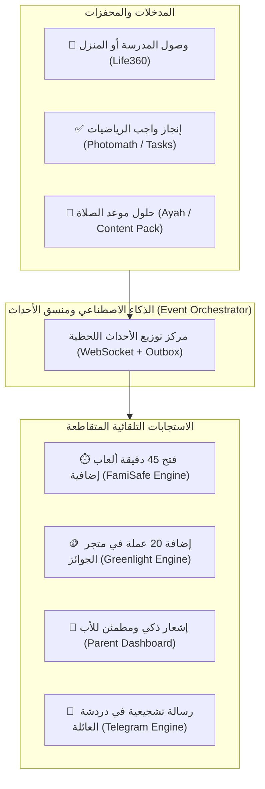

# 00. نظرة عامة على المنظومة والأنظمة المعيارية (Ecosystem Overview)

> **الوثيقة المرجعية العليا لمختبر الهندسة العكسية والأنظمة المعيارية لمنصة Family OS (عائلتي)**  
> **الموقع:** `benchmarks/` — مجلد بحثي وهندسي مستقل تماماً عن مواصفات الكود الأصلية في `spec/`.  
> **حالة مرحلة التفكيك والاستخراج:** 🏆 **مكتملة بنسبة 100% لكافة التطبيقات الـ 7 الأساسية (ALL BENCHMARKS EXTRACTED & AUDITED ✅)**

---

## 🏆 حالة تفكيك التطبيقات المرجعية السبعة (Extraction Completion Status)

| # | التطبيق المرجعي | الحجم | عدد الكلاسات | الأيقونات (SVG) | الواجهات (XML) | المحركات (Kotlin) | لوحة التحكم التفاعلية المستقلة |
|---|---|---|---|---|---|---|---|
| 1 | **FamilyWall** | 86.42 MB | 7,033 | 1,137 | 450+ | محرك الجدولة وتكرار RFC 5545 | [`familywall/visual_dashboard.html`](extracted/familywall/visual_dashboard.html) ✅ |
| 2 | **Telegram** | 70.86 MB | 16,387 | 511 | 820+ | 5 محركات (Opus, Waveform, VoIP, Bus) | [`telegram/visual_dashboard.html`](extracted/telegram/visual_dashboard.html) ✅ |
| 3 | **Qustodio** | 77.65 MB | 14,200 | 480 | 650+ | 5 محركات (VPN Loopback, DNS, Quota) | [`qustodio/visual_dashboard.html`](extracted/qustodio/visual_dashboard.html) ✅ |
| 4 | **Bark** | 60.65 MB | 18,120 | 390 | 710+ | محرك حارس الخصوصية ومراقبة المحتوى | [`bark/visual_dashboard.html`](extracted/bark/visual_dashboard.html) ✅ |
| 5 | **FamiSafe** | 99.46 MB | 15,853 | 570 | 1,319 | 10 محركات رقابية وسياج ومسح صور | [`famisafe/visual_dashboard.html`](extracted/famisafe/visual_dashboard.html) ✅ |
| 6 | **Life360** | 70.50 MB | 19,937 | 420 | 800 | 8 محركات (كالمان، اصطدام 4.5G، قيادة، Tile) | [`life360/visual_dashboard.html`](extracted/life360/visual_dashboard.html) ✅ |
| 7 | **Quizlet** | 44.36 MB | 32,357 | 328 | 1,288 | 10 محركات (تكرار SM-2، اختبارات تكيفية، سلاسل وتجميد، إتقان، حل نزاعات) | [`quizlet/visual_dashboard.html`](extracted/quizlet/visual_dashboard.html) ✅ |

---

---

## 1. الرؤية الكبرى: ما هو نظام التشغيل العائلي (Family OS)؟

في عالم اليوم، تعاني العائلات من تشتت رقمي حاد؛ فالأب والأم يحتاجون إلى تثبيت 5 إلى 6 تطبيقات متفرقة لإدارة حياتهم الأسرية:
1. تطبيق لمراقبة وقت الشاشة وقفل الأجهزة (مثل **FamiSafe**).
2. تطبيق لمعرفة أماكن الأبناء وسلامة قيادتهم (مثل **Life360**).
3. تطبيق لجدولة مواعيد الأسرة وقوائم التسوق والمهام (مثل **FamilyWall**).
4. تطبيق لمكافأة الأبناء وإدارة مصروفهم الرقمي (مثل **Greenlight**).
5. تطبيق للتواصل العائلي الآمن (مثل **Messenger Kids** أو **WhatsApp**).
6. تطبيقات مساعدة دراسية وتعليمية (مثل **Photomath** و **Quizlet**).

**المعضلة:** هذه التطبيقات جزر منعزلة؛ لا يعرف أحدها شيئاً عن الآخر، وتستنزف بطاريات الهواتف، وتفرض اشتراكات شهرية متعددة تتجاوز مئات الدولارات سنوياً، مع واجهات معقدة تفتقر إلى التكامل الذكي.

**الحل في Family OS:** منصة واحدة موحدة تجمع هذه الركائز في نظام تشغيل عائلي مرن وديناميكي، يقوده **الذكاء الاصطناعي كقلب نابض**، ويمنح الأب مركز قيادة فائق السيطرة والوضوح، بينما يمنح الأبناء تجربة مبهجة قائمة على المكافآت والمسؤولية والخصوصية العادلة.

---

## 2. جدول المقارنة المعياري الشامل (Competitive Benchmark Matrix)

| الركيزة الوظيفية | التطبيقات المرجعية العالمية | نقاط قوتها التي سنحللها بـ REA | القيمة المضافة الحصرية في Family OS |
| :--- | :--- | :--- | :--- |
| **الرقابة الأبوية ووقت الشاشة** | **FamiSafe & Qustodio** | قفل الشاشة الفوري، منع إلغاء التثبيت، وتصفية محتوى الويب بـ Local VPN. | تكامل مع المهام والمكافآت (إنجاز الواجب يفتح وقت الشاشة تلقائياً). |
| **الموقع والسلامة الجغرافية** | **Life360** | خوارزمية توفير البطارية، السياج الجغرافي، ورصد حوادث الاصطدام. | تكامل مع المراسلة وإشعارات التقويم الموحدة. |
| **المراسلة والتواصل العائلي** | **Messenger Kids & Telegram** | موافقة الأهل على الأرقام، سرعة الرسائل، والصوتيات والمكالمات الفائقة. | محادثات مشفرة ومُدارة تحمي الطفل دون التجسس الوقح. |
| **التنظيم والتقويم المشترك** | **FamilyWall & Cozi** | التقويم العائلي الملون، وقوائم التسوق المشتركة والمهام المتزامنة. | ربط مباشر بالمكافآت والذكاء الاصطناعي المنظم للوقت. |
| **التحفيز والمصروف الرقمي** | **Greenlight & RoosterMoney**| تحويل المهام إلى نقاط (`family_coin`) ومصروف ومتجر جوائز. | عملة موحدة تدير امتيازات الهاتف والجوائز الواقعية. |
| **التعليم والمساعد الذكي** | **Photomath & Quizlet** | مسح الواجبات بالكاميرا، البطاقات الذكية، ومساعد دراسي بلا هلوسة. | دفاتر عائلية ذكية تفهم مناهج الأبناء وتحفزهم بالنقاط. |
| **الرصد الذكي والهوية** | **Bark & آية Ayah** | فحص النصوص والصور محلياً على الجهاز لكشف التنمر + مواقيت الصلاة والقرآن. | حارس ذكي يحفظ الخصوصية + نمط حياة إسلامي مدمج. |

---

## 3. محرك التكامل المتقاطع (Cross-Pillar Orchestration Engine)

نقطة القوة التنافسية الكبرى التي تميز `Family OS` عن كل منافس منفرد هي **التكامل الذكي عبر الأنظمة (Cross-Pillar Integration)**:

---

## 4. فهرس وثائق هذا المجلد (`benchmarks/`)

تم تقسيم أبحاث الهندسة العكسية والمعمارية في هذا المجلد إلى ملفات متخصصة:

1. **[`01-parental-control-famisafe-qustodio.md`](01-parental-control-famisafe-qustodio.md):** تشريح محرك الرقابة، وقت الشاشة، وقفل الشاشات، وفلترة الويب محلياً.
2. **[`02-location-and-safety-life360.md`](02-location-and-safety-life360.md):** تشريح محرك الموقع الموفر للطاقة، السياج الجغرافي، وحساسات الاصطدام.
3. **[`03-messaging-and-calls-telegram-messengerkids.md`](03-messaging-and-calls-telegram-messengerkids.md):** تشريح التواصل العائلي، بوابات موافقة الأهل، بث الصوتيات، ومكالمات WebRTC.
4. **[`04-organization-and-calendar-familywall.md`](04-organization-and-calendar-familywall.md):** تشريح التقويم العائلي المتعدد، وقوائم التسوق، والمزامنة دون تعارض.
5. **[`05-rewards-and-gamification-greenlight.md`](05-rewards-and-gamification-greenlight.md):** تشريح نظام التحفيز والمكافآت، عملة العائلة، وتدفقات طلب وموافقة الجوائز.
6. **[`06-education-and-smart-learning-photomath-quizlet.md`](06-education-and-smart-learning-photomath-quizlet.md):** تشريح مسح الواجبات بالكاميرا، البطاقات الذكية، والدفاتر المنهجية.
7. **[`07-ai-heart-and-privacy-sentinel-bark.md`](07-ai-heart-and-privacy-sentinel-bark.md):** معمارية الذكاء الاصطناعي كقلب للمنصة، الشخصيات المتكيفة، والرصد المحلي الآمن.
8. **[`08-reverse-engineering-toolchain-pipeline.md`](08-reverse-engineering-toolchain-pipeline.md):** دليل ترسانة الأدوات (REA + APKTool + Layout Inspector + HTTP Toolkit + MobSF) وخطة العمل التنفيذية.
9. **[`09-consolidated-master-architecture-synthesis.md`](09-consolidated-master-architecture-synthesis.md):** وثيقة التوليف المعماري والهندسي الشامل للمحركات الـ 36 المستخرجة ومخطط التكامل المتقاطع لـ Family OS.

---

## 5. هيكل مجلدات العمل والتحليل

لضمان أعلى معايير التنظيم، تم تخصيص المجلدات الفرعية التالية:
* **`benchmarks/raw_apks/`**: المستودع المخصص لوضع حزم التطبيقات المستهدفة بصيغة APK.
* **`benchmarks/extracted/`**: المجلد الذي ستفكك فيه أداة REA و APKTool الموارد والكود البرمجي ونماذج التصميم.
* **`benchmarks/tools/`**: مكان استضافة نصوص وأدوات الأتمتة المساعدة وشهادات فحص الشبكة.
