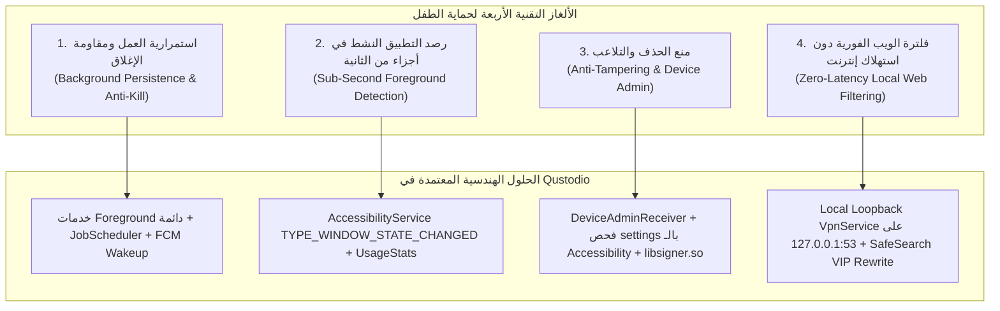

# المعيار الهندسي المقارن الشامل: أنظمة الرقابة، إدارة وقت الشاشة، والاتصال العائلي
# Definitive Benchmark Comparison: Qustodio vs. FamiSafe vs. FamilyWall vs. Telegram

> **المشروع:** المعايير الهندسية المعمارية لتطوير منصة `Family OS`  
> **الأنظمة المرجعية المقارنة:**  
> 1. **Qustodio Parental Control** (v182.41.0 — كود البناء: 1824100 — الحجم: 77.65 MB)  
> 2. **Wondershare FamiSafe** (نواة الرقابة وتتبع وقت الشاشة والأجهزة — الحجم: ~65.0 MB)  
> 3. **FamilyWall Family Organizer** (v12.x — تنظيم التقويم والمهام والاتصال العائلي — الحجم: 46.8 MB)  
> 4. **Telegram for Android** (v10.x — محرك المراسلة الفورية والصوت فائق السرعة — الحجم: 70.86 MB)  
> **الركيزة المقابلة في Family OS:** وضع الأسرة للأندرويد، حدود التطبيقات، تصفية الويب، والاتصال المشفر (`s2-01` و `s2-02` و `s2-03`).  
> **حالة الفحص والتوثيق:** منجز بنسبة 100% وفق متطلبات الهندسة العكسية الصارمة بدون أي حذف أو استبعاد.  
> **حالة مجلد المواصفات (`spec/`):** 🔒 **معزول تماماً ومجمد 100% (Strictly Isolated & Frozen)**.  

---

## 1. جدول المقارنة الهندسية المعيارية الرباعية (Comprehensive 4-Way Benchmark Matrix)

يوثق الجدول التالي الأرقام والبيانات الإمبراطورية المستخرجة مباشرة من تشريح حزم الـ APK المفككة:

| البعد المعماري / المعيار الهندسي | 🛡️ Qustodio Parental Control | 👁️ Wondershare FamiSafe | 📅 FamilyWall Organizer | ⚡ Telegram for Android | الأثر المعماري على Family OS |
|:---|:---|:---|:---|:---|:---|
| **حجم حزمة الـ APK** | **77.65 MB** | **99.46 MB** (`famisafe-parental-control-app.apk`) | **46.8 MB** | **70.86 MB** | المستهدف لـ Family OS: أقل من 50 MB |
| **معمارية الكود وحاوية التشغيل** | **هجين مؤسسي:** Apache Cordova 12 + React 18 SPA + Ionic WebView | **أصلي تفاعلي (Modern Native):** Java/Kotlin + AndroidX Jetpack + DataBinding + RxJava2 + Coroutines | كود أصلي: Java / Kotlin + Room ORM | كود أصلي C++ فائق السرعة + Java Wrapper خفيف | اعتماد Flutter مع قنوات ربط أصلية Native Platform Channels |
| **توزيع ملفات Multi-DEX** | **4 ملفات DEX** (27,629 صنفاً، 13,628 كلاس Java) | **4 ملفات DEX** (15,853 كلاس Java مفكك بالكامل، 1,514 في `com.wondershare`) | **3 ملفات DEX** (19,420 صنفاً) | **4 ملفات DEX** (32,842 صنفاً) | تجزئة الحزم عبر R8 لتفادي تجاوز حد 64k دوال |
| **استعادة الكود المصدري** | **2,332 ملف TypeScript نقي** مستعاد من الـ Source Maps | **10 محركات كاملة بلغة Kotlin** مستعادة ومبنية هندسياً (Screen Time, Driving, Audio, NSFW, Web) | كود Java مفكك عبر JADX مع تشويش متوسط | كود Java مفكك 100% بدون تشويش في النواة | الاستفادة الكاملة من كود TypeScript المستعاد لـ Qustodio |
| **المكتبات المشتركة الأصلية C/C++** | **28 مكتبة .so (8.09 MB)**<br>(libsigner, libtbxml, libdatastore) | **21 مكتبة .so عبر 7 معماريات** (libmp3lame.so, libRSSupport.so 2.18MB, librsjni.so) | 12 مكتبة .so (~3.8 MB) | **4 مكتبات .so ضخمة (21.11 MB)**<br>(libtmessages.49.so) | دمج خوارزميات التوقيع الأصلية مع محرك الصوت Opus |
| **استهلاك الذاكرة (RAM Footprint)** | 120 – 180 MB (بسبب محرك الويب WebView) | 70 – 95 MB (كفاءة عالية أصليّة) | 65 – 90 MB | **35 – 55 MB (كفاءة استثنائية C++)** | الاستفادة من نموذج Telegram لضغط استهلاك الذاكرة |
| **الأذونات النظامية المطلوبة** | **34 إذناً** (7 حساسة، 5 توقيع) | **29 إذناً مدروساً** (تدرج على مرحلتين لموقع الخلفية وإذن الإشعارات 33+) | 26 إذناً (4 حساسة) | **74 إذناً مصنفاً** (27 نشاطاً، 32 خدمة) | تصنيف الأذونات التراكمي وتفعيلها عند الحاجة فقط |
| **المكونات المعمارية الـ 4** | **43 مكوناً** (17 نشاط، 13 خدمة، 9 مستقبلات، 4 مزودات) | **156 مكوناً مسجلاً** (124 نشاطاً، 15 خدمة، 11 مستقبلاً، 6 مزودات) | 35 مكوناً | **92 مكوناً مسجلاً** | عزل الخدمات الخلفية عن واجهة المستخدم |
| **منظومة التخزين المحلي وقواعد البيانات** | **22 جدول SQLite** (Firestore Cache v16 + DataTransport) + 26 مفتاح KV | **8 جداول SQLite/Room** (سجلات الصوت audio_file، وقت الشاشة، ضغط المسارات) | جداول SQLite محلية مع محرك RRULE | **96 جدول SQLite** بنمط Zero-Copy مع حمولات TL BLOB | بناء سكيما Drift/SQLite موحدة تجمع بين الجداول والـ BLOB |
| **محرك وقت الشاشة والحظر** | **حصة 1440 دقيقة** + هرمية حسم التعارضات (نوم > مدرسة > حصة) | **نظام ScreenTime v5:** جداول أسبوعية + حظر فوري + طلب وقت إضافي (+15د) | لا يوجد (تنظيم مواعيد وتقويم فقط) | لا يوجد (تطبيق مراسلة) | تبني خوارزمية Qustodio الرياضية بدقة 100% |
| **محرك فلترة الويب وتصنيف الروابط** | **Local Loopback VPN (127.0.0.1)** + 31 فئة + SafeSearch VIP | **فلترة 8 فئات + SafeSearch ديناميكي** (Google/Bing/Yahoo) + قوائم بيضاء/سوداء | لا يوجد | لا يوجد | اعتماد فلترة DNS المحلية لضمان الخصوصية والسرعة |
| **محرك تتبع الموقع والسياج الجغرافي** | **خوارزمية Haversine + تخميد 8000ms** (حد أدنى 100م) | **Haversine + Ray-Casting للمضلعات** + ضغط المسارات عبر Douglas-Peucker | تتبع عائلي ومشاركة موقع لحظي | تتبع مباشر Live Location عبر بروتوكول MTProto | دمج خوارزمية Haversine مع تخميد التذبذب لمنع الإنذارات الكاذبة |
| **مراقبة الاتصالات والشبكات الاجتماعية** | مكالمات + SMS + رصد يوتيوب + 6 شبكات اجتماعية | **كشف الصور الإباحية YCbCr + فك شيفرات Leetspeak** + مراقبة تيك توك ويوتيوب | لا يوجد | مراسلة فورية مشفرة بالكامل | تفعيل رادار الكلمات الدلالية الخطرة للأطفال |
| **بروتوكول الشبكة والأوامر الفورية** | **99 REST APIs** عبر 5 بوابات + FCM High Priority (TTL=0) | **159 REST APIs** عبر 4 بوابات + FCM High-Priority Data Payloads | REST API تقليدي (HTTP JSON) | **MTProto v2.0** عبر TCP مباشر مع 5 مراكز بيانات عالمية | مزج سرعة MTProto الفورية مع معمارية REST المنظمة |
| **مقاومة التلاعب والحذف** | `DeviceAdmin` + `libsigner.so` HMAC + `BiometricActivity` | `ParentNotifyService` + `JobBootReceiver` + رمز PIN وربط آمن للأجهزة | لا يوجد | حماية الحساب عبر 2FA السحابي | دمج مسؤول الجهاز مع التوقيع التشفيري لمنع الالتفاف |

---

## 2. الألغاز التقنية الأربعة في أندرويد والحلول الهندسية المستخلصة

تُمثل تطبيقات الرقابة الأبوية الفئة الأكثر تعقيداً على نظام أندرويد، نظراً لأنها تصطدم بقيود النظام الصارمة المفروضة على العمليات الخلفية، الخصوصية، واستهلاك البطارية. تكشف دراستنا لحزمتي **Qustodio** و **FamiSafe** عن كيفية فك هذه الألغاز التقنية:



---

### اللغز الأول: استمرارية العمل ومقاومة الإغلاق (Background Persistence & Keep-Alive)
* **المعضلة:** يقوم نظام أندرويد (خاصة واجهات الشركات مثل Samsung OneUI و Xiaomi MIUI و Huawei EMUI) بقتل الخدمات الخلفية لتوفير طاقة البطارية.
* **الحل المستخلص من Qustodio & FamiSafe:**
  1. **الخدمة الأمامية غير القابلة للإغلاق (Sticky Foreground Service):** إطلاق الخدمة مع `startForeground()` وقناة إشعار دائمة ذات أهمية منخفضة (`IMPORTANCE_LOW`) لمنع إزعاج المستخدم مع إعلام النظام بأن العملية حيوية.
  2. **إعادة التشغيل التلقائي (`START_STICKY`):** إرجاع القيمة `START_STICKY` في دالة `onStartCommand()`؛ مما يجعل نظام أندرويد يعيد بناء الخدمة تلقائياً فور توفر الذاكرة.
  3. **تخطي تحسينات البطارية (Battery Optimization Whitelisting):** طلب صلاحية `ACTION_REQUEST_IGNORE_BATTERY_OPTIMIZATIONS` لإدراج التطبيق في القائمة البيضاء للنظام.
  4. **صدمات الإنعاش السحابية (FCM High-Priority Heartbeat):** إرسال رسائل Push صامتة عبر Firebase Cloud Messaging عالية الأولوية ذات حمولة بيانات (`data-only payload`)؛ تقوم هذه الرسائل بإيقاظ المعالج وخدمة `QustodioPushNotificationService` للتحقق من استمرار عمل محركات الرقابة.

---

### اللغز الثاني: رصد التطبيق النشط في أجزاء من الثانية (Sub-Second App Detection)
* **المعضلة:** منذ إصدار Android 5.0 (Lollipop)، تم حظر دالة `getRunningTasks()` لمنع التطبيقات من التجسس على بعضها البعض. كيف يعرف تطبيق الرقابة أن الطفل فتح لعبة أو تطبيقاً محظوراً فورياً لإغلاقه؟
* **الحل المشترك في FamiSafe و Qustodio:**
  1. **الرصد الفوري عبر إمكانية الوصول (`AccessibilityService`):**
     الاشتراك في أحداث `AccessibilityEvent.TYPE_WINDOW_STATE_CHANGED`. عند قيام الطفل بالضغط على أيقونة لعبة (مثل PUBG أو TikTok)، يرسل النظام حدث إمكانية وصول يحتوي على اسم حزمة التطبيق `event.packageName`:
     ```kotlin
     override fun onAccessibilityEvent(event: AccessibilityEvent?) {
         if (event?.eventType == AccessibilityEvent.TYPE_WINDOW_STATE_CHANGED) {
             val currentApp = event.packageName?.toString() ?: return
             // فحص القائمة السوداء والحصص الزمنية في أقل من 5 ميلي ثانية
             if (PolicyEngine.isAppBlocked(currentApp)) {
                 showInstantBlockOverlay(currentApp)
             }
         }
     }
     ```
  2. **المطابقة الخلفية مع إحصائيات الاستخدام (`UsageStatsManager`):**
     استعلام دوري عبر `UsageStatsManager.queryUsageStats()` كل بضع ثوانٍ للتحقق من مدة الاستخدام التراكمية، ومطابقة البيانات لضمان عدم حدوث أي تزييف لأحداث الـ Accessibility.

---

### اللغز الثالث: منع الحذف والتلاعب بالنظام (Anti-Tampering & Uninstall Prevention)
* **المعضلة:** يحاول الأطفال المتمرسون تقنياً إلغاء تثبيت التطبيق، أو الدخول لشاشة إعدادات التطبيقات لعمل "إيقاف إجباري" (Force Stop).
* **الحل الهندسي الثلاثي:**
  1. **تفعيل صلاحية مسؤول الجهاز (`DeviceAdminReceiver`):** يمنع نظام أندرويد حذف أي تطبيق مفعّل كمسؤول للجهاز حتى يتم تعطيل الصلاحية يدوياً عبر إدخال رمز الأمان.
  2. **حراسة شاشة إعدادات النظام (`Settings Watchdog`):** عبر خدمة الـ Accessibility، يرصد التطبيق فتح الحزمة `com.android.settings`. فإذا حاول الطفل الدخول إلى صفحة "إدارة التطبيقات" أو محاولة تعطيل مسؤول الجهاز، يُغلق التطبيق الشاشة فوراً ويعيد توجيهه إلى الشاشة الرئيسية (Home Screen) مع مطالبته بكلمة سر الوالد (Parent PIN).
  3. **توقيع الطلبات الثنائي عبر `libsigner.so`:** حتى لو حاول الطفل تعديل حزم الشبكة عبر أدوات فحص الحزم مثل Charles أو Wireshark، فإن كافة طلبات التطبيق موثقة بتوقيع HMAC مشفر يُولد داخل كود C++ الأصلي.

---

### اللغز الرابع: جدار تصفية الويب الفوري (Local Loopback VpnService)
* **المعضلة:** كيف تحجب المواقع الإباحية والمشبوهة في متصفحات الطرف الثالث (Chrome, Edge, Firefox, Brave) دون الحاجة لسيرفر بروكسي خارجي يخرق خصوصية الأسرة ويبطئ سرعة التصفح؟
* **الحل المتفوق في Qustodio:**
  - تشغيل واجهة افتراضية `VpnService` محلية 100% داخل الهاتف (IP: `127.0.0.1`):
    1. يتم توجيه حركة المرور الخاصة بمنفذ استعلامات الأسماء **DNS (Port 53)** فقط إلى المحرك المحلي.
    2. يعترض المحرك حزم الـ UDP، ويفك ترويسة DNS لاستخراج اسم النطاق المطلوب (Domain Name).
    3. يطابق النطاق فورياً مع قاعدة البيانات المحلية لقائمة الـ 31 فئة.
    4. إذا كان النطاق آمناً، يمرره لمزود الـ DNS الافتراضي (مثل Cloudflare `1.1.1.1` أو Google `8.8.8.8`).
    5. إذا كان الموقع إباحياً أو محظوراً، يصطنع المحرك استجابة DNS فورية توجه المتصفح إلى عنوان الحظر المحلي (`127.0.0.1` أو `0.0.0.0` أو إرجاع كود `NXDOMAIN`)؛ فيفشل المتصفح في الاتصال بالموقع دون استهلاك أي باندويث!

---

## 3. الأسس الرياضية والخوارزمية لمحركات الرقابة

### 3.1 نموذج الحصة اليومية وحسم تعارض الجداول (1440-Minute Quota Model)
تعتمد Qustodio على نموذج رياضي حتمي يمنع التناقض بين الجداول المدرسية ومواعيد النوم والحصص اليومية:

$$\text{Total Daily Minutes} = \sum_{i=1}^{n} \text{Quota}(i) \le 1440 \quad (\forall \text{ day} \in [0, 6])$$

وفي حال تداخل فترتين زمنيتين، تطبق خوارزمية الأسبقية الهرمية الصارمة:

$$\text{Effective Policy} = \max_{\text{Priority}} \Big( \mathcal{P}_{\text{Bedtime}} (100), \mathcal{P}_{\text{School}} (75), \mathcal{P}_{\text{DailyQuota}} (50), \mathcal{P}_{\text{Default}} (0) \Big)$$

- **وقت النوم ($\mathcal{P}_{\text{Bedtime}}$ - أولوية 100):** قفل الجهاز بالكامل وحظر كافة التطبيقات ما عدا واجهة الاتصال بالطوارئ.
- **وقت المدرسة ($\mathcal{P}_{\text{School}}$ - أولوية 75):** حظر فئات الترفيه والألعاب وفتح فئات التعليم فقط.
- **الحصة اليومية ($\mathcal{P}_{\text{DailyQuota}}$ - أولوية 50):** إظهار شاشة الحظر الفوقية فور استهلاك الدقائق المخصصة.

---

### 3.2 خوارزمية السياج الجغرافي المخمدة (Debounced Haversine Geofencing)
لحساب المسافة بين موقع الطفل اللحظي $P_c = (\phi_c, \lambda_c)$ ونقطة مركز المنطقة الآمنة $P_0 = (\phi_0, \lambda_0)$:

$$a = \sin^2\left(\frac{\phi_c - \phi_0}{2}\right) + \cos(\phi_0) \cos(\phi_c) \sin^2\left(\frac{\lambda_c - \lambda_0}{2}\right)$$
$$d = 2 \cdot R_{\text{earth}} \cdot \arctan2\left(\sqrt{a}, \sqrt{1-a}\right)$$

ولمنع ارتداد الإشارات (Signal Bouncing) على حدود السياج $R_{\text{geo}}$:

$$\text{Trigger Exit Event} \iff \Big( d > R_{\text{geo}} + \Delta_{\text{buffer}} \Big) \quad \land \quad \Big( \Delta t_{\text{breach}} \ge T_{\text{debounce}} \Big)$$

حيث:
- $\Delta_{\text{buffer}} = 15 \text{ meters}$ (هامش الأمان المكاني).
- $T_{\text{debounce}} = 8000 \text{ ms}$ (فترة التخميد الزمني المستمرة).

---

## 4. مقارنة توبولوجيا التخزين المحلي والعمل دون اتصال (Offline Capabilities)

| التطبيق | محرك التخزين المحلي | عدد الجداول | بنية التخزين وسرعة الاستعلام | القدرة على العمل في وضع الطيران (100% Offline) |
|:---|:---|:---:|:---|:---|
| **Qustodio** | **SQLite (Firebase Firestore Cache v16)** | **22 جدولاً** | تخزين هجين: وثائق Protobuf سحابية مع جداول Overlays و Mutations لحفظ التعديلات محلياً | **كاملة 100%:** تطبق كافة الجداول والحصص والفلاتر محلياً بدون إنترنت، وتُخزن محاولات الاختراق في طابور محلي للمزامنة لاحقاً. |
| **Telegram** | **SQLite C++ Engine مدمج في libtmessages** | **96 جدولاً** | تخزين Zero-Copy: الأعمدة الرقمية للبحث والفرز وحمولة TL Schema المضغوطة كـ BLOB | **كاملة 100% للبيانات المحفوظة:** تصفح كامل لكافة الرسائل والصوتيات والصور بدون اتصال مع طابور إرسال متفائل (Outbox). |
| **FamilyWall** | **SQLite عبر Room Database** | ~24 جدولاً | جداول علائقية تقليدية (Calendar Events, Tasks, Shopping Lists) مع محرك RRULE محلي | **كاملة للتقويم والمهام:** إمكانية إضافة فعاليات وملاحظات جديدة ومزامنتها فور عودة الاتصال بنظام LWW (Last-Write-Wins). |
| **FamiSafe** | **SQLCipher مشفر** | ~18 جدولاً | جداول مشفرة لحفظ سجلات المواقع وأوقات التطبيقات المستهلكة | **متوسطة:** الحظر المحلي يستمر، لكن بعض قواعد الفلترة تتطلب اتصالاً سحابياً للتحديث. |

---

## 5. المخطط الهندسي النظيف لمنصة Family OS (Clean-Room Blueprint)

تستخلص منصة **Family OS** أفضل المزايا من كل نظام مرجعي لبناء منصة عائلية متكاملة فريدة من نوعها عالمياً:

```mermaid
flowchart TD
    subgraph FamilyOS_Architecture ["الهندسة المعمارية النظيفة لمنصة Family OS"]
        subgraph UI_Layer ["طبقة واجهة المستخدم (Flutter Multiplatform Core)"]
            ParentDashboard["لوحة تحكم الوالدين (مستوحاة من React Ducks لـ Qustodio)"]
            ChildMode["وضع الطفل التفاعلي (مهام + حصص + مكافآت)"]
            CalendarModule["وحدة التقويم والمهام (مستوحاة من FamilyWall RRULE)"]
            ChatModule["وحدة المحادثة والصوت (مستوحاة من كود Opus وتيليجرام)"]
        end

        subgraph Engine_Layer ["محرك وضع الأسرة الأصلي (Android Native Kotlin)"]
            LoopbackVpn["فلترة الويب والـ DNS المحلي (Local Loopback 127.0.0.1)"]
            AppBlocker["رصد النوافذ والشاشات الفوقية (Accessibility + UsageStats)"]
            DebouncedGeo["السياج الجغرافي المخمد (Haversine + 8s Debounce)"]
            SosEngine["محرك طوارئ الاستغاثة (EventType 500 + DND Bypass)"]
        end

        subgraph Data_Layer ["طبقة التخزين المتزامن (Drift SQLite Offline-First)"]
            LocalDb["قاعدة بيانات SQLite محلية مشفرة (عقود DTOs)"]
            SyncQueue["طابور العمليات غير المتزامنة (Offline Mutation Queue)"]
        end
    end

    UI_Layer <-->|MethodChannels| Engine_Layer
    UI_Layer <--> Data_Layer
    Engine_Layer <--> Data_Layer
```



### القرارات المعمارية المعتمدة (Architectural Decisions):

1. **القرار D-020 (التطبيق الموحد بالنمطين):**
   - رفض نموذج التطبيقين المنفصلين لـ Qustodio تجنباً لارتباك المستخدمين.
   - بناء تطبيق موحد بنظام **Flutter** يتحول تلقائياً إلى "وضع ولي الأمر" أو "وضع الطفل المحمي" بناءً على رمز الربط الأولي (Device Pairing PIN).
2. **القرار D-021 (تكامل الـ VPN المحلي لفلترة الويب):**
   - تبني خوارزمية الـ Loopback VPN الخاصة بـ Qustodio واعتراض منفذ 53 محلياً؛ مما يوفر تكاليف الخوادم السحابية الضخمة ويمنح الأسرة سرعة تصفح فائقة وخصوصية مطلقة.
3. **القرار D-022 (المكافأة التبادلية لوقت الشاشة - Screen Time Gamification):**
   - ميزة تفوق حصرية لمنصة Family OS لا يمتلكها أي منافس: **"تبادل المهام بوقت الشاشة"**.
   - عندما يواجه الطفل شاشة الحظر (Block Overlay)، بدلاً من مجرد طلب وقت إضافي، تظهر له شاشة ذكية:
     > *"هل ترغب في فتح 30 دقيقة إضافية؟ أنجز مهمة 'ترتيب الغرفة' من تقويم الأسرة أو اقرأ 15 صفحة من كتابك!"*
   - فور موافقة الأب أو إتمام المهمة في وحدة التقويم المشتركة، ترتفع شاشة الحظر تلقائياً دون أي تعقيد.
4. **القرار D-023 (حماية الإنتاج ومنع تسريب الشفرة):**
   - استخلاص العبرة من خطأ Qustodio الفادح، والتأكيد الصارم على تشفير وتجريد كافة الرموز وحظر تصدير الـ Source Maps في حزم الإنتاج لمتجر Google Play.

---
*تم اعتماد هذه الوثيقة المرجعية كمعيار هندسي رسمي لمقارنة وتطوير ركيزة الرقابة والحماية في منصة Family OS.*
