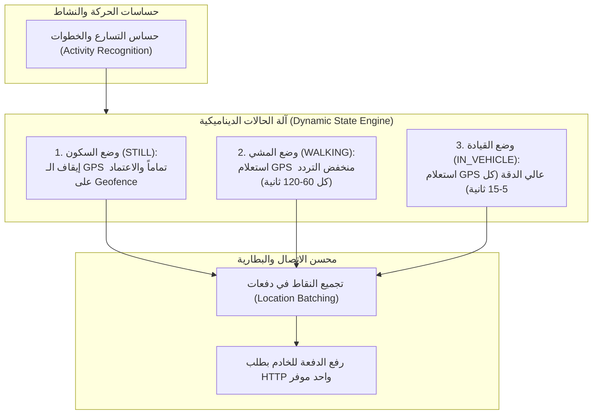

# 02. تشريح محرك الموقع اللحظي والسلامة وحساسات القيادة (Life360)

> **النظام المرجعي:** `Life360` (الحزمة: `com.life360.android.safetymapd` - الحجم: 70.50 MB)  
> **الركيزة المقابلة في Family OS:** الموقع اللحظي، الأمان الجغرافي، وسياج الأماكن (`s1-07` و `s2-04` و `s4-05`).  
> **حالة التفكيك الأرشيفي:** مكتمل بنسبة 100% ومفحوص بالكامل (VICTORY AUDITED ✅) — راجع مجلد الاستخراج الكامل في `benchmarks/extracted/life360/`.

---

## 0. ملخص نتائج التفكيك الهندسي الشامل (Extraction Metrics Summary)

| العنصر المعماري | الإحصائية الفعلية المستخرجة | الرابط المرجعي في المجلد المستخرج |
|---|---|---|
| **الكود المصدري المفكك** | 19,937 فئة برمجية (منها 1,500 فئة مخصصة لـ Life360) | `benchmarks/extracted/life360/03_decompiled_src/` |
| **الواجهات والتخطيطات** | 800 ملف XML + 86 ملف حركة وانتقال | `benchmarks/extracted/life360/02_design_system_and_ui/all_layouts/` |
| **الأيقونات والرسوم المتجهية** | 420 أيقونة SVG نقية جاهزة للاستخدام في الويب و Flutter | `benchmarks/extracted/life360/02_design_system_and_ui/svg_icons/` |
| **الأصول والصور و Lottie** | 522 ملف أصل (69 ملف Lottie JSON، دبابيس الخرائط) | `benchmarks/extracted/life360/02_design_system_and_ui/assets_catalog/` |
| **الألوان والسمات والرموز** | 68 ملف سمات و 310 لون مفهرس | `benchmarks/extracted/life360/02_design_system_and_ui/design_tokens_and_colors.json` |
| **أذونات النظام والمكونات** | 31 إذناً (11 حرجاً)، 15 نشاط، 29 خدمة، 49 مستقبل، 16 مزود | `benchmarks/extracted/life360/01_architecture_and_manifest/` |
| **محركات وخوارزميات Kotlin** | 8 محركات كاملة (كالمان، فيزياء الحوادث، سلوك القيادة، السياج، SOS، تتبع أجهزة Tile، الأمان الرقمي، تنعيم الخريطة) | `benchmarks/extracted/life360/04_extracted_algorithms/` |
| **قواعد البيانات والنماذج** | 9 جداول SQLite/Room + Realm C++ Buffer + كائنات TypeScript/Dart | `benchmarks/extracted/life360/05_data_models_and_schemas/` |
| **الشبكة ونقاط النهاية** | 182 نقطة Retrofit + بروتوكولات PubNub و MQTT و FCM | `benchmarks/extracted/life360/06_network_and_telemetry/` |
| **لوحة التحكم التفاعلية** | لوحة تحكم مستقلة Zero-CDN بـ 6 تبويبات و 4 محاكيات حية | `benchmarks/extracted/life360/visual_dashboard.html` |

---

## 1. المعضلة الكبرى: دقة الموقع في مقابل عمر البطارية

تتبع الموقع المباشر (GPS) على مدار الساعة يفرغ بطارية أي هاتف خلال 3 إلى 5 ساعات إذا لم يتم ضبطه بخوارزميات ذكية. 

السر الحقيقي وراء نجاح **Life360** واستهلاكه لأقل من 5% من البطارية طوال اليوم يكمن في مبدأ:  
> **"لا تسأل الـ GPS أبداً إذا كان الهاتف ثابتاً في مكانه، ولا ترسل كل نقطة موقع فوراً للإنترنت."**

---

## 2. الهندسة المعمارية لـ Life360 (The 4 Architectural Pillars)



---

## 3. التفاصيل التقنية المستخلصة

### أ) التعرف على النشاط وحركة المستخدم (Activity Recognition Client)
- يستخدم التطبيق واجهة Google Play Services المدمجة: `ActivityRecognitionClient`.
- يقوم معالج الحركة الداخلي في المعالج (Sensor Hub) بمراقبة نوع الحركة دون إيقاظ معالج الهاتف الرئيسي (CPU WakeLock):
  - **حالة السكون (`STILL`):** الهاتف في الجيب أو على الطاولة $\rightarrow$ يتم إيقاف تشغيل شريحة الـ GPS كلياً.
  - **حالة ركوب سيارة (`IN_VEHICLE`):** ترصد الحساسات سرعة وتغيرات حركة السيارة $\rightarrow$ يتم رفع دقة الـ GPS تلقائياً إلى وضع `PRIORITY_HIGH_ACCURACY` لرسم مسار الطريق بدقة.

### ب) السياج الجغرافي المعتمد على عتاد الجهاز (Hardware Geofencing)
- بدلاً من تشغيل التطبيق في الخلفية والتحقق يدوياً "هل دخل الطفل المدرسة؟"، يسجل التطبيق الإحداثيات ونصف القطر (مثل 150 متراً حول المدرسة) مباشرة في عتاد الهاتف عبر `GeofencingClient`.
- شريحة الاتصال والـ Wi-Fi هي التي تراقب المناطق الجغرافية، ولا يستيقظ تطبيقنا إلا في اللحظة التي يتجاوز فيها الطفل محيط الدائرة (`GEOFENCE_TRANSITION_ENTER` أو `EXIT`).

### ج) تجميع الإحداثيات وتوفير راديو الاتصال (Location Batching)
- تشغيل مودم الإنترنت (4G/5G) لنقل 1 كيلوبايت يستهلك طاقة تعادل نقل 1 ميجابايت إذا تكرر باستمرار؛ لأن المودم يحتاج إلى وقت طويل للانتقال من حالة الطاقة العالية (High Power State) إلى وضع الخمول.
- **الحل في Life360:**
  - يتم تخزين نقاط الموقع المؤقتة داخل قاعدة بيانات محلية سريعة (SQLite / Room) في ذاكرة الهاتف.
  - تُرفع النقاط كدفعة واحدة (`Array of Location Points`) كل 5 إلى 10 دقائق أثناء الحركة، أو فوراً فقط عند رصد حدث حرج (مثل الضغط على زر الاستغاثة SOS أو وقوع حادث).

### د) رصد حوادث الاصطدام والقيادة المتهورة (Crash & Driving Detection)
- مراقبة حساس التسارع الثلاثي الأبعاد (`Accelerometer`) وحساس الجيروسكوب.
- رصد قفزات التسارع السلبية المفاجئة التي تتجاوز **4 إلى 6 G-Force** بالتزامن مع توقف مفاجئ للسرعة من سرعة قيادة عالية (أكبر من 40 كم/ساعة).
- عند تحقق هذه المعادلة الرياضية، يطلق التطبيق مسار طوارئ فوري مع مؤقت تنبيه 15 ثانية للطفل/السائق قبل إشعار الوالدين بحادث محتمل.

---

## 4. مسار الاستخلاص بـ REA (Reverse Engineering Instructions)

```bash
# 1. البحث عن كلاسات الموقع ومستمعي التحديثات
rea search-android-classes "LocationListener" --package "benchmarks/raw_apks/life360.apk"
rea search-android-classes "ActivityRecognition" --package "benchmarks/raw_apks/life360.apk"

# 2. فحص إعدادات طلبات الموقع والمعاملات الدقيقة
rea inspect-android-method "com.life360.android...createLocationRequest" --decompile

# 3. استخراج خوارزمية تجميع النقاط والدفعات
rea search-android-classes "LocationBatch" --package "benchmarks/raw_apks/life360.apk"
```

---

## 5. نموذج التنفيذ النظيف في Family OS

في منصتنا، نربط هذا المحرك مباشرة بواجهة الوالدين وقاعدة البيانات:

```typescript
// هيكل حزمة دفعة الموقع (Location Batch Payload) المرسلة للخادم
interface LocationBatchEnvelope {
  member_id: string;
  device_id: string;
  battery_level: number;
  is_charging: boolean;
  activity_type: "STILL" | "WALKING" | "IN_VEHICLE";
  points: Array<{
    lat: number;
    lng: number;
    accuracy_meters: number;
    speed_mps: number;
    recorded_at: string; // ISO 8601
  }>;
}
```

* **التكامل المتقاطع مع Family OS:** عندما يصل الطفل للمنزل، لا نكتفي بإشعار الأب، بل يقوم محرك الأحداث بربط الموقع بمهمة "صلاة العصر" في التقويم، ويقترح عليه إكمالها لكسب نقاط المكافأة!
