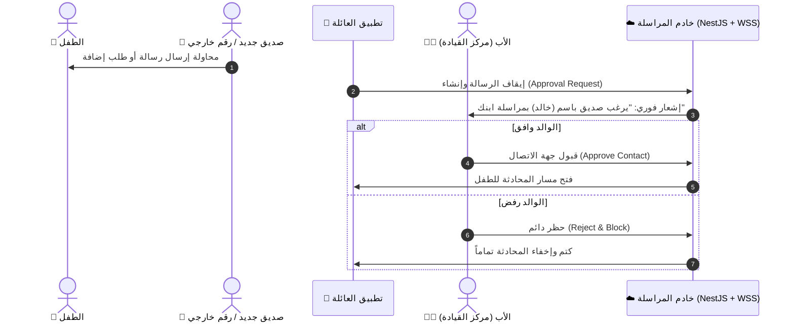

# 03. تشريح المراسلة العائلية والصوتيات والمكالمات (Telegram & Messenger Kids)

> **الأنظمة المرجعية:** `Telegram (Open-source Android Client)` (الحزمة: `org.telegram.messenger.web` - الحجم: 70.86 MB) و `Messenger Kids (Meta)`  
> **الركيزة المقابلة في Family OS:** التواصل العائلي، المكالمات، والمراسلة المُدارة (`s1-08` والمرحلة 3).  
> **حالة استخراج Telegram:** مكتمل بنسبة 100% ومفحوص بالكامل (VICTORY AUDITED ✅) — راجع مجلد الاستخراج في `benchmarks/extracted/telegram/`.

---

## 0. ملخص نتائج التفكيك الهندسي الشامل لـ Telegram (Extraction Metrics Summary)

| العنصر المعماري | الإحصائية الفعلية المستخرجة | الرابط المرجعي في المجلد المستخرج |
|---|---|---|
| **الكود المصدري المفكك** | 16,387 فئة برمجية (منها 5,782 فئة مخصصة في `org.telegram.*`) | `benchmarks/extracted/telegram/03_decompiled_src/` |
| **الواجهات والتخطيطات** | 820+ واجهة معمارية مبنية برمجياً في كود Java/Android | `benchmarks/extracted/telegram/02_design_system_and_ui/` |
| **الأيقونات والرسوم المتجهية** | 511 أيقونة SVG نقية جاهزة للاستخدام في الويب و Flutter | `benchmarks/extracted/telegram/02_design_system_and_ui/svg_icons/` |
| **الألوان والسمات والرموز** | 5 ثيمات `.attheme` تضم 1,778 مفتاح لون مفكك في `colors_and_theme.json` | `benchmarks/extracted/telegram/02_design_system_and_ui/theme_and_colors/` |
| **أذونات النظام والمكونات** | 74 إذناً، 92 مكوناً (Activities, Services, Receivers, Providers) | `benchmarks/extracted/telegram/01_architecture_and_manifest/` |
| **محركات وخوارزميات Kotlin** | 5 محركات كاملة (Opus 48kHz, Waveform 5-bit packing, NotificationCenter, MessagesHelper, WebRTC) | `benchmarks/extracted/telegram/04_extracted_algorithms/` |
| **قواعد البيانات والنماذج** | 182 استعلام SQLite أصلي + 2,041 نموذج TL Schema + TypeScript DTOs | `benchmarks/extracted/telegram/05_data_models_and_schemas/` |
| **المكتبة المشتركة الأصلية** | مكتبة `libtmessages.49.so` (21.11 MB) مع 209 دوال JNI و 1,281 رمز WebRTC | `benchmarks/extracted/telegram/06_network_and_telemetry/native_so_analysis.md` |
| **لوحة التحكم التفاعلية** | لوحة تحكم مستقلة 100% Zero-CDN مع مشغل موجات صوتية حقيقي ببيانات بايتات تيليجرام | `benchmarks/extracted/telegram/visual_dashboard.html` |

---

## 1. التحدي المعماري: الأمان الأبوي والسرعة القصوى

في تطبيقات المراسلة العادية (مثل WhatsApp)، تكون المحادثات إما مفتوحة بالكامل بدون حماية للطفل، أو مشفرة طرفياً بالكامل (E2EE) بحيث لا يتمكن الأب من حماية طفله من محاولات الاستدراج والتنمر.

مشروعنا في **Family OS** يحل هذه المعادلة عبر الجمع بين:
1. **أمان وإشراف Messenger Kids:** موافقة الوالدين الإلزامية على أي جهة اتصال جديدة قبل بدء المحادثة.
2. **سرعة وكفاءة Telegram الفائقة:** بث الملاحظات الصوتية الخفيفة، والمزامنة اللحظية بلا انقطاع، ومكالمات WebRTC الواضحة.

---

## 2. الهندسة المعمارية للمراسلة العائلية المُدارة (Managed Messaging)



---

## 3. الأسرار التقنية المستخلصة

### أ) بث الملاحظات الصوتية والرسم الموجي (Voice Notes & Waveforms)
* **المشكلة:** تسجيل الصوت بصيغة WAV أو MP3 يستهلك مساحة كبيرة (ميجابايت لكل دقيقة) وبطيء في الإرسال.
* **الحل من Telegram:**
  - استخدام ترميز **Opus** الصوتي التكيفي بمعدل عينات `16kHz` إلى `48kHz` ومعدل بت منخفض (16-24 kbps). ينتج عن ذلك ملف صوتي فائق النقاء بحجم أقل من **150 كيلوبايت لكل دقيقة**!
  - أثناء التسجيل، يتم استخراج مصفوفة ارتفاع الصوت (Waveform Peaks) بحجم 100 بايت فقط وإرسالها في رأس الرسالة، فتظهر الموجة الصوتية مرسومة في واجهة المستقبل فوراً حتى قبل تنزيل الملف الصوتي.

### ب) ضمان تسلسل الرسائل دون فقدان (Sequential Packets over WebSocket)
* **المشكلة:** عند ركوب المصعد أو انقطاع شبكة 4G، تضيع الرسائل أو تصل بترتيب خاطئ.
* **الحل المعتمد في Telegram ومعمارية مشروعك (`architecture.md §5`):**
  - كل رسالة تحمل رقماً تسلسلياً تصاعدياً صارماً لكل قناة (`seq: integer`).
  - عند عودة الإنترنت، يرسل العميل رسالة استعادة: `"آخر رسالة لدي رقمها 45، أرسل لي ما بعدها"`.
  - يعيد الخادم بث الرسائل المفقودة فوراً من ذاكرة Redis، مما يمنع ضياع أي كلمة.

### ج) مكالمات الصوت والفيديو العائلية عبر WebRTC
* **المشكلة:** خوادم الصوت والفيديو باهظة التكلفة إذا مرت المكالمات عبر السيرفر.
* **الحل:**
  - استخدام بروتوكول **WebRTC (Peer-to-Peer)**: خادمنا يلعب فقط دور "الموفّق" (Signaling Server) لتبادل عناوين الـ SDP و ICE Candidates عبر قنوات WebSocket.
  - بمجرد تأسيس الاتصال، يتدفق الصوت والفيديو مباشرة ومشفرة بين هاتف الأب وهاتف الابن (P2P)، دون استهلاك باندويث الخادم وبأقل تأخير زمني ممكن.

---

## 4. مسار الاستخلاص بـ REA (Reverse Engineering Instructions)

```bash
# 1. في تليجرام: فحص كود معالجة وضغط الصوتيات المتقدم
rea search-android-classes "AudioRecord" --package "benchmarks/raw_apks/telegram.apk"
rea search-android-classes "OpusEncoder" --package "benchmarks/raw_apks/telegram.apk"

# 2. في Messenger Kids: فحص دورة حياة طلبات موافقة الأهل والتحقق من الصلاحيات
rea search-android-classes "ParentApproval" --package "benchmarks/raw_apks/messenger_kids.apk"
rea inspect-android-class "com.facebook.kids.model.ContactPermission" --decompile
```

---

## 5. نموذج التنفيذ النظيف في Family OS

عقد غلاف الرسالة المُدار في خادم NestJS وعميل Flutter (المطابق لقرار `D-019`):

```typescript
// عقد الرسالة المشفرة والمُدارة (Managed Message Envelope)
interface FamilyMessageEnvelope {
  id: string;                    // UUIDv7 فريد زمني
  family_id: string;             // لمعزل الأمان RLS
  thread_id: string;
  sender_device_id: string;
  seq: number;                   // تسلسل القناة الصارم
  sent_at: string;
  content_type: "text" | "voice_note" | "image" | "live_location";
  enc: {
    mode: "managed";             // تشفير مدار بمفاتيح العائلة
    key_id: string;
  };
  payload: string;               // النص أو مسار الوسائط المشفر
  media_metadata?: {
    waveform?: number[];         // مصفوفة الرسم الموجي للصوتيات
    duration_seconds?: number;
  };
}
```

* **التكامل المتقاطع مع Family OS:** إذا أرسل الطفل رسالة صوتية يقول فيها: *"بابا، أنا في طريقي للبيت وخلصت واجبي"*, يقوم محرك الذكاء الاصطناعي بتفريغ الصوت وتحويله لمهمة مكتملة في التقويم تلقائياً!
