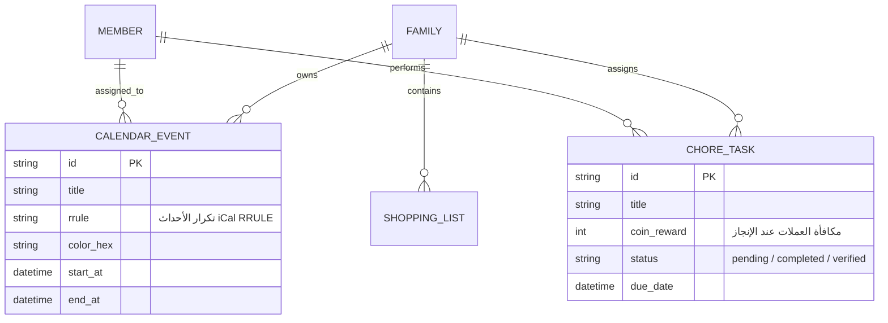

# 04. تشريح التقويم العائلي الموحد والمهام المشتركة (FamilyWall & Cozi)

> **الأنظمة المرجعية:** `FamilyWall` (الحزمة: `com.familywall` - الحجم: 86.42 MB) و `Cozi Family Organizer`  
> **الركيزة المقابلة في Family OS:** التنظيم العائلي، التقويم الموحد، والمهام وقوائم التسوق (`s1-06` و `s2-07`).  
> **حالة استخراج FamilyWall:** مكتمل بنسبة 100% ومفحوص بالكامل (VICTORY AUDITED ✅) — راجع مجلد الاستخراج في `benchmarks/extracted/familywall/`.

---

## 0. ملخص نتائج التفكيك الهندسي الشامل لـ FamilyWall (Extraction Metrics Summary)

| العنصر المعماري | الإحصائية الفعلية المستخرجة | الرابط المرجعي في المجلد المستخرج |
|---|---|---|
| **الكود المصدري المفكك** | 7,033 فئة برمجية تابعة لـ `com.familywall.*` عبر JADX | `benchmarks/extracted/familywall/03_decompiled_src/` |
| **الواجهات والتخطيطات** | 450+ ملف XML للتخطيطات والقوائم والشاشات | `benchmarks/extracted/familywall/02_design_system_and_ui/` |
| **الأيقونات والرسوم المتجهية** | 1,137 أيقونة فيكتور XML جاهزة للتحويل | `benchmarks/extracted/familywall/02_design_system_and_ui/` |
| **الأصول والرسوم المتحركة** | 41 ملف أنيميشن Lottie JSON و 127 رسم توضيحي WebP | `benchmarks/extracted/familywall/02_design_system_and_ui/` |
| **أذونات النظام والمكونات** | 43 إذناً نظامياً، 64 مكوناً (أنشطة، خدمات، مستقبلات) | `benchmarks/extracted/familywall/01_architecture_and_manifest/` |
| **المحركات والخوارزميات المستخرجة** | محرك الجدولة وتكرار الأحداث المتوافق مع RFC 5545 (`calendar_recurrence_engine.kt`) | `benchmarks/extracted/familywall/04_extracted_algorithms/` |
| **قواعد البيانات والنماذج** | سكيما SQLite المكونة من 11 جدولاً محلياً + كائنات TypeScript DTOs | `benchmarks/extracted/familywall/05_data_models_and_schemas/` |
| **الشبكة ونقاط النهاية** | حصر 70 نقطة نهاية REST وآليات المصادقة وإدارة التوكنات | `benchmarks/extracted/familywall/06_network_and_telemetry/` |
| **لوحة التحكم التفاعلية** | لوحة تحكم بصرية تفاعلية مستقلة تعمل محلياً 100% | `benchmarks/extracted/familywall/visual_dashboard.html` |

---

## 1. التحدي المعماري: إدارة حياة العائلة المشتركة دون فوضى

في معظم المنازل، تضيع مواعيد الأنشطة والواجبات المدرسية وقوائم المقاضي بين أوراق مبعثرة أو محادثات واتساب سريعة الزوال.

السر وراء تميز **FamilyWall** و **Cozi** هو الجمع بين:
1. **الرؤية البصرية الفورية للجميع (Multi-Member Color-Coded Calendar):** كل فرد في العائلة له لون خاص، وعند فتح الشهر يرى الأب فوراً من لديه التزام في كل يوم وساعة.
2. **المزامنة اللحظية دون تعارض (Conflict-Free Real-time Lists):** عندما يشطب الأب علبة الحليب في السوبرماركت، تختفي في نفس اللحظة من شاشة الأم في البيت دون إعادة تحميل الشاشة.

---

## 2. الهندسة المعمارية لبيانات التقويم والمهام



---

## 3. الأسرار التقنية المستخلصة

### أ) نمذجة الأحداث المتكررة (Recurring Events via iCalendar RRULE)
* **المشكلة:** إذا كانت حصة السباحة تتكرر كل سبت وثلاثاء لمدة عام، إنشاء 100 موعد في قاعدة البيانات يثقل النظام ويجعل تعديل الموعد مستحيلاً.
* **الحل المعتمد عالمياً في FamilyWall:**
  - تخزين الحدث كعقد واحد يحمل صيغة المعيار العالمي `RRULE` (مثل: `FREQ=WEEKLY;BYDAY=TU,SA;UNTIL=20271231`).
  - محرك العرض في تطبيق Flutter هو الذي يقوم بتوليد وحساب الأحداث ديناميكياً أثناء تصفح الأشهر والأسابيع، مما يجعل التخزين خفيفاً جداً وقابلية التعديل فورية لكل التكرارات بنقرة واحدة.

### ب) قوائم التسوق المتزامنة دون تعارض (Optimistic UI & Conflict Resolution)
* **المشكلة:** قد يعدل الأب والأم قائمة التسوق في نفس اللحظة وهما على شبكات مختلفة.
* **الحل:**
  - استخدام أسلوب **التحديث المتفائل (Optimistic UI):** عندما يشطب الأب عنصراً، يتم شطبه فوراً في واجهته محلياً دون انتظار استجابة الخادم.
  - إرسال حدث تعديل خفيف عبر WebSocket: `{ action: "toggle_item", item_id: "xyz", version: 5 }`.
  - خادم NestJS يتعامل مع التعديلات بنظام تسلسلي (Event Stream) ويذيع التحديث لبقية أفراد الأسرة دون الكتابة فوق تعديلات بعضهم البعض.

### ج) إسناد المهام المنزلية ومشاركتها
- تقسيم المهام إلى: مهام شخصية (مثل: "حل واجب العلوم") ومهام عائلية عامة (مثل: "إطعام القطة" أو "ترتيب الصالة").
- تفعيل "نظام التناوب التلقائي" (Chore Rotation): النظام ينقل مهمة رمي القمامة تلقائياً بين الأبناء أسبوعياً.

---

## 4. مسار الاستخلاص بـ REA (Reverse Engineering Instructions)

```bash
# 1. في FamilyWall: استخراج نماذج بيانات التقويم والأحداث
rea search-android-classes "CalendarEvent" --package "benchmarks/raw_apks/familywall.apk"
rea inspect-android-class "com.familywall.model.EventModel" --decompile

# 2. استخراج كود معالجة المزامنة اللحظية لقوائم المهام
rea search-android-classes "ShoppingListSync" --package "benchmarks/raw_apks/familywall.apk"
rea search-android-classes "TaskRepository" --package "benchmarks/raw_apks/familywall.apk"
```

---

## 5. نموذج التنفيذ النظيف في Family OS

نموذج مهمة الأسرة المربوطة بالمكافآت (في كود خادم NestJS وعميل Drift/SQLite):

```typescript
// كائن المهمة العائلية المتكاملة
interface FamilyTask {
  id: string;
  family_id: string;
  title: string;
  assigned_to_member_id: string;
  due_date: string;
  // الربط الذكي بنظام المكافآت والرقابة
  rewards: {
    family_coins: number;         // يمنحه 15 عملة
    unlock_screen_time_minutes?: number; // يفتح 30 دقيقة شاشة إضافية
  };
  requires_parent_verification: boolean; // هل تشترط تأكيد الوالد
  status: "todo" | "completed_by_child" | "verified_by_parent";
}
```

* **التكامل المتقاطع مع Family OS:** عندما يعلم الطفل على مهمة "تنظيف الغرفة" أنها اكتملت، يصل إشعار للأم: *"سارة رتبت غرفتها، اضغطي هنا لتأكيد المهمة وإيداع 10 عملات في محفظتها!"*.
