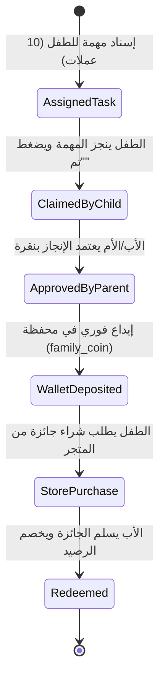

# 05. تشريح نظام المكافآت والمصروف الرقمي للأبناء (Greenlight & RoosterMoney)

> **الأنظمة المرجعية:** `Greenlight (Kids Banking & Chores)` و `RoosterMoney`  
> **الركيزة المقابلة في Family OS:** نظام المكافآت للأطفال، عملة العائلة، وإدارة المصروف (`s1-05` و `s2-06` و `s5-06`).

---

## 1. الفلسفة التربوية والتقنية: تحويل المسؤولية إلى متعة

العقاب الدائم وسحب الأجهزة يخلقان عناداً وتوتراً مستمراً بين الآباء والأبناء. 

التطبيقات العالمية الرائدة مثل **Greenlight** و **RoosterMoney** أسست نموذج نجاحها على مبدأ:  
> **"التربية الإيجابية بالألعاب (Gamified Parenting): اربط كل التزام مرغوب (واجب، صلاة، ترتيب) بنقاط ملموسة، واترك الطفل يختار مكافآته بنفسه."**

---

## 2. دورة حياة التحفيز والمكافآت (The Gamification Cycle)



---

## 3. الأسرار التقنية المستخلصة

### أ) عملة العائلة (`family_coin`) وسجل المعاملات المزدوج (Ledger Integrity)
* **المشكلة:** إذا تم تعديل رصيد النقاط عشوائياً، قد تقع أخطاء في المزامنة أو تلاعب.
* **الحل من تطبيقات التكنولوجيا المالية للأطفال (Fintech for Kids):**
  - لا يتم تخزين الرصيد كرقم بسيط يُعدل عشوائياً، بل كـ **"دفتر أستاذ غير قابل للتعديل" (Immutable Transaction Ledger)**:
    - كل إضافة أو خصم تسجل كمعاملة (`type: "EARN_CHORE" | "SPEND_STORE" | "MANUAL_BONUS"`).
    - رصيد الطفل الفعلي هو مجموع كل المعاملات السابقة، مما يضمن أماناً وموثوقية بنسبة 100%.

### ب) متجر الجوائز المرن (`reward_store`)
- يقسم المتجر إلى نوعين رئيسيين من المكافآت التي يحددها الأب:
  1. **امتيازات رقمية وفورية داخل النظام:** مثل *(30 دقيقة وقت شاشة إضافي، تغيير ثيم التطبيق، شارة مميزة)*. هذه الجوائز يفعلها النظام تلقائياً دون تدخل يدوي فور الشراء!
  2. **مكافآت واقعية وحياتية:** مثل *(رحلة للملاهي، وجبة مفضلة، شراء لعبة جديدة، مصروف نقدي)*. هذه تتطلب تسليماً يدوياً من الأهل وتأكيد الصرف.

### ج) سلاسل الإنجاز والمستويات (Streaks & Levels)
- استخدام خوارزمية **سلسلة الأيام المتتالية (`Daily Streak`)**:
  - إذا أكمل الطفل أوراده أو واجباته 7 أيام متتالية، يحصل على مضاعف نقاط (`2x Multiplier`)، مما يزرع فيه عادة الاستمرارية والانضباط الذاتي.

---

## 4. مسار الاستخلاص بـ REA (Reverse Engineering Instructions)

```bash
# 1. في Greenlight: فحص محرك حساب الأرصدة وسجلات المعاملات
rea search-android-classes "RewardWallet" --package "benchmarks/raw_apks/greenlight.apk"
rea inspect-android-class "com.greenlight.model.ChoreLedger" --decompile

# 2. في RoosterMoney: استخراج نماذج متجر الجوائز وشاشات الشراء
rea search-android-classes "RewardStore" --package "benchmarks/raw_apks/roostermoney.apk"
rea inspect-android-class "com.roostermoney.models.RewardItem" --decompile
```

---

## 5. نموذج التنفيذ النظيف في Family OS

كود معاملة المكافأة في خادم NestJS وقاعدة PostgreSQL (المطابق لـ `D-012`):

```typescript
// معاملة محفظة المكافآت للأطفال
interface FamilyCoinTransaction {
  id: string;
  family_id: string;
  child_member_id: string;
  amount: number;                // موجب للإيداع، سالب للشراء
  transaction_type: "CHORE_COMPLETION" | "STORE_PURCHASE" | "STREAK_BONUS";
  reference_task_id?: string;
  reference_reward_id?: string;
  created_at: string;
}

// عنصر في متجر جوائز العائلة
interface FamilyRewardItem {
  id: string;
  family_id: string;
  title: string;
  cost_in_coins: number;
  reward_type: "DIGITAL_SCREEN_TIME" | "PHYSICAL_GIFT";
  digital_screen_time_minutes?: number; // إذا كان رقماً يفتحه النظام فوراً
  stock_limit?: number;
}
```

* **التكامل المتقاطع مع Family OS:** الطفل يرى في صفحته الرئيسية عداد العملات وشريط التقدم للعبة التي يحلم بشرائها؛ وعندما ينجز واجباته، يرى رصيده يرتفع مباشرة، فيتحول الالتزام إلى شغف ذاتي!
