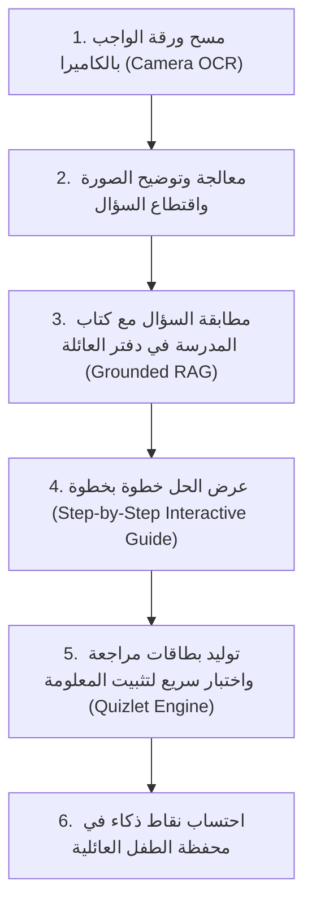

# 06. تشريح المساعد التعليمي والدفاتر الذكية والمذاكرة (Photomath & Quizlet)

> **الأنظمة المرجعية:** `Photomath (Google)`, `Quizlet` (الحزمة: `com.quizlet.quizletandroid` - الحجم: 44.36 MB)، و `NotebookLM (Architecture Concept)`  
> **الركيزة المقابلة في Family OS:** التعليم والواجبات، الدفاتر والمصادر الذكية، ومخرجات المذاكرة (`s5-01` إلى `s5-04`).  
> **حالة استخراج Quizlet:** مكتمل بنسبة 100% ومفحوص بالكامل (VICTORY AUDITED ✅) — راجع مجلد الاستخراج في `benchmarks/extracted/quizlet/`.

---

## 0. ملخص نتائج التفكيك الهندسي الشامل لـ Quizlet (Extraction Metrics Summary)

| العنصر المعماري | الإحصائية الفعلية المستخرجة | الرابط المرجعي في المجلد المستخرج |
|---|---|---|
| **الكود المصدري المفكك** | 32,357 فئة برمجية (منها 10,757 فئة مخصصة في `com.quizlet.*`) | `benchmarks/extracted/quizlet/03_decompiled_src/` |
| **الواجهات والتخطيطات** | 1,288 ملف واجهة XML | `benchmarks/extracted/quizlet/02_design_system_and_ui/all_layouts/` |
| **الأيقونات والرسوم المتجهية** | 328 أيقونة SVG نقية جاهزة للاستخدام في الويب و Flutter | `benchmarks/extracted/quizlet/02_design_system_and_ui/svg_icons/` |
| **الألوان والسمات والرموز** | 563 لون مفهرس في `design_tokens_and_colors.json` | `benchmarks/extracted/quizlet/02_design_system_and_ui/design_tokens_and_colors.json` |
| **أذونات النظام والمكونات** | 25 إذناً، 96 نشاط، 23 خدمة، 21 مستقبل، 7 مزودات محتوى | `benchmarks/extracted/quizlet/01_architecture_and_manifest/` |
| **محركات وخوارزميات Kotlin** | 10 محركات كاملة بلغة Kotlin (التكرار SM-2، توليد الاختبارات التكيفية والمشتتات، السلاسل والتلعيب، تتبع الإتقان، وحل النزاعات، والتصحيح العربي، وفيزياء Match، والصوت، وتنظيم الجلسات) | `benchmarks/extracted/quizlet/04_extracted_algorithms/` |
| **قواعد البيانات والنماذج** | 9 جداول SQLite/Room + كائنات TypeScript DTOs + نماذج Dart | `benchmarks/extracted/quizlet/05_data_models_and_schemas/` |
| **الشبكة ونقاط النهاية** | 195 نقطة REST فريدة + بروتوكول مسابقات Quizlet Live اللحظي + بروتوكول المزامنة غير المتصلة وضغط GZIP | `benchmarks/extracted/quizlet/06_network_and_telemetry/` |
| **المكتبات المشتركة الأصلية** | 6 مكتبات ثنائية arm64 (معالجة كاميرا OCR وتوثيق Approov) | `benchmarks/extracted/quizlet/06_network_and_telemetry/native_so_analysis.md` |
| **لوحة التحكم التفاعلية** | لوحة تحكم مستقلة 100% Zero-CDN بـ 6 تبويبات و 6 محاكيات حية (تقليب 3D، SM-2، مطابقة، تصحيح عربي، سلاسل وتجميد، واختبار ذكي) | `benchmarks/extracted/quizlet/visual_dashboard.html` |

---

## 1. التحدي المعماري: التعليم التفاعلي الموثوق بلا هلوسة

معظم تطبيقات الذكاء الاصطناعي العامة عند استخدامها في المذاكرة ترتكب خطأين قاتلين:
1. إعطاء الإجابة النهائية للطفل مباشرة دون شرح، مما يجعله كسولاً يعتمد على الغش.
2. الهلوسة في المناهج المحلية وعدم الالتزام بكتاب المدرسة الرسمي للطفل.

الجمع بين عبقرية **Photomath** (في الشرح خطوة بخطوة) و **Quizlet** (في التكرار المتباعد والبطاقات الذكية) و **NotebookLM** (في حصر إجابات الذكاء الاصطناعي في ملازم وكتب المدرسة) يمنح `Family OS` محركاً تعليمياً لا يُنافس.

---

## 2. المسار التعليمي الذكي (The Interactive Learning Pipeline)



---

## 3. الأسرار التقنية المستخلصة

### أ) تدفق مسح الواجبات بالكاميرا (Camera OCR to Step-by-Step Solution)
* **من Photomath:**
  - يتم استخدام معالجة صور محلية على الهاتف لتحسين التباين (Adaptive Thresholding) واقتطاع المربع الذي يحدده إصبع الطالب.
  - تحويل المعادلات والنصوص إلى صيغة رياضية موحدة (`LaTeX` أو `MathML`).
  - إرسال المسألة إلى خادم الذكاء الاصطناعي بقالب توجيه صارم:
    > *"أنت معلم صبور. لا تعطِ الحل النهائي فوراً؛ قسّم الشرح إلى 3 خطوات تفاعلية، واطرح سؤالاً في كل خطوة لتتأكد من فهم الطالب."*

### ب) خوارزمية التكرار المتباعد للمذاكرة (Spaced Repetition Algorithm)
* **من Quizlet:**
  - استخدام خوارزمية رياضية مثبتة علمياً لحساب منحنى النسيان (مشتقة من خوارزمية **SM-2 / Leitner System**):
    - إذا أجاب الطفل صح: يتضاعف الفاصل الزمني لمراجعة البطاقة (يوم $\rightarrow$ 3 أيام $\rightarrow$ أسبوع $\rightarrow$ شهر).
    - إذا أخطأ الطفل: تعود البطاقة للمراجعة الفورية في نفس الجلسة.
  - هذا يحول ساعات المذاكرة المرهقة قبل الاختبار إلى مراجعات خفيفة مدتها 5 دقائق يومياً تثبت المعلومة للأبد.

### ج) دفاتر العائلة المنهجية (Family Notebooks & Source Ingestion)
* **مفهوم NotebookLM:**
  - يرفع الأب أو الطالب ملف الـ PDF الخاص بكتاب المدرسة أو ملخص الأستاذ إلى قسم `Notebooks`.
  - يتم تقسيم الكتاب إلى مقاطع صغيرة (Text Chunks) وفهرستها في قاعدة بيانات متجهة (Vector Database).
  - عند طرح أي سؤال، يبحث الذكاء الاصطناعي فقط داخل صفحات هذا الكتاب، ويضع رقماً مرجعياً للصفحة: *(المصدر: كتاب العلوم، صفحة 45)* مما يمنع الهلوسة نهائياً.

---

## 4. مسار الاستخلاص بـ REA (Reverse Engineering Instructions)

```bash
# 1. في Photomath: فحص كود معالجة الصور ومكونات عرض خطوات الحل
rea search-android-classes "MathSolver" --package "benchmarks/raw_apks/photomath.apk"
rea inspect-android-class "com.photomath.ui.solver.StepView" --decompile

# 2. في Quizlet: استخراج خوارزمية جدولة البطاقات التعليمية
rea search-android-classes "SpacedRepetition" --package "benchmarks/raw_apks/quizlet.apk"
rea search-android-classes "FlashcardScheduler" --package "benchmarks/raw_apks/quizlet.apk"
```

---

## 5. نموذج التنفيذ النظيف في Family OS

كائن البطاقة التعليمية الذكية في عميل Flutter وقاعدة البيانات:

```typescript
// بطاقة تعليمية ذكية تعتمد خوارزمية التكرار المتباعد
interface SmartFlashcard {
  id: string;
  notebook_id: string;          // الدفتر التابع له (مثل: علوم الصف الخامس)
  front_question: string;
  back_answer: string;
  explanation_steps: string[];   // خطوات الشرح التفاعلي
  source_page_number: number;   // رقم الصفحة في كتاب المدرسة
  
  // مقاييس خوارزمية التكرار المتباعد
  repetition_stats: {
    interval_days: number;       // الفاصل حتى المراجعة القادمة
    ease_factor: number;         // معامل السهولة (افتراضي 2.5)
    repetitions_count: number;
    next_review_date: string;    // تاريخ الاستحقاق القادم
  };
}
```

* **التكامل المتقاطع مع Family OS:** عندما تتبقى 24 ساعة على اختبار مجدول في التقويم العائلي، يرسل النظام تلقائياً إشعاراً للطالب: *"أمامك 10 بطاقات سريعة لمراجعتها قبل اختبار العلوم غداً.. أتممها واكسب 15 عملة عائلية!"*.
