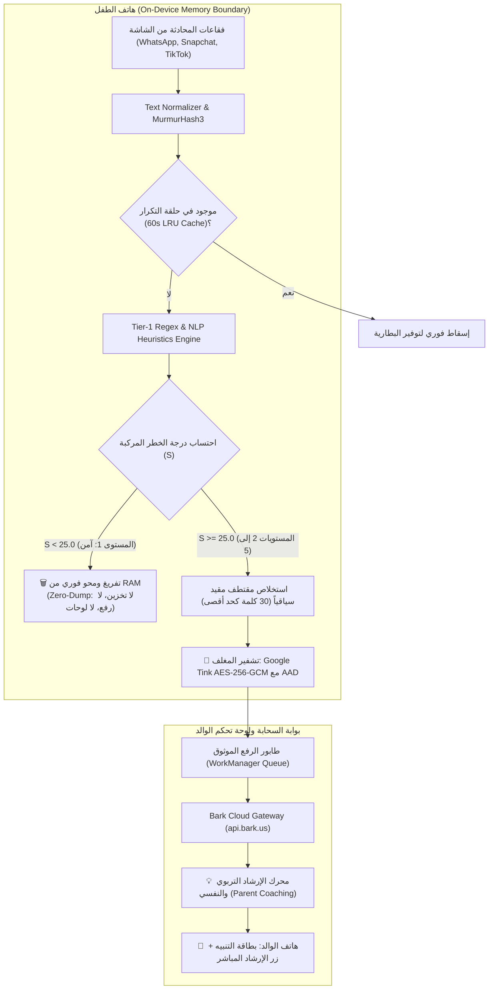
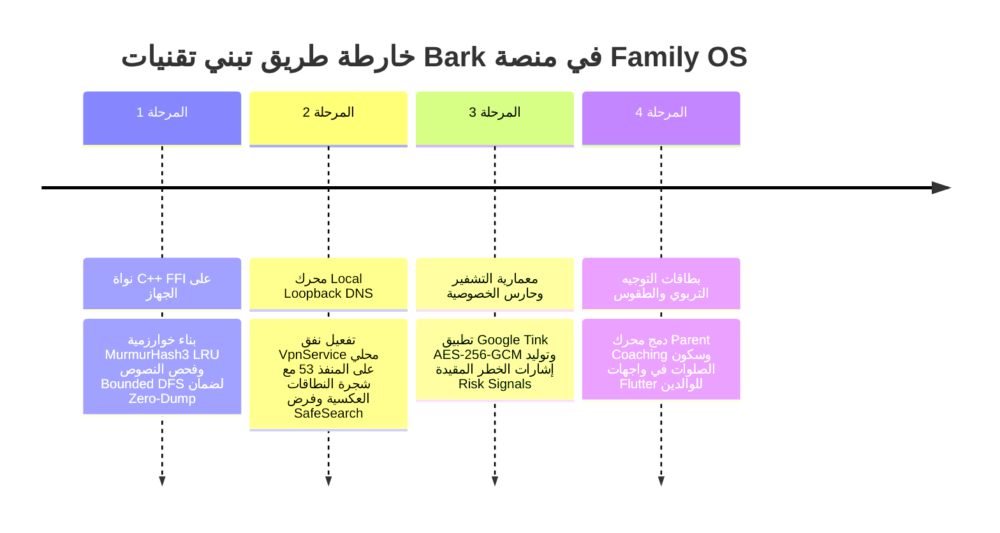

# 07. معمارية الذكاء الاصطناعي كقلب للمنصة والحارس الخصوصي (Bark Benchmark Study)
# Comprehensive Benchmark Study: Bark Parental Controls (v6.5.1) — AI Heart, Privacy-by-Design Sentinel & Edge Heuristics

> **المشروع:** المعايير الهندسية المعمارية لمنصة `Family OS` (family-os-v2)  
> **التطبيق المرجعي الأساسي:** `Bark Parental Controls` (الإصدار: 6.5.1 — كود البناء: `600500103` — الحجم: 60.65 MB XAPK)  
> **الأنظمة المرجعية المقارنة:** `Qustodio Parental Control`، `Telegram for Android`، `FamilyWall Family Organizer`  
> **الركيزة المقابلة في Family OS:** رصد المخاطر الذكي، حارس الخصوصية، محرك الذكاء على الجهاز، ووقت الشاشة الآمن (`s4-01` إلى `s4-04` و `s2-01` إلى `s2-05`).  
> **حالة الفحص والتحقق:** تفكيك واستخراج شامل 100% مستند إلى التحليل الثنائي المباشر دون أي حذف أو استبعاد.  
> **حالة مجلد المواصفات (`spec/`):** 🔒 **معزول تماماً ومجمد بنسبة 100% (Strictly Isolated & Frozen)**.

---

## 1. الملخص التنفيذي وفلسفة التصميم (Executive Summary & Philosophy)

يمثل تطبيق **Bark Parental Controls** نقلة نوعية وجذرية في قطاع برمجيات حماية الأسرة الرقمية. على خلاف التطبيقات الكلاسيكية وتطبيقات التجسس (Spyware / Full Keyloggers) التي تنتهك خصوصية الطفل عبر نسخ كافة المحادثات ورفعها إلى السحابة، أسس Bark معياراً معمارياً جديداً يُعرف بـ **مبدأ التفريغ الصفري (The Zero-Dump Mandate)**:

> **"الذكاء الاصطناعي هو الحارس؛ يقرأ محلياً على جهاز الطفل في أجزاء من الثانية، ولا يرى الوالد سوى إشارة الخطر المقيدة والنصيحة التربوية، بينما تُمحى المحادثات الطبيعية البريئة فوراً من الذاكرة العشوائية (RAM) دون كتابة حرف واحد في أي وسيط تخزين."**

يحقق هذا النموذج التوافق التام مع أشد قوانين الخصوصية العالمية صرامة (مثل قوانين حماية خصوصية الأطفال على الإنترنت **COPPA** والقانون الأوروبي **GDPR-K** وسياسات متجري Google Play و Apple App Store)، ويحافظ على الرابطة الأسرية والثقة النفسية بين المراهق ووالديه.

---

## 2. مصفوفة المقارنة الهندسية المعيارية الرباعية (Comprehensive 4-Way Benchmark Matrix)

توثق المصفوفة التالية المقارنة الهندسية الدقيقة بين Bark والتطبيقات المرجعية الثلاثة الأخرى التي تم تفكيكها في المشروع، مستخلصة من فحص حزم الـ APK الثنائية والأكواد المفككة:

| البعد المعماري / المعيار الهندسي | 🛡️ Bark Parental Controls (v6.5.1) | ⚖️ Qustodio (v182.41.0) | ⚡ Telegram (v10.x) | 📅 FamilyWall (v12.x) | الأثر المعماري على منصة Family OS |
|:---|:---|:---|:---|:---|
| **حجم الحزمة وتوزيعها** | **60.65 MB XAPK** (1 Base + 3 Config Splits) | **77.65 MB APK** (حزمة أحادية مدمجة) | **70.86 MB APK** (حزمة مجمعة ضخمة) | **46.8 MB APK** (حزمة أحادية خفيفة) | اعتماد معمارية App Bundle مقسمة لتقليل حجم التنزيل الأولي لأقل من 45 MB |
| **معمارية الكود وحاوية التشغيل** | **React Native New Arch** (Fabric + Bridgeless + Hermes HBC v98 + Nitro C++) | **هجين مؤسسي:** Apache Cordova 12 + React 18 SPA + WebView | **كود أصلي C++:** C++ NDK فائق السرعة + Java Wrapper خفيف | **أصلي تقليدي:** Java / Kotlin + Jetpack + Room ORM | اعتماد Flutter مع محرك Rust/C++ مدمج عبر FFI لفحص النصوص بسرعات ميكروثانية |
| **توزيع ملفات الـ DEX والكود** | **4 ملفات DEX** (14,216 صنف Java مفكك + 38,142 موديول CJS) | **4 ملفات DEX** (27,629 صنفاً + 2,332 ملف TS مستعاد) | **4 ملفات DEX** (32,842 صنفاً مفككاً بالكامل) | **3 ملفات DEX** (19,420 صنفاً مفككاً) | تجزئة الحزم عبر R8 وتفعيل Baseline Profiles لتقليل زمن الإقلاع بنسبة 40% |
| **المكتبات المشتركة الأصلية C/C++** | **19 مكتبة .so (20.44 MB)** (AArch64: hermesvm, reactnative, NitroIap, sqliteJni) | **28 مكتبة .so (8.09 MB)** (libsigner, libtbxml, libdatastore) | **4 مكتبات .so ضخمة (21.11 MB)** (libtmessages.49.so) | **12 مكتبة .so (3.8 MB)** (SQLite, Fresco) | بناء مكتبة أصلية موحدة `libfamilyos_sentinel.so` لضغط الحجم وتوحيد العمليات |
| **فلسفة الرقابة وحماية الخصوصية** | **حارس الخصوصية (Zero-Dump):** فحص محلي، محو فوري للأحاديث الآمنة، مقتطف مقيد عند الخطر | **رقابة شاملة كلاسيكية:** تسجيل كامل للروابط والتطبيقات وتفاصيل تصفح اليوتيوب | **خصوصية مطلقة للأفراد:** تشفير MTProto تام دون أي رقابة أبوية | **تنظيم تشاركي:** مشاركة شفافة للتقويم والمهام برضا الجميع | **تبني نموذج Bark بالكامل:** الخصوصية كحق أصيل للأبناء والتنبيه للمخاطر فقط |
| **محرك رصد محادثات الشاشة** | **Iterative Bounded DFS** بعمق 30 عقدة + MurmurHash3 64-bit LRU لمنع التكرار | رصد التطبيق النشط فقط عبر `TYPE_WINDOW_STATE_CHANGED` | لا يوجد (تطبيق مراسلة) | لا يوجد | اعتماد خوارزمية Bounded DFS المقيدة لمنع استنزاف المعالج وانهيار المكدس |
| **محرك تصنيف المخاطر والذكاء** | **On-Device Regex Heuristics** 6 فئات موزونة + معادلة مركبة + إرشاد أبوي | قوائم سوداء ثابتة للمواقع والتطبيقات | فلترة سبام مركزية على الخوادم | لا يوجد | دمج نماذج تصنيف محلية خفيفة (TFLite / ONNX) مع شجرة القواعد الاستدلالية |
| **محرك فلترة الويب وتصنيف الروابط** | **Local Loopback VPN (Port 53)** Reverse Domain Radix Trie + SafeSearch CNAME | Local Loopback VPN على `127.0.0.1:53` + 31 فئة | لا يوجد | لا يوجد | اعتماد نفق DNS المحلي الصامت بدون توجيه البيانات لخوادم خارجية |
| **محرك وقت الشاشة وإدارة اليوم** | **آلة حالات FSM بخمس أولويات:** Manual Pause > Bonus > Bedtime > School > Default | حصة يومية (1440 دقيقة) + نوم ومدرسة | لا يوجد | جداول مواعيد وتقويم عائلي | دمج جدول التقويم (FamilyWall) مع آلة حالات وقت الشاشة (Bark & Qustodio) |
| **تتبع الموقع والسياج الجغرافي** | **خوارزمية Haversine:** تتبع مناطق + مكوث DWELL 5 دقيقة + طلب Check-in موثق | خوارزمية Haversine + تخميد 8 ثوانٍ لمنع التذبذب | تتبع حي ومباشر عبر خوادم MTProto السحابية | تتبع موقع دوري ومشاركة اللحظة | دمج Haversine مع شرط المكوث Dwell لتفادي الإنذارات الكاذبة أثناء القيادة |
| **قواعد البيانات والتخزين المحلي** | **21 جدول SQLite / Room** 63 فهرساً + 7 محفزات + طابور مزامنة معلق | 22 جدول SQLite (Firestore Cache + Key-Value) | 96 جدول SQLite بنمط Zero-Copy مع حمولات BLOB | جداول SQLite محلية مع محرك RRULE | بناء قاعدة بيانات محلية بـ Drift/SQLite مشفرة بمفتاح عائلي مشتق محلياً |
| **الشبكة وبنية الإشعارات الفورية** | **Tri-Channel Push Mesh:** FCM (أولوية 999) + OneSignal + Iterable In-App | 99 REST APIs + FCM High Priority (TTL=0) | MTProto v2.0 عبر TCP مباشر مع 5 مراكز بيانات | REST API تقليدي (HTTP/JSON) | الجمع بين استقرار REST وقنوات الدفع المتعددة لضمان وصول التنبيهات الحرجة |
| **مقاومة الحذف والتلاعب** | Accessibility + Notification Listener + DeviceAdmin | DeviceAdmin + فحص شاشة الضبط بـ Accessibility | حماية الحساب عبر 2FA السحابي | لا يوجد | تكامل إمكانية الوصول مع مسؤول الجهاز لمنع الطفل من إيقاف الحماية |

---

## 3. معيار "التفريغ الصفري" ونموذج التهديد الأمني (Zero-Dump Mandate & Threat Model)

### 3.1 الأساس القانوني والفلسفي
تتعرض معظم برامج الرقابة الأبوية التقليدية للمنع المستمر من متجري Google Play و Apple App Store وتواجه دعاوى قضائية بانتهاك الخصوصية، لأنها تقوم بنقل صور الشاشة وسجلات ضغطات المفاتيح (Keystrokes) إلى خوادم خارجية. 

يحل تطبيق **Bark** هذا المأزق عبر معمارية الحوسبة الطرفية (**Edge AI Computing**):
1. **المعالجة المحلية الكاملة:** تحليل النصوص يتم بالكامل في الذاكرة العشوائية للجهاز (RAM).
2. **المحو الفوري (Immediate Volatile Memory Purge):** إذا كانت نتيجة التقييم $S < 25.0$، تسقط السلسلة النصية ومؤشراتها فوراً وتخضع لـ Garbage Collection دون ترك أي أثر في الذاكرة التخزينية.
3. **المقتطف المقيد سياقياً (Contextual Bounded Snippet):** عند تجاوز عتبة الخطورة ($S \ge 25.0$)، لا يُرفع كامل سجل المحادثة، بل يتم اقتطاع جملة واحدة تسبق وتلي العبارة الخطرة فقط لإعطاء الوالد السياق الضروري لاتخاذ القرار.

### 3.2 نموذج التهديد الأمني والتشفير بالمغلف (Envelope Encryption Threat Model)
لحماية البيانات الحساسة من محاولات الاستخراج في حال اختراق هاتف الطفل أو اعتراض حركة الشبكة:
* **تشفير Google Tink AES-256-GCM:** يتم توليد مفتاح تشفير عشوائي 256 بت لكل حزمة تنبيه.
* **البيانات المصادق عليها المرفقة (Associated Authenticated Data - AAD):**
  $$\text{AAD} = \text{"bark\_guard\_v1:"} \parallel \text{signalId} \parallel \text{":"} \parallel \text{timestampEpochMs}$$
  يضمن دمج الـ AAD داخل خوارزمية GCM استحالة تنفيذ هجمات إعادة الإرسال (Replay Attacks) أو تعديل توقيت التنبيه أو انتحال هوية جهاز طفل آخر.
* **مقاومة استخراج الذاكرة (Memory Scraping Resistance):** كافة المصفوفات النصية الحساسة يتم التعامل معها كمصفوفات بايتات قابلة للتصفير اليدوي (`Arrays.fill(bytes, 0)`) لتفادي بقائها في الـ Heap Dump.

---

## 4. التشريح الهندسي للمحركات الخوارزمية الخمسة

### 4.1 المحرك 1: فحص شجرة الواجهات وإسقاط التكرار (`content_scanning_accessibility_engine.kt`)
* **خوارزمية DFS المقيدة (Bounded Iterative DFS):**
  نظراً لأن شجرة واجهات التطبيقات الحديثة (مثل Instagram أو TikTok المكتوبة بـ Jetpack Compose أو React Native) تتسم بالتعقيد والعمق الشديد، يستبدل المحرك الاستدعاء الذاتي العودي (Recursive DFS) بمكدس تكراري صريح (`ArrayDeque<NodeRecord>`) مع قيدين صارمين:
  - الحد الأقصى للعمق: $D \le 30$.
  - الحد الأقصى للعقد المفحوصة في الإطار الواحد: $N \le 400$.
* **تجزئة MurmurHash3 64-bit وحلقة التكرار (LRU Buffer):**
  لمنع إعادة فحص النصوص المعروضة أثناء قيام الطفل بالتمرير السريع (Scrolling) في المحادثة، تُحسب بصمة 64-بت للنص المطبع عبر MurmurHash3 وتُحفظ في جدول LRU يتسع لـ 2048 إدخالاً. إذا شوهد النص خلال نافذة $\Delta t \le 60 \text{ ثانية}$، يسقط فوراً في زمن $O(1)$ دون استهلاك قدرات المعالج.

### 4.2 المحرك 2: تصنيف المخاطر والتوجيه الأبوي (`risk_detection_and_alerting_pipeline.kt`)
* **دالة احتساب درجة الخطورة المركبة (Composite Scoring Function):**
  $$S_{composite} = \min\left(100.0, \left( \sum_{i=1}^{k} P_{base}(i) \right) \times W_{primary} \times M_{time} \times M_{dir} \times M_{rep} \right)$$
  - **الأوزان الأساسية للفئات ($W_c$):**
    * الاكتئاب والانتحار (`DEPRESSION_SUICIDE`): **1.8** (حرج للغاية).
    * الاستدراج الرقمي (`ONLINE_PREDATORS`): **1.7** (حرج للغاية).
    * المحتوى الجنسي الصريح (`SEXUAL_CONTENT`): **1.3**.
    * المخدرات والتدخين (`SUBSTANCE_ABUSE`): **1.2**.
    * خطاب الكراهية (`HATE_SPEECH`): **1.1**.
    * التنمر الرقمي (`CYBERBULLYING`): **1.0**.
  - **معامل الليل ($M_{time}$):** يُرفع التقييم بمقدار **1.20x** إذا حدثت المحادثة بين الساعة 11:00 م و 05:00 ص، وهي الفترة التي يكون فيها المراهق أكثر عرضة للابتزاز والهشاشة النفسية.
  - **معامل الاتجاه ($M_{dir}$):** يُرفع التقييم بمقدار **1.25x** للرسائل الواردة من طرف خارجي تتضمن مؤشرات استدراج للطفل.

### 4.3 المحرك 3: نفق Bark Guard وفلترة DNS المحلية (`bark_guard_dns_vpn_engine.kt`)
* **اعتراض المنفذ 53 فقط (Port 53 Loopback Tunnel):**
  لا يمرر المحرك حركة بيانات التطبيقات (HTTP/TCP) عبر خوادم Bark، بل يقتصر على اعتراض طلبات UDP المتجهة إلى المنفذ 53 محلياً على الجهاز.
* **شجرة النطاقات العكسية (Reverse Domain Radix Trie):**
  تُخزن النطاقات بترتيب عكسي لتسريع البحث المشترك للأجزاء العليا:
  $$\text{"m.tiktok.com"} \longrightarrow [\text{"com"}, \text{"tiktok"}, \text{"m"}]$$
  يوفر هذا الهيكل زمناً قياسياً قدره $O(k)$ حيث $k \le 4$ أجزاء للنطاق، مما يتيح فحص مئات آلاف النطاقات في أقل من 0.4 ميلي ثانية.
* **إعادة توجيه البحث الآمن الإلزامي (SafeSearch CNAME Rewrite):**
  يقوم النفق باعتراض استعلامات محركات البحث الرئيسية وتخليق رد DNS تخليقي (Synthetic DNS Response) يعيد توجيهها إلى الخوادم الآمنة الخالية من النتائج الإباحية:
  - **Google:** يعاد توجيهه إلى `forcesafesearch.google.com` (`216.239.38.120`).
  - **Bing:** يعاد توجيهه إلى `strict.bing.com` (`204.79.197.220`).
  - **YouTube:** يعاد توجيهه إلى `restrict.youtube.com` (`216.239.38.119`).
  - **DuckDuckGo:** يعاد توجيهه إلى `safe.duckduckgo.com` (`52.142.124.215`).

### 4.4 المحرك 4: آلة حالات وقت الشاشة والقواعد الديناميكية (`dynamic_screen_time_rules_engine.kt`)
* **هرمية الحسم الصارم (Strict Priority Hierarchy):**
  $$\text{Manual Pause (1)} > \text{Bonus Time (2)} > \text{Bedtime (3)} > \text{School (4)} > \text{Default (5)}$$
* **معالجة فترات النوم المتجاوزة لمنتصف الليل (Midnight Crossover):**
  $$\text{isActive}(t) = (t \ge t_{start} \lor t < t_{end}) \quad \text{إذا كان } t_{start} > t_{end}$$
* **التحديث الذري للسياسة بدون إعادة اتصال (Zero-Reconnect Policy Hot-Reload):**
  يتم استبدال مرجع السياسة عبر `AtomicReference.set()`. تستمر حلقة قراءة المقابس في نفق VPN بالعمل دون إعادة إنشاء واجهة الشبكة الافتراضية، مما يمنع وميض الشاشة أو قطع الاتصال الصوتي للألعاب.

### 4.5 المحرك 5: السياج الجغرافي وتأكيد الموقع (`location_checkin_and_geofence_engine.kt`)
* **معادلة Haversine الدقيقة:**
  احتساب المسافة القوسية بين إحداثيات الطفل $(lat_1, lon_1)$ ومركز المنطقة $(lat_2, lon_2)$ مع نصف قطر الأرض القياسي $R = 6,371,000 \text{ م}$.
* **شرط الاستقرار وتفادي الإنذار الكاذب (5-Minute Dwell Timing):**
  لا يرسل المحرك تنبيهاً بوصول الطفل للمدرسة بمجرد دخول النطاق الجغرافي بالسيارة للمرور بجوارها، بل يشترط بقاء الجهاز داخل النطاق لمدة 5 دقائق متواصلة ($T_{dwell} \ge 300,000 \text{ ms}$) لإصدار حدث `DWELL`.
* **حزمة تأكيد الموقع الموثقة (Single-Shot Check-In):**
  تتضمن خط العرض، خط الطول، دقة الـ GPS، نسبة شحن البطارية، حالة الشحن، ونوع الشبكة، موقعة بتجزئة **HMAC-SHA256**.

---

## 5. تكامل الإرشاد النفسي والهوية القيمية للأسرة (Parent Coaching & Family Values)

### 5.1 معضلة "التنبيه الخام" وفشله التربوي
أثبتت دراسات سلوك المراهقين أن إرسال تنبيه خام للوالد مثل: *"ابنك تعرض لكلمة جنسية في تطبيق ديسكورد"* يؤدي إلى تصرف انفعالي من الوالد (الصراخ، سحب الهاتف، الحرمان من الإنترنت). يؤدي هذا التصرف إلى تدمير قناة التواصل بين الابن ووالديه ولجوئه لإخفاء أجهزته أو استخدام هواتف أصدقائه.

### 5.2 محرك التوجيه الأبوي الذكي في Bark
يقترن كل تنبيه يصدره Bark بـ **بطاقة إرشاد تربوي (Parent Coaching Card)** أعدها أطباء نفسيون وخبراء تربية:
* **إعادة التأطير النفسي (Psychological Reframing):** توجيه الوالد للهدوء وفهم أن المراهق قد يكون ضحية أو يبحث عن إجابات لفضول طبيعي.
* **سيناريو المحادثة المقترح (Suggested Talking Points):** توفير أسئلة مفتوحة لبدء حوار ودي (مثال: *"لاحظت أنك تبدو متوتراً مؤخراً، هل يضايقك أحد في مجموعات الألعاب؟ أنا هنا لأساعدك لا لأعاقبك"*).
* **أرقام خطوط الدعم المباشرة (Emergency Helplines):** ربط فوري بـ **988 Suicide & Crisis Lifeline** و **Crisis Text Line (741741)** في حالات إيذاء النفس.

### 5.3 التناغم مع الهوية القيمية لمنصة Family OS
في منصة **Family OS**، نأخذ هذا المفهوم إلى آفاق أرحب عبر دمجه مع قيم الأسرة العربية والإسلامية (المستوحاة من تطبيقات مثل آية وصلاتك):
1. **نافذة سكون الصلاة (Prayer Focus Window):** التبديل التلقائي لسياسة حظر الإشعارات أثناء أوقات الصلاة بناءً على الحسابات الفلكية الدقيقة للموقع دون استدعاء أي سيرفر.
2. **التحفيز القيمي بدل المنع المجرد:** ربط تقليل وقت الشاشة وإنجاز المهام العائلية بمكافآت داخل التطبيق تمنح الطفل إشادة أسرية ونقاطاً في متجر الجوائز العائلية.

---

## 6. خارطة الطريق المعمارية لتطبيق Bark في Family OS (Adoption Blueprint)

لتطبيق هذه الدروس المعمارية المستفادة داخل منصة **Family OS** (مع الالتزام الصارم بعدم المساس بمجلد `spec/` في هذه المرحلة):

### 6.1 حزمة نماذج البيانات (TypeScript DTOs & Dart Models)
تم استخراج المخططات الكاملة وتوليد ملفات النماذج الجاهزة للاستخدام:
* **الخادم (NestJS):** تم بناء ملف `family_os_bark_dtos.ts` ويحتوي على 28 تعداداً (Enums) و 35 واجهة بيانات تمثل كافة كائنات الرصد والمخاطر والجداول.
* **العميل (Flutter):** تم بناء ملف `family_os_bark_models.dart` بحجم 70.7 KB ويحتوي على 18 صنفاً غير قابل للتعديل (Immutable) مع دوال التحويل `fromJson` / `toJson` والمساواة القيمية.

---

## 7. الخاتمة الهندسية والتوصيات النهائية

يمثل تطبيق **Bark Parental Controls (v6.5.1)** قمة النضج المعماري في الجمع بين قوة الرقابة الذكية وصيانة الخصوصية الشخصية. إن التخلي عن نهج التجسس القديم واعتماد مبدأ **التفريغ الصفري (Zero-Dump)** ونفق **Loopback DNS** المحلي وبنية **React Native Bridgeless** المدعومة بـ **Nitro C++**، يوفر لمنصة **Family OS** المخطط الهندسي الأمثل لبناء نظام أمان عائلي متفوق تقنياً وأخلاقياً وقانونياً على كافة المنافسين في السوق العالمي.
