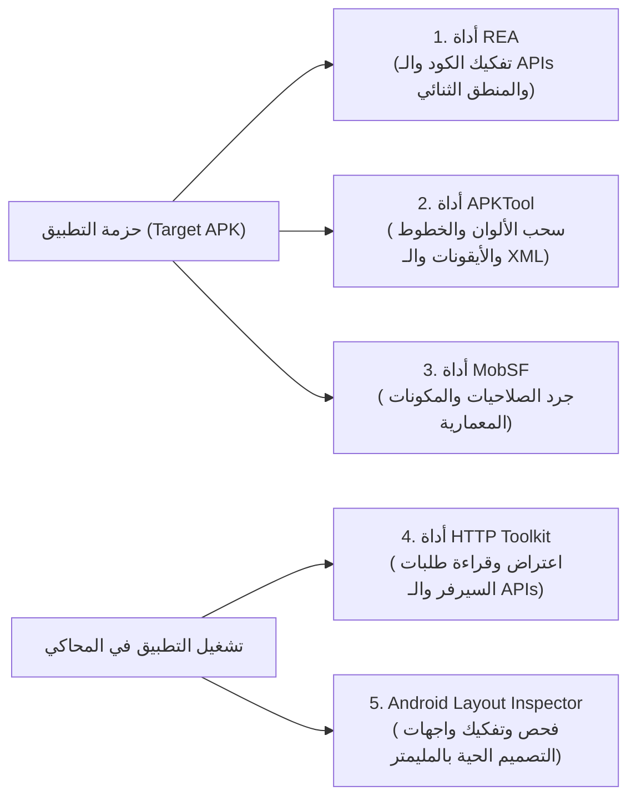

# 08. دليل ترسانة الأدوات ومسار العمل التنفيذي (Toolchain Pipeline)

> **الوثيقة الإجرائية والتنفيذية لمختبر الهندسة العكسية**  
> **الهدف:** توضيح كيفية تثبيت وتشغيل ترسانة الأدوات المساعدة ودمجها مع أداة REA في مسار عمل متكامل.

---

## 1. الترسانة المتكاملة (The Unified Engineering Toolchain)

لتحقيق أقصى درجات الإنتاجية والسرعة، لا نعتمد على أداة واحدة بمفردها؛ بل نربط سلسلة من الأدوات المتخصصة التي تكمل بعضها:



---

## 2. جدول الأدوات وطريقة تثبيتها على نظام Windows

| الأداة | وظيفتها الأساسية | أمر التثبيت على Windows (PowerShell / CMD) |
| :--- | :--- | :--- |
| **REA (الرئيسية)** | فك الكود، فحص الدوال، وتتبع الـ Xrefs | **مثبتة وجاهزة لديك عالمياً** (`rea --version` 6.7.0). |
| **APKTool** | فك موارد الـ XML والألوان والأيقونات | `winget install -e --id iBotPeaches.Apktool` أو تنزيل ملف JAR. |
| **JADX-GUI** | متصفح بصري سريع لكود الجافا والكوتلن | `winget install -e --id Skylot.Jadx` |
| **HTTP Toolkit** | اعتراض حركة الشبكة وفك تشفير SSL بنقرة واحدة | `winget install -e --id HTTPToolkit.HTTPToolkit` |
| **Android Studio** | محاكي أندرويد + Layout Inspector لفحص الواجهات | مثبت عادة مع بيئة تطوير أندرويد. |

---

## 3. مسار العمل الهندسي الميداني خطوة بخطوة (The 4-Stage Pipeline)

عند جلب أي تطبيق مستهدف (مثل `famisafe.apk` أو `life360.apk`)، نتبع الخطوات الـ 4 التالية بالتسلسل:

### المرحلة 1: الجرد المعماري الشامل (Architecture & Manifest Triage)
1. نضع حزمة الـ APK في مجلد `benchmarks/raw_apks/`.
2. نشغل فحص REA الأولي:
   ```bash
   rea analyze-android-package "benchmarks/raw_apks/target.apk" --json
   ```
3. نحصل فوراً على قائمة بجميع: الشاشات (`Activities`)، الخدمات (`Services`)، الصلاحيات (`Permissions`)، والمكتبات المدمجة.

### المرحلة 2: استخراج نظام التصميم والأصول (Design Token Extraction)
1. نفكك الموارد باستخدام APKTool داخل مجلد `benchmarks/extracted/`:
   ```bash
   apktool d "benchmarks/raw_apks/target.apk" -o "benchmarks/extracted/target_ui" --no-src
   ```
2. نسحب أسرار التصميم مباشرة:
   - الألوان: `benchmarks/extracted/target_ui/res/values/colors.xml`
   - المسافات والأبعاد: `benchmarks/extracted/target_ui/res/values/dimens.xml`
   - الخطوط الأصلية: `benchmarks/extracted/target_ui/assets/fonts/`
   - الأيقونات المتجهة: تحويل ملفات الـ VectorDrawables إلى `SVG`.

### المرحلة 3: كشف وفك أسرار الـ API والخدمات السحابية (API Reverse Engineering)
1. نشغل التطبيق داخل المحاكي مع تشغيل **HTTP Toolkit**.
2. يتخطى HTTP Toolkit حماية الـ SSL Pinning تلقائياً ويعترض جميع طلبات الخادم.
3. نسجل حزم الـ JSON المرسلة والمستقبلة لميزات:
   - تسجيل إحداثيات الموقع وتحديثات السياج الجغرافي.
   - مزامنة مواعيد التقويم وقوائم المهام.
   - رسائل الإشعارات وأوامر الحظر الفوري.
4. نحفظ مخططات البيانات (`JSON Schemas`) لاستخدامها في خادمنا.

### المرحلة 4: كتابة الكود النظيف والتكامل العائلي (Clean-Room Implementation)
1. بمجرد وضوح الخوارزمية وعقد البيانات، نغلق ملفات الـ APK.
2. نبدأ بكتابة كود أصلي ونظيف 100% بلغة **Flutter** لتطبيق العائلة، و **NestJS/TypeScript** للخادم، و **Kotlin** للوحدة الأصلية بأندرويد.
3. نربط الميزة ببقية المنظومة العائلية (التكامل المتقاطع بين الرقابة، والموقع، والتقويم، والمكافآت، والذكاء الاصطناعي).

---

## 4. الخطوات التالية للبدء الفعلي

1. **الخطوة الأولى:** البدء بتثبيت الأدوات المساعدة المطلوبة في بيئة العمل.
2. **الخطوة الثانية:** وضع أول حزمة APK في مجلد `benchmarks/raw_apks/` (المقترح: FamiSafe أو Life360).
3. **الخطوة الثالثة:** إطلاق أول جلسة تشريح بـ REA وبدء استخلاص الميزات!
