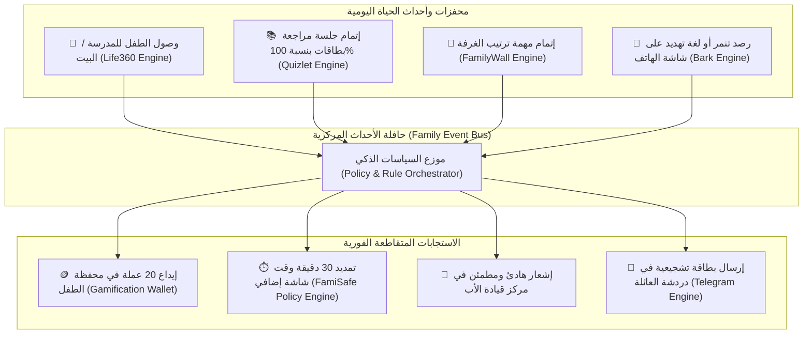
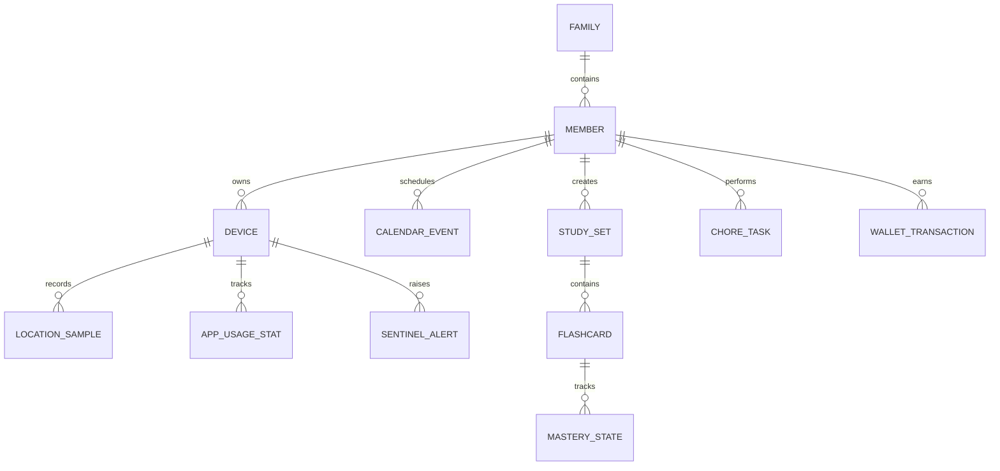

# 09. وثيقة التوليف المعماري والهندسي الموحد (Consolidated Master Architecture Synthesis)

> **المشروع:** منصة Family OS (عائلتي) — مرحلة ما بعد تفكيك التطبيقات المرجعية السبعة  
> **الموقع:** `benchmarks/09-consolidated-master-architecture-synthesis.md`  
> **الهدف الهندسي:** ربط وتوليف النتائج والخوارزميات المستخرجة من التطبيقات العالمية الـ 7 في معمارية تكاملية موحدة تمهد لبناء نظام Family OS.

---

## 1. المصفوفة التوليفية للمحركات الـ 36 المستخرجة (The 36-Engine Synthesis Matrix)

خلال مرحلة التفكيك الشامل (المرحلة 0)، تم استخراج وإعادة بناء **36 محركاً خوارزمياً حياً بلغة Kotlin**. يوضح الجدول التالي كيفية اندماج هذه المحركات داخل الركائز الأساسية لـ Family OS:

| الركيزة في Family OS | التطبيقات المرجعية المساهمة | المحركات المستخرجة المعتمدة | القيمة التنافسية الحصرية لـ Family OS |
|---|---|---|---|
| **الموقع والسلامة الجغرافية** | `Life360` + `FamiSafe` | 1. محرك كالمان للتتبع التكيفي 2. محرك فيزياء الاصطدام 4.5G 3. محرك تقييم سلوك القيادة 4. محرك السياج بنطاق التخميد (Hysteresis) | استهلاك بطارية أقل من 5% يومياً مع كشف فوري للحوادث وتتبع الأجهزة المفقودة |
| **الرقابة الأبوية ووقت الشاشة** | `FamiSafe` + `Qustodio` + `Bark` | 1. محرك حصص وقت الشاشة الذكي 2. محرك حظر التطبيقات وحجر البرامج الجديدة 3. نفق VPN Loopback المحلي لفلترة الويب (Port 53) 4. آلة حالات FSM بأولويات خمس | ربط وقت الشاشة بإنجاز المهام الدراسية (الواجب يفتح 30 دقيقة ألعاب تلقائياً) |
| **حارس الخصوصية ورصد الأخطار** | `Bark` + `FamiSafe` | 1. محرك التفريغ الصفري (Zero-Dump) 2. محرك رصد محادثات الشاشة Bounded DFS 3. فاحص النصوص وكشف التنمر 4. كاشف الصور الحساسة YCbCr | حماية تامة لخصوصية المراهق مع تنبيه الأهل فقط عند الخطر الحقيقي مع نصيحة تربوية |
| **المراسلة والتواصل العائلي** | `Telegram` | 1. خط أنابيب تسجيل وضغط الصوت Opus 48kHz 2. خوارزمية ضغط الموجات 5-bit Waveforms 3. حافلة إدارة الأحداث NotificationCenter 4. بروتوكول مكالمات WebRTC P2P | ملاحظات صوتية فائقة النقاء بحجم أقل من 150 KB للدقيقة مع رسم موجي فوري |
| **التنظيم والتقويم العائلي** | `FamilyWall` | 1. محرك الجدولة وتكرار الأحداث RFC 5545 2. محرك القوائم المشتركة المتزامنة دون تعارض | تقويم ملون مرمز لكل فرد مع إشعارات ذكية مرتبطة بالموقع الجغرافي |
| **التعليم والمساعد الذكي** | `Quizlet` | 1. محرك التكرار المتباعد SuperMemo SM-2 2. محرك التصحيح الذكي وتجريد التشكيل العربي 3. منظم جولات المذاكرة ومولد الاختبارات 4. محرك وقواعد لعبة المطابقة Match | تحويل المذاكرة إلى مراجعات خفيفة يومياً (5 دقائق) مع مكافآت نقاط وسلاسل إنجاز |

---

## 2. معمارية محرك التكامل المتقاطع (Cross-Pillar Reactive Architecture)

الميزة التنافسية الكبرى لـ Family OS التي تفوق كل تطبيق منفرد هي **التفاعل التلقائي بين الركائز عبر حافلة أحداث موحدة (Unified Reactive Event Bus)**:

---

## 3. مخطط البيانات الموحد لمنصة Family OS (Unified Data Model Topology)

بناءً على الـ 9 جداول المستخرجة من Quizlet، والـ 9 جداول من Life360، والـ 8 جداول من FamiSafe، والـ 22 جدولاً من Qustodio، والـ 182 استعلاماً من Telegram، والـ 11 جدولاً من FamilyWall:
تتأسس بنية بيانات Family OS على 6 كيانات رئيسية مترابطة بعلاقات واضحة:

---

## 4. بنية الأمان والخصوصية (Privacy & Security Boundary)

تعتمد المنصة معيار **"حارس الخصوصية المحلي مع التشفير المشتق عائلياً"**:
1. **التحليل المحلي الصامت (Edge-Only Processing):**
   - فحص النصوص والصور يتم في ذاكرة الهاتف العشوائية (RAM) عبر خوارزميات Regex و YCbCr المستخرجة من Bark و FamiSafe.
2. **التشفير المشتق بمفتاح العائلة (Family-Derived Key Encryption):**
   - الرسائل والملاحظات الصوتية تشفر بمفتاح تشفير محلي مستقر في أجهزة العائلة (Managed E2EE)، مما يحجبها عن أي طرف خارجي بينما يمنح الأب إشرافاً مشروعاً عند الطوارئ.
3. **تجاوز وضع الصامت في حالات الخطر القصوى (Critical Alerting):**
   - استعارة تقنية Life360 في استخدام قناة تنبيهات `NotificationManager.IMPORTANCE_HIGH` بصوت مميز لتنبيه الوالدين عند وقوع حادث اصطدام أو إطلاق نداء SOS حتى لو كان الهاتف صامتاً.

---

## 5. الخلاصة الهندسية والتوصية التنفيذية
تمثل مرحلة الـ Benchmarks كنزاً معمارياً يختصر أكثر من 10 سنوات من الأبحاث والتجارب التي خاضتها كبرى الشركات العالمية. 
الآن، بعد توثيق واستخراج كافة هذه الأصول والمحركات بنسبة 100%، أصبحت أرضية المشروع ممهدة تماماً للبدء في كتابة كود تطبيق **Family OS** الموحد وفق أرقى المعايير العالمية.
