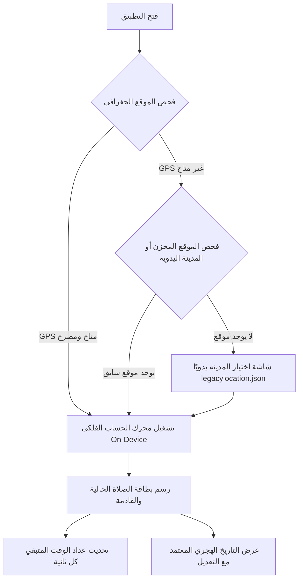
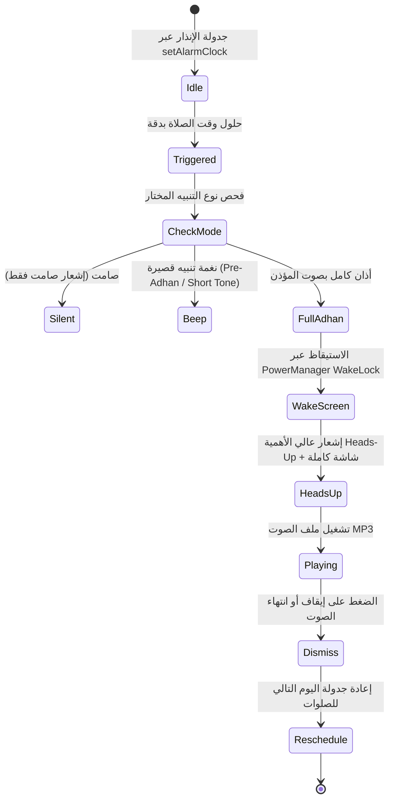
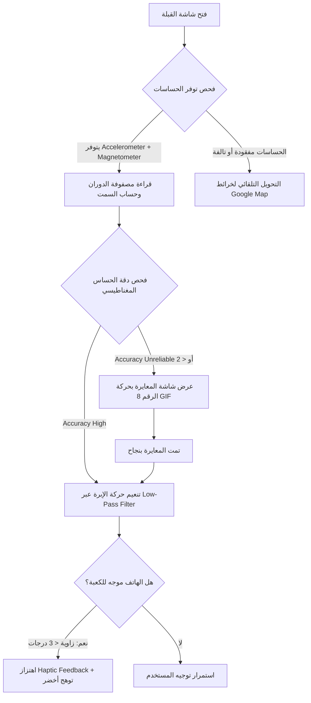

# مسارات وتدفقات تجربة المستخدم (UI/UX Complete Flows) — Muslim Pro

> **المرجع الهندسي:** تطبيق Muslim Pro v11.2.9 (`com.bitsmedia.android.muslimpro`)  
> **الهدف:** توثيق تدفقات الشاشات، آلات الحالة التفاعلية، ونقاط القوة والضعف المعمارية لاستلهامها في منصة `Family OS` (المرحلة 2 والمرحلة 5).

---

## 1. شاشة المتابعة الرئيسية وبطاقة الصلاة (Home & Prayer Card Flow)

### تفاصيل بطاقة الصلاة الحالية:
- **المؤشر الزمني النشط:** إبراز وقت الصلاة القادمة بلون مميز مع شريط تقدم نسبي (Circular / Linear Progress).
- **العداد التنازلي الدقيق (Countdown Timer):** يعرض الساعات والدقائق والثواني حتى موعد الأذان القادم.
- **التاريخ الهجري المزدوج:** عرض التاريخ الميلادي مع التاريخ الهجري المتزامن فلكياً أو المعدل محلياً.

---

## 2. شاشة مواقيت الصلاة الموسعة والضبط اليدوي (Prayer Times Hub)

تتيح الشاشة الانتقال بين العرض اليومي والشهر الكامل (Calendar / Timetable):
- **محدد طريقة الحساب (Calculation Method Picker):** قائمة بـ 21 طريقة حسابية معتمدة دولياً (أم القرى، رابطة العالم الإسلامي، الهيئة المصرية، كراتشي، ديانت، إلخ).
- **محدد مذهب صلاة العصر (Asr Juristic Method):**
  - القياسي (Standard): الشافعي، المالكي، الحنبلي (طول الظل = 1).
  - الحنفي (Hanafi): طول الظل = 2.
- **تعديل الدقائق اليدوي (Manual Minute Adjustments):**
  - منزلق أو حقل رقمي لكل صلاة من الصلوات الست (الفجر، الشروق، الظهر، العصر، المغرب، العشاء) بمعدل $\pm 30$ دقيقة للتزامن الدقيق مع مسجد الحي.
- **قواعد خطوط العرض العالية (High Latitude Adjustment):**
  - منتصف الليل (Midnight).
  - سبع الليل (One Seventh).
  - الزاوية النسبية (Angle-Based).

---

## 3. تدفق التنبيهات والأذان على شاشة القفل (Azan & Alert Flow)

---

## 4. تدفق بوصلة القبلة وحالات المعايرة (Qibla Compass Flow)

---

## 5. تدفق قارئ القرآن الكريم والتلاوة (Quran Reader & Audio Flow)

1. **فهرس السور والأجزاء:** قائمة بالسور الـ 114 مع بيانات التنزيل، الآيات، ومكان النزول (مكية / مدنية).
2. **وضع القراءة (Reading View):**
   - دعم خط الرسم العثماني وخط المصحف الإندونيسي (Kemenag) وخط النقاء (Clean).
   - مفتاح إظهار أحكام التجويد الملونة (Tajweed Rules).
   - تمييز الآيات (Highlights) والملاحظات (Notes) والفواصل المرجعية (Bookmarks).
3. **مشغل التلاوة الصوتي (Audio Recitation Bar):**
   - اختيار القارئ (المجاني: قارئ واحد افتراضي؛ المدفوع: فتح باقي القرّاء).
   - تكرار الآية أو المقطع (A-B Repeat) لحفظ القرآن.
   - التحكم في سرعة الصوت (0.75x, 1.0x, 1.25x, 1.5x).

---

## 6. تدفق حصن المسلم والأذكار اليومية (Hisnul Muslim & Dhikr Flow)

1. **تصنيفات الأذكار:** تبويب الأذكار حسب المناسبة (الصباح والمساء، النوم، الاستيقاظ، الصلاة، السفر، المرض).
2. **شاشة الذكر التفاعلية:**
   - عرض النص العربي مشكولاً بالكامل.
   - النص اللاتيني الصوتي (Transliteration) للناطقين بغير العربية.
   - الترجمة المعتمدة باللغات المختلفة.
   - سند الحديث ومصدر التخريج (Ref).
3. **السبحة الرقمية المدمجة (Digital Tasbih):**
   - عداد لمس على الشاشة بالكامل مع اهتزاز لمسي عند كل تسبيحة وعند إتمام الـ 33 أو الـ 100.

---

## 7. تدفق إشعارات تحسين البطارية للأجهزة الآسيوية (OEM Battery Saver Flow)

1. **الرصد:** عند تأخر الأذان أو عند الإقلاع، يفحص التطبيق اسم المصنع والبرمجيات المثبتة.
2. **الكشف عن مديري الطاقة:**
   - شاومي: `com.miui.securitycenter`
   - هواوي: `com.huawei.systemmanager`
   - سامسونج: `com.samsung.android.lool`
   - أوبو وفيفو: برامج الحماية وإدارة الطاقة المخصصة.
3. **الحوار الإرشادي:** عرض بطاقة واضحة بالصور تشرح للمستخدم كيفية منح إذن التشغيل التلقائي (Autostart) واستثناء التطبيق من تحسين البطارية، مع زر ينقل مباشرة إلى صفحة الإعدادات الأصلية الخاصة بذلك المصنع.
