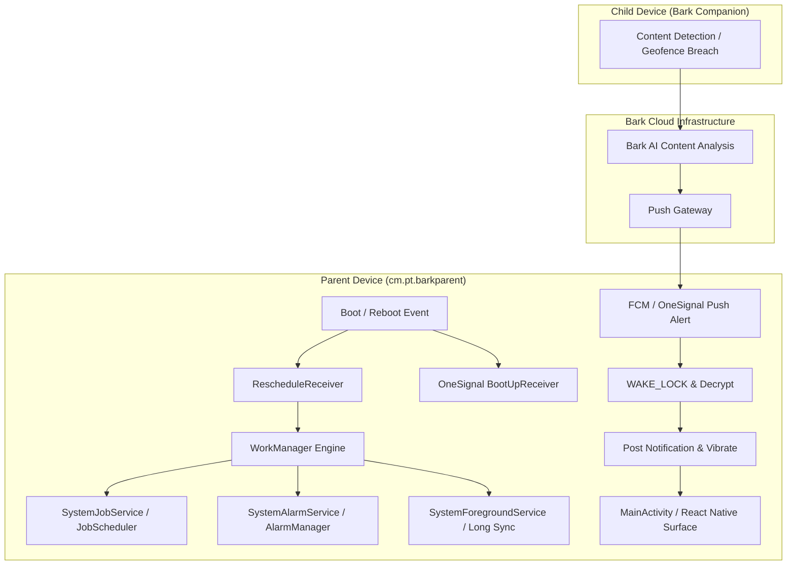
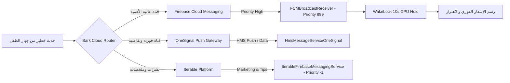

# التحليل المعماري لآليات البقاء والاستمرارية — تطبيق Bark Parent
## Persistence, Resilience & Anti-Tampering Architectural Analysis: cm.pt.barkparent (v6.5.1)

> **المستهدف المعماري:** تطبيق إدارة الوالدين `cm.pt.barkparent` (Bark Parental Controls v6.5.1)  
> **تاريخ التوثيق:** 29 أكتوبر 2026  
> **الوكيل الهندسي:** `worker_m1` (Architecture & Manifest Specialist)  
> **حالة مجلد المواصفات:** `spec/` معزول ومجمد بنسبة 100% (Strictly Isolated & Frozen)

---

## 1. الملخص التنفيذي والسياق المعماري (Executive Summary)

تعتمد منصة **Bark** العالمية في نموذجها التشغيلي على معمارية النظم الموزعة ثنائية التطبيقات (Dual-App Distributed Architecture):
1. **تطبيق التحكم والإدارة الأبوية (Parent Control & Dashboard Plane):** الحزمة `cm.pt.barkparent` موضوع هذا الفحص، والمصممة للعمل على هواتف الوالدين لاستعراض التنبيهات، ضبط سياسات وقت الشاشة، متابعة الموقع الجغرافي، وإدارة اشتراكات الأسرة.
2. **تطبيق الرصد والحماية للطفل (Child Sentinel / Data Plane):** الحزمة التابعة `Bark for Kids` (أو Bark Jr / Bark Companion) المثبتة على أجهزة الأبناء، والتي تمتلك أذونات الوصول المعماري العميق (`AccessibilityService` لالتقاط نصوص المحادثات، `VpnService` لفلترة النطاقات واعتراض DNS، و `DeviceAdminReceiver` لمنع الإلغاء والحذف).

يكشف التحليل الدقيق لحزمة `cm.pt.barkparent` عن استراتيجية استمرارية وبقاء متطورة تركز على **الموثوقية الفائقة في تسليم التنبيهات الفورية (Alert Delivery Reliability)** مع **أقل استهلاك ممكن للبطارية (Zero-Drain Passive Standby)** عبر استثمار منظومة أندرويد المعيارية الحديثة (`AndroidX WorkManager`، `JobScheduler`، `App Startup`، وشبكة دفع رسائل ثلاثية القنوات: Firebase + OneSignal + Iterable).



---

## 2. آليات التعافي عند إقلاع النظام (Boot-Up Resilience & Auto-Recovery)

عند قيام الوالد بإعادة تشغيل الهاتف أو نفاذ البطارية ثم إعادة الشحن، يجب ألا يفقد التطبيق قدرته على استقبال التنبيهات الحرجة المتعلقة بسلامة الأبناء. يضمن التطبيق ذلك عبر سلسلة من المكونات المتخصصة:

### 2.1 إذن الاستماع لإقلاع النظام (`RECEIVE_BOOT_COMPLETED`)
يطلب التطبيق الإذن صراحة في المانيفست:
```xml
<uses-permission android:name="android.permission.RECEIVE_BOOT_COMPLETED"/>
```
يتيح هذا الإذن لمستقبلات البث المسجلة الاستيقاظ فور إنهاء نظام أندرويد لعملية الإقلاع (`android.intent.action.BOOT_COMPLETED`).

### 2.2 مستقبل استعادة الإشعارات (`com.onesignal.notifications.receivers.BootUpReceiver`)
- **طبيعة المكون:** `BroadcastReceiver` غير مُصدّر (`exported="false"`).
- **الفلتر:** يستمع للحدث `android.intent.action.BOOT_COMPLETED`.
- **الدور الهندسي:**
  1. يقوم بإعادة تسجيل قنوات الإشعارات (Notification Channels) في نظام أندرويد والتأكد من مطابقة إعدادات الصوت والاهتزاز لقنوات التنبيهات الحرجة.
  2. يعيد جدولة الإشعارات المحلية المعلقة (Local Scheduled Reminders).
  3. يطلق خدمة خفيفة للتأكد من صلاحية اشتراك الجهاز في سحابة OneSignal وتجديد التوكن إذا لزم الأمر.

### 2.3 مستقبل إعادة جدولة المهام الشامل (`androidx.work.impl.background.systemalarm.RescheduleReceiver`)
- **طبيعة المكون:** `BroadcastReceiver` غير مُصدّر (`exported="false"`).
- **الفلاتر:**
  * `android.intent.action.BOOT_COMPLETED` (إعادة تشغيل الجهاز)
  * `android.intent.action.TIME_SET` (تعديل ساعة الهاتف يدوياً)
  * `android.intent.action.TIMEZONE_CHANGED` (تغيير المنطقة الزمنية عند السفر)
- **الدور الهندسي:**
  * يحل معضلة شائعة في تطبيقات الرقابة الأبوية: عندما يسافر الوالد أو تتغير المنطقة الزمنية، قد تختل مواعيد جداول وقت نوم الأطفال أو المزامنة الدورية.
  * يستدعي `RescheduleReceiver` محرك WorkManager لقراءة جدول المهام من قاعدة بيانات Room المحلية وإعادة حساب كافة أوقات التنفيذ المجدولة وضخها مجدداً في نظام `JobScheduler`.

### 2.4 التوافق مع وضع الإقلاع المباشر (Direct Boot Awareness & FBE)
يدعم التطبيق ميزة التشفير المعتمد على الملفات (File-Based Encryption - FBE) في أندرويد عبر وسم المكونات الحرجة بـ `android:directBootAware="true"`:
* `com.google.firebase.messaging.FirebaseMessagingService`
* `com.google.firebase.components.ComponentDiscoveryService`
* `com.google.firebase.provider.FirebaseInitProvider`
* `androidx.room.MultiInstanceInvalidationService`

**الأهمية الأمنية:**  
يتيح هذا التصميم استيقاظ خدمات Firebase واستقبال التنبيهات الفورية حتى ولو كان الهاتف في حالة "Locked after reboot" (قبل أن يقوم الوالد بإدخال رمز PIN أو بصمة الإصبع لأول مرة)، حيث تستخدم هذه المكونات مساحة التخزين المشفرة بجهاز الجهاز (Device Encrypted Storage) للوصول للتوكنات وقنوات الاتصال.

---

## 3. هندسة إدارة المهام الخلفية المتقدمة (WorkManager Orchestration)

تعتمد حزمة Bark على مكتبة `AndroidX WorkManager` باعتبارها المعيار الهندسي الأرقى لإدارة المهام الخلفية الموثوقة وفق متطلبات أنظمة أندرويد الحديثة (Doze Mode و App Standby Buckets).

### 3.1 الهيكل الثلاثي لخدمات التنفيذ (Execution Service Hierarchy)

| اسم الخدمة | نوع المشغل (Execution Engine) | الصلاحيات والسمات | الاستخدام في Bark |
|---|---|---|---|
| `androidx.work.impl.background.systemjob.SystemJobService` | `JobScheduler` (Android 5.0+) | `exported="true"`<br>`permission="android.permission.BIND_JOB_SERVICE"` | المشغل الأساسي الافتراضي لمهام المزامنة، متكامل مع قيود النظام لتوفير الطاقة. |
| `androidx.work.impl.background.systemalarm.SystemAlarmService` | `AlarmManager` (Legacy/Exact) | `exported="false"` | مشغل بديل للأجهزة التي لا تدعم JobScheduler بكفاءة أو عند الحاجة لتوقيت دقيق. |
| `androidx.work.impl.foreground.SystemForegroundService` | `Foreground Service` (Android 8.0+) | `exported="false"`<br>يتطلب إذن `FOREGROUND_SERVICE` | تنفيذ عمليات المزامنة الطويلة التي تتجاوز قيود الخلفية (مثل تنزيل سجلات النشاط وتصدير التقارير). |

### 3.2 وكلاء القيود الحركية لتوفير الطاقة (Dynamic Constraint Proxies)
تستخدم حزمة Bark أربعة وكلاء قيود (Constraint Proxies) ذكية مدمجة في المانيفست بحالة افتراضية معطلة (`android:enabled="false"`):
1. **`ConstraintProxy$BatteryChargingProxy`:** يراقب الشاحن عبر `ACTION_POWER_CONNECTED` و `ACTION_POWER_DISCONNECTED`.
2. **`ConstraintProxy$BatteryNotLowProxy`:** يراقب مستوى البطارية عبر `BATTERY_OKAY` و `BATTERY_LOW`.
3. **`ConstraintProxy$StorageNotLowProxy`:** يراقب سعة التخزين عبر `DEVICE_STORAGE_LOW` و `DEVICE_STORAGE_OK`.
4. **`ConstraintProxy$NetworkStateProxy`:** يراقب توفر الإنترنت عبر `android.net.conn.CONNECTIVITY_CHANGE`.

#### آلية التفعيل الحركي الذكي (Zero Waste Activation):
- عند جدولة مهمة لا تشترط شحن الهاتف، يظل `BatteryChargingProxy` معطلاً تماماً في `PackageManager`.
- عند تسجيل مهمة مزامنة كبيرة تشترط الاتصال بالشاحن، يرسل WorkManager أمراً إلى `ConstraintProxyUpdateReceiver` (`androidx.work.impl.background.systemalarm.UpdateProxies`) لتفعيل الوكيل فقط خلال فترة الانتظار.
- **النتيجة الهندسية:** صفر استهلاك للبطارية عند غياب المهام المقيدة، مع استجابة فورية لحظة توفر الشرط المطلوب.

---

## 4. التعافي من الإيقاف القسري (Force-Stop Detection & Recovery)

عندما يقوم المستخدم بإيقاف التطبيق قسرياً من إعدادات النظام (Force Stop):
1. يقوم نظام أندرويد فوراً بحذف كافة منبهات `AlarmManager` وإلغاء كافة وظائف `JobScheduler` المسجلة للتطبيق.
2. يدخل التطبيق في حالة التوقف الكامل (Stopped State) حتى يقوم المستخدم بفتحه يدوياً.

### آلية `ForceStopRunnable` المبتكرة:
تتضمن معمارية Bark المستقبل الداخلي:
```xml
<receiver android:directBootAware="false" android:enabled="true" android:exported="false" 
          android:name="androidx.work.impl.utils.ForceStopRunnable$BroadcastReceiver"/>
```
- يعتمد هذا المستقبل على خدعة ذكية: يقوم ببرمجة منبه دوري خاص لا يتم تفعيله أبداً، ولكنه يحتوي على علم فريد في الذاكرة.
- بمجرد تشغيل أي مكون في التطبيق مستقبلاً (مثل فتح التطبيق، أو استقبال رسالة FCM ذات أولوية عالية)، ينفذ كود `ForceStopRunnable`.
- إذا اكتشف الكود اختفاء المنبه، يستنتج فوراً أن التطبيق تعرض للإيقاف القسري (`Application was force-stopped`).
- يقوم الكود فوراً بإعادة بناء جداول قاعدة بيانات Room المحلية وإعادة تسجيل كافة الوظائف في `JobScheduler`، مستعيداً جاهزية التطبيق الكاملة في أجزاء من الثانية.

---

## 5. منظومة استقبال ودفع التنبيهات متعددة المسارات (Multi-Gateway Push Redundancy)

لضمان وصول تنبيهات المخاطر (مثل اكتشاف محتوى تنمر، اكتشاف أفكار اكتئابية، أو طلب استغاثة SOS) بنسبة موثوقية تقارب 100%، تعتمد Bark على بنية ثلاثية المستويات:



### 5.1 عزل قناة الرسائل السحابية (`C2D_MESSAGE` Signature Protection)
لحماية تنبيهات الوالدين من التجسس المحلي، قامت Bark بتعريف إذن مخصص بمستوى `signature`:
```xml
<permission android:name="cm.pt.barkparent.permission.C2D_MESSAGE" android:protectionLevel="signature"/>
<uses-permission android:name="cm.pt.barkparent.permission.C2D_MESSAGE"/>
```
يضمن هذا الإجراء أن نظام أندرويد سيرفض تسليم حزم الإشعارات الموجهة لـ Bark لأي تطبيق خبيث مثبت على جهاز الوالد ما لم يكن موقعاً بنفس الشهادة الرقمية الرسمية لشركة Bark.

### 5.2 قفل الاستيقاظ المؤقت (`android.permission.WAKE_LOCK`)
تطلب Bark إذن `WAKE_LOCK` لتنفيذ أمر استيقاظ جزئي للمعالج (`PowerManager.PARTIAL_WAKE_LOCK`) لمدة وجيزة (أقل من 10 ثوانٍ) عند وصول حمولة FCM المشفرة. يمنع هذا دخول الهاتف في نوم عميق (Deep Sleep) قبل اكتمال فك تشفير التنبيه، حفظه في قاعدة البيانات المحلية، وإظهار الإشعار المرئي والصوتي على شاشة الوالد.

---

## 6. الدور المعماري لـ `cm.pt.barkparent` مقابل تطبيق الطفل (Companion Architecture)

أظهر المسح الشامل خلو مانيفست `cm.pt.barkparent` من المكونات الرقابية العنيفة التالية:
- **`AccessibilityService`:** غير موجود (لا يقوم بقراءة نصوص الشاشة في جهاز الوالد).
- **`VpnService`:** غير موجود (لا ينشئ نفق VPN محلي لفلترة الويب في جهاز الوالد).
- **`DeviceAdminReceiver`:** غير موجود (لا يطلب صلاحيات مدير الجهاز لمنع إلغاء التثبيت في جهاز الوالد).

### التفسير الهندسي لنموذج Bark (Architectural Rationale):
تطبق Bark مبدأ هندسي بالغ الذكاء: **الفصل التام بين لوحة التحكم ومحرك الرصد (Control Plane vs Data Plane)**:

| المعيار الهندسي | تطبيق الوالدين (`cm.pt.barkparent`) | تطبيق الطفل (`Bark for Kids / Companion`) |
|---|---|---|
| **المنصة والتقنية** | React Native (Hermes VM) + AndroidX | Native Android (Java/Kotlin) خفيف ومرن |
| **طبيعة الواجهة** | واجهات مستخدم غنية، رسوم بيانية، إدارة حسابات | واجهة خفيفة شبه مخفية مع شاشات تفويض وإعداد فقط |
| **صلاحيات النظام** | أذونات عادية: إنترنت، موقع، إشعارات، وبايومتري | أذونات قصوى: إمكانية الوصول، VPN محلي، مدير الجهاز |
| **نمط استهلاك الطاقة** | سلبي (Passive): يستيقظ فقط عند التفاعل أو وصول إشعار | إيجابي نشط (Active Sentinel): رصد مستمر للنصوص والشبكة |
| **الحماية من الإغلاق** | تعتمد على WorkManager و Firebase Push | تعتمد على Persistent Foreground Service و DeviceAdmin |

---

## 7. الدروس المستفادة وتوصيات التصميم لمنصة Family OS

يقدم الفحص المعماري لآليات استمرارية Bark خارطة طريق واضحة وقابلة للتطبيق مباشرة عند بناء منصة **Family OS**:

1. **اعتماد نموذج التطبيقين المنفصلين (Dual-App Strategy):**
   - تصميم تطبيق الوالدين في `Family OS` باستخدام إطار متعدد المنصات (Flutter) يركز على تجربة المستخدم وإدارة الإشعارات والبيانات التفاعلية.
   - تصميم تطبيق خدمة الحماية للطفل (`Family OS Sentinel`) كتطبيق أندرويد أصلي مستقل (Native Companion) مكرس لأداء مهام الرصد بأقصى كفاءة وأقل استهلاك للذاكرة.

2. **الاستغناء عن خدمات الخلفية العشوائية واستبدالها بـ WorkManager:**
   - عدم استخدام خدمات `Service` تقليدية دائمة في تطبيق الوالدين، والاعتماد الحصري على `AndroidX WorkManager` المدار عبر `JobScheduler` لتفادي تصنيف التطبيق كمستهلك للبطارية في واجهات الشركات (Samsung, Xiaomi).

3. **الدمج بين قنوات الدفع السحابية المتعددة (Push Redundancy):**
   - الاعتماد على Firebase Cloud Messaging كقناة رئيسية، مع توفير قناة احتياطية (مثل WebSocket خفيف أو OneSignal/UnifiedPush) لضمان تسليم تنبيهات الطوارئ العائلية دون تأخير.

4. **الاستفادة من مكتبة AndroidX App Startup:**
   - توحيد تهيئة قواعد البيانات والمكتبات داخل `InitializationProvider` واحد لتسريع الإقلاع البارد (Cold Start) لتطبيق `Family OS`.

---
*أُعد التقرير الهندسي بواسطة `worker_m1` (Architecture & Manifest Specialist) — مشروع التفكيك والتحليل المرجعي Family OS.*
