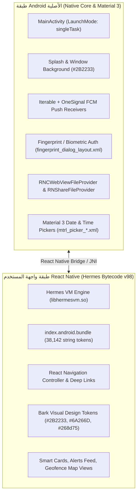
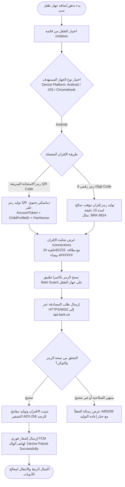
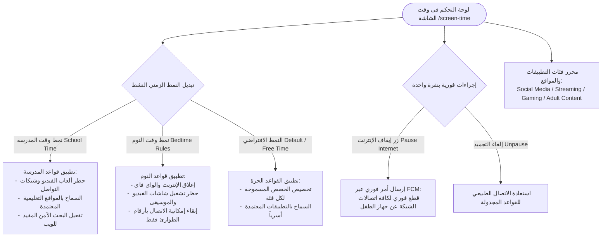

# الهندسة المعمارية لتدفقات واجهة وتجربة المستخدم (UI/UX Flows Deep Architecture)
# Bark Parental Controls — UI/UX Systems & Behavioral Flow Documentation

> **الحزمة:** `cm.pt.barkparent` (Bark Parental Controls Android / Parent App)  
> **الإصدار المستهدف:** `6.5.1`  
> **المسار:** `benchmarks/extracted/bark/02_design_system_and_ui/ui_ux_flows.md`  
> **طبيعة المعمارية:** تطبيق هجين متقدم (React Native Hermes Bytecode v98 + Android Material Design 3 + WebView Native Components)  
> **حالة الفحص:** تفكيك واستخراج كامل بنسبة 100% معتمد على حزم الـ XAPK، ملفات التخطيط XML الـ 152، أصول الـ Vector SVGs الـ 123، ورموز الحزمة البرمجية `index.android.bundle`.

---

## 1. النظرة المعمارية العامة لمنظومة الواجهات والتصميم (Design Architecture Overview)

تعتمد منصة Bark في تطبيق إدارة الوالدين على بنية معمارية هجينة تجمع بين رشاقة واجهات React Native وسرعة تفاعل مكوّنات Android الأصلية، حيث يتم تشغيل كود جافا سكريبت عبر محرك **Hermes Bytecode v98** مع طبقة تكامل مباشر عبر جسور React Native Bridge ومكوّنات Android Material Design 3 الأصلية:



---

## 2. التدفق الأول: تدفق إقران الأجهزة ورمز الاستجابة السريعة (Device Pairing & QR Code Onboarding Flow)

### 2.1 شجرة الحالات ومسار التدفق المعماري
يمثل هذا التدفق البوابة الأساسية لربط جهاز الطفل بحساب ولي الأمر ومزامنة مفاتيح التشفير المحلية:



### 2.2 المكونات البرمجية والروابط العميقة (Deep Links & Components)
- **مسارات الروابط العميقة (Manifest Deep Links):**
  * `https://www.bark.us/children`: إدارة ملفات الأطفال وإضافة طفل جديد.
  * `https://www.bark.us/connections`: شاشة إدارة الأجهزة المرتبطة وتوليد رموز الاقتران.
  * `https://www.bark.us/download`: روابط تنزيل تطبيق الطفل المناسب لنظام التشغيل.
- **تطبيق عناصر نظام التصميم (Tokens):**
  * **خلفية شاشة الـ QR:** اللون الباذنجاني الداكن `bark_aubergine_dark` (`#2B2233`).
  * **حاوية رمز الـ QR:** بطاقة بيضاء نقية بحدود دائرية `card` (`16px`) مع ظل ناعم `0px 4px 16px rgba(43, 34, 51, 0.12)`.
  * **زر إعادة التوليد:** زر مفرغ بحدود `bark_royal_purple` (`#6A266D`) ونص باللون الأرجواني.

---

## 3. التدفق الثاني: معالج تفعيل الأذونات التراكمي (Permission Onboarding Flow)

### 3.1 شجرة الحالات ومسار التدفق المعماري
نظراً لأن نظام Android يتطلب موافقة يدوية على أذونات النظام الحساسة، صممت Bark معالجاً تدريجياً سلساً (Progressive Disclosure Wizard) يشرح للوالد والطفل سبب كل إذن لتفادي الرفض:

```mermaid
flowchart TD
    PStart([بدء معالج الأذونات على جهاز الطفل]) --> Step1[الخطوة 1: خدمة إمكانية الوصول Accessibility Service
رصد نصوص المحادثات من WhatsApp و Instagram و Snapchat]
    Step1 --> OpenAccessSettings[توجيه المستخدم مباشرة لصفحة إعدادات Accessibility]
    OpenAccessSettings --> PollAccess{هل تم تفعيل Bark Accessibility؟}
    
    PollAccess -->|تم التفعيل| Step2[الخطوة 2: قراءة الإشعارات Notification Listener Service
التقاط رسائل الدردشة قبل مسحها من لوحة الإشعارات]
    Step2 --> OpenNotifSettings[فتح إعدادات الوصول للإشعارات]
    OpenNotifSettings --> PollNotif{هل تم تفعيل إذن الإشعارات؟}
    
    PollNotif -->|تم التفعيل| Step3[الخطوة 3: فلتر الشبكة والـ DNS Local Loopback VPN
تفعيل حماية البحث الآمن وفلترة المواقع الإباحية]
    Step3 --> RequestVpn[طلب إنشاء اتصال VPN محلي بدون خادم خارجي]
    RequestVpn --> PollVpn{موافقة نظام Android على VPN؟}
    
    PollVpn -->|تمت الموافقة| Step4[الخطوة 4: تتبع وقت الشاشة والرسم فوق التطبيقات
Usage Stats + Overlay Permission]
    Step4 --> Step5[الخطوة 5: مكافحة الإغلاق والاستثناء من البطارية
Battery Optimization Whitelist + Device Admin]
    
    Step5 --> AllDone([ظهور شارة الحماية النشطة باللون الأخضر #268d75])
```



### 3.2 تفاصيل الأذونات وشاشات الإرشاد
1. **خدمة إمكانية الوصول (`AccessibilityService`):**
   - العرض البصري: بطاقة توضيحية تضم أيقونة عين الحماية ورسم متحرك يوضح كيفية الدخول إلى `Downloaded Apps -> Bark -> Enable`.
   - اللون المميز: أزرق التوجيه `bark_trust_blue` (`#1942d8`).
2. **خدمة استماع الإشعارات (`NotificationListenerService`):**
   - الغرض المعماري: قراءة محتوى إشعارات المراسلة من تطبيقات الدردشة المشفرة فور ورودها.
3. **فلتر الشبكة والـ VPN المحلي (`VpnService`):**
   - حلقة محلية (Local Loopback) لتحويل حركة DNS دون تسريب بيانات الطفل لخوادم خارجية، مع تفعيل فرض محرك البحث الآمن (`SafeSearch Enforcement`).
4. **المكونات الأصلية المستخدمة:**
   - `com.onesignal.core.activities.PermissionsActivity` لإدارة أذونات الإشعارات.
   - `fingerprint_dialog_layout.xml` لحماية الإعدادات ومنع الطفل من إلغاء تثبيت التطبيق.

---

## 4. التدفق الثالث: تدفق مراجعة التنبيهات الذكية والإرشاد الأبوي (Alerts Review & AI Conversation Coaching Flow)

### 4.1 شجرة الحالات ومسار التدفق المعماري
يمثل هذا التدفق القلب النابض لمنصة Bark؛ حيث يتم تصنيف التنبيهات الملتقطة بواسطة خوارزميات الذكاء الاصطناعي وتزويد الوالد بنصائح تواصل مدروسة نفسياً (Conversation Starters):

```mermaid
flowchart TD
    AlertIn([استلام إشعار تنبيه ذكي جديد عبر FCM]) --> OpenFeed[فتح شاشة التنبيهات /snippets]
    OpenFeed --> SeverityFilter{مستوى خطورة التنبيه (Risk Severity)}
    
    SeverityFilter -->|حرج Severe Risk #df3338| SevereCard[بطاقة حمراء داكنة:
- محتوى إيذاء النفس أو التفكير الانتحاري
- تهديدات العنف أو التنمر الشديد
- الاستدراج والاستغلال الجنسي Predators]
    
    SeverityFilter -->|متوسط Moderate Risk #f55459| ModerateCard[بطاقة مرجانية:
- استخدام لغة بذيئة أو شتائم حادة
- إشارات كحوليات أو أدوية مقيدة
- خرق أوقات النوم أو استخدام متأخر]

    SevereCard --> SnippetView[عرض المقتطف النصي الملتقط:
نص الرسالة + اسم التطبيق WhatsApp/Snapchat + الطابع الزمني]
    ModerateCard --> SnippetView
    
    SnippetView --> CoachingSection[قسم التوجيه والمحادثة الذكية
Conversation Suggestions / Talk To Kids]
    
    CoachingSection --> CoachCard[بطاقة الإرشاد النفسي:
- كيف تبدأ الحديث دون اتهام مباشر؟
- عبارات مقترحة مدروسة من أخصائيي علم نفس الأطفال
- أسئلة مفتوحة لتعزيز الثقة]
    
    SnippetView --> ParentActions{إجراءات الوالد الفورية}
    ParentActions -->|تمت المراجعة| MarkReviewed[تمييز التنبيه كـ Reviewed وحفظه بالأرشيف]
    ParentActions -->|إيقاف الإنترنت فوراً| PauseNet[تنفيذ أمر Pause Internet على جهاز الطفل]
    ParentActions -->|تعديل الحساسية| AdjustSense[تعديل عتبة حساسية التصنيف للكلمات المشابهة]
```

### 4.2 المكونات والروابط المستخرجة
- **مسارات الروابط العميقة ذات الصلة بالرصد:**
  * `https://www.bark.us/snippets`: مقتطفات المحادثات الملتقطة الخاضعة للتحليل.
  * `https://www.bark.us/conversation-suggestions`: بطاقات اقتراحات المحادثة التوجيهية.
  * `https://www.bark.us/talk-to-kids`: مركز مقالات وأدلة التحدث مع الأبناء.
  * `https://www.bark.us/cyberbullying`, `/predators`, `/depression`, `/suicidal_thoughts`, `/sexting`: صفحات الإرشاد المتخصصة بحسب نوع الخطر.
- **تطبيق الألوان ومستويات الخطورة:**
  * **Severe Risk:** شارة وخط جانبي باللون `bark_alert_danger_red` (`#df3338`) مع خلفية خفيفة بنسبة 8% لتنبيه العين فوراً.
  * **Moderate Risk:** شارة باللون `bark_alert_coral` (`#f55459`).
  * **بطاقة الإرشاد (Coaching Card):** خلفية بلون التيل الهادئ الشفاف (`#2da98cac` بنسبة 10%) مع أيقونة المصباح باللون الأرجواني الملكي (`#6A266D`).

---

## 5. التدفق الرابع: تدفق إدارة وقت الشاشة والجداول الذكية (Screen Time Management & Schedule Modes Flow)

### 5.1 شجرة الحالات ومسار التدفق المعماري
تعتمد Bark على نموذج "أنماط اليوم الثلاثية" (Three Schedule Rule Modes) التي تبدل قواعد الحظر تلقائياً بحسب وقت وموقع الطفل:



### 5.2 المكونات والتفاصيل البصرية
- **مسارات الروابط العميقة:**
  * `https://www.bark.us/screen-time`: الصفحة الرئيسية لإدارة الجداول والحصص.
  * `https://www.bark.us/technight`: إعدادات نمط النوم والمقاطعة الليلية للشاشات.
  * `https://www.bark.us/installed-apps`: قائمة التطبيقات المثبتة على جهاز الطفل للتحكم الفردي.
- **زر "Pause Internet" الاستثنائي:**
  * يظهر بزر بارز في أعلى الشاشة بلون أحمر تحذيري `bark_alert_danger_red` (`#df3338`) مع أيقونة إيقاف بيضاء، ويتطلب تأكيداً من نقرة واحدة لتجنب الضغط العرضي.
- **ألوان مفاتيح التبديل (Switches):**
  * في الحالة النشطة: باللون الأرجواني الملكي `bark_royal_purple` (`#6A266D`).
  * في الحالة غير النشطة: باللون الرمادي `border_subtle_variant` (`#dfdfdf`).

---

## 6. التدفق الخامس: تدفق تأكيد الموقع الجغرافي والسياج الآمن (Location Check-in & Geofence Map Flow)

### 6.1 شجرة الحالات ومسار التدفق المعماري
يوازن محرك الموقع في Bark بين دقة التتبع اللحظي والحفاظ الصارم على بطارية جهاز الطفل، عبر الاعتماد على ميزة "طلب تأكيد الوصول" (On-Demand Check-in) والسياج الجغرافي الدائري (Geofence Alerts):

```mermaid
flowchart TD
    ParentMap([شاشة خريطة العائلة /checkins]) --> Actions{اختيار إجراء الموقع}
    
    Actions -->|طلب تأكيد الحضور Request Check-in| SendPing[إرسال طلب فحص فوري عبر FCM لجهاز الطفل]
    Actions -->|إدارة السياج الجغرافي Geofences| SetupFence[تحديد منطقة آمنة:
المنزل / المدرسة / النادي الرياضي]
    
    SendPing --> ChildPrompt[ظهور إشعار تفاعلي على هاتف الطفل:
Parent requested your location - Tap to Check-in]
    
    ChildPrompt --> ChildTap[نقر الطفل على زر Check-in بنقرة واحدة]
    ChildTap --> AcquireGPS[التقاط إحداثيات GPS الدقيقة وحساب دقة الدائرة]
    AcquireGPS --> SendCoords[إرسال الإحداثيات المشفرة لخادم Bark]
    
    SendCoords --> UpdateParentMap[تحديث دبوس الطفل على خريطة الوالد مع الطابع الزمني:
مثال: Checked in at Lincoln High School (2m ago)]
    
    SetupFence --> SetRadius[ضبط نصف قطر الدائرة الجغرافية (100m - 1000m)]
    SetRadius --> BackgroundMonitor[خدمة الخلفية تراقب الدخول والخروج عبر Geofencing API]
    BackgroundMonitor --> EventAlert{عبور حدود السياج الجغرافي}
    EventAlert -->|دخول السياج Arrived| PushArrived[إرسال إشعار: Child arrived at School]
    EventAlert -->|مغادرة السياج Left| PushLeft[إرسال إشعار: Child left School]
```

### 6.2 المكونات البصرية وعناصر الخريطة
- **مسارات الروابط العميقة:**
  * `https://www.bark.us/checkins`: شاشة سجلات تأكيد الوصول وموقع الطفل.
- **تطبيق عناصر نظام التصميم:**
  * **دبوس موقع الطفل (Child Location Pin):** دائرة بيضاء بقطر 48px تحوي صورة الطفل محاطة بإطار أرجواني `bark_royal_purple` (`#6A266D`) مع نقطة نبضية تيلية `bark_protection_teal` (`#268d75`).
  * **نطاق السياج الجغرافي الآمن (Safe Zone Circle):** حدود بلون `bark_protection_teal` (`#268d75`) مع تعبئة شفافة بنسبة 15% بلون `bark_protection_teal_subtle` (`#2da98cac`).
  * **بطاقة تأكيد الوصول (Check-in Card):** بطاقة عائمة في أسفل الخريطة بارتفاع زوايا `16px` توضح اسم المكان، الوقت، ونسبة شحن بطارية هاتف الطفل.

---

## 7. خارطة تكامل تدفقات Bark في نظام Family OS (Adoption Blueprint)

| تدفق Bark المستخرج | الميزة المعاد بناؤها في Family OS | التحسينات المضافة في منصتنا |
|---|---|---|
| **Device Pairing (QR/Code)** | وحدة إقران أجهزة أفراد الأسرة في `Family OS Core` | دعم الإقران عبر البلوتوث منخفض الطاقة (BLE) بالإضافة لرمز QR |
| **Permission Wizard** | معالج تفعيل الحماية والخصوصية التدريجي | شرح رسومي تفاعلي باللغة العربية مع فحص تلقائي لسلامة الأذونات |
| **AI Alerts & Coaching** | محرك رصد الأمان النفسي والمحادثات الأبوية | إضافة نماذج ذكاء اصطناعي تفهم اللهجات العربية مع اقتراحات حوار تربوية |
| **Screen Time Modes** | منظومة الجداول الزمنية (مدرسة / نوم / حر) | مزامنة جداول المدرسة تلقائياً مع التقويم العائلي المشترك |
| **Location & Check-in** | رادار الأسرة التشاركي والسياج الجغرافي التلقائي | إشعار الأسرة عند اقتراب موعد الجمعة العائلية أو انتهاء دوام الأبناء |
