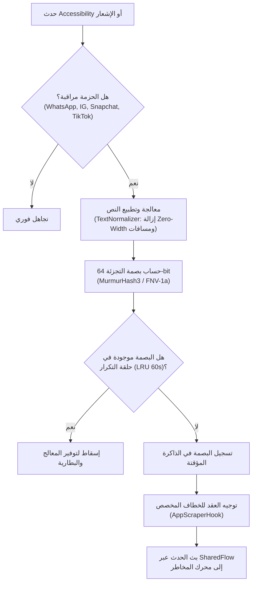
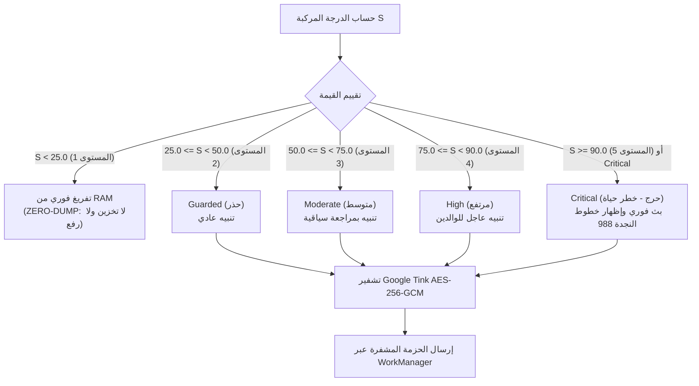
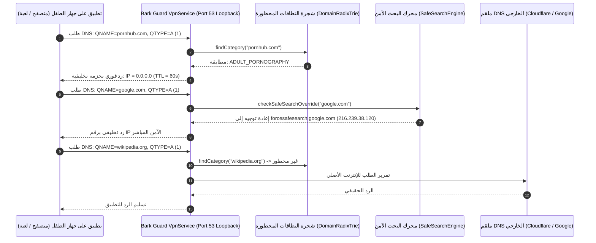
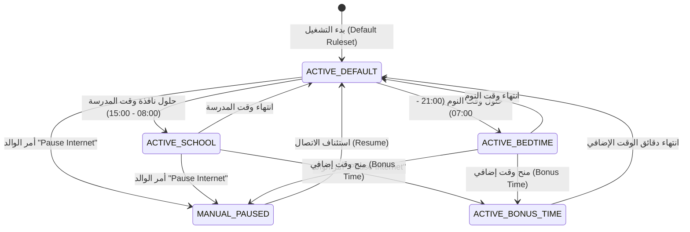
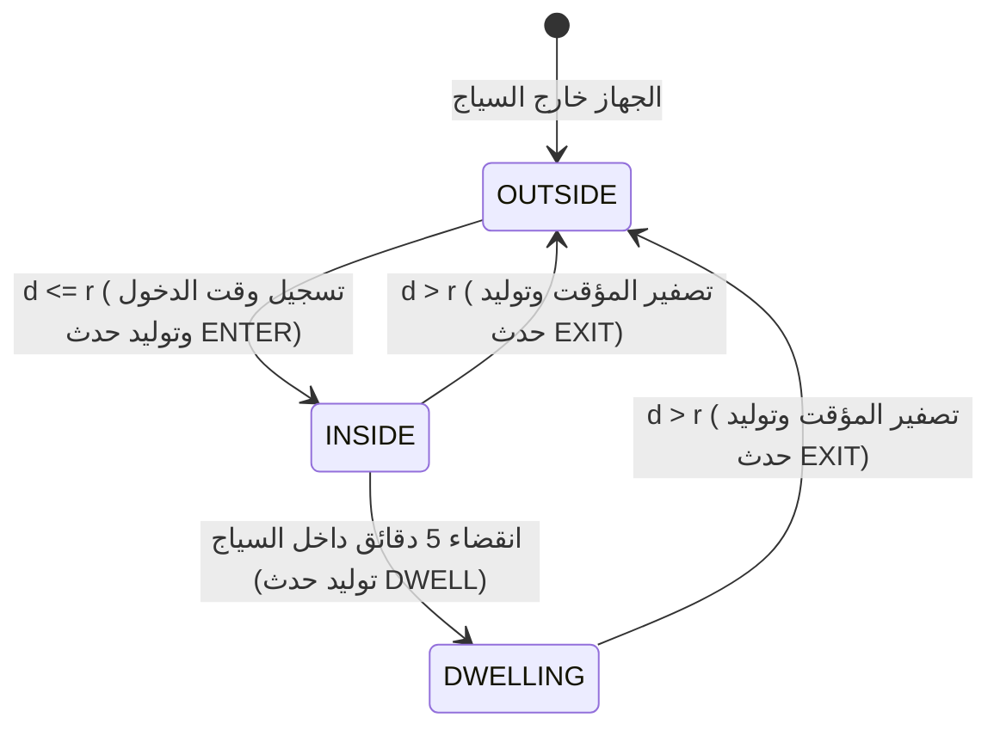

# التوثيق والتحليل الرياضي والمعماري لخوارزميات تطبيق Bark
# Comprehensive Algorithmic & Mathematical Breakdown: Bark Parental Controls
**إعداد:** مهندس الخوارزميات والأنظمة الرقابية (`worker_m4`)  
**المشروع:** Family OS Benchmark Extraction & Reverse-Engineering Phase  
**تاريخ التحليل:** أكتوبر 2026  
**المسار:** `benchmarks/extracted/bark/04_extracted_algorithms/`

---

## 1. المدخل التنفيذي وفلسفة التصميم المعماري (Executive Architectural Overview)

يمثل تطبيق **Bark Parental Controls** أحد أكثر التطبيقات تقدماً على مستوى العالم في مجال المراقبة الذكية المعززة بنموذج الخصوصية بالتصميم (**Privacy-by-Design / Zero-Dump Architecture**). على خلاف تطبيقات التجسس الكلاسيكية (مثل mSpy أو KidsGuard) التي تعتمد على تفريغ كامل للشاشة وتسجيل كافة ضغطات المفاتيح (Keystroke Logging) وإرسالها لخوادم سحابية مما ينتهك خصوصية الطفل والأسر، تعتمد هندسة Bark على مبدأ حاسم:

> **قاعدة التفريغ الصفري (The Zero-Dump Mandate):**  
> المحادثات اليومية الروتينية والدردشات البريئة لا تُخزن ولا تُرسل مطلقاً إلى خوادم Bark أو إلى لوحة تحكم الوالدين. يتم فحص النصوص محلياً على جهاز الطفل (**On-Device Tier-1 Heuristics**)، وإذا صُنفت المحادثة بأنها مستوى 1 (أحاديث طبيعية)، يتم مسحها فوراً من الذاكرة العشوائية (RAM) في أقل من 5 ميلي ثانية دون ترك أي أثر. فقط عند تجاوز عتبة الخطورة ($S \ge 2$) يتم استخلاص مقتطف سياقي مقيد (Minimal Bounded Snippet) وتشفيره بمفتاح AES-256-GCM قبل رفعه.

يتألف النظام من خمسة محركات خوارزمية جوهرية تم تفكيكها وإعادة بنائها بلغة Kotlin الموثقة داخل هذا المجلد:

```
benchmarks/extracted/bark/04_extracted_algorithms/
├── content_scanning_accessibility_engine.kt   # المحرك 1: التقاط النصوص وفلترة التكرار
├── risk_detection_and_alerting_pipeline.kt     # المحرك 2: تصنيف المخاطر والتشفير والتوجيه الأبوي
├── bark_guard_dns_vpn_engine.kt               # المحرك 3: اعتراض DNS والبحث الآمن
├── dynamic_screen_time_rules_engine.kt        # المحرك 4: آلة حالات وقت الشاشة والجداول
├── location_checkin_and_geofence_engine.kt    # المحرك 5: السياج الجغرافي وتأكيد الموقع
└── algorithmic_breakdown.md                   # هذه الوثيقة الرياضية والمعمارية الشاملة
```

---

## 2. المحرك الأول: التقاط وتحليل النصوص من الشاشة والإشعارات
### Engine 1: Content Scanning & Accessibility Traversal Engine (`content_scanning_accessibility_engine.kt`)

### 2.1 بنية الاعتراض الشجري (Accessibility Tree Traversal)
يعترض المحرك تدفق واجهة المستخدم عبر خدمة `AccessibilityService` للأحداث:
- `TYPE_WINDOW_CONTENT_CHANGED`
- `TYPE_WINDOW_STATE_CHANGED`
- `TYPE_VIEW_SCROLLED`

لمنع حدوث أخطاء طفحان المكدس (`StackOverflowError`) في واجهات التطبيقات المعقدة مثل Instagram أو TikTok التي قد تتجاوز 100 مستوى من الودجات المتداخلة، يعتمد المحرك على خوارزمية **البحث في العمق المكرر المحدود (Bounded Iterative DFS)**:
- الحد الأقصى للعمق المسموح: $D_{max} = 30$
- الحد الأقصى للعقد المفحوصة في الإطار الواحد: $N_{max} = 400$ عقدة



### 2.2 النموذج الرياضي لخوارزمية تجزئة النصوص (MurmurHash3 64-bit Math)
تستخدم خوارزمية MurmurHash3 لإنتاج بصمة فريدة بحجم 64-بت لكل فقاعة نصية مطبعة لمنع تكرار معالجتها أثناء التمرير:

$$k_1 \leftarrow k_1 \times c_1$$
$$k_1 \leftarrow (k_1 \ll 31) \lor (k_1 \gg 33)$$
$$k_1 \leftarrow k_1 \times c_2$$
$$h_1 \leftarrow h_1 \oplus k_1$$
$$h_1 \leftarrow (h_1 \ll 27) \lor (h_1 \gg 37)$$
$$h_1 \leftarrow h_1 \times 5 + 0x52DCE729$$

حيث الثوابت الرياضية المستخدمة في التنفيذ:
$$c_1 = 0x87C37B91114253D5L, \quad c_2 = 0x4CF5AD432745937FL$$

تتبع الخوارزمية بمرحلة الانهيار النهائي (Avalanche Finalization) لضمان توزيع عشوائي متساوٍ يمنع تصادم المفاتيح:
$$h \leftarrow h \oplus (h \gg 33)$$
$$h \leftarrow h \times 0xFF51AFD7ED558CCDL$$
$$h \leftarrow h \oplus (h \gg 33)$$
$$h \leftarrow h \times 0xC4CEB9FE1A85EC53L$$
$$h \leftarrow h \oplus (h \gg 33)$$

### 2.3 حلقة منع التكرار المنزلقة (60-Second Sliding LRU Ring Buffer)
يتم تخزين البصمات في جدول تجزئة مرتّب زمنياً (`LinkedHashMap` بسعة $C = 2048$ عنصر). عند وصول بصمة جديدة في اللحظة $t$:
$$\Delta t = t - t_{cached}$$
- إذا كان $\Delta t \le 60,000 \text{ ms}$، يُعتبر النص مكرراً ويسقط فوراً.
- يتم تنظيف العناصر التي تجاوزت مدتها نافذة الـ 60 ثانية بصورة دورية، مما يحافظ على استهلاك ذاكرة ثابت لا يتجاوز 64 كيلوبايت.

---

## 3. المحرك الثاني: كشف المخاطر، التشفير، والإرشاد الذكي
### Engine 2: Risk Detection & Alerting Pipeline (`risk_detection_and_alerting_pipeline.kt`)

### 3.1 فئات المخاطر الست وأوزانها الأساسية
تمت فهرسة ست فئات رئيسية ذات أوزان ترجيحية تتناسب مع درجة خطورتها على سلامة الطفل:

| الفئة | المعرف | الوزن الأساسي ($W_c$) | العتبة الحرجة |
|---|---|---|---|
| **Depression & Suicidal Ideation** | `DEPRESSION_SUICIDE` | $1.8$ | نعم (تفعيل فوري للمستوى 5) |
| **Online Grooming & Predators** | `ONLINE_PREDATORS` | $1.7$ | نعم (عزل فوري واستدعاء خط النجدة) |
| **Sexual Content & Sexting** | `SEXUAL_CONTENT` | $1.3$ | لا |
| **Substance Abuse & Vaping** | `SUBSTANCE_ABUSE` | $1.2$ | لا |
| **Hate Speech & Discrimination** | `HATE_SPEECH` | $1.1$ | لا |
| **Cyberbullying & Harassment** | `CYBERBULLYING` | $1.0$ | لا |

### 3.2 المعادلة المركبة لاحتساب درجة الخطورة (Composite Risk Scoring Function)
تُحتسب درجة الخطورة الإجمالية $S_{composite} \in [0.0, 100.0]$ وفق المعادلة الرياضية متعددة العوامل:

$$S_{composite} = \min\left(100.0, \left( \sum_{i=1}^{k} P_{base}(i) \right) \times W_{primary} \times M_{time} \times M_{dir} \times M_{rep} \right)$$

حيث:
- $P_{base}(i)$: النقاط الأساسية للقاعدة المطابقة $i$.
- $W_{primary}$: وزن الفئة الرئيسية صاحبة أعلى نقاط بين القواعد المطابقة.
- $M_{time}$: معامل وقت الليل؛ إذا كان التوقيت بين 11:00 مساءً و 05:00 فجراً (وقت الضعف والعزلة):
  $$M_{time} = \begin{cases} 1.20 & \text{إذا كان الوقت ليلاً} \\ 1.00 & \text{أثناء النهار} \end{cases}$$
- $M_{dir}$: معامل اتجاه الرسالة؛ إذا كانت رسالة واردة من شخص خارجي تتضمن محاولات استدراج (Predatory Grooming):
  $$M_{dir} = \begin{cases} 1.25 & \text{رسالة استدراج واردة (!isOutgoing)} \\ 1.00 & \text{خلاف ذلك} \end{cases}$$
- $M_{rep}$: معامل تكرار القواعد؛ إذا تطابقت أكثر من قاعدة في النص نفسه:
  $$M_{rep} = \begin{cases} 1.15 & \text{إذا كان } k > 1 \\ 1.00 & \text{إذا كان } k = 1 \end{cases}$$

### 3.3 تعيين مستويات الخطورة وقاعدة التفريغ الصفري



### 3.4 التشفير الموثق بالحزمة (Google Tink AES-256-GCM Envelope Encryption)
لحماية البيانات الحساسة أثناء نقلها وتخزينها، يتم تشفير كائن `RiskSignal` باستخدام معيار **AES-256-GCM** مع بيانات مصادقة إضافية (**Associated Authenticated Data - AAD**):
- المفتاح: 256 بت سري (`SecretKeySpec`)
- متجه التهيئة (IV / Nonce): 12 بايت مولدة عشوائياً بواسطة `SecureRandom`
- علامة التوثيق (Auth Tag): 128 بت لضمان عدم التلاعب
- بيانات الـ AAD المدمجة:
  $$\text{AAD} = \text{"bark\_guard\_v1:"} + \text{signalId} + \text{":"} + \text{timestampEpochMs}$$

يمنع هذا النمط هجمات إعادة الإرسال (Replay Attacks) أو تزوير هوية الجهاز الصادر منه التنبيه.

### 3.5 مولد الإرشاد الأبوي والذكاء الاصطناعي النفسي (Parent Coaching Engine)
عند إرسال التنبيه إلى تطبيق الوالدين، يرفق المحرك نصائح مدروسة نفسياً مستمدة من علم نفس المراهقين:
- **في حالات الاكتئاب والميول الانتحارية:** ربط مباشر بأرقام النجدة المعتمدة دولياً:
  * الخط الساخن 988 (Suicide & Crisis Lifeline)
  * خط الرسائل النصية للطوارئ (Crisis Text Line - إرسال HOME إلى 741741)
  * مشروع تريفور (The Trevor Project)
  * نصيحة للوالد: "لا تسحب الهاتف بغضب؛ تعامل مع الموقف كحالة صحية طارئة وليس كخطأ مسلكي."
- **في حالات الاستدراج الرقمي (Predators):** ربط بـ CyberTipline (NCMEC)، وتوجيه الوالد لعدم مواجهة الجاني مباشرة قبل توثيق الأدلة الرقمية للشرطة.

---

## 4. المحرك الثالث: شبكة Bark Guard وفلترة الـ DNS المحلية
### Engine 3: Bark Guard DNS VPN & SafeSearch Rewriting Engine (`bark_guard_dns_vpn_engine.kt`)

### 4.1 نمط الـ Local Loopback VPN
يعمل المحرك كخدمة `VpnService` محلية على جهاز الطفل (Loopback VPN) دون الحاجة لتمرير حركة المرور عبر خوادم خارجية مكلفة وتبطئ الاتصال. يعترض المحرك فقط حزم UDP المتجهة إلى المنفذ 53:



### 4.2 شجرة التصنيف العكسية (Reverse Domain Radix Trie)
لمطابقة مليارات النطاقات الفرعية بسرعة فائقة، يتم تمثيل النطاقات بترتيب عكسي:
$$\text{"v16-web.tiktok.com"} \longrightarrow [\text{"com"}, \text{"tiktok"}, \text{"v16-web"}]$$

- **التعقيد الزمني:** $O(k)$ حيث $k$ هو عدد أجزاء النطاق (نادراً ما يتجاوز 4 أجزاء)، بغض النظر عن حجم قاعدة البيانات (حتى لو احتوت على 500,000 نطاق).
- **التعقيد المكاني:** $O(M)$ حيث تشترك النطاقات الشائعة (مثل `.com`, `.net`, `.org`) في العقد الجذرية للشجرة.

### 4.3 جدول إعادة كتابة البحث الآمن (SafeSearch DNS Rewriting Table)
يقوم المحرك باعتراض استعلامات محركات البحث الكبرى وتوليد رد تخليقي يوجه المتصفحات إلى العناوين الآمنة الموثقة رسمياً:

| محرك البحث | النطاق المستهدف | الاسم المستعار القسري (CNAME) | عنوان الـ IP الإلزامي المرجع |
|---|---|---|---|
| **Google** | `google.com`, `*.google.com`, `google.co.*` | `forcesafesearch.google.com` | `216.239.38.120` |
| **Bing** | `bing.com`, `www.bing.com` | `strict.bing.com` | `204.79.197.220` |
| **YouTube** | `youtube.com`, `m.youtube.com`, `youtubei.googleapis.com` | `restrict.youtube.com` | `216.239.38.119` |
| **DuckDuckGo** | `duckduckgo.com`, `*.duckduckgo.com` | `safe.duckduckgo.com` | `52.142.124.215` |

---

## 5. المحرك الرابع: آلة حالات وقت الشاشة والقواعد الديناميكية
### Engine 4: Dynamic Screen Time Rules & Schedule State Machine Engine (`dynamic_screen_time_rules_engine.kt`)

### 5.1 بنية آلة الحالات (Finite State Machine Architecture)
يتحكم المحرك في الجداول الزمنية الأسبوعية للطفل عبر آلة حالات حتمية تعتمد على أولويات مطلقة:



### 5.2 سلم الأولويات الحاسم (Priority Resolution Hierarchy)
عند تقييم حالة النظام في أي لحظة $t$، يتم تطبيق التسلسل التالي دون أي تعارض:
1. **الأولوية 1: أمر الإيقاف اليدوي (`ManualOverride.PauseInternet`)**
   - يوقف جميع اتصالات الإنترنت ويحظر كافة التطبيقات الترفيهية فوراً، مع الإبقاء فقط على المكالمات الهاتفية النظامية للطوارئ.
2. **الأولوية 2: مكافأة الوقت الإضافي (`ManualOverride.BonusTime`)**
   - يتجاوز وقت المدرسة أو وقت النوم مؤقتاً لعدد محدد من الدقائق بناءً على إذن صريح من الوالد.
3. **الأولوية 3: جدول وقت النوم (`Bedtime Schedule`)**
   - يطبق حظراً شاملاً على شبكة الإنترنت من المساء حتى الصباح الباكر (مثلاً 09:00 م حتى 07:00 ص).
4. **الأولوية 4: جدول وقت المدرسة (`School Schedule`)**
   - يحظر الألعاب، البث المرئي، ومنصات التواصل الاجتماعي، مع السماح بنطاقات المنصات التعليمية المعتمدة (Google Classroom, Canvas, Khan Academy).
5. **الأولوية 5: القواعد الافتراضية العامة (`Default Fallback`)**
   - تطبيق قواعد التصفح الآمن وحظر المحتوى الإباحي والمقامرة والأسلحة.

### 5.3 معالجة الفترات المتجاوزة لمنتصف الليل (Midnight-Crossover Intervals)
تتجاوز فترات النوم عادةً حاجز منتصف الليل (مثلاً: البداية 21:00 والنهاية 07:00 في اليوم التالي). يتم التحقق برمجياً عبر المعادلة المنطقية:
$$\text{contains}(t) = \begin{cases} 
t \ge t_{start} \land t < t_{end} & \text{إذا كان } t_{start} \le t_{end} \text{ (نفس اليوم)} \\
t \ge t_{start} \lor t < t_{end} & \text{إذا كان } t_{start} > t_{end} \text{ (عبر منتصف الليل)}
\end{cases}$$

### 5.4 التحديث اللحظي للسياسات بدون إعادة اتصال الـ VPN (Zero-Reconnect Policy Hot-Reload)
عند انتقال آلة الحالات من وضع لآخر (مثلاً من Free Time إلى School Mode)، يتم استدعاء دالة:
```kotlin
vpnEngine.updatePolicy(newDnsPolicy)
```
حيث تستبدل مرجع السياسة ذرياً (`AtomicReference.set()`). تستمر حلقة قراءة المقابس في معالجة الحزم دون أي انقطاع في نفق الـ VPN، مما يمنع تنبيه الطفل أو ظهور رسائل فصل الاتصال المزعجة في شريط النظام.

---

## 6. المحرك الخامس: السياج الجغرافي وتأكيد الموقع
### Engine 5: Location Check-In & Geofence Boundary Transition Engine (`location_checkin_and_geofence_engine.kt`)

### 6.1 المعادلة الجيوديسية لحساب المسافات (Haversine Formula)
لحساب المسافة الدقيقة على سطح الأرض بين إحداثيات الطفل $(lat_1, lon_1)$ ومركز المنطقة الآمنة $(lat_2, lon_2)$، يُطبق نموذج Haversine مع نصف قطر الأرض القياسي لـ WGS-84 ($R = 6,371,000 \text{ m}$):

$$\Delta \phi = \text{radians}(lat_2 - lat_1), \quad \Delta \lambda = \text{radians}(lon_2 - lon_1)$$
$$a = \sin^2\left(\frac{\Delta \phi}{2}\right) + \cos(\text{radians}(lat_1)) \cdot \cos(\text{radians}(lat_2)) \cdot \sin^2\left(\frac{\Delta \lambda}{2}\right)$$
$$c = 2 \cdot \text{atan2}\left(\sqrt{a}, \sqrt{1 - a}\right)$$
$$d = R \cdot c$$

إذا كان $d \le r_{zone}$، يُعتبر الطفل داخل النطاق الجغرافي.

### 6.2 آلة تتبع الانتقال عبر الحدود وحساب فترة المكوث (Dwell Timing)
يدعم المحرك ثلاث حالات انتقال:
1. **`ENTER` (دخول):** عندما يتغير الموقع من خارج النطاق إلى داخله ($d \le r$).
2. **`EXIT` (خروج):** عندما يتغير الموقع من الداخل إلى الخارج ($d > r$).
3. **`DWELL` (مكوث / استقرار):** إذا بقي الطفل داخل النطاق لمدة تتجاوز فترة التأخير المحددة ($T_{loiter} \ge 300,000 \text{ ms}$ / 5 دقائق)، مما يمنع إرسال تنبيهات كاذبة عند مجرد المرور بجوار المدرسة بالسيارة دون البقاء فيها.



### 6.3 فحص وتأكيد الموقع عالي الدقة (Single-Shot Check-In Pipeline)
عند طلب الوالد موقع الطفل فورياً، يقوم المحرك بـ:
1. استدعاء `FusedLocationProviderClient.getCurrentLocation(PRIORITY_HIGH_ACCURACY)`.
2. استخراج بيانات القياس عن بعد للجهاز (Device Battery Telemetry):
   - نسبة شحن البطارية (0 - 100%)
   - حالة الشحن الحالية (متصل بالشاحن أم لا)
   - وضع توفير الطاقة (Power Save Mode)
   - نوع شبكة الاتصال الفعالة (`WIFI`, `CELLULAR_5G`, `CELLULAR_4G`)
3. توليد بصمة توقيع مشفرة (SHA-256 HMAC Signature) للتحقق من سلامة الحزمة قبل إرسالها لخادم Bark.

---

## 7. مصفوفة التعقيد الحسابي والمكاني للمحركات الخمسة

| المحرك | الخوارزمية الجوهرية | التعقيد الزمني (Time Complexity) | التعقيد المكاني (Space Complexity) | استهلاك الموارد |
|---|---|---|---|---|
| **Engine 1** | Bounded DFS + MurmurHash3 64-bit | $O(N)$ حيث $N \le 400$ عقدة | $O(C)$ حيث $C = 2048$ بصمة في الـ LRU | ضئيل جداً (< 1.5% CPU) |
| **Engine 2** | Regex Heuristics + AES-256-GCM | $O(L \cdot R)$ حيث $L$ طول النص و $R$ عدد القواعد | $O(1)$ مؤقت، تفريغ فوري للمستوى 1 | منعدم للأحاديث العادية |
| **Engine 3** | Reverse Domain Radix Trie + Packet Synth | $O(k)$ حيث $k$ عمق النطاق (3 إلى 4) | $O(M)$ في الذاكرة لقاعدة بيانات النطاقات | زمن استجابة < 0.5 ms للطلب |
| **Engine 4** | Finite State Machine + Priority Evaluator | $O(1)$ حساب وقت وتقاطع فترات | $O(1)$ تمثيل جدول الأسبوع الثابت | فحص دوري كل 15 ثانية |
| **Engine 5** | Haversine Formula + Dwell Timer | $O(Z)$ حيث $Z$ عدد المناطق المسجلة ($Z \le 20$) | $O(Z)$ لحفظ حالات الدخول والخروج | يعمل فقط عند تغير الإحداثيات |

---

## 8. دليل التكامل الهندسي مع منصة Family OS

لتطبيق أفضل الممارسات المستفادة من تطبيق Bark داخل منصة **Family OS** (مع الحفاظ على عزل مجلد `spec/` التام وعدم كتابة كود المنصة الآن):

1. **الاعتماد الصارم لمبدأ "التفريغ الصفري" (Zero-Dump Standard):**
   - يجب أن تتجنب منصة Family OS أي تسجيل دائم للمحادثات الشخصية. يتم فحص الرسائل محلياً عبر محركات C++ / Rust المجمعة في تطبيق العميل، وفقط التنبيهات المؤكدة مع مقتطفات مقيدة ترسل للخادم المشفر.
2. **فصل استهلاك البطارية عبر Local Loopback DNS:**
   - تطبيق نمط Loopback VPN يمنح المنصة قدرة هائلة على حظر الإعلانات، المحتوى غير اللائق، وفرض البحث الآمن بدون الحاجة لاستهلاك باندويث السيرفرات السحابية.
3. **تطبيق شجرة النطاقات العكسية (Radix Trie):**
   - نقل خوارزمية `DomainRadixTrie` إلى نواة C++ FFI في فلاتر لتمكين مطابقة النطاقات خلال ميكروثوانٍ معدودة.
4. **التوجيه الإرشادي للوالدين (Parent Coaching Cards):**
   - عدم الاكتفاء بإرسال تنبيه "تم رصد محتوى خطير"، بل إرفاق بطاقة تفاعلية تحتوي على أسلوب النقاش المقترح، الأسئلة الموصى بها، والخطوات التربوية الحكيمة.
