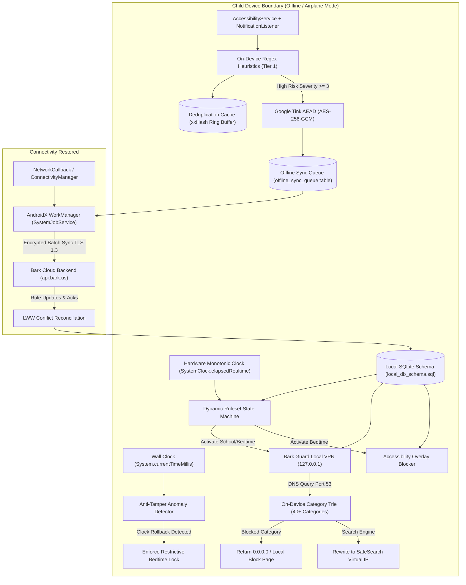

# Bark Offline Enforcement Rules & Architecture Breakdown
**Target App:** Bark Parental Controls (`cm.pt.barkparent` v6.5.1 Build 600500103 & Bark Kids Sentinel)  
**Artifact:** Data Models, Database & Schemas Extraction (`05_data_models_and_schemas/`)  
**Scope:** Deep architectural specification of zero-connectivity enforcement, local policy persistence, offline DNS loopback filtering, monotonic clock anti-tampering, on-device risk buffering, and reconnection reconciliation.

---

## 1. Executive Summary & Zero-Trust Threat Model

In adolescent parental monitoring and digital wellbeing systems, the child device is treated as an **untrusted, hostile runtime environment**. Children actively seek loopholes to circumvent supervision. The primary evasion vectors include:
1. **Severing Internet Connectivity:** Engaging **Airplane Mode**, disabling Wi-Fi, or pulling the physical SIM card to prevent cloud policy enforcement.
2. **DNS & Network Evasion:** Attempting to configure private DNS providers (DoH / DoT), third-party VPNs, or proxy apps.
3. **Wall-Clock Tampering:** Modifying the Android system date and time backwards to reset daily screen time quotas or escape scheduled "Bedtime" or "School Hours" rulesets.
4. **Task Killing & Safe Mode:** Attempting to force-stop background services or rebooting into Android Safe Mode.

Bark counters these attack vectors using a **Zero-Trust, Offline-First Enforcement Engine**:
- **Autonomous Local Enforcement:** Screen time schedules, category-based web filtering, and social media text scraping execute entirely on-device without requiring real-time server connectivity.
- **Fail-Secure Architecture:** If the child device loses connectivity or is disconnected from `api.bark.us`, it automatically retains the last synchronized ruleset and defaults to the most restrictive applicable policy (e.g., Bedtime or School Hours during designated windows).
- **Local Loopback DNS VPN (`127.0.0.1`):** Web and app traffic filtering occurs through a local loopback `VpnService` that sinkholes blocked domain queries on-device without routing packets to an external VPN server.
- **Durable Write-Ahead Buffering:** Captured social media text, positive risk signals, and location check-ins are encrypted locally with Google Tink (`AES-256-GCM`) and queued in SQLite tables (`offline_sync_queue`, `risk_signals`) for guaranteed delivery upon reconnection.



---

## 2. Local State Snapshotting & Storage Hierarchy

To guarantee continuous protection across reboots, app restarts, and offline periods, Bark maintains a three-tiered local storage architecture:

### 2.1 Storage Tier Breakdown

| Storage Tier | Implementation | Primary Contents & Function | Security & Invalidation |
|---|---|---|---|
| **Tier 1: React Native AsyncStorage SQLite** | `entries` table (`StorageDatabase_Impl` in `classes4.dex`) | Serialized Redux state tree (`bark/@state`) containing child profiles, account metadata, active ruleset IDs, and UI preferences. | Persists indefinitely across app cold starts; validated on boot by schema hash. |
| **Tier 2: AndroidX Room & Native SQLite** | `local_db_schema.sql` (21 tables across 6 domains) | High-throughput relational storage: `monitored_messages`, `deduplication_cache`, `risk_signals`, `screen_time_rulesets`, `schedule_blocks`, `category_block_rules`, and `offline_sync_queue`. | ACID transactional guarantees with WAL (Write-Ahead Logging); protected by Android per-app sandbox UID isolation. |
| **Tier 3: Encrypted SharedPreferences & KeyStore** | Android KeyStore + Google Tink (`MasterKeys.AES256_GCM_SPEC`) | Cryptographic KeySets, device authentication tokens (`sessionToken`), and last-known NTP time anchor. | Hardware-backed keystore (TEE / StrongBox) preventing extraction even on rooted devices. |

### 2.2 Cached Policy Snapshot Components
The locally cached policy snapshot enables complete autonomous policy evaluation:
1. **Active Screen Time Ruleset (`screen_time_rulesets`):**
   - Flags: `allow_internet`, `enforce_safesearch`, `block_all_apps`.
   - Ruleset type: `default`, `school`, `bedtime`, `bonus`, `paused`.
2. **Recurring Schedule Grid (`schedule_blocks`):**
   - 7-day weekly matrix (0 = Sunday to 6 = Saturday).
   - Start minute (`start_time_minutes`) and End minute (`end_time_minutes`) within [0 - 1439].
   - Recurrence rules: RFC 5545 `RRULE` strings.
3. **DNS Category Blocking Table (`category_block_rules`):**
   - 40+ category codes (e.g., `adult`, `social_media`, `gaming`, `streaming`, `gambling`, `weapons`, `dating`).
   - Associated action: `allow`, `block`, `warn`.
   - Sinkhole IP target (default: `0.0.0.0`).
4. **Explicit Custom Exceptions (`custom_exceptions`):**
   - Domain wildcards (`*.khanacademy.org`, `*.wikipedia.org`).
   - Android package names (`com.duolingo`, `com.google.android.apps.classroom`).
   - Override actions: `always_allow`, `always_block`.

---

## 3. Bark Guard Local DNS VPN Loopback Engine Offline

The Bark Guard subsystem runs a local loopback `android.net.VpnService` on the child device. Unlike traditional corporate VPNs, **Bark does not route all traffic to a remote cloud VPN server**. Instead, it intercepts DNS queries locally on `127.0.0.1`:

```
+-----------------------------------------------------------------------------------------+
|                                    Android Child Device                                 |
|                                                                                         |
|  [ Chrome / App ]                                                                       |
|         │                                                                               |
|         │ (DNS Query: "badsite.com:53" or "google.com:53")                              |
|         ▼                                                                               |
|  [ Android Network Stack ]                                                              |
|         │                                                                               |
|         │ (VpnService TUN Interface: 10.0.0.2 / fd)                                     |
|         ▼                                                                               |
|  [ Bark Guard Local Loopback Server (127.0.0.1:53) ]                                    |
|         │                                                                               |
|         ├── Step 1: Parse UDP/TCP DNS Header & QNAME                                    |
|         ├── Step 2: Check Local Memory Trie & Bloom Filter                              |
|         │                                                                               |
|         ├── IF in Blocked Category (e.g., Pornography, Gambling):                       |
|         │   └── Forge DNS Response: Answer = 0.0.0.0 (Sinkhole)                         |
|         │                                                                               |
|         ├── IF in Custom Exceptions (always_allow):                                     |
|         │   └── Pass through to underlying network DNS resolver                         |
|         │                                                                               |
|         └── IF Search Engine & enforce_safesearch == 1:                                 |
|             └── Rewrite Answer to SafeSearch Canonical CNAME / IP                       |
|                 (e.g., forcesafesearch.google.com -> 216.239.38.120)                    |
+-----------------------------------------------------------------------------------------+
```

### 3.1 On-Device Trie & Bloom Filter Structure
- The domain category database is compiled into an optimized radix trie structure stored in memory and indexed SQLite tables.
- Query matching complexity is $O(k)$ where $k$ is domain label depth (e.g., `sub.domain.com`), independent of database size.
- If Airplane Mode is on, loopback DNS queries continue to be handled by the local TUN interface. If a child attempts to browse a blocked local/cached site or connects to a local offline Wi-Fi router, the VPN instantly replies with `0.0.0.0`.

### 3.2 Forced SafeSearch DNS Rewriting Tables
When `enforce_safesearch = 1`, the offline DNS engine intercepts queries for major search and video engines and rewrites the resolved `A` and `AAAA` records to strict virtual IPs:

| Search Service | Original Domain Pattern | Rewritten SafeSearch Target | Virtual IP Answer (IPv4) |
|---|---|---|---|
| **Google Search** | `*google.*` (all ccTLDs) | `forcesafesearch.google.com` | `216.239.38.120` |
| **Bing Search** | `*bing.com` | `strict.bing.com` | `204.79.197.220` |
| **YouTube** | `*youtube.com`, `*googlevideo.com` | `restrict.youtube.com` | `216.239.38.119` |
| **DuckDuckGo** | `*duckduckgo.com` | `safe.duckduckgo.com` | `52.142.124.215` |

---

## 4. Dynamic Screen Time State Machine Offline

The dynamic screen time rules engine switches between three daily rulesets:
1. **Default Ruleset:** Recreational access; social media, games, and entertainment allowed within parental guidelines.
2. **School Ruleset:** Distraction-free academic mode; social media, streaming, and games blocked; educational domains and apps allowed.
3. **Bedtime Ruleset:** Sleep and night hygiene; complete internet block (`allow_internet = 0`) and third-party app lockdown (`block_all_apps = 1`).

### 4.1 Anti-Tampering: Hardware Monotonic Clock vs. Wall Clock
A primary vulnerability in parental control apps is children manually setting the phone's clock backwards (e.g., from 10:30 PM bedtime back to 4:00 PM). Bark neutralizes this using dual-clock verification:

$$\Delta t_{wall} = t_{wall}(now) - t_{wall}(last\_check)$$
$$\Delta t_{monotonic} = t_{monotonic}(now) - t_{monotonic}(last\_check)$$

1. **Hardware Clock Verification:**
   - The engine reads `SystemClock.elapsedRealtime()` (monotonic hardware timer that cannot be modified by user settings, continuing during device sleep) and `SystemClock.elapsedRealtimeNanos()`.
2. **Clock Rollback Detection:**
   - If $\Delta t_{wall} < 0$ or $\Delta t_{wall} \ll \Delta t_{monotonic} - \text{threshold}$ (where threshold = 120 seconds):
     * A **Clock Tamper Anomaly** is flagged.
     * The engine records an `anti_tamper_alert` event in `telemetry_logs`.
     * **Fail-Secure Penalty:** The engine automatically locks down into **Bedtime Ruleset** (most restrictive mode) until an authenticated network time handshake occurs.
3. **Reboot Time Anchorage:**
   - Upon system boot (`BOOT_COMPLETED`), the engine computes:
     $$\text{BootEpoch} = \text{System.currentTimeMillis()} - \text{SystemClock.elapsedRealtime()}$$
   - Compares `BootEpoch` against the last persisted boot epoch in `EncryptedSharedPreferences`. If the device date was rolled back prior to boot, the tamper lock engages immediately.

### 4.2 Offline App Blocker Execution
When `block_all_apps = 1` or an individual application is restricted during School/Bedtime:
1. `AccessibilityService` intercepts `TYPE_WINDOW_STATE_CHANGED` events.
2. The active foreground package name is compared against `custom_exceptions` and the system emergency whitelist (`com.android.dialer`, `com.google.android.dialer`, emergency SOS activities).
3. If the app is prohibited, the engine launches an immediate fullscreen system overlay (`TYPE_APPLICATION_OVERLAY`) displaying the Bark "Time's Up" / "School Hours" block screen and sends an intent to return the user to the home launcher (`Intent.CATEGORY_HOME`).

---

## 5. On-Device Content Scanning & Offline Buffering

Bark's privacy-first core philosophy dictates that monitored messages are analyzed **on the child device first**. The parent never receives raw chat logs—only evaluated risk alerts.

```
+-----------------------------------------------------------------------------------------+
|                              On-Device Scanning Pipeline                                |
|                                                                                         |
|  [ Chat Apps: WhatsApp, Snapchat, Instagram, TikTok, SMS ]                              |
|         │                                                                               |
|         │ (AccessibilityNodeInfo Tree / StatusBarNotification Extras)                   |
|         ▼                                                                               |
|  [ Text Normalization & Sanitization ]                                                  |
|         │ (Lowercase, trim whitespace, strip zero-width characters)                     |
|         ▼                                                                               |
|  [ Fast Rolling Deduplication Buffer (64-bit xxHash / SHA-256) ]                        |
|         ├── Match Found in deduplication_cache (within 60s)? ──► Discard (Zero Battery) |
|         └── New Text Event                                                              |
|                  │                                                                      |
|                  ▼                                                                      |
|  [ Tier 1 Heuristic Regex & Keyword Classifier ]                                        |
|         ├── Categories: Cyberbullying, Suicide/Depression, Sexting,                     |
|         │               Predators, Drugs, Hate Speech, Weapons                          |
|         │                                                                               |
|         ├── Severity < 2 (Benign chatter) ────────► Purge from RAM immediately          |
|         └── Severity >= 2 (Positive Risk Detected)                                      |
|                  │                                                                      |
|                  ▼                                                                      |
|  [ Envelope Encryption: Google Tink AEAD (AES-256-GCM) ]                                |
|         │ (Encrypt context snippet + matched keywords + metadata)                       |
|         ▼                                                                               |
|  [ Durable SQLite Transaction ]                                                         |
|         ├── INSERT INTO risk_signals                                                    |
|         └── INSERT INTO offline_sync_queue (priority = 1 for severity >= 4)             |
+-----------------------------------------------------------------------------------------+
```

### 5.1 Deduplication LRU Ring-Buffer Mechanics
- Social media feeds trigger high-frequency `AccessibilityNodeInfo` update bursts as the user scrolls.
- Bark calculates a 64-bit hash:
  $$\text{Hash} = \text{xxHash64}(\text{normalized\_text} + \text{channel\_id} + \text{bucket\_window})$$
  where $\text{bucket\_window} = \lfloor \text{epoch\_seconds} / 60 \rfloor$.
- If the hash exists in `deduplication_cache`, the event is dropped in under $0.1\text{ ms}$, saving CPU cycles and battery.
- Cache size is strictly bounded at 10,000 entries; trigger `trg_prune_deduplication_cache` evicts the oldest entries automatically.

### 5.2 Google Tink Envelope Encryption
Before high-risk snippets are committed to SQLite disk storage:
```kotlin
// Extracted pattern from classes3.dex com.google.crypto.tink.Aead
val aead = KeysetHandle.read(keysetReader, masterKeyAead).getPrimitive(Aead::class.java)
val ciphertext = aead.encrypt(
    plaintextContextSnippet.toByteArray(Charsets.UTF_8),
    associatedDataChildId.toByteArray(Charsets.UTF_8)
)
```
Even if a technically sophisticated user gains root access and inspects `local_db_schema.sql`, all captured danger snippets in `risk_signals` and `offline_sync_queue` remain cryptographically unreadable without the TEE-backed private key.

---

## 6. Reconnection & Synchronization Protocol

When the child device regains cellular or Wi-Fi connectivity, the offline queue must drain smoothly without packet loss or server thundering herds:

### 6.1 Connectivity State Machine
1. **Network Detection:** An `android.net.ConnectivityManager.NetworkCallback` listens for `onAvailable()` and `onCapabilitiesChanged()`.
2. **Internet Capability Verification:** The engine verifies `NetworkCapabilities.NET_CAPABILITY_VALIDATED` (confirming real WAN internet, not a captive portal).
3. **WorkManager Dispatch:** Triggers an expedited background job via `androidx.work.impl.WorkDatabase` (`SystemJobService`).

### 6.2 Draining the `offline_sync_queue`
- **Priority-Ordered Drain:** Items drain by priority tier ($1 \to 5$):
  * **Priority 1 (Emergency):** High-severity risk signals (Suicidal ideation, physical threats, predatory contact) and manual SOS check-ins.
  * **Priority 2:** Standard risk signals (Cyberbullying, profanity, drug slang).
  * **Priority 3:** Geofence entry/exit events and routine check-ins.
  * **Priority 4:** Ruleset acknowledgments and daily screen time metrics.
  * **Priority 5:** Background diagnostic telemetry logs.
- **Batching & Compression:** Up to 50 queue mutations are bundled into a single GZIP/Protobuf payload to minimize radio power consumption.
- **Exponential Backoff:** If the server returns HTTP 5xx or connection times out, the item's `attempt_count` increments with exponential jittered backoff:
  $$T_{retry} = \min(300, 2^{\text{attempt}} \times 5) \pm \text{jitter}$$
- **Quarantine:** After 10 consecutive failures (`max_retries = 10`), the item moves to `failed` status for parent dashboard diagnostics.

### 6.3 Conflict Resolution (Last-Write-Wins & Vector Timestamps)
If the parent modified screen time rules while the child was offline:
- Each ruleset update carries an ISO-8601 UTC timestamp and monotonic version counter.
- **Parent Authority Principle:** Cloud parent updates always supersede child device local state.
- Upon reconnect, the child device downloads the latest policy snapshot from `/api/screen-time/rulesets` and updates `local_db_schema.sql` within a single SQLite transaction, instantly updating the local DNS VPN loopback filters.

---

## 7. Architectural Synthesis & Recommendations for Family OS

| Architectural Dimension | Bark Benchmark Implementation | Family OS Production Architecture |
|---|---|---|
| **Local Offline VPN** | Android `VpnService` running local DNS loopback on `127.0.0.1` | Native Rust / Dart FFI local loopback DNS VPN engine (`family_os_guard.so`) with Zero-Copy packet processing. |
| **Clock Anti-Tampering** | `SystemClock.elapsedRealtime()` vs `currentTimeMillis()` delta tracking | Dual-clock validation with periodic encrypted server NTP heartbeat anchor and automated Bedtime lock penalty. |
| **Persistence Schema** | 21 SQLite / Room tables + AsyncStorage `entries` table | Unified SQLite database managed via Drift / Floor with automated migrations, encryption via SQLCipher, and WAL mode. |
| **Data Contracts** | TypeScript DTOs + React Native Hermes bytecodes | Production NestJS TypeScript DTOs (`family_os_bark_dtos.ts`) and immutable Flutter Dart client models (`family_os_bark_models.dart`). |
| **Privacy Safeguards** | On-device Regex pre-filtering with Google Tink AEAD | On-device ML classification with zero routine chat logging; only encrypted confirmed risk alerts dispatched to parents. |
