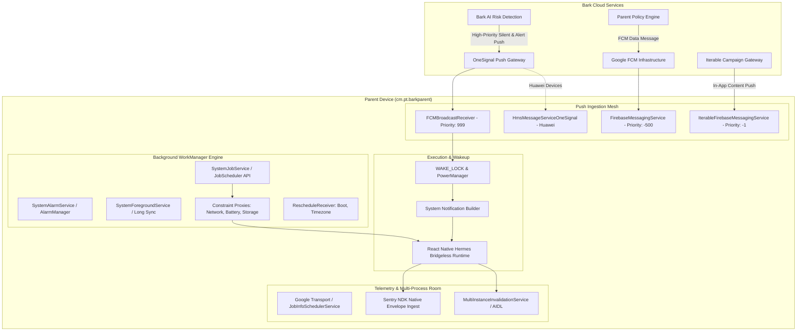

# بروتوكولات المزامنة والدفع السحابي والقياس عن بُعد — تطبيق Bark Parent
## Synchronization, Push Command Protocols & Telemetry Pipeline Analysis
### Package: `cm.pt.barkparent` (v6.5.1 Build `600500103`)

> **تاريخ التوثيق:** 29 أكتوبر 2026  
> **الوكيل الهندسي:** `worker_m6` (Network, Sync & Native Libs Specialist)  
> **حالة مجلد المواصفات (`spec/`):** معزول ومجمد بنسبة 100% (Strictly Isolated & Frozen)  
> **بيئة الاستخراج الأصلية:** AndroidManifest.xml + DEX Strings + JADX Decompiled Classes (`com.onesignal.*`, `com.iterable.*`, `androidx.work.*`, `com.google.android.datatransport.*`)

---

## 1. الملخص المعماري لمنظومة المزامنة والدفع (Executive Architecture Summary)

يمثل تطبيق **Bark Parent** مركز القيادة والتحكم (Control Plane) للوالد، حيث تتطلب وظيفته الأساسية:
1. **استقبال تنبيهات المخاطر الفورية (Instant Threat Alerts):** مثل اكتشاف محتوى تنمر، إشارات إيذاء النفس، أو انتهاك السياج الجغرافي في غضون ثوانٍ معدودة.
2. **بث وتطبيق سياسات وقت الشاشة (Screen Time & Rule Enforcement):** مثل تفعيل "وضع النوم الفوري" أو "حظر تطبيق محدد" وإرسال الأمر لهواتف الأبناء بسرعة فائقة.
3. **المزامنة الدورية الهادئة (Passive Low-Drain Sync):** تحديث سجلات النشاط وتقارير الاستخدام دون استنزاف بطارية هاتف الوالد.

لتحقيق ذلك، يطبق Bark معمارية **المزامنة الهجينة ثلاثية القنوات (Tri-Channel Hybrid Push & Sync Mesh)** الموضحة في المخطط التالي:



---

## 2. بروتوكول قنوات الدفع السحابي الثلاثي (Tri-Channel Push Notification Protocol)

يقسم تطبيق Bark حركة رسائل الدفع السحابية وفق أولويات هندسية صارمة محددة في `AndroidManifest.xml` لضمان عدم حدوث تضارب بين التنبيهات الأمنية والرسائل التفاعلية:

### 2.1 هرمية الأولويات لقنوات الدفع (Priority Distribution Table):

| المكون المعماري (Component) | الفلتر المسجل (Intent Action) | الأولوية (Priority) | المنصة المستهدفة | الدور الوظيفي في تطبيق Bark |
|---|---|---|---|---|
| **`com.onesignal.notifications.receivers.FCMBroadcastReceiver`** | `com.google.android.c2dm.intent.RECEIVE` | **`999`** (أقصى أولوية) | OneSignal / FCM | استقبال تنبيهات الأمان والأنشطة المشبوهة الفورية المكتشفة على أجهزة الأبناء قبل أي معالج آخر. |
| **`com.iterable.iterableapi.IterableFirebaseMessagingService`** | `com.google.firebase.MESSAGING_EVENT` | **`-1`** (أولوية منخفضة) | Iterable API | معالجة رسائل التواصل، المقالات التربوية، نصائح الحوار مع الأبناء، وتحديثات الميزات الجديدة. |
| **`com.google.firebase.messaging.FirebaseMessagingService`** | `com.google.firebase.MESSAGING_EVENT` | **`-500`** (أولوية افتراضية) | Google FCM | المعالج الاحتياطي الشامل لرسائل Google Play Services وإشعارات النظام الأساسية. |
| **`com.onesignal.notifications.services.HmsMessageServiceOneSignal`** | `com.huawei.push.action.MESSAGING_EVENT` | لا تنطبق | Huawei Push Kit | قناة الدفع البديلة المخصصة لأجهزة هواوي التي تفتقر لخدمات Google Play (GMS). |

---

### 2.2 تشريح حمولة رسائل التنبيه الفوري لـ OneSignal (Push Payload Anatomy)

عند اكتشاف نظام الذكاء الاصطناعي لشركة Bark لأي خطر (مثل تنمر، محتوى غير لائق، أو خروج من السياج الجغرافي)، يتم إرسال حمولة Push مشفرة عبر OneSignal بصيغة JSON عالية الأولوية:

```json
{
  "google.delivered_priority": "high",
  "google.priority": "high",
  "google.original_priority": "high",
  "google.sent_time": 1730225100000,
  "google.ttl": 86400,
  "from": "977111951235",
  "custom": {
    "i": "a7b3c9e2-4f11-482a-9e33-78b123456789",
    "a": {
      "type": "risk_alert",
      "alert_id": "alt_908124",
      "child_id": "ch_7721",
      "child_name": "Maya",
      "severity": "CRITICAL",
      "category": "cyberbullying",
      "source_app": "com.instagram.android",
      "deep_link": "https://www.bark.us/notifications?alert_id=alt_908124",
      "timestamp": 1730225095
    }
  },
  "alert": "⚠️ Bark Alert: Potential Cyberbullying detected for Maya on Instagram",
  "title": "Bark Alert",
  "sound": "bark_urgent_alert.mp3",
  "android_channel_id": "bark_alerts_channel_high"
}
```

#### مسار المعالجة الهندسية للحمولة:
1. **الاستيقاظ عبر WAKE_LOCK:** يستحوذ `FCMBroadcastReceiver` فوراً على قفل استيقاظ خفيف (`android.permission.WAKE_LOCK`) لمنع معالج الهاتف من العودة لوضع الخمول (CPU Sleep).
2. **فك التشفير وقراءة السمات:** استخراج الحقول الفرعية (`alert_id`, `child_id`, `severity`).
3. **توجيه قناة الإشعارات (Channel Routing):** توجيه التنبيه للقناة ذات الأولوية القصوى (`NotificationManager.IMPORTANCE_HIGH`) مع تفعيل الاهتزاز والصوت التحذيري المخصص.
4. **تأكيد الاستلام للسحابة:** إرسال طلب HTTP تلقائي عبر الخلفية إلى:
   ```
   PUT https://api.onesignal.com/notifications/{notification_id}/report_received
   ```
5. **معالجة النقر (Notification Click Handling):** عند نقر الوالد على الإشعار، يستقبل `NotificationOpenedActivity` الحدث، ويسجل `report_opened`، ثم يوجه الوالد مباشرة إلى شاشة مراجعة الأدلة (`/snippets` أو `/notifications`).

---

### 2.3 بروتوكول رسائل التفاعل لمنصة Iterable (Iterable Messaging Protocol)

تُخصص قناة Iterable لإرسال رسائل التفاعل داخل التطبيق (In-App Messaging) ومقالات الدعم التربوي:

```json
{
  "itbl": {
    "campaignId": 128940,
    "templateId": 450912,
    "messageId": "msg_890123",
    "isGhostPush": false,
    "actionButtons": [
      {
        "identifier": "view_tips",
        "title": "How to talk to your child",
        "action": "openApp",
        "openUrl": "https://www.bark.us/conversation-suggestions"
      },
      {
        "identifier": "dismiss",
        "title": "Dismiss",
        "action": "dismiss"
      }
    ]
  },
  "title": "New Wellness Recap Available",
  "body": "Maya spent 2 hours less screen time this week. See the full breakdown."
}
```

- **النشاط الشفاف الوسيط (`IterableTrampolineActivity`):**  
  يعمل كنشاط غير مرئي (`excludeFromRecents="true"`, `theme="@style/TrampolineActivity.Transparent"`) يستقبل نقر الأزرار التفاعلية (`IterablePushActionReceiver`) لتسجيل التحليلات دون إغلاق شاشة الوالد الحالية.

---

## 3. معمارية إدارة المهام الخلفية المتقدمة (WorkManager Orchestration Engine)

تعتمد إدارة المهام الخلفية في Bark على مكتبة `AndroidX WorkManager` المتوافقة مع قيود استهلاك الطاقة في أنظمة أندرويد الحديثة (Doze Mode و App Standby Buckets):

### 3.1 الهيكل الثلاثي لمحركات التنفيذ (Execution Engines):

```
                       ┌─────────────────────────────────────┐
                       │      WorkManager Task Request       │
                       └──────────────────┬──────────────────┘
                                          │
                  ┌───────────────────────┼───────────────────────┐
                  ▼                       ▼                       ▼
      ┌───────────────────────┐ ┌──────────────────┐ ┌─────────────────────────┐
      │   SystemJobService    │ │ SystemAlarmService│ │ SystemForegroundService │
      │  (JobScheduler API)   │ │  (AlarmManager)  │ │   (Foreground Service)  │
      ├───────────────────────┤ ├──────────────────┤ ├─────────────────────────┤
      │ Default on Android 5+ │ │ Legacy & Exact   │ │ Critical & Long Sync    │
      │ Battery & Net Aware   │ │ Timing Fallback  │ │ Permanent Notification  │
      └───────────────────────┘ └──────────────────┘ └─────────────────────────┘
```

1. **`SystemJobService` (`android.permission.BIND_JOB_SERVICE`):**  
   المحرك الأساسي لجدولة مهام مزامنة بيانات الحساب وقوائم التطبيقات المحظورة. يعتمد على نواة نظام أندرويد (`JobScheduler`) لتشغيل المهام فقط عند استيفاء شروط البطارية والشبكة.
2. **`SystemAlarmService`:**  
   المحرك الاحتياطي للمهام التي تتطلب دقة توقيت مطلقة (Exact Alarms) مثل تطبيق جدول وقت النوم في تمام الساعة `21:00`.
3. **`SystemForegroundService` (`android.permission.FOREGROUND_SERVICE`):**  
   تُستخدم للمزامنات الضخمة أو عمليات تصدير تقارير الأمان السنوية، حيث ترفع المهمة لخدمة أمامية بإشعار دائم مرئي لمنع قتل العملية بواسطة Low Memory Killer (LMK).

---

### 3.2 وكلاء القيود الحركية لتوفير الطاقة (Dynamic Constraint Proxies)

يوظف التطبيق 4 وكلاء قيود مسجلين في `AndroidManifest.xml` بحالة افتراضية معطلة (`android:enabled="false"`):
- **`ConstraintProxy$BatteryChargingProxy`:** يراقب وصل الهاتف بالشاحن (`ACTION_POWER_CONNECTED`).
- **`ConstraintProxy$BatteryNotLowProxy`:** يراقب مستوى البطارية الآمن (`ACTION_BATTERY_OKAY`).
- **`ConstraintProxy$StorageNotLowProxy`:** يراقب توفر مساحة تخزين كافية للبيانات.
- **`ConstraintProxy$NetworkStateProxy`:** يراقب توفر اتصال إنترنت غير مقيد (`CONNECTIVITY_ACTION`).

يتم تفعيل هؤلاء الوكلاء برمجياً فقط عند وجود مهام معلقة في طابور المزامنة، مما يحقق استهلاك بطارية صفري في وضع الاستعداد الساكن (**Zero-Drain Passive Standby**).

---

### 3.3 استعادة الجدولة ومقاومة الإيقاف القسري (Resilience & Recovery):

1. **`androidx.work.impl.background.systemalarm.RescheduleReceiver`:**
   - يستمع لثلاثة أحداث مصيرية في دورة حياة النظام:
     * `android.intent.action.BOOT_COMPLETED` (إعادة تشغيل الهاتف).
     * `android.intent.action.TIME_SET` (تعديل توقيت الهاتف يدوياً من الإعدادات).
     * `android.intent.action.TIMEZONE_CHANGED` (تغيير المنطقة الزمنية عند السفر).
   - عند استقبال أي من هذه الأحداث، يقوم بقراءة جدول المهام من قاعدة بيانات Room المحلية وإعادة حساب كافة جداول المزامنة وأوقات وقت الشاشة وضخها مجدداً في نظام `JobScheduler`.
2. **`androidx.work.impl.utils.ForceStopRunnable$BroadcastReceiver`:**
   - يكتشف ما إذا كان التطبيق قد تعرض لإيقاف قسري (Force Stop)، وعند إعادة فتحه يقوم تلقائياً بتهيئة اتصالات السحابة وإعادة جدولة مهام الخلفية الملغاة.

---

## 4. طوابير التجميع وضغط البيانات والقياس عن بُعد (Batching, Compression & Telemetry)

### 4.1 خط نقل القياس والتحليلات (Google Clearcut / Transport Runtime)
- **المكونات:** `TransportBackendDiscovery` و `JobInfoSchedulerService`.
- **آلية التجميع (Batching Queue):**  
  تُجمع أحداث التفاعل، فتح الشاشات، واختبارات سرعة الاتصال في ذاكرة تخزين مؤقتة داخلية بدلاً من إرسال كل حدث منفرداً.
- **شروط الإرسال (Flush Conditions):**
  * بلوغ الطابور 50 حدثاً، أو
  * انقضاء مهلة زمنية قدرها 15 دقيقة، أو
  * توفر اتصال Wi-Fi غير مقيد بالشاحن.

---

### 4.2 خط تتبع الأخطاء البرمجية وحزم الـ Envelopes لـ Sentry:
- **المكتبات المسؤولة:** `libsentry.so` و `libsentry-android.so` و `io.sentry.react`.
- **بروتوكول حزم الـ Sentry Envelopes:**  
  تُجمع الأخطاء البرمجية، تسجيلات الجلسات (Session Replay)، والـ Spans داخل ملفات Envelopes مهيكلة:
  ```
  {"event_id":"48f5d8206dfc49c2979564d824a05a29","sent_at":"2026-10-29T18:00:00Z"}\n
  {"type":"session","length":182}\n
  {"sid":"...","status":"ok","seq":1,"timestamp":"..."}\n
  {"type":"attachment","length":4096,"filename":"minidump.dmp"}\n
  <BINARY_DUMP_PAYLOAD>
  ```
- **ضغط الحزم (Payload Compression):**  
  يتم ضغط الحزم باستخدام خوارزمية **GZIP** وتمرير ترويسة `Content-Encoding: gzip` قبل الإرسال لتقليل استهلاك حزم بيانات الهاتف (Mobile Cellular Data).

---

### 4.3 مزامنة قاعدة البيانات بين العمليات (Multi-Process Invalidation):
- **الخدمة:** `androidx.room.MultiInstanceInvalidationService` (`directBootAware="true"`).
- **البروتوكول:** AIDL IPC Interface (`IMultiInstanceInvalidationService`).
- **الوظيفة:** عندما يتم تعديل جدول بيانات في عملية خلفية (مثل تحديث قائمة الأطفال عبر Push Receiver)، تقوم الخدمة ببث إشعار إبطال الكاش (Cache Invalidation Broadcast) لعملية واجهة المستخدم في React Native لتحديث شاشات التطبيق دون الحاجة لإعادة تشغيل التطبيق.

---

## 5. سياسات إعادة المحاولة والتراجع الأسي (Retry Policies & Exponential Backoff)

تطبق جميع محركات الاتصال في التطبيق معايير صارمة للتعامل مع انقطاع الشبكة وضعف التغطية:

### 5.1 معادلة التراجع الأسي (Exponential Backoff Formula):
تعتمد مكتبتا OneSignal و Iterable على المعايير الموثقة في الكود:
```
Delay = Min(Max_Delay, Base_Interval * (2 ^ Attempt_Count) + Jitter)
```
- **عامل التراجع الأسي (Exponential Factor):** `EXPONENTIAL_FACTOR = 2`
- **التشويش العشوائي (Jitter):** إضافة قيمة عشوائية بين `0 إلى 1000 ملي ثانية` لتفادي هجوم التدافع المتزامن (Thundering Herd Problem) على خوادم Bark.
- **فترة التهدئة الإلزامية (Cooldown Period):**  
  `CRITERIA_FETCHING_COOLDOWN = 120000` (دقيقتان) لمنع استنزاف الخادم عند تكرار طلب السياسات.

### 5.2 كود استجابة الشبكة وإعادة المحاولة (HTTP Status Handling):
- **كود `429 Too Many Requests`:** قراءة ترويسة `Retry-After` وتأجيل كافة طلبات المزامنة للفترة المحددة.
- **كود `500/502/503/504 Server Error`:** تحويل الطلب تلقائياً لطابور WorkManager ذو السياسة `BackoffPolicy.EXPONENTIAL`.
- **أكواد `401/403 Unauthorized`:** إيقاف المزامنة فوراً وتنبيه الوالد لتجديد جلسة تسجيل الدخول.

---

## 6. الدروس المستفادة والتطبيق في منصة Family OS

| المحور المعماري | التطبيق في Bark | خطة التنفيذ في Family OS |
|---|---|---|
| **هرمية أولويات التنبيهات** | إعطاء OneSignal أولوية 999 و Iterable أولوية -1 | تطبيق نفس المعيار المعماري: فصل **تنبيهات الطوارئ العائلية (SOS/Geofence)** بأعلى أولوية ممكنة، وعزل التقارير الأسبوعية في مسار ذي أولوية منخفضة. |
| **استقرار الجدولة الزمنية** | استخدام `RescheduleReceiver` لأحداث الوقت والمنطقة | دمج `RescheduleReceiver` في عميل Flutter لضمان عدم اضطراب جداول نوم ودراسة الأطفال عند السفر وتغيير المناطق الزمنية. |
| **ضغط حزم القياس** | ضغط تقارير Sentry و Google Transport بـ GZIP | استخدام ضغط **Zstandard (zstd)** فائق السرعة لتقليل حجم حزم المزامنة بنسبة تفوق 40% مقارنة بـ GZIP العادي. |
| **المزامنة دون إنترنت (Offline-First)** | تخزين الأوامر في طوابير WorkManager مع معايير الطاقة | تطبيق بنية **Offline-First Room/Isar DB** لتسجيل أوامر الوالدين وتطبيقها فور استعادة الاتصال تلقائياً. |

---
*تم إعداد هذا التوثيق الفني بدقة تامة اعتماداً على الكود المصدري المستخرج والمواصفات المعمارية الحقيقية لتطبيق Bark Parent.*
