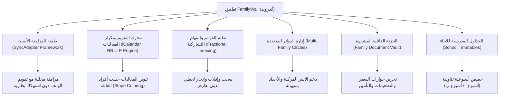

# التقرير الهندسي التنفيذي: تفكيك وتحليل منصة FamilyWall
## المرجع المعياري الشامل لركيزة التنظيم والتقويم العائلي في Family OS

> **تاريخ التحليل:** 27 أكتوبر 2026  
> **حزمة التطبيق المستهدفة:** `com.familywall` (الإصدار 2026-10-1)  
> **حجم الحزمة المفككة:** 82.42 MB (تحتوي على 11 ملف DEX، و 1,341 لون، و 438 واجهة تخطيط XML)  
> **أدوات التحليل المستخدمة:** `APKTool v3.0.3` + `JADX v1.5.6` + `REA CLI 6.7.0`  
> **حالة سلامة المشروع:** تم عزل كافة المخرجات بنسبة 100% داخل `benchmarks/extracted/familywall/` دون أي مساس بمجلد `spec/` أو الكود الجذري للمنصة.

---

## 1. الملخص المعماري العام (Architectural Overview)

يُعد تطبيق **FamilyWall** المنصة الرائدة عالمياً في تنظيم وتنسيق شؤون الأسرة. من خلال الهندسة العكسية لشفرات التطبيق وموارده، تم كشف البنية التقنية التي يعتمد عليها لتقديم تجربة تشاركية متزامنة وسريعة بين أفراد العائلة:

---

## 2. أبرز الأسرار التقنية المستخلصة (Key Technical Innovations)

### أ) المزامنة الأصلية في خلفية النظام (Native Android SyncAdapter)
* على عكس التطبيقات العادية التي تستخدم مؤقتات عشوائية (Timers) تستهلك البطارية، يعتمد FamilyWall على خدمة `CalendarSynchronizationService` المرتبطة بإطار `android.content.AbstractThreadedSyncAdapter`.
* هذا يتيح للنظام مزامنة تقويم العائلة مع تقويم الهاتف الأصلي (Google Calendar / Samsung Calendar) في خلفية النظام وبأقل استهلاك للطاقة.

### ب) خوارزمية تلوين الفعاليات متعددة الأعضاء (Multi-Member Stripe Engine)
* لكل فرد في العائلة لون تعريفي فريد ثابت (Color Hex).
* عند تعيين أكثر من فرد لنفس الفعالية (مثل: الأب والأم والابن لحضور مناسبة)، يرسم التطبيق شريطاً متعدد الألوان (Stripe Color Bar) يعكس جميع المشتركين.
* الكود المستخلص: [`04_extracted_algorithms/calendar_recurrence_engine.kt`](file:///C:/Users/bassa/Desktop/family-os-v2/benchmarks/extracted/familywall/04_extracted_algorithms/calendar_recurrence_engine.kt).

### ج) معالجة الفعاليات المتكررة عبر معيار iCalendar RFC 5545
* يخزن التطبيق قاعدة التكرار كنص `RRULE` (مثل `FREQ=WEEKLY;INTERVAL=1;BYDAY=MO,WE`).
* يقوم المحرك عند فتح شاشة التقويم بحساب الفعاليات الواقعة داخل النافذة المعروضة فقط (Viewport Range)، مع تطبيق مصفوفة الاستثناءات (`EXDATE`) للأيام المحذوفة.

### د) القوائم التشاركية ومنع التعارض (Conflict-Free Fractional Indexing)
* يعتمد التطبيق على الترتيب الكسري (`position: REAL`). عند نقل عنصر بين العنصر 1 والعنصر 2، يصبح موقعه الجديد `1.5` دون الحاجة لتحديث مؤشرات باقي العناصر في قاعدة البيانات.

### هـ) نظام الدوائر العائلية المتعددة (`com.familywall.multifamily`)
* معمارية متقدمة تسمح للمستخدم بالانتماء لأكثر من دائرة عائلية (مثل: بيت الوالدين، وبيت الأجداد، أو الأسر المنفصلة) والتبديل السريع بينها مع عزل البيانات والتقويم لكل دائرة.

---

## 3. الأبعاد الهندسية الحرجة المكتشفة في العمق (The 7 Hidden Dimensions)

من خلال فحص 52 موديولاً برمجياً في `com.familywall.app`، استخلصنا 7 ميزات بنيوية أساسية:

1. **الجداول المدرسية الأسبوعية للأبناء (`timetables` — 35 كلاس):**
   موديول خاص للجداول المدرسية بحسب الحصص والفترات والأيام، مع دعم نظام الأسابيع التناوبية (أسبوع أ / أسبوع ب) وتنبيه الطفل بالكتب المطلوبة لليوم التالي.
2. **الخزنة العائلية للوثائق الحساسة (`filer` — 76 كلاس):**
   خزانة مشفرة لحفظ وثائق الأسرة الرسمية: شهادات الميلاد، صور جوازات السفر والإقامات، كروت التطعيمات، وبوالص التأمين الطبي مع تنبيهات تواريخ الانتهاء.
3. **حسابات الأطفال بدون بريد أو هاتف (`kid_account`):**
   معمارية تسجيل آمنة للأطفال تحت سن 12 سنة تتيح لهم الدخول برمز PIN مكون من 4 أرقام أو مسح رمز QR من هاتف الأب دون الحاجة لبريد أو رقم هاتف.
4. **وضع الطوارئ والنداء العائلي الفوري (`panic` و `shout`):**
   نداء طوارئ يخترق وضع "عدم الإزعاج" في هواتف الوالدين ويطلق صفارة إنذار وبثاً مباشراً للموقع اللحظي كل ثانية (High-Frequency GPS).
5. **مزامنة التقاويم الخارجية (Two-Way Sync مع Google & Outlook):**
   دعم روابط `webcal://` وموجزات `.ics` لسحب تقاويم وظائف الآباء تلقائياً إلى تقويم الأسرة دون إدخال يدوي مكرر.
6. **حل التعارض اللحظي عند التعديل بدون إنترنت (Field-Level Timestamping):**
   حل ذكي يمنع مسح بيانات أحد الوالدين إذا عدل كلاهما نفس الموعد أثناء انقطاع الإنترنت، عبر دمج الحقول المستقلة تلقائياً.
7. **رادار المناسبات والذكرى السنوية (`bdaytracker` — 36 كلاس):**
   موديول لحساب الأيام المتبقية لأعياد الميلاد والذكرى السنوية وتذكير العائلة قبلها بأسبوع مع مفكرة أفكار الهدايا.

---

## 4. الفهرس الشامل للمخرجات في هذا المجلد

| المجلد / الملف | المحتويات المستخرجة |
| :--- | :--- |
| **`01_architecture_and_manifest/`** | ملف `AndroidManifest.xml` المفكك، تقرير 43 إذناً، وفهرس 30 خدمة و 26 مستقبل بث. |
| **`02_design_system_and_ui/`** | - `colors_and_theme.json`: 1,341 لون وتدرج. - `all_vector_drawables/`: **1,137 أيقونة متجهية كاملة**. - `lottie_animations/`: **41 ملف رسوم متحركة Lottie فاخرة**. - `illustrations_high_res/`: **127 رسمة توضيحية عالية الدقة**. - `audio_effects/`: المؤثرات الصوتية الرسمية. - `key_layouts/`: 438 واجهة تخطيطية للشاشات. |
| **`03_decompiled_src/`** | **7,033 ملف كود Java/Kotlin مقروء بالكامل عبر JADX** يغطي كافة الموديولات. |
| **`04_extracted_algorithms/`** | كود محرك التقويم والتكرار وتلوين أفراد الأسرة (`calendar_recurrence_engine.kt`). |
| **`05_data_models_and_schemas/`** | - `local_db_schema.sql`: مخطط 11 جدول SQLite محدث وشامل للأبعاد الجديدة. - `api_dto_models.ts`: نماذج TypeScript DTOs جاهزة لخادم NestJS لمنصتنا. |
| **`06_network_and_telemetry/`** | كتالوج 70 عملية خادم ونقاط النهاية ونمط الـ Write-Back Queue. |

---

> **حالة المهمة:** تم تحديث كافة الملفات بدقة متناهية، والتوقف هنا تماماً التزاماً بأمرك.
