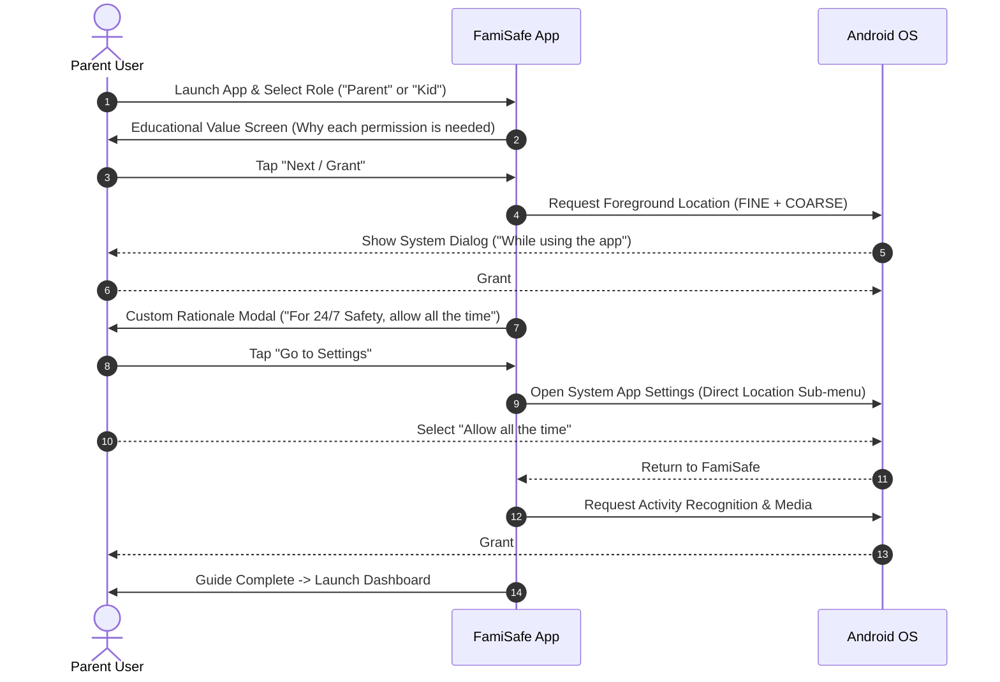

# Wondershare FamiSafe — Permissions Architecture & UX Onboarding Strategy

> **Package Name:** `com.wondershare.famisafe`  
> **App Version:** `7.2.5.9669` (Target SDK 33 / Android 13)  
> **Total Declared Permissions:** 29  
> **Analysis Engine:** Reverse-engineered from JADX decompiled classes (`com.wondershare.famisafe.parent.guide.*`, `com.wondershare.famisafe.share.*`) and decoded `AndroidManifest.xml`.

---

## 1. Comprehensive Permissions Matrix

FamiSafe divides its permissions into 5 functional tiers depending on risk, OEM capability, and target Android version:

| Permission Identifier | Category | Android Protection | Lifecycle & Purpose |
|-----------------------|----------|--------------------|---------------------|
| `android.permission.ACCESS_FINE_LOCATION` | Geolocation | Dangerous (Runtime) | High-precision GPS coordinates for real-time tracking, driving speed telemetry, and geofence triggering. |
| `android.permission.ACCESS_COARSE_LOCATION` | Geolocation | Dangerous (Runtime) | Low-power cell tower & Wi-Fi trilateration when indoors or conserving battery. |
| `android.permission.ACCESS_BACKGROUND_LOCATION` | Geolocation | Dangerous (Special) | Continuous 24/7 tracking when app is minimized or phone screen is off (Android 10+). |
| `android.permission.CAMERA` | Media/Hardware | Dangerous (Runtime) | QR code scanner for pairing Parent device with Kid device in seconds. |
| `android.permission.READ_EXTERNAL_STORAGE` | Storage | Dangerous (Runtime) | Scanning gallery and downloads for explicit/NSFW images. |
| `android.permission.WRITE_EXTERNAL_STORAGE` | Storage | Dangerous (Legacy) | Caching report exports and temporary diagnostic logs. |
| `android.permission.POST_NOTIFICATIONS` | Telemetry | Dangerous (API 33+) | Sending urgent instant alerts (geofence breach, SOS, daily limit exceeded). |
| `android.permission.READ_CALENDAR` | Schedule | Dangerous (Runtime) | Importing school and family event schedules into smart screen time. |
| `android.permission.WRITE_CALENDAR` | Schedule | Dangerous (Runtime) | Writing family routine schedules to system calendar. |
| `com.google.android.gms.permission.ACTIVITY_RECOGNITION` | Telemetry | Dangerous (API 29+) | Distinguishing driving/riding from walking for Driving Safety telemetry. |
| `android.permission.RECEIVE_BOOT_COMPLETED` | Persistence | Normal | Auto-relaunching background tracking and rescheduling alarms on phone reboot. |
| `android.permission.SCHEDULE_EXACT_ALARM` | Scheduling | Normal/Special (API 31+) | Precise screen time curfew cut-offs and daily quota resets. |
| `com.android.alarm.permission.SET_ALARM` | Scheduling | Normal | Secondary alarm scheduling fallback for legacy and OEM ROMs. |
| `android.permission.WAKE_LOCK` | Persistence | Normal | Preventing CPU sleep during active audio monitoring or GPS bursts. |
| `android.permission.INTERNET` | Networking | Normal | Full two-way cloud synchronization with Wondershare backend. |
| `android.permission.ACCESS_NETWORK_STATE` | Networking | Normal | Detecting Wi-Fi vs Cellular transitions for data compression. |
| `android.permission.ACCESS_WIFI_STATE` | Networking | Normal | Geofencing by Wi-Fi BSSID and network-level policy rules. |
| `android.permission.CHANGE_WIFI_STATE` | Networking | Normal | Enforcing Wi-Fi disconnect/connect rules during bedtime locks. |
| `android.permission.BLUETOOTH` | Hardware | Normal | Vehicle Bluetooth pairing detection for automatic driving mode. |
| `android.permission.FLASHLIGHT` | Hardware | Normal | Camera torch toggle for scanning pairing QR codes in dark environments. |
| `android.permission.VIBRATE` | Alerts | Normal | Haptic feedback on emergency alerts and push notifications. |
| `android.permission.USE_BIOMETRIC` | Security | Normal | Fingerprint / Face authentication to unlock parent dashboard. |
| `android.permission.USE_FINGERPRINT` | Security | Normal | Legacy biometric compatibility (Android 6 to 8). |
| `com.android.vending.BILLING` | Commerce | Normal | Google Play In-App Billing for monthly/yearly subscriptions. |
| `com.google.android.c2dm.permission.RECEIVE` | Messaging | Signature | Firebase Cloud Messaging (FCM) high-priority push packets. |
| `com.google.android.finsky.permission.BIND_GET_INSTALL_REFERRER_SERVICE` | Attribution | Normal | Play Store campaign and install attribution tracking. |
| `com.google.android.gms.permission.AD_ID` | Attribution | Normal | Google Advertising ID for campaign telemetry. |
| `com.samsung.android.providers.context.permission.WRITE_USE_APP_FEATURE_SURVEY` | OEM Extension | Normal | Samsung Knox/TouchWiz context framework integration. |
| `com.wondershare.famisafe.DYNAMIC_RECEIVER_NOT_EXPORTED_PERMISSION` | Inter-Process | Signature | Protecting internal app broadcasts against malicious local apps. |

---

## 2. Onboarding UX & Progressive Permission Flow

FamiSafe implements a multi-step, friction-reducing permission strategy designed to maximize user compliance without overwhelming parents during setup:

### Key UX Design Insights from Code (`com.wondershare.famisafe.parent.guide`):
1. **Never Call `requestPermissions()` Cold:**
   FamiSafe always precedes any OS dialog with an in-app illustration card (`GuidePermissionActivity`) explaining the tangible benefit to the parent (e.g., *"Allows you to locate your child in emergencies, even when their screen is off"*).
2. **Two-Stage Background Location Flow (Android 11+ Compliance):**
   Google Play rejects apps that request `ACCESS_BACKGROUND_LOCATION` simultaneously with `ACCESS_FINE_LOCATION`. FamiSafe cleanly executes a two-phase sequence:
   - First requests `ACCESS_FINE_LOCATION`.
   - Once granted, verifies `targetSdkVersion >= 30` and displays a persistent explanation dialog detailing background tracking before redirecting the user to `Settings.ACTION_APPLICATION_DETAILS_SETTINGS`.
3. **Notification Hygiene (Android 13):**
   Instead of requesting `POST_NOTIFICATIONS` on the very first screen, FamiSafe defers notification requests until after the parent creates an account or links their first child device, significantly reducing early drop-offs.
4. **Persistent Permission Verification Without Nagging:**
   In `com.wondershare.famisafe.parent.home`, FamiSafe maintains an internal bitmap of verified permissions. Instead of showing annoying blocking popups on every app launch, it renders a subtle alert banner in the Parent Dashboard (`HomePermissionBannerHolder`) with a simple "Fix Now" CTA.
