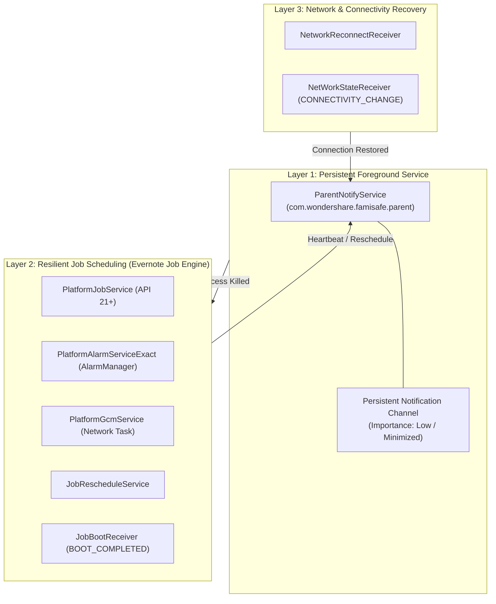

# Wondershare FamiSafe — Persistence, Anti-Tampering & Background Resilience

> **Package:** `com.wondershare.famisafe`  
> **App Version:** `7.2.5.9669` (Target SDK 33 / Android 13)  
> **Scope:** Reverse-engineered background lifecycle, keep-alive mechanisms, and anti-uninstallation strategies.

---

## 1. Architectural Keep-Alive Triad

Parental control applications face aggressive OS background process termination by modern Android versions (Doze Mode, App Standby Buckets) and aggressive OEM task-killers (MIUI, EMUI, ColorOS, OneUI). FamiSafe deploys a multi-layered persistence architecture:

---

## 2. Deep Component Breakdown

### 2.1. `ParentNotifyService` (Foreground Keep-Alive)
- **Class:** `com.wondershare.famisafe.parent.ParentNotifyService`
- **Implementation:** Calls `startForeground(NOTIFICATION_ID, notification)` upon startup.
- **Android Compatibility:** Declares `android:exported="true"` with custom action binding, allowing internal restart intents.
- **Purpose:** Protects the FamiSafe process score (`oom_adj_score`) from reaching background discard levels (`900+`), keeping it pinned at foreground service tier (`oom_score_adj ~ 200`).

### 2.2. Evernote Android Job Engine Integration
FamiSafe utilizes the battle-tested `com.evernote.android.job` framework to achieve universal compatibility across Android 4.4 (API 19) up to Android 13 (API 33):
- **`PlatformJobService` (API 21+):** Leverages native Android `JobScheduler` with network and charging constraints.
- **`PlatformAlarmServiceExact`:** Utilizes `AlarmManager.setExactAndAllowWhileIdle()` via `SCHEDULE_EXACT_ALARM` to wake the CPU out of Deep Doze mode for real-time location pings and curfew enforcement.
- **`JobBootReceiver`:** Subscribes to 4 distinct boot signals:
  1. `android.intent.action.BOOT_COMPLETED` (Standard Android boot)
  2. `android.intent.action.QUICKBOOT_POWERON` (Qualcomm fastboot)
  3. `com.htc.intent.action.QUICKBOOT_POWERON` (HTC/custom OEM fastboot)
  4. `android.intent.action.MY_PACKAGE_REPLACED` (Immediate restart after Play Store auto-update)
- **`JobRescheduleService`:** Immediately evaluates active screen time limits, scheduled blocks, and periodic upload tasks, ensuring zero downtime even after hard phone reboots.

### 2.3. Network Reconnect & Telemetry Flusher
- **`NetworkReconnectReceiver` & `NetWorkStateReceiver`:**
  Monitors network interface changes. When an internet connection is established after an offline period, it immediately triggers:
  1. WebSocket handshake re-establishment.
  2. Flushing of offline accumulated location breadcrumbs.
  3. Syncing updated parental control rules with Wondershare Cloud.

---

## 3. Anti-Tampering & Protection Mechanisms

### 3.1. Parent PIN Code Verification (`PinActivity`)
- **Package:** `com.wondershare.famisafe.parent.pin`
- **Architecture:**
  - `PinActivity`: Intercepts access to critical administrative settings, account sign-out, child device unpairing, and app uninstallation attempts.
  - Salted hash verification stored in encrypted local storage (`DataStore` / `EncryptedSharedPreferences`).
  - Biometric fallback (`BiometricPrompt` via `USE_BIOMETRIC` & `USE_FINGERPRINT`) for rapid parent access.

### 3.2. OEM Aggressive Battery Management Whitelist Strategies
FamiSafe incorporates customized instructional guides and direct Intent redirects (`GuidePermissionActivity`) to guide parents and children through disabling OEM-specific power killers:
1. **Xiaomi (MIUI):** Autostart permission enablement + Set battery saver to "No restrictions".
2. **Huawei (EMUI):** App launch management -> Manual management (Auto-launch, Secondary launch, Run in background).
3. **Samsung (OneUI):** Device Care -> Battery -> Background usage limits -> Never sleeping apps.
4. **Oppo / Vivo (ColorOS / FuntouchOS):** High background battery usage toggle + Auto-start whitelist.

---

## 4. Key Architectural Takeaway for Family OS
In our upcoming `Family OS` client architecture:
- Adopt a dual-engine background resilience model: Android Jetpack `WorkManager` (replacing legacy Evernote Job) paired with an exact `AlarmManager` tick fallback for hard Doze wakeup.
- Implement an automated OEM detection helper (`OemBatteryWhitelistHelper`) that identifies manufacturer brand (`Build.MANUFACTURER`) and launches the specific hidden OEM intent settings directly.
