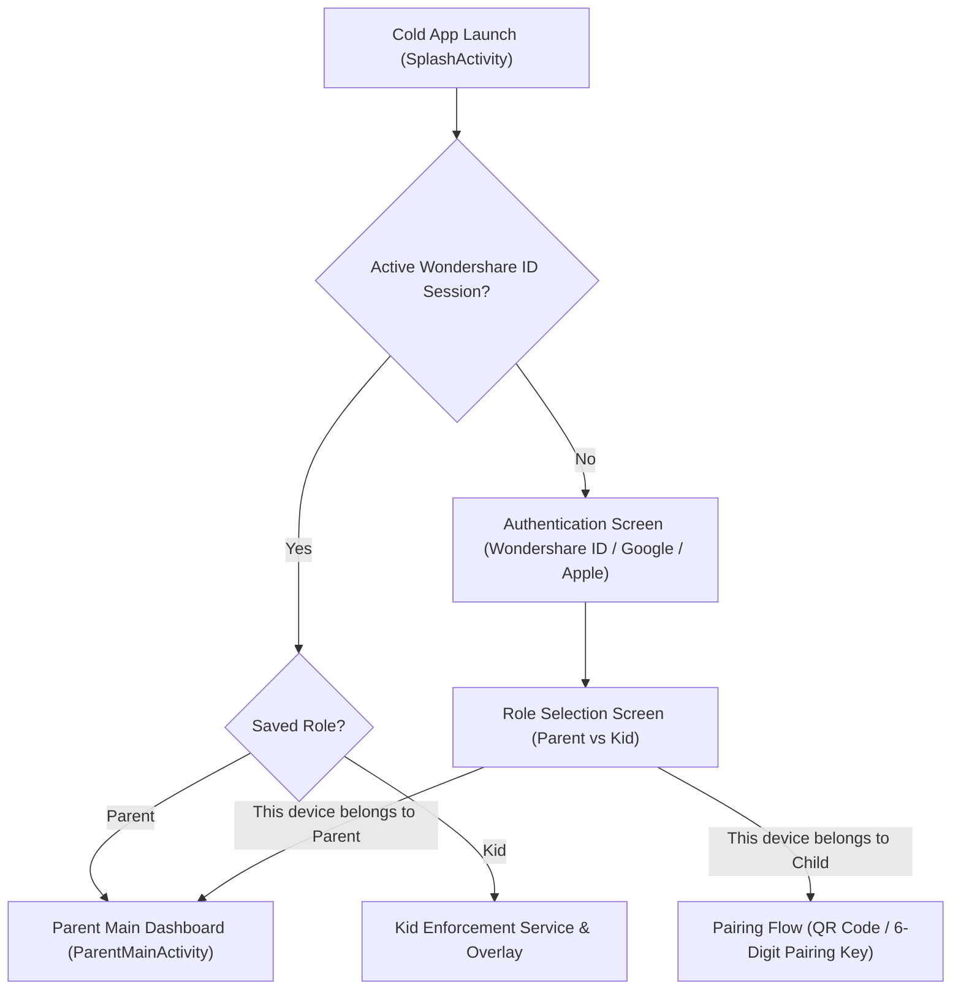
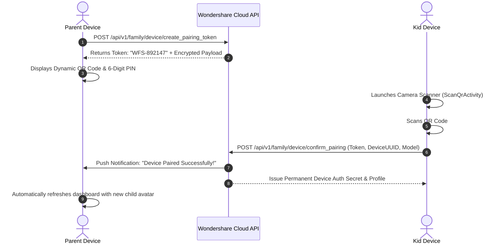

# Wondershare FamiSafe — Complete UI/UX Screen Flows & Design System

> **Package:** `com.wondershare.famisafe`  
> **Extracted UI Assets:** 1,319 Layout/Menu XMLs, 570 SVGs, 1,520 Raster Images, 66 Lottie Animations, 129 Theme/Color XMLs.  
> **Source Packages Analyzed:** `com.wondershare.famisafe.parent.*`, `com.wondershare.famisafe.share.*`

---

## 1. Visual Design System & Brand Identity

FamiSafe utilizes a vibrant, friendly, and trustworthy visual palette designed to appeal to both parents and teens without appearing overly punitive:

| Design Token | Hex Code | Purpose & Usage in Code |
|--------------|----------|-------------------------|
| `color_primary_famisafe` | `#00D2B4` (Teal Cyan) | Primary brand color, main CTA buttons, active tab indicators, and safe status badges. |
| `color_primary_dark` | `#00B398` | Toolbar headers and status bar tinting. |
| `color_accent_orange` | `#FFA800` | Warning badges, approaching time limits, and driving speed alerts. |
| `color_danger_red` | `#FF4D4F` | Instant Block buttons, explicit content alerts, geofence breaches, and SOS alarms. |
| `color_purple_indigo` | `#6366F1` | Screen Time charts, app categories, and educational modules. |
| `color_bg_slate` | `#F8FAFC` | Main app background and card container backgrounds. |
| `color_card_white` | `#FFFFFF` | Elevated card surfaces with 12dp rounded corners (`cardCornerRadius`). |
| `color_text_primary` | `#1E293B` | High-contrast body text and headers. |
| `color_text_muted` | `#94A3B8` | Subtitles, timestamps, and secondary metrics. |

---

## 2. End-to-End User Experience Flows

### 2.1. Onboarding, Role Selection & Dual-Mode Split
Upon initial launch (`SplashActivity` -> `GuideActivity`), FamiSafe presents a clean bifurcated entry point:

### 2.2. Child Device Pairing Flow (Fast QR & 6-Digit Code)
FamiSafe achieves pairing in under 30 seconds using a synchronous pairing model:
1. **Parent Device:** Taps "Add Device" -> Selects child platform (Android / iOS / Kindle) -> Enters Child Name and Age -> Generates a dynamic QR code containing a temporary authorization token and family group ID.
2. **Kid Device:** Installs FamiSafe Junior / FamiSafe Companion -> Taps "Scan QR" (`ScanQrActivity`) -> Camera reads token -> Kid app sends secure HTTPS registration handshake to Wondershare API.
3. **Instant Confirmation:** Both devices receive an FCM push event confirming synchronization.

### 2.3. Parent Executive Dashboard (`ParentMainActivity`)
The parent dashboard is architected as an expandable modular card list (`com.wondershare.famisafe.parent.dashboard.card`):
- **Child Selector Header:** Horizontal carousel of linked child profiles with current status (Battery %, Active/Idle, Last GPS update time).
- **Instant Block Quick Switch:** Prominent one-tap master toggle to lock all child phone activities immediately.
- **Card 1: Screen Time & Today's Usage:** Donut chart of hours used today vs. daily limit, with a list of top 3 most used apps.
- **Card 2: Live Location & Safe Zones:** Interactive map preview with child's live marker, address string, and quick buttons to create new Geofences (Home, School, Park).
- **Card 3: Activity Timeline:** Chronological feed of app launches, website visits, and screen unlock events.
- **Card 4: Driving Safety:** Displays miles driven today, top speed attained, and count of high-risk driving events (hard brakes, rapid turns).
- **Card 5: Real-Time Alerts & Flagged Content:** Red badge alerts for suspicious words found in SMS/WhatsApp, or explicit photos detected in the device gallery.
- **Card 6: Remote One-Way Audio:** Feature enabling parent to listen to ambient surroundings for 60 seconds during safety emergencies.

### 2.4. Kid Device Block Overlay & Time Request Flow
When a daily quota expires or a restricted application is opened:
1. **Screen Lock Overlay:** An unobtrusive, non-dismissible full-screen overlay (`SYSTEM_ALERT_WINDOW`) covers the screen.
2. **Contextual Messaging:** Informs the child politely: *"Time's up for today! Your daily allowance of 2 hours has finished."*
3. **Time Extension Request:** Child can tap **"Ask for More Time"** (options: 15 min, 30 min, 1 hour).
4. **Instant Push to Parent:** Parent receives a high-priority push notification with two actions: **[Approve +30m]** or **[Deny]**.
5. **Real-time Unlock:** Upon parent approval, cloud push sends an unlock payload to the kid app, and the overlay dismisses smoothly.
