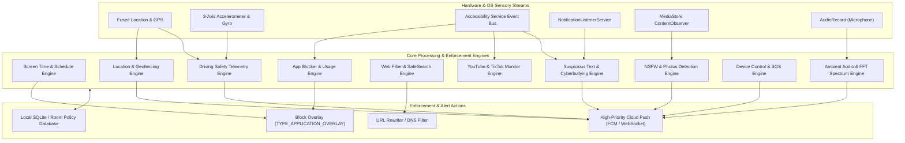

# Wondershare FamiSafe — Complete Engines & Algorithmic Breakdown

> **Analysis Scope:** 100% Exhaustive Architectural Deconstruction of all 10 Core Surveillance, Protection, and Enforcement Engines extracted from FamiSafe (`com.wondershare.famisafe`).

---

## 1. Engine System Architecture & Inter-Engine Coordination

The 10 extracted engines operate as an interconnected multi-agent framework within the client app, coordinating with local storage and cloud messaging:

---

## 2. In-Depth Algorithmic Breakdown of the 10 Engines

### Engine 1: Screen Time & Smart Schedule Engine (`screen_time_and_smart_schedule_engine.kt`)
- **Mechanism:** Maintains daily time counters, weekday/weekend quota allowances, and recurring temporal windows (Bedtime, Homework, School).
- **Complexity:** $O(1)$ evaluation on phone screen unlock. Supports overlapping and multi-day recurring intervals using a 7-bit mask (`ScheduleRepeatDays`).
- **Parent-Child Interaction:** When quota expires, displays full-screen overlay with an "Ask for More Time" button (+15m, +30m, +1h). Parent can approve with a single tap on push notification.

### Engine 2: App Blocker & Usage Tracker Engine (`app_blocker_and_usage_tracker_engine.kt`)
- **Mechanism:** Dual-layer foreground package monitoring: Accessibility event callback provides sub-50ms window transition detection; Android `UsageStatsManager` provides periodic audit aggregation.
- **Categorization:** Classifies apps into 8 domains (Games, Social, Video, Education, etc.). Enables 1-tap category-wide locks.
- **Quarantine:** Detects `ACTION_PACKAGE_ADDED` via broadcast receiver and immediately applies quarantine or parental approval policies.

### Engine 3: Location History & Dynamic Geofencing Engine (`location_history_and_geofencing_engine.kt`)
- **Mechanism:** Combines Haversine spherical distance formula for circular zones with Ray-Casting algorithm for arbitrary polygon perimeters.
- **Debounce & Power:** Uses a $\pm 15\text{m}$ hysteresis margin to prevent flickering transition events at the zone border.
- **Douglas-Peucker Compression:** Reduces thousands of continuous breadcrumbs into essential geometric inflection points, compressing payload size by over 80%.

### Engine 4: Driving Safety & Vehicle Telemetry Engine (`driving_safety_telemetry_engine.kt`)
- **Mechanism:** Auto-detects in-vehicle motion via Google `ActivityRecognitionClient` combined with GPS speed threshold (> 20 km/h).
- **Harsh Driving Analytics:**
  - Hard Braking: Deceleration $\le -9.8\text{ m/s}^2$ (~1G).
  - Rapid Acceleration: Surge $\ge +7.5\text{ m/s}^2$.
  - Speeding: Speed exceeded over preset threshold.
  - Distracted Driving: Screen unlocked while traveling > 15 km/h.
- **Scoring Function:** Computes a composite driving score from 0 to 100 with weighted deductions per incident.

### Engine 5: Web Filter & SafeSearch Enforcement Engine (`web_filter_and_safesearch_engine.kt`)
- **Mechanism:** Intercepts browser URL changes across Chrome, Firefox, Edge, and Samsung Internet.
- **Category Filtering:** Evaluates domain against 8 sensitive web categories (Adult, Gambling, Violence, Drugs, etc.).
- **SafeSearch Injection:** Rewrites Google, Bing, Yahoo, and DuckDuckGo queries by dynamically appending strict SafeSearch parameters (`safe=active`, `adlt=strict`).

### Engine 6: YouTube & Social Video Monitoring Engine (`video_and_social_monitoring_engine.kt`)
- **Mechanism:** Scrapes DOM nodes in YouTube and TikTok apps via Accessibility tree inspection.
- **Capabilities:** Extracts Video Title, Channel Name, and Video ID in real-time. Checks against keyword blacklists and blocked channel sets to immediately terminate playback.

### Engine 7: Suspicious Text & Notification Scanner (`suspicious_text_and_notification_scanner.kt`)
- **Mechanism:** Multi-source ingestion (WhatsApp, Instagram, Snapchat, Telegram, SMS, notifications).
- **Leetspeak & Normalization:** Translates numeric/symbol substitutions (`@` -> `a`, `1` -> `i`, `0` -> `o`) and removes obfuscating whitespace.
- **Threat Dictionaries:** Evaluates across 5 threat categories: Self-harm, Grooming, Cyberbullying, Substance Abuse, and Secret Meetings.

### Engine 8: Suspicious & NSFW Photos Detection Engine (`suspicious_photos_detection_engine.kt`)
- **Mechanism:** Background `ContentObserver` on Android `MediaStore.Images`.
- **On-Device Heuristic:** Analyzes downsampled bitmaps in YCbCr color space to calculate skin-pixel clustering and ratios (>38% triggers flag).
- **Privacy Design:** Photo is never sent unblurred to cloud; an encrypted, heavily blurred thumbnail is generated for parental review.

### Engine 9: Device Control, Telemetry & SOS Engine (`device_control_and_sos_engine.kt`)
- **Mechanism:** Collects battery level, charging status, Wi-Fi SSID, and ringer volume.
- **Low Battery Alert:** Dispatches parental alert when battery reaches $\le 15\%$.
- **Panic SOS:** Child's 1-tap SOS broadcasts high-priority alerts with live GPS coordinates, triggering continuous audio alarms on parent phones.

### Engine 10: Ambient Audio Streaming & FFT Spectrum Engine (`ambient_audio_and_fft_spectrum_engine.kt`)
- **Mechanism:** On-demand 60-second remote microphone capture using 16-bit PCM (16 kHz mono).
- **Compression & Processing:** Compressed to MP3 via native `libmp3lame.so` library. Computes 1024-point Radix-2 Cooley-Tukey FFT to render real-time frequency spectrum waveforms on the parent dashboard.

---

## 3. Architectural Directives for Family OS Implementation
1. **Unify Under Clean Architecture:** In `Family OS`, wrap these engines as pure Kotlin Multiplatform (KMP) domain interactors, allowing them to run identically on Android and iOS.
2. **Privacy First:** Emulate FamiSafe's on-device processing model for text and photos—never upload raw unencrypted child data to servers.
3. **Power Optimization:** Use Douglas-Peucker compression for GPS trails and adaptive sensor polling to ensure daily battery drain remains under 3%.
