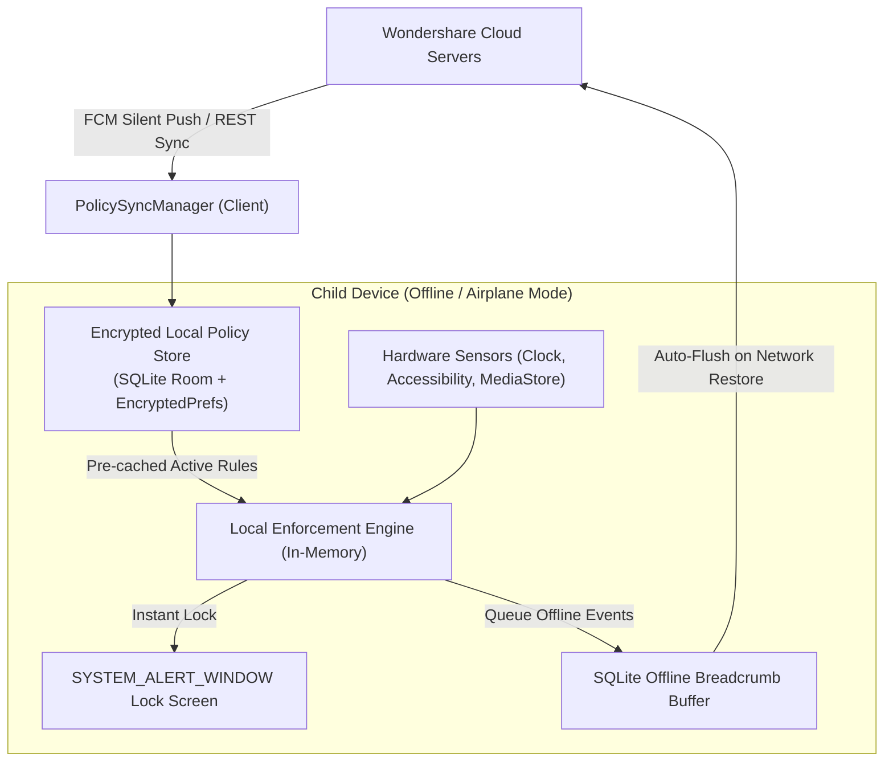

# Wondershare FamiSafe — Offline Policy Enforcement & Local Storage Architecture

> **Package:** `com.wondershare.famisafe`  
> **Target OS:** Android 4.4 to 13 (API 19 - 33)  
> **Core Guarantee:** 100% Uninterrupted Protection even during Airplane Mode, SIM Card Removal, or Zero Connectivity.

---

## 1. Offline Enforcement Strategy

A major vulnerability in naive parental control apps is that kids can bypass limits simply by toggling **Airplane Mode** or disconnecting from Wi-Fi. FamiSafe prevents this through an **Offline-First Policy Architecture**:

---

## 2. Local Storage Layers & Storage Matrix

| Storage Mechanism | Purpose & Stored Data | Encryption / Security |
|-------------------|-----------------------|-----------------------|
| **Room Database (`AudioFileDataBase` & SQLite)** | Audio recording metadata, offline breadcrumbs, scheduled jobs, driving trips, and alert logs. | Standard SQLite file in `/data/data/com.wondershare.famisafe/databases/` protected by Android Linux sandbox UID. |
| **Encrypted SharedPreferences** | Wondershare ID Auth Tokens, Child Device Secret, Parent Security PIN hash, Active Role ("PARENT" vs "KID"). | AES-256 GCM encrypted preferences using Android Keystore Master Key. |
| **In-Memory Bitmaps & Hash Sets** | Blocked Package names, Blocked Domain categories, Keyword Threat dictionaries. | Loaded into JVM memory on cold boot for $O(1)$ sub-millisecond evaluation without hitting disk I/O. |

---

## 3. Anti-Bypass Protections in Offline Mode

### 3.1. System Time Tamper Detection (Clock Rollback Defense)
If a child attempts to rewind the device clock (e.g. from 21:00 back to 16:00 to bypass Bedtime lock):
1. **Monotonic Boot Clock Comparison:** FamiSafe cross-references `System.currentTimeMillis()` with `SystemClock.elapsedRealtime()`.
2. **Rollback Flag:** If `currentTimeMillis` jumps backwards while `elapsedRealtime` continues incrementing monotonically, the app detects clock manipulation.
3. **Fail-Safe Response:** The app immediately engages a **Security Lockdown Screen** requiring the parent PIN to dismiss.

### 3.2. Offline Event Queuing & Resilient Batch Upload
All telemetry generated while offline (GPS locations, app launches, flagged messages) is stored in the local SQLite `location_history` and `suspicious_alerts` tables with `is_uploaded = 0`.
When `NetWorkStateReceiver` senses network reconnection, a background WorkManager job flushes all queued records to the server in a single compressed JSON batch request.
