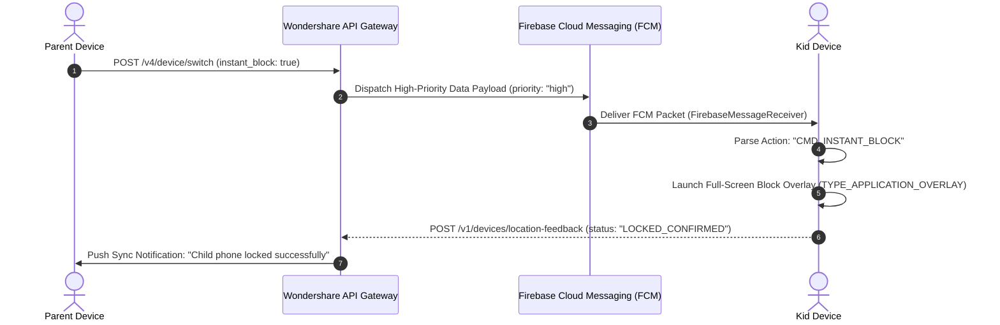

# Wondershare FamiSafe — Real-Time Push & Synchronization Protocol

> **Scope:** Cloud-to-Device and Device-to-Device Instant Messaging, Low-Latency Commands, and Telemetry Scheduling.  
> **Source Package:** `com.wondershare.famisafe.share.FirebaseMessageReceiver`, `com.wondershare.famisafe.parent.notify.*`

---

## 1. High-Priority Push Architecture

To achieve sub-2-second command latency (e.g. Instant Block, SOS, Ambient Audio), FamiSafe implements an asymmetric dual-channel architecture:



---

## 2. FCM Command Protocol & Payload Schemas

FamiSafe utilizes raw `data` payloads rather than standard OS `notification` payloads, ensuring the app handles the action programmatically even when running in the background:

### 2.1. Instant Block / Unblock Payload
```json
{
  "to": "fcm_token_kid_device_xxx",
  "priority": "high",
  "data": {
    "action": "CMD_DEVICE_LOCK",
    "member_id": "WS-CHILD-98214",
    "lock_state": true,
    "lock_reason": "PARENT_MANUAL_OVERRIDE",
    "duration_minutes": 0,
    "timestamp": 1698624000000,
    "signature": "sha256_hmac_hex"
  }
}
```

### 2.2. Time Request & Approval Protocol
1. **Child Request:** Child taps "+15m":
```json
{
  "action": "REQ_TIME_EXTENSION",
  "member_id": "WS-CHILD-98214",
  "requested_minutes": 15,
  "app_package": "com.zhiliaoapp.musically",
  "timestamp": 1698624100000
}
```
2. **Parent Instant Decision Action:** Parent notification renders action buttons: `[Approve +15m]` / `[Deny]`.
3. **Unlock Confirmation Payload:** Sent from server to kid device:
```json
{
  "action": "CMD_TIME_EXTENSION_GRANTED",
  "granted_minutes": 15,
  "new_expiry_timestamp": 1698625000000
}
```

### 2.3. Emergency SOS Panic Payload
High-priority alert sent to all family members simultaneously:
```json
{
  "action": "ALERT_EMERGENCY_SOS",
  "child_name": "Leo",
  "member_id": "WS-CHILD-98214",
  "latitude": 37.774929,
  "longitude": -122.419416,
  "accuracy_meters": 4.5,
  "battery_level": 42,
  "play_audible_siren": true,
  "timestamp": 1698624200000
}
```

---

## 3. Scheduled Telemetry & Periodic Flush Strategy

To balance real-time awareness with battery conservation:
1. **Real-time Push (Immediate):** SOS alerts, Geofence boundary enter/exits, Instant Lock commands, and Critical Battery ($\le 15\%$) warnings.
2. **Periodic Batched Telemetry (15-Minute Windows):**
   - Location breadcrumb history (Douglas-Peucker compressed).
   - App foreground usage durations (`UsageStatsManager` deltas).
   - Web browsing history log.
   - YouTube/TikTok watched video records.
3. **Network Failure Queue:** Queued in SQLite `location_history` and uploaded automatically when `NetworkReconnectReceiver` signals online state.
