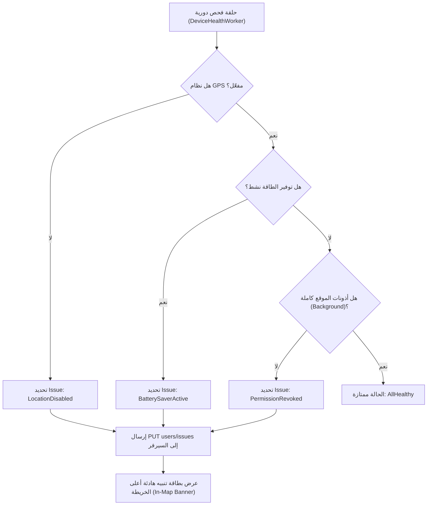

# استراتيجية أذونات وتفاعل المستخدم في تطبيق Life360 (Permissions Architecture & UX Strategy)

> **الحزمة:** `com.life360.android.safetymapd`  
> **الإصدار المستهدف:** Android 13 (API Level 33)  
> **نظام الأذونات:** 31 إذن نظامي، منها 11 إذن خطر (Dangerous/Runtime) و 7 أذونات خاصة (Special Access)

---

## 1. فلسفة طلب الأذونات في Life360 (The "Context-First" Onboarding Funnel)

تطبيق Life360 يُعد دراسة حالة عالمية في كيفية إقناع المستخدم بمنح أخطر وأكثر الأذونات حساسية في نظام أندرويد (تتبع الموقع الدائم في الخلفية طوال الوقت `ACCESS_BACKGROUND_LOCATION`، حساسات الحركة `ACTIVITY_RECOGNITION`، البلوتوث `BLUETOOTH_SCAN`، وتجاوز توفير الطاقة `REQUEST_IGNORE_BATTERY_OPTIMIZATIONS`) دون إثارة مخاوف الخصوصية أو التسبب في حذف التطبيق.

### نموذج التدرج السياقي (Progressive Contextual Disclosure):
1. **الامتناع التام عن طلب أذونات دفعة واحدة عند التشغيل الأول:**  
   لا يطلب التطبيق أي إذن نظامي بمجرد فتحه، بل يعرض شاشات ترحيبية تشرح القيمة العائلية المضافة ("اطمئن على عائلتك بلمسة واحدة"، "تنبيهات فورية عند وصول الأطفال للمدرسة").
2. **شاشات التحضير المسبق (Pre-Permission Primer Screens):**  
   قبل استدعاء نافذة نظام أندرويد الرسمية (`ActivityCompat.requestPermissions`)، يُظهر Life360 شاشة وسيطة مخصصة بالكامل (In-App Bottom Sheet أو Fullscreen Explainer) تشرح بالضبط:
   - ما هو الإذن المطلوب؟
   - لماذا تحتاجه عائلتك؟
   - ما هو الخيار الدقيق الذي يجب اختياره في نافذة النظام ("Allow all the time" بدلاً من "While using the app").
3. **تفكيك طلب الموقع إلى مرحلتين (2-Stage Location Request):**
   - **المرحلة الأولى (Foreground Location):** طلب `ACCESS_FINE_LOCATION` و `ACCESS_COARSE_LOCATION` أثناء استخدام التطبيق لتمركز الخريطة حول المستخدم.
   - **المرحلة الثانية (Background Location):** شاشة توضيحية بعنوان "حماية مستمرة لعائلتك حتى عند إغلاق التطبيق" تشرح للمستخدم كيفية الانتقال إلى إعدادات النظام واختيار "السماح طوال الوقت" (`Allow all the time`).

---

## 2. جدول الأذونات الحرجة والوظائف الهندسية المقابلة

| الإذن البرمجي | التصنيف الأمني | الوظيفة التقنية داخل Life360 | استراتيجية التبرير للمستخدم (UX Primer) |
|---|---|---|---|
| `android.permission.ACCESS_FINE_LOCATION` | Runtime / Critical | الحصول على إحداثيات GPS الدقيقة بمعدل دقة عالي (High Accuracy) | "تحديد موقعك بدقة على الخريطة ومشاركة مسار رحلتك مع أفراد دائرتك" |
| `android.permission.ACCESS_BACKGROUND_LOCATION` | Special Runtime / Critical | استمرار التتبع عند إغلاق التطبيق أو قفل الشاشة دون انقطاع | "إرسال إشعارات المغادرة والوصول للأماكن (Geofence) حتى وإن كان هاتفك في جيبك" |
| `android.permission.ACTIVITY_RECOGNITION` | Runtime / High | التعرف على النشاط الحركي (Still, Walking, In-Vehicle, Biking) عبر Google Awareness API | "توفير بطارية هاتفك عبر إيقاف الـ GPS عند الوقوف، وتفعيل كشف الحوادث عند القيادة" |
| `android.permission.HIGH_SAMPLING_RATE_SENSORS` | Special (API 31+) | الوصول إلى قراءات الجيروسكوب والتسارع بتردد يفوق 100Hz دون تقليص النظام | "محرك كشف حوادث السير الفوري (Crash Detection) لرصد الاصطدامات القوية" |
| `android.permission.BLUETOOTH_SCAN` | Runtime (API 31+) | البحث عن أجهزة التتبع Tile الذكية المحيطة في الخلفية | "العثور على المفاتيح والحقائب وأجهزة Tile المفقودة حتى دون اتصال بالإنترنت" |
| `android.permission.BLUETOOTH_CONNECT` | Runtime (API 31+) | الاتصال بأجهزة Tile المربوطة لإصدار رنين وتحديث البرامج الثابتة | "إطلاق صوت الرنين من جهاز التتبع المفقود لمعرفة مكانه" |
| `android.permission.REQUEST_IGNORE_BATTERY_OPTIMIZATIONS` | System Exemption | إعفاء التطبيق من قيود توفير الطاقة القاتلة في أندرويد (Doze Mode) | "ضمان عدم قيام الهاتف بإيقاف تتبع الرحلات أو تأخير تنبيهات الطوارئ" |
| `android.permission.POST_NOTIFICATIONS` | Runtime (API 33+) | إظهار الإشعار الدائم لخدمة التتبع وخدمات الطوارئ | "تنبيهك الفوري في حال تعرض أحد أفراد العائلة لحادث سير أو طلب استغاثة SOS" |
| `android.permission.CALL_PHONE` | Dangerous | إجراء اتصال تلقائي مباشر بخدمات الطوارئ أو جهات الاتصال المحددة | "الاتصال السريع بنجدة الطوارئ (911/Dispatch) عند وقوع تصادم خطير" |

---

## 3. محرك مراقبة صحة الجهاز والأذونات الصامتة (`devicehealth` Engine)

بدلاً من إزعاج المستخدم بنوافذ منبثقة متكررة عند قيامه بإيقاف الـ GPS أو تفعيل وضع توفير الطاقة، طورت Life360 حزمة برمجية متخصصة: `com.life360.android.devicehealth`:

### الميزات الجوهرية لمعمارية `devicehealth`:
1. **عدم حظر واجهة المستخدم (Non-blocking Degradation):**  
   في حال سحب المستخدم لإذن الموقع في الخلفية، يستمر التطبيق بالعمل في الواجهة الأمامية بشكل طبيعي دون إغلاقه، مع وضع علامة تحذير صفراء على صورة المستخدم داخل الخريطة.
2. **إشعار أفراد الدائرة بحالة العضو (Circle-wide Visibility):**  
   يقوم تطبيق العضو بإرسال تقرير حالة الجهاز إلى السيرفر عبر نقطة النهاية `PUT users/issues`. يتيح ذلك لرب الأسرة أو الوالدين رؤية علامة "تم إيقاف الموقع" أو "البطارية أقل من 10%" بجانب اسم الطفل مباشرة، مما يدفع الطفل لتفعيله ذاتياً بعد تذكير والديه بدلاً من ظهور رسائل مزعجة من التطبيق نفسه.
3. **التعامل مع بيئات الهواتف الذكية المخصصة (OEM Killers):**  
   يتضمن كود Life360 فحصاً لنوع المصنّع (`Build.MANUFACTURER`):
   - **Samsung (OneUI):** توجيه المستخدم مباشرة لشاشة `Sleeping apps` لإلغاء إدراج Life360 في التطبيقات النائمة.
   - **Xiaomi (MIUI/HyperOS):** توجيه المستخدم لتفعيل `Autostart` وإلغاء تقييد البطارية `No restrictions`.
   - **Huawei / Honor:** توجيه المستخدم لصفحة `App Launch -> Manage manually`.
