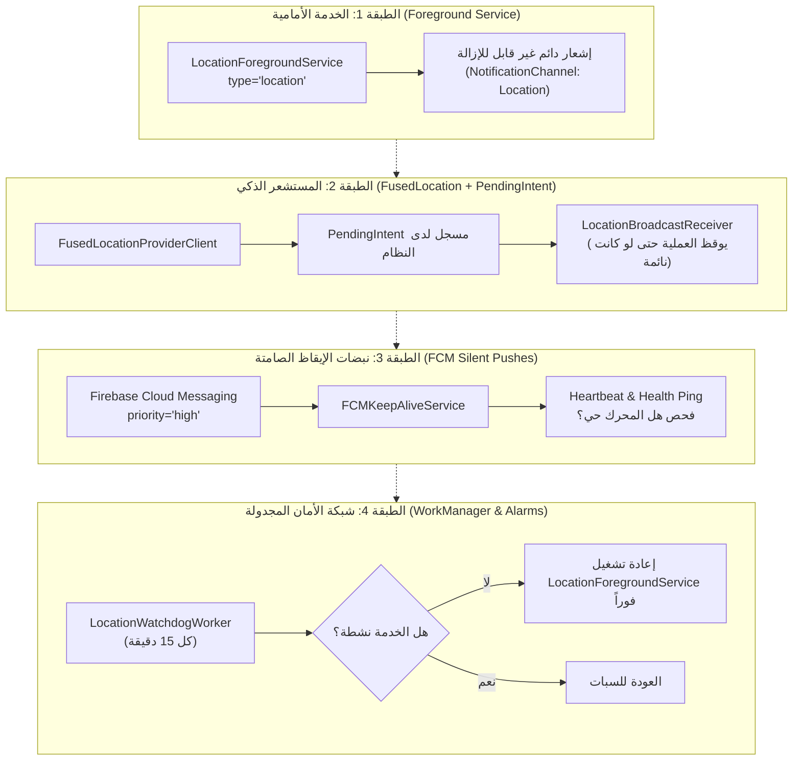

# معمارية البقاء بالخلفية وتتبع الموقع المستمر 24/7 في تطبيق Life360 (Persistence & Location Keep-Alive)

> **الهدف الهندسي:** فك شفرة الآلية التي يعتمدها Life360 في الحفاظ على تتبع موقع دقيق ومتواصل 24 ساعة يومياً على مدار الأسبوع دون أن يتوقف أو تقتله أنظمة تشغيل أندرويد الصارمة، مع الحفاظ على استهلاك طاقة بطارية لا يتجاوز 5-8% يومياً.

---

## 1. الهيكلية متعددة المستويات للبقاء (Multi-Tiered Keep-Alive Architecture)

لا يعتمد Life360 على ميكانيكية مفردة، بل يوظف 4 طبقات حماية متراكبة (Redundant Layers): في حال فشلت طبقة أو أوقفتها إدارة الذاكرة بالنظام، تُعيد الطبقة التالية إحياء المحرك فوراً:



---

## 2. تفكيك ميكانيكيات الطبقات بالتفصيل

### 2.1. الخدمة الأمامية المتخصصة (`ForegroundService` من نوع `location`)
- منذ تحديثات أندرويد 10 إلى أندرويد 14، يفرض النظام تصنيفاً دقيقاً للخدمات الأمامية. يسجل Life360 خدمته بالخاصية:
  ```xml
  android:foregroundServiceType="location|connectedDevice"
  ```
- تضمن هذه الخاصية منح العملية أولوية معالجة قصوى (`OOM_ADJ` تقترب من الصفر)، مما يمنع محرك إدارة الذاكرة في أندرويد (Low Memory Killer - LMK) من قتل العملية إلا في حالات نفاذ الذاكرة الحرج الشديد.
- يتم إقران الخدمة بإشعار مستمر في لوحة الإشعارات (`NotificationCompat.Builder.setOngoing(true)`).

### 2.2. تتبع الموقع المعتمد على `PendingIntent` بدلاً من `LocationListener`
- **الخطأ الشائع:** استخدام `LocationCallback` الذي يتطلب بقاء العملية حية في الذاكرة لتلقي التحديثات.
- **حل Life360 العبقري:** تسجيل `requestLocationUpdates` باستخدام `PendingIntent` يوجه الإحداثيات إلى `LocationBroadcastReceiver`. عندما تتوفر إحداثيات جديدة من أقمار الـ GPS أو أبراج الاتصال، يقوم نظام أندرويد نفسه بإيقاظ التطبيق وإدخاله في الذاكرة لتسليم الإحداثية، حتى لو تم إغلاق التطبيق بواسطة المستخدم!

### 2.3. النبضات الهادئة السحابية (Silent Push Heartbeats)
- في حال دخل الهاتف في وضع السبات العميق (Doze Mode) لفترة طويلة، يرسل خادم Life360 رسالة FCM عالية الأولوية (`priority: high`) بدون حمولة إشعار بصري (`data-only payload`).
- هذه الرسائل تمنح التطبيق نافذة استثناء مؤقتة (Temporary Whitelist Window) مدتها من 10 إلى 30 ثانية تمكنه من:
  1. سحب الإحداثيات الحالية عبر GPS.
  2. مزامنة حالة الأجهزة المتصلة وبطاقات أفراد العائلة.
  3. رفع سجل المسارات المؤقتة إلى الخادم عبر نقطة النهاية `PUT locations`.

### 2.4. حارس المراقبة الدوري (`LocationWatchdogWorker`)
- يعمل عبر `AndroidX WorkManager` المربوط بـ `JobScheduler`.
- يُجدول فحصاً كل 15 دقيقة يتحقق فيه من التالي:
  - هل `LocationManager` يستقبل إحداثيات؟
  - هل مضى أكثر من X دقيقة على آخر إحداثية مسجلة؟
  - في حال وجود خلل، يعيد تهيئة `FusedLocationProviderClient` ويعيد تشغيل الخدمة الأمامية.

---

## 3. هندسة التكيف الحركي وتوفير البطارية (Adaptive Power States)

لتفادي استنزاف البطارية، لا يبقي Life360 شريحة الـ GPS قيد التشغيل المستمر بأقصى تردد، بل يقسم حركة المستخدم إلى حالات حركة (`Motion States`):

| حالة الحركة | تردد الاستشعار | دقة الاستشعار (Priority) | استهلاك البطارية | شروط الانتقال |
|---|---|---|---|---|
| **السكون التام (Stationary / At Home)** | بدون GPS (0 Hz) | `PRIORITY_BALANCED_POWER_ACCURACY` (أبراج خلوية و Wi-Fi فقط) | أقل من 0.2% بالساعة | توقف الحركة لأكثر من 5 دقائق داخل دائرة جغرافية معروفة (Geofence) |
| **المشي (Walking / Jogging)** | كل 30 إلى 60 ثانية | `PRIORITY_HIGH_ACCURACY` (مسافة > 25 متر) | ~ 1% بالساعة | استشعار خطى الأقدام عبر حساس الخطوات و `ActivityRecognition: WALKING` |
| **القيادة (Driving / In-Vehicle)** | كل 1 إلى 5 ثواني | `PRIORITY_HIGH_ACCURACY` + تشغيل حساسات 100Hz لكشف الحوادث | ~ 3-4% بالساعة أثناء القيادة | سرعة تفوق 15 كم/س أو التقاط `ActivityTransition: IN_VEHICLE` |

---

## 4. استراتيجية مقاومة "قتلة التطبيقات" في الهواتف الصينية (OEM Killers Navigation)

أجهزة Samsung, Xiaomi, Huawei, Oppo, Vivo تحتوي على برامج إدارة طاقة مفرطة العدوانية تغلق التطبيقات فور قفل الشاشة. يتصدى Life360 لذلك عبر:

1. **كشف البيئة المصنعة (`ManufacturerDetection`):**  
   فحص `android.os.Build.MANUFACTURER` وتحديد مسار الإعدادات الدقيق لكل شركة.
2. **شاشات إرشادية تفاعلية تفصيلية:**  
   بدلاً من إرسال المستخدم لصفحة الإعدادات العامة، يطلق نية مباشرة (`Intent`) تستهدف الشاشة الداخلية للمصنّع:
   - **Xiaomi:** `miui.intent.action.OP_AUTO_START` لتفعيل التشغيل التلقائي.
   - **Samsung:** `com.samsung.android.lool.ACTION_BATTERY_OPTIMIZATION` لإلغاء إدراج التطبيق ضمن التطبيقات التي توضع في وضع السكون العميق.
   - **Huawei:** استهداف `com.huawei.systemmanager/appcontrol.activity.StartupAppControlActivity`.
3. **فحص الـ White-list الرسمي:**  
   التحقق البرمجي عبر `PowerManager.isIgnoringBatteryOptimizations(packageName)`، وإذا كانت الإجابة `false`، يتم فتح حوار النظام الرسمي لطلب الإعفاء عبر `ACTION_REQUEST_IGNORE_BATTERY_OPTIMIZATIONS`.
