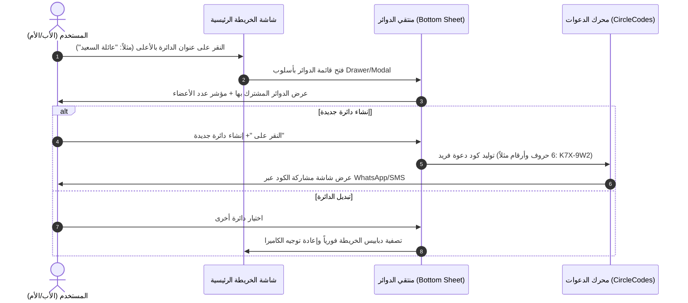
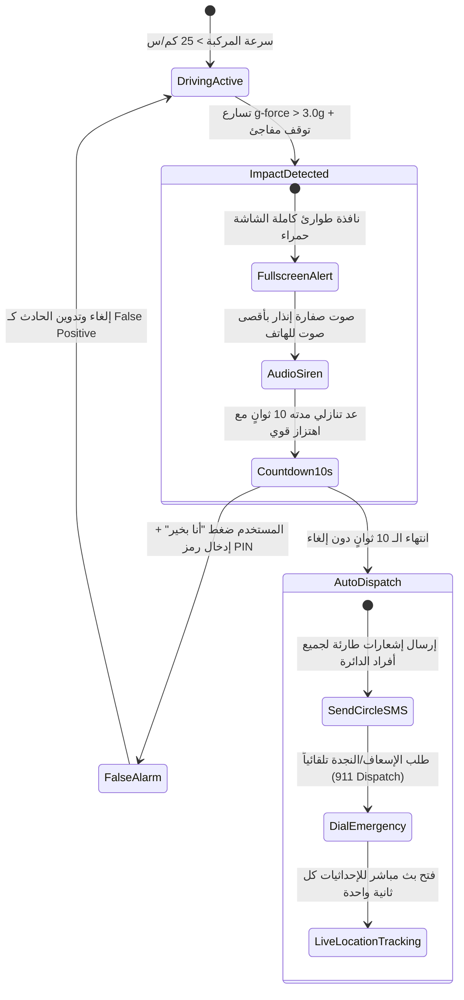

# نظام التصميم وهندسة تدفق تجربة المستخدم في تطبيق Life360 (UI/UX Architecture & Complete Flows)

> **الهدف:** توثيق شامل للأنظمة البصرية، الشاشات، الرسوم المتحركة، وتدفقات المستخدم من اللحظة الأولى لفتح التطبيق وحتى إدارة الحوادث والتتبع المتقدم.

---

## 1. فلسفة التصميم ونظام الهوية البصرية (Life360 Design Language)

تتميز تجربة Life360 بالتركيز على "الطمأنينة البصرية الفورية" (Instant Visual Reassurance):
- **اللون الأساسي للعلامة (Signature Brand Color):** البنفسجي الكهربائي الموثوق (`#6835F9`) الذي يرمز للأمان والحداثة.
- **الطباعة (Typography):** خطوط هندسية واضحة ومقروءة على الخريطة أثناء الحركة (San Francisco / Roboto بنسخ مخصصة).
- **التدرجات اللونية للأمان (Safety Status Badges):**
  - **الأخضر (`#2ECC71`):** اتصال سليم، في مكان آمن، أو قيادة ممتازة.
  - **البرتقالي (`#F39C12`):** انخفاض البطارية (<15%)، فرملة مفاجئة، أو تحذير سرعة.
  - **الأحمر الصارخ (`#E74C3C`):** تصادم مروري، زر الطوارئ SOS، أو قيادة خطيرة.
  - **الرمادي المعتم (`#95A5A6`):** الجهاز مطفأ أو تم إيقاف مشاركة الموقع.

---

## 2. تفكيك التدفقات الرئيسية الستة (The 6 Core User Flows)

### التدفق الأول: محول الدوائر العائلية وإدارة المجموعات (Circle Switcher & Management Flow)

### التدفق الثاني: واجهة الخريطة التفاعلية ودبابيس الأعضاء الديناميكية (Live Map & Avatar Markers)
1. **دبوس العضو التفاعلي (Dynamic Member Pin):**
   - **الصورة الشخصية (Circular Avatar):** صورة مستديرة محاطة بحلقة ملونة.
   - **حلقة شحن البطارية (Battery Ring Indicator):** حلقة محيطة بالأفاتار تُمثل نسبة شحن بطارية هاتف العضو (100% -> حلقة كاملة خضراء، 15% -> حلقة حمراء صغيرة).
   - **شارة السرعة الحية (Speed Badge):** تظهر أسفل الصورة فور تجاوز سرعة العضو 15 كم/س (مثلاً: "65 كم/س").
   - **سهم التوجيه والاتجاه (Bearing Compass Arrow):** يدور بسلاسة مع اتجاه حركة السيارة أو الهاتف.
2. **شريط الأماكن السفلية (Bottom Sliding Sheet):**
   - سحب الشريط لأعلى يكشف قائمة أفراد العائلة، موقعهم الحالي بنص مفهوم (مثلاً: "في المنزل منذ 25 دقيقة"، "في المدرسة"، "على طريق الملك فهد - 80 كم/س").

### التدفق الثالث: تقرير سجل القيادة الذكي (Smart Driving Safety Report)
1. **لوحة تقييم السائق (Driver Score Card):**
   - مؤشر دائري جذاب يعرض تقييماً من 100 للسائق خلال الأسبوع.
   - تصنيف السائق: *سائق مثالي (Top Driver)*، *سائق جيد (Safe)*، أو *يحتاج حذر (Needs Caution)*.
2. **سجل الرحلات التفصيلي (Trip Details Screen):**
   - مسار الرحلة مرسوم على الخريطة بخط بنفسجي ناعم.
   - **نقاط الأحداث الخطرة (Drive Event Pins):**
     - أيقونة برتقالية: **فرملة حادة (Hard Braking)** (انخفاض السرعة بأكثر من 13 كم/س خلال ثانية واحدة).
     - أيقونة صفراء: **تسارع سريع (Rapid Acceleration)** (زيادة السرعة بأكثر من 11 كم/س خلال ثانية واحدة).
     - أيقونة بنفسجية: **استخدام الهاتف أثناء القيادة (Phone Usage While Driving)** (لمس الشاشة أو فتح قفل الهاتف أثناء حركة السيارة).
     - أيقونة حمراء: **تجاوز السرعة القصوى المسموحة (Top Speed / Speeding)**.

### التدفق الرابع: تنبيهات الأماكن والجيوفنسينغ (Place Alerts & Geofencing Flow)
1. **إضافة مكان جديد (Add Place):**
   - اختيار نقطة على الخريطة أو البحث عن عنوان (عبر Google Places).
   - شريط تمرير دائري مرن (Circular Slider) لتحديد نصف قطر الحماية (من 50 متراً للمنازل إلى 1000 متر للمجمعات أو الجامعات).
2. **إعدادات الإشعارات (Alert Toggles):**
   - تنبيه عند الوصول (Arrive Alert) لكل عضو بالدائرة.
   - تنبيه عند المغادرة (Leave Alert) لكل عضو بالدائرة.

### التدفق الخامس: كشف الاصطدام وطوارئ الاستغاثة (Crash Detection & SOS Countdown Flow)

### التدفق السادس: شبكة التتبع بأجهزة البلوتوث (Tile Device Tracking Flow)
- بعد استحواذ Life360 على شركة Tile، تم دمج أجهزة التتبع ضمن شاشة العائلة.
- تعرض شاشة Tile بطاقة لكل غرض (المفاتيح، المحفظة، حقيبة الظهر، أطواق الحيوانات الأليفة).
- **دوائر القرب (Proximity Rings):** تدرج لوني يشير إلى قرب الغرض بناءً على قوة إشارة البلوتوث (RSSI).
- زر "رنين جهازي" (Find / Ring Tile) لإطلاق نغمة من التاج الصغير.
- **وضع الفقدان وشبكة المجتمع (Lost Mode & Mesh Network):** إذا فُقد الغرض خارج نطاق البلوتوث، يتم تحويله لوضع "Lost"، وتعمل هواتف جميع مستخدمي Life360 في العالم كمستشعرات صامتة تلتقط إشارة التاج وتحدث موقعه سرياً لمالكه!
