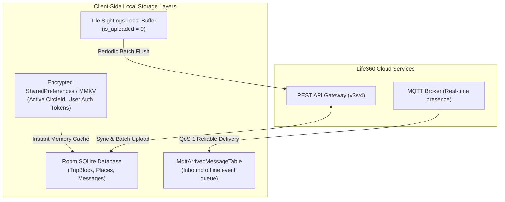

# Life360 — Offline Data Storage & Message Resilience Architecture

> **Package:** `com.life360.android`  
> **Core Guarantee:** Uninterrupted safety tracking, offline breadcrumb logging, and crash recording even without cellular coverage.

---

## 1. Local Storage Architecture

Life360 utilizes a multi-tiered local caching and storage model to deliver instant map rendering on startup and continuous offline protection:

---

## 2. Offline Telemetry & Trip Reconstruction

1. **Dead Reckoning & Offline GPS Buffering:**
   When traveling through tunnels, rural highways, or areas with zero cellular reception, Life360 continues recording IMU sensor samples and GPS points into the local `TripBlock` SQLite table.
2. **Crash Event Persistence:**
   If a severe crash occurs in a cellular dead zone, the high-G impact record, pre-collision speed, and GPS coordinates are immediately committed to `crash_events` with `status = PENDING_COUNTDOWN`. As soon as emergency roaming or a signal becomes available, the system immediately dispatches the alert.
3. **Tile Mesh Offline Accumulation:**
   Tile BLE tags discovered while offline are queued in `tile_sightings`. Once network connectivity is restored via `ConnectivityManager` broadcast, the background worker triggers `/api/v1/clients/{uuid}/batch_location_updates`.
