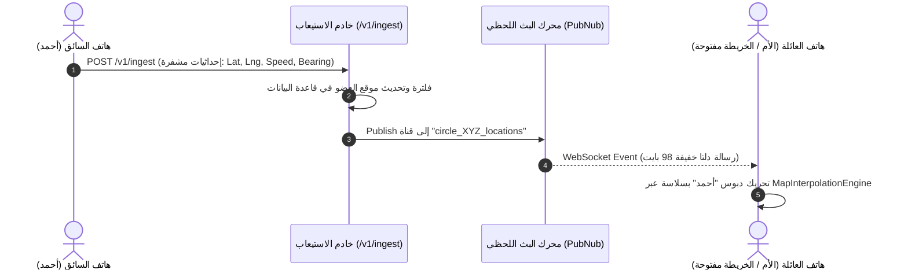

# بروتوكول البث اللحظي للمواقع الجغرافية في Life360 (Real-Time Location Streaming Protocol)

> **الهدف الهندسي:** تفكيك بروتوكول الاتصال ثنائي الاتجاه منخفض زمن الانتقال (Low-Latency Bi-Directional Streaming) الذي يربط ملايين الهواتف بخريطة Life360 لتحديث دبابيس العائلة فورياً بحركة ناعمة.

---

## 1. المعمارية الهجينة: PubNub WebSockets + REST Ingestion Gateway

لا يعتمد Life360 على مجرد استعلامات REST دورية (Polling)، بل يجمع بين نمطين:
1. **قناة الرفع السريعة (High-Throughput Ingestion REST Gateway):**  
   - نقطة النهاية: `POST /v1/ingest` و `PUT locations`.
   - يقوم هاتف العضو المتحرك برفع حزم الإحداثيات المشفرة كل 2 ثانية أثناء القيادة.
2. **قناة التوزيع اللحظي للعائلة (PubNub Real-Time Data Streaming):**  
   - بمجرد معالجة الإحداثية في السيرفر وتطبيق قيود الخصوصية، يقوم السيرفر بنشر الإحداثية عبر قناة PubNub مخصصة لكل دائرة:
     ```
     channel: "circle_{circleId}_locations"
     ```
   - جميع الهواتف المفتوحة داخل تلك الدائرة تستقبل الإحداثية عبر WebSocket دائم الاتصال بزمن تأخير يقل عن 250 ميلي ثانية.



---

## 2. بنية رسالة البث اللحظي (Message Framing & Payload Structure)

لتقليل استهلاك البيانات والبطارية، تُرسل رسائل الموقع بصيغة JSON مضغوطة ومختزلة المفاتيح (Short-Key Framing):

```json
{
  "u": "usr_98a72f10b",
  "c": "crc_512ab99",
  "lat": 24.713552,
  "lng": 46.675298,
  "acc": 4.5,
  "spd": 62.4,
  "brg": 182.0,
  "bat": 84,
  "chg": 0,
  "act": "IN_VEHICLE",
  "t": 1729983712000
}
```

### معاني المفاتيح المختصرة:
- `u`: معرف المستخدم (`userId`).
- `c`: معرف الدائرة (`circleId`).
- `lat` / `lng`: خط العرض وخط الطول المفلتر بكالمان.
- `acc`: دقة الإشارة بالأمتار (`accuracyMeters`).
- `spd`: السرعة الحالية بالكيلومتر/ساعة (`speedKmh`).
- `brg`: زاوية التوجيه البوصلية (`bearingDegrees` من 0 إلى 360).
- `bat`: نسبة شحن بطارية هاتف العضو (`batteryPercent`).
- `chg`: هل الهاتف قيد الشحن؟ (`1`: نعم، `0`: لا).
- `act`: نوع الحركة المستشعر (`motionActivity`).
- `t`: الطابع الزمني الملي ثانية (`timestampMs`).

---

## 3. التعامل مع انقطاع الشبكة وقفل الشاشة (Sleep Mode & Push Fallback)

1. **الخريطة في الخلفية (Background Receiver):**  
   عندما تغلق الأم تطبيق Life360، يتم قطع اتصال الـ WebSocket فورياً لمنع استنزاف بطاريتها.
2. **الاستيقاظ عبر FCM Data Messages:**  
   إذا حدث أمر طارئ (مثل: دخول الابن للمدرسة، أو تعرضه لاصطدام مروري، أو ضغطه زر SOS)، يُرسل السيرفر رسالة FCM صامتة عالية الأولوية تستيقظ بها الخدمة الخلفية في هاتف الأم وتطلق تنبيهاً فورياً بصوت مميز.
