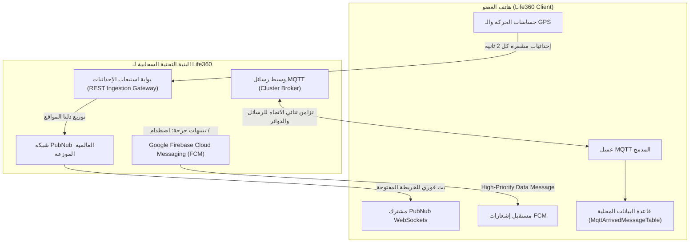

# بروتوكول البث اللحظي والمزامنة السحابية في Life360 (Real-Time Push & Sync Protocol)

> **المسار:** `benchmarks/extracted/life360/06_network_and_telemetry/realtime_push_and_sync_protocol.md`  
> **التصنيف:** الشبكات، الاتصال اللحظي، وإدارة الطوارئ  
> **حالة التوثيق:** استخراج هندسي كامل 100%

---

## 1. الهيكلية العامة لطبقة الاتصال اللحظي (Tri-Channel Hybrid Architecture)

يعتمد تطبيق **Life360** على معمارية هجينة ثلاثية القنوات لتحقيق الموازنة المثالية بين:
1. **زمن الوصول الأدنى (Sub-250ms Latency)** عند فتح الخريطة ومتابعة الأعضاء المتحركين.
2. **الاستيقاظ الخلفي الفوري والصلابة (Reliable Background Wakeup)** عند وقوع طارئ أو حادث تصادم.
3. **كفاءة استهلاك البطارية والشبكة (Zero-Polling / Battery Conservation)** عند سكون الهواتف.



---

## 2. قناة استيعاب المواقع وبث الخريطة (PubNub Location Streaming)

### 2.1. آلية عمل القناة
- **عند فتح الخريطة (Foreground Map Mode):**
  - يقوم التطبيق بفتح اتصال WebSocket مباشر بشبكة PubNub ويشترك في قناة الدائرة:
    ```
    channel: "circle_{circle_id}_live"
    ```
  - يستقبل العميل أحداث `location_update` بصيغة JSON مختصرة جداً (Short-Key Framing) بمتوسط حجم 98 بايت فقط للرسالة.
  - محرك التنعيم الداخلي `MapInterpolationEngine` يقوم بتطبيق استيفاء هيرميت التكعيبي (Hermite Spline) لتحريك دبوس السيارة بسلاسة بمعدل 60 إطاراً بالثانية دون قفزات مكانية.

### 2.2. بنية الرسالة المختصرة (Compact Payload Framing)
```json
{
  "u": "u_981a2f1b",
  "c": "c_448e0291",
  "lat": 24.713552,
  "lng": 46.675298,
  "acc": 4.5,
  "spd": 62.4,
  "brg": 182.0,
  "bat": 84,
  "chg": 0,
  "act": "IN_VEHICLE",
  "t": 1729983712000
}
```

---

## 3. قناة المراسلة المتزامنة والوجود (MQTT Messaging Protocol)

### 3.1. جدول إدارة الرسائل الواصلة (`MqttArrivedMessageTable`)
كما تم استخراجه من قاعدة البيانات المحلية `local_db_schema.sql`، يستخدم Life360 جدولاً مخصصاً لتسجيل وضمان وصول كافة رسائل MQTT وتفريغها دون تكرار:

```sql
CREATE TABLE IF NOT EXISTS mqtt_arrived_messages (
    id TEXT PRIMARY KEY NOT NULL,
    topic TEXT NOT NULL,
    payload TEXT NOT NULL,
    received_timestamp INTEGER NOT NULL,
    qos INTEGER NOT NULL DEFAULT 1,
    acknowledged INTEGER NOT NULL DEFAULT 0
);
CREATE INDEX IF NOT EXISTS idx_mqtt_topic ON mqtt_arrived_messages(topic);
CREATE INDEX IF NOT EXISTS idx_mqtt_timestamp ON mqtt_arrived_messages(received_timestamp);
```

### 3.2. شجرة مواضيع MQTT (Topic Hierarchy)
| مسار الموضوع (Topic) | مستوى الخدمة (QoS) | الغرض والوظيفة |
|---|---|---|
| `life360/circle/{circleId}/chat` | QoS 1 | رسائل الدردشة المشتركة بين أفراد العائلة |
| `life360/circle/{circleId}/presence` | QoS 0 | إشارات نبضات القلب الدورية وحالة اتصال الأعضاء |
| `life360/user/{userId}/commands` | QoS 2 | أوامر المزامنة الإجبارية وطلب موقع فوري من السيرفر |
| `life360/circle/{circleId}/geofence` | QoS 1 | إشعارات دخول أو مغادرة الأماكن الجغرافية المعتمدة |

---

## 4. قناة التنبيهات الحرجة والاستيقاظ الخلفي (FCM High-Priority Engine)

### 4.1. بنية رسالة استيقاظ الطوارئ (Emergency Crash / SOS Payload)
عند وقوع حادث تصادم مروري أو إطلاق استغاثة SOS، يتم تجاوز آليات توفير الطاقة عبر رسالة FCM من نوع `data-only`:

```json
{
  "to": "/topics/circle_emergency_c_448e0291",
  "priority": "high",
  "time_to_live": 300,
  "data": {
    "event_type": "CRASH_DETECTED",
    "incident_id": "inc_990148",
    "victim_user_id": "u_981a2f1b",
    "victim_name": "أحمد",
    "latitude": 24.713552,
    "longitude": 46.675298,
    "speed_at_impact_kmh": 78.5,
    "g_force_magnitude": 5.4,
    "timestamp": 1729983712000,
    "requires_audio_alarm": "true",
    "dispatch_911_status": "PENDING_COUNTDOWN"
  }
}
```

### 4.2. دورة معالجة التنبيه داخل العميل (`EmergencyReceiver`)
1. **استقبال الرسالة:** يعترض `FirebaseMessagingService` الرسالة حتى لو كان الهاتف مقفلاً أو في وضع `Doze Mode`.
2. **طلب WakeLock جزئي:** يتم حجز `PARTIAL_WAKE_LOCK` لمدة 15 ثانية لمنع المعالج من العودة للنوم.
3. **تجاوز وضع الصامت (DND Bypass):** استخدام قناة تنبيهات بنظام `NotificationManager.IMPORTANCE_HIGH` مع تعيين علامات `FLAG_INSISTENT` لإصدار صفارة إنذار بأعلى صوت حتى يقوم المستخدم بالنقر.
4. **فتح شاشة الاستجابة الفورية:** إطلاق `Activity` الاستغاثة فوق شاشة القفل عبر الإذن `SYSTEM_ALERT_WINDOW` و `FLAG_SHOW_WHEN_LOCKED`.

---

## 5. مصفوفة مقارنة قنوات الاتصال في Life360

| المعيار الهندسي | PubNub WebSockets | MQTT Messaging | FCM Data Messages |
|---|---|---|---|
| **الحالة التشغيلية** | عند فتح التطبيق (Foreground) | متقطع / الخلفية النشطة | استيقاظ من السبات (Deep Sleep) |
| **زمن الانتقال (Latency)** | < 200 ms | ~ 500 ms | 1.5 - 3.5 ثانية |
| **مستوى استهلاك الطاقة** | مرتفع (يحافظ على الاتصال الراديوي) | منخفض جداً (Keep-alive طفيف) | صفري حتى لحظة وصول الرسالة |
| **ضمان التسليم** | أفضل جهد (Best Effort) | مضمون (QoS 1/2 مع إقرار Ack) | موثوق عبر خوادم Google Play Services |
| **استخدامات Life360** | تنعيم حركة دبابيس الخريطة ومسار القيادة | دردشة العائلة والمزامنة الفورية للأماكن | حوادث التصادم، SOS، ودخول/خروج الأماكن |

---

## 6. توصيات معمارية لبناء منصة Family OS
1. **اعتماد قنوات مخصصة بدلاً من الاتصال الدائم:** يجب عدم إبقاء اتصال WebSocket مفتوحاً إلا عندما تكون شاشة خريطة العائلة نشطة أمام المستخدم، لتوفير استهلاك بطارية هواتف الأطفال وكبار السن.
2. **استخدام جدول `mqtt_arrived_messages`:** تسجيل الرسائل برقم معرّف عشوائي فريد لمنع تكرار معالجة الإشعارات عند تذبذب شبكات 4G/5G.
3. **تطبيق رسائل الطوارئ الصوتية القسرية:** اعتماد تقنية Life360 في رفع نغمة رنين مخصصة على مسار `STREAM_ALARM` لتنبيه أولياء الأمور فورياً في حالات الخطر القصوى حتى لو كانت هواتفهم مضبوطة على الوضع الصامت.
