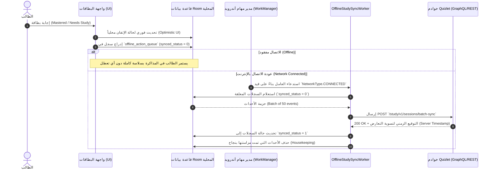

# معمارية الجدولة بالخلفية والمزامنة دون اتصال في Quizlet
## (Offline Sync & Background Scheduling Architecture via WorkManager)

> **المسار:** `benchmarks/extracted/quizlet/01_architecture_and_manifest/offline_sync_and_background_scheduling.md`  
> **الحزمة المستهدفة:** `com.quizlet.quizletandroid`  
> **المكونات المفحوصة:** `androidx.work.*`, `com.quizlet.features.infra.workers.*`, `com.quizlet.data.sync.*`

---

## 1. الرؤية الهندسية: المزامنة غير المرئية والمحافظة على استمرارية التعلم

يواجه تطبيق تعليمي مثل Quizlet تحدياً مزدوجاً:
1. **توفير تجربة استجابة صفرية التأخير (Zero Latency UX):** يجب أن يقلب الطالب البطاقة ويجيب على الأسئلة وتُحتسب درجات الإتقان فورياً دون انتظار ردود الشبكة.
2. **ضمان عدم ضياع أي مجهود دراسي (Zero Progress Loss):** إذا انقطع الاتصال أو أُغلق التطبيق فجأة أو نفدت البطارية، يجب أن تظل كافة إجابات الطالب، سلاسله اليومية، وتعديلاته محفوظة محلياً وتُرفع إلى الخادم بأمان فور عودة الاتصال.

لتحقيق ذلك، تم بناء طبقة المزامنة بالخلفية استناداً إلى **Android Jetpack WorkManager** المدعوم بـ **Room Database** و **JobScheduler**.

---

## 2. جدول عمال الخلفية المستخرج من الكود (Extracted Background Workers)

من خلال تفكيك حزم `com.quizlet.features.infra.workers` و `androidx.work.impl.*` تم حصر العمال التاليين:

| اسم العامل (Worker Class) | نوع الجدولة (Trigger / Schedule) | القيود المطلوبة (Constraints) | الوظيفة والمسؤولية التقنية |
|---|---|---|---|
| `OfflineStudySyncWorker` | حدث استعادة الاتصال (One-Time / Triggered) | `NetworkType.CONNECTED` | رفع طابور أحداث المذاكرة غير المتصلة (`offline_action_queue`) دفعة واحدة وفض النزاعات. |
| `DailyStudyReminderWorker` | دوري كل 24 ساعة (Periodic 24h) | لا يتطلب شبكة | إطلاق إشعار تذكير المذاكرة اليومية قبل موعد نوم الطالب لحماية السلسلة (Streak). |
| `PreFetchStudySetsWorker` | دوري كل 12 ساعة أو فايبر (Periodic / Wi-Fi) | `NetworkType.UNMETERED`, `BatteryNotLow` | التنزيل المسبق للبطاقات المميزة بنجمة (Starred) والمجموعات الحديثة لتكون جاهزة دون اتصال. |
| `AudioCacheCleanupWorker` | دوري أسبوعي (Periodic Weekly) | `DeviceIdle`, `BatteryNotLow` | تنظيف ملفات الـ TTS والوسائط القديمة وفق سياسة LRU لتفادي امتلاء ذاكرة الجهاز. |
| `StreakValidationWorker` | عند انتصاف الليل المحلي (00:05 AM) | لا يتطلب شبكة | فحص تسجيل جلسة المذاكرة لليوم المنصرم؛ إذا لم يذاكر يتم خصم Streak Freeze إن وُجد. |

---

## 3. خط أنابيب مزامنة المذاكرة غير المتصلة (Offline Sync Pipeline)



---

## 4. إعدادات وسياسات إعادة المحاولة والتراجع الأسي (Retry & Exponential Backoff)

عند حدوث أخطاء شبكية مؤقتة أو استجابات `5xx` من الخادم، يُطبق `OfflineStudySyncWorker` سياسة تراجع أسي لمنع استنزاف بطارية الهاتف وحماية الخوادم من طوفان الطلبات:

```kotlin
val syncConstraints = Constraints.Builder()
    .setRequiredNetworkType(NetworkType.CONNECTED)
    .build()

val syncWorkRequest = OneTimeWorkRequestBuilder<OfflineStudySyncWorker>()
    .setConstraints(syncConstraints)
    .setBackoffCriteria(
        BackoffPolicy.EXPONENTIAL,
        WorkRequest.MIN_BACKOFF_MILLIS, // 10 ثوانٍ
        TimeUnit.MILLISECONDS
    )
    .addTag("quizlet_offline_study_sync")
    .build()

WorkManager.getInstance(context).enqueueUniqueWork(
    "unique_offline_study_sync",
    ExistingWorkPolicy.APPEND_OR_REPLACE,
    syncWorkRequest
)
```

---

## 5. استراتيجية حماية السلسلة اليومية عند انتصاف الليل (Midnight Streak Protection)

1. **الاعتماد على التوقيت المحلي للمستخدم (Timezone-Aware Scheduling):**
   - لا يعتمد التطبيق على توقيت خادم الساحل الغربي لـ Quizlet (PST/UTC)، بل يسجل المنطقة الزمنية للجهاز عبر `ZoneId.systemDefault()`.
   - يتم احتساب انتصاف الليل الحقيقي لمدينة المستخدم (مثل `Asia/Riyadh`).
2. **منع الإزعاج في ساعات النوم:**
   - يتيح التطبيق للطالب اختيار نافذة التذكير المفضلة (مثلاً 07:00 مساءً إلى 09:00 مساءً).
   - إذا اقترب انتصاف الليل (10:00 مساءً) ولم يُسجل الطالب أي جلسة مذاكرة، يتم إرسال إشعار عالي الأهمية ينبهه بأن سلسلته الدراسية (Streak) مهددة بالانقطاع خلال ساعتين.
3. **تطبيق تجميد السلسلة (Streak Freeze Integration):**
   - إذا دخل اليوم الجديد دون مذاكرة، يقوم `StreakValidationWorker` باستهلاك درع تجميد واحد (`streak_freeze_count - 1`) وحفظ السلسلة، مع إرسال إشعار صباحي: *"لقد قمنا بحماية سلسلتك تلقائياً بدرع التجميد!"*.

---

## 6. الدروس المعمارية المستفادة لمنصة Family OS

| ميزة Quizlet | كيفية تطبيقها في Family OS |
|---|---|
| **طابور الأحداث المعلقة (`offline_action_queue`)** | تطبيقه في تطبيق الطفل لدعم تسجيل إتمام المهام المدرسية والبطاقات أثناء التواجد في باص المدرسة بدون إنترنت. |
| **التنزيل الاستباقي لشبكة Wi-Fi** | تنزيل المواد الدراسية الخاصة باختبارات التقويم العائلي تلقائياً عندما يتصل هاتف الطفل بشبكة المنزل ليلاً. |
| **المزامنة الفريدة (`ExistingWorkPolicy.KEEP`)** | منع تكرار استدعاءات عمال المزامنة عند تذبذب شبكة الهاتف 4G/5G. |
| **استهلاك دروع التجميد في انتصاف الليل** | ربط دروع التجميد بنظام المكافآت العائلية (Family Rewards) بحيث يستطيع الوالدان منح الطفل درع تجميد إضافي عند الإجازات العائلية. |
