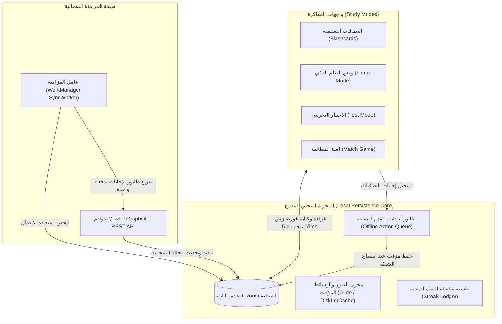

# استراتيجية البقاء والمذاكرة دون اتصال بالإنترنت في Quizlet (Persistence & Offline Learning Engine)

> **المسار:** `benchmarks/extracted/quizlet/01_architecture_and_manifest/persistence_and_offline_learning.md`  
> **التصنيف:** معمارية التخزين دون اتصال، مزامنة التقدم، وحماية سلسلة التعلم

---

## 1. التحدي المعماري: التعليم في بيئات منعدمة الاتصال (The Zero-Connectivity Challenge)

يتنقل الطلاب يومياً في بيئات تفتقر لاتصال إنترنت مستقر (حافلات النقل المدرسي، مترو الأنفاق، قاعات دراسية معزولة، أو أثناء السفر).
إذا اعتمد التطبيق على استعلام الخادم عند كل تقليب لبطاقة أو إنهاء لاختبار، ستفشل تجربة المستخدم تماماً.

لذلك صمم مهندسو Quizlet معمارية قائمة على مبدأ **"المذاكرة أولاً، والمزامنة في الخلفية" (Offline-First / Study-Uninterrupted)**.

---

## 2. آليات التخزين المؤقت المسبق (Pre-Fetching & Caching Strategy)

لا ينتظر Quizlet قيام الطالب بالنقر على زر "تحميل دون اتصال"، بل يطبق سياسة استباقية ذكية:

1. **المجموعات ذات الأولوية القصوى (Tier-1 Auto-Cached):**
   - آخر 10 مجموعات دراسية تم فتحها مؤخراً.
   - جميع المجموعات التي أنشأها المستخدم بنفسه.
   - المجموعات المميزة بنجمة (Starred Sets) والمجلدات الدراسية المخصصة للاختبارات القادمة.
2. **تخزين الوسائط والصور المرافقة:**
   - تخزين الصور المصغرة والرسومات التوضيحية داخل ذاكرة التخزين المؤقت للجهاز (`DiskLruCache`) بحد أقصى يتم ضبطه تلقائياً حسب السعة المتاحة.
3. **توليد الصوت دون اتصال (Offline TTS Fallback):**
   - إذا تعذر تنزيل ملفات النطق الصوتي المسجلة بجودة الاستوديو، يتحول التطبيق تلقائياً إلى محرك نطق النصوص المدمج في نظام أندرويد (`TextToSpeech Engine`) لنطق الكلمات بالإنجليزية والإسبانية والفرنسية دون الحاجة للإنترنت.

---

## 3. طابور العمليات غير المتزامنة (Offline Action Queue & Conflict Resolution)

عندما يجيب الطالب على 50 بطاقة في وضع `Learn` أثناء وجوده في وضع الطيران:
1. **تسجيل كل إجابة محلياً:**
   - يتم تخزين كائن `StudySessionEvent` يضم: معرّف البطاقة `studiableId`، هل الإجابة صحيحة أم خاطئة `isCorrect`، الطابع الزمني للحدث `timestamp`، ووقت الاستجابة بالمللي ثانية `responseDurationMs`.
2. **تحديث مستوى الإتقان المحلي (Local Mastery State):**
   - تنتقل البطاقة فورياً في واجهة المستخدم من صندوق "قيد المراجعة" إلى "أتقنتها" دون انتظار أي رد من الخادم.
3. **استشعار عودة الشبكة (`NetworkChangeReceiver`):**
   - فور توفر اتصال Wi-Fi أو 4G، يقوم عامل `WorkManager` بقراءة جميع الأحداث المعلقة من جدول `pending_study_events`، وتجميعها في طلب واحد (Bulk Batch Request)، وإرسالها إلى الخادم.
4. **فض التعارضات السحابية (Last-Write-Wins / Progression Merge):**
   - إذا قام الطالب بالمذاكرة من هاتفه ثم من الحاسوب: يعتمد الخادم أعلى مستوى إتقان مسجل بين الجهازين لضمان عدم ضياع أي مجهود بذله الطالب.

---

## 4. حماية سلسلة المذاكرة اليومية (Daily Streak Persistence)

سلسلة التعلم (Daily Streak) هي أقوى محفز نفسي لعودة الطالب يومياً للتطبيق. يتعامل Quizlet معها بحرص هندسي فائق:
1. **احتساب السلسلة بناءً على التوقيت المحلي للهاتف (Local Timezone Anchoring):**
   - اليوم الدراسي للطالب ينتهي عند منتصف الليل بتوقيته المحلي، وليس بتوقيت خوادم كاليفورنيا (UTC).
2. **اعتماد المذاكرة غير المتصلة بأثر رجعي (Retroactive Streak Credit):**
   - إذا درس الطالب في الطائرة يوم الثلاثاء بدون إنترنت، وعندما اتصل بالإنترنت يوم الأربعاء، يقوم السيرفر بفحص الطوابع الزمنية المحلية للإجابات وتثبيت سلسلة يوم الثلاثاء بأثر رجعي دون كسرها!
3. **مجدول التنبيهات المقاوم لإعادة التشغيل (`BootCompletedReceiver`):**
   - يقوم التطبيق بإعادة تسجيل منبه `AlarmManager` بنوع `RTC_WAKEUP` عند كل إعادة تشغيل للهاتف لتذكير الطالب قبل انتهاء اليوم بـ ساعتين في حال لم يدرس بعد.
