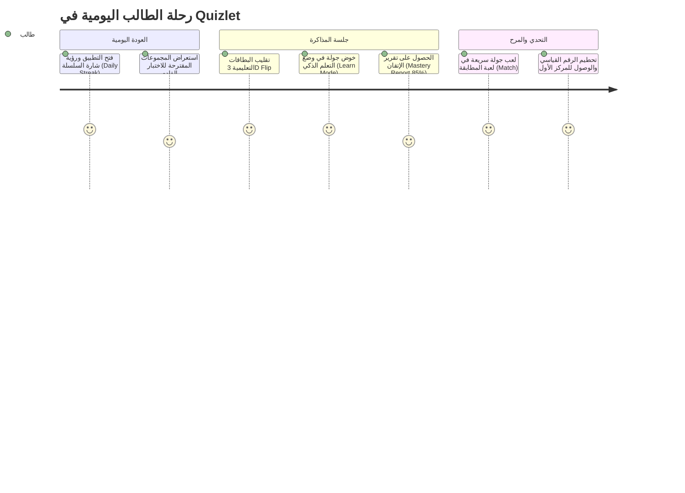

# توثيق التدفقات وتجربة المستخدم الكاملة في Quizlet (UI/UX Complete Flows)

> **المسار:** `benchmarks/extracted/quizlet/02_design_system_and_ui/ui_ux_complete_flows.md`  
> **التصنيف:** تصميم واجهات المستخدم، مسارات التعلم، وتجربة الطالب والمعلم

---

## 1. فلسفة نظام التصميم في Quizlet (Design System Philosophy)

يعتمد Quizlet على هوية بصرية مفعمة بالحيوية والوضوح لتقليل التوتر الدراسي وزيادة تركيز الطالب:
- **اللون الأساسي:** أزرق نيلي مركز (`#4255FF`) يعبر عن الثقة والتركيز الأكاديمي.
- **لون الخلفية الليلية:** كحلي داكن عميق (`#2E3856` و `#0A092D`) يريح عين الطالب أثناء المذاكرة الليلية الطويلة.
- **لون المكافأة والنجاح:** أخضر نعناعي مشرق (`#23B26D`) للإجابات الصحيحة، وأصفر ذهبي ناصع (`#FFCD1F`) للنجوم وسلاسل الإنجاز (Streaks).
- **التفاعل الحركي (Micro-interactions):** فيزياء البطاقات ثلاثية الأبعاد (3D Card Flip)، سحب البطاقات بسلاسة (Smooth Swiping)، واندثار البلاطات المتطابقة في لعبة Match.

---

## 2. التدفقات الستة الرئيسية لتجربة المستخدم (Core UX Flows)

### التدفق الأول: إنشاء وإثراء المجموعات الدراسية (Study Set Creation & OCR Scan)
1. **التهيئة السريعة:** ينقر الطالب على زر `[+]` العائم في أي مكان داخل التطبيق.
2. **إدخال العنوان والوسوم:** كتابة عنوان المادة (مثل: *"أحياء 1 - علم الوراثة"*).
3. **طرق إدخال المحتوى المتعددة:**
   - **الكتابة اليدوية:** حقول مرنة تقترح الإكمال التلقائي للمصطلحات والترجمات الشائعة.
   - **المسح الضوئي الذكي (Document OCR):** فتح الكاميرا وتوجيهها لصفحة الكتاب أو الدفتر، ليقوم المحرك بقراءة السطور وتوليد أزواج المصطلحات والتعريفات آلياً.
   - **إدراج الوسائط:** دعم إضافة صور توضيحية من مكتبة الجهاز أو البحث السريع في مكتبة صور مجانية، وتسجيل النطق الصوتي المخصص.
4. **تحديد خصوصية المجموعة:** [عام للجميع]، [محمي بكلمة مرور]، أو [مخصص لفصلي الدراسي فقط].

---

### التدفق الثاني: دراسة البطاقات التعليمية التفاعلية (Flashcards Study Mode)
1. **واجهة البطاقة الأفقية ثلاثية الأبعاد (3D Flip Card):**
   - يُعرض وجه البطاقة (المصطلح) بخط كبير ومقروء.
   - عند النقر في أي نقطة على البطاقة، تدور البطاقة حول محورها الأفقي (Y-Axis) بنعومة عبر تحويلات `graphics.Camera` و `rotationY` لتظهر التعريف وصورته المرافقة.
2. **إيماءات السحب الطبيعية (Tinder-style Gestures):**
   - **سحب لليمين (Swipe Right):** يعني "أعرف هذا المصطلح جيداً" (Know) $\rightarrow$ تظهر حافة خضراء ناعمة.
   - **سحب لليسار (Swipe Left):** يعني "ما زلت أتعلمه" (Still Learning) $\rightarrow$ تظهر حافة برتقالية ويُعاد المصطلح في نهاية الدورة.
3. **المذاكرة بدون يدين (Hands-Free Audio Autoplay):**
   - زر تشغيل يبدأ دورة صوتية آلية: قراءة المصطلح $\rightarrow$ صمت ثانيتين $\rightarrow$ قراءة التعريف $\rightarrow$ الانتقال التلقائي للبطاقة التالية، مع إمكانية إطفاء الشاشة.

---

### التدفق الثالث: وضع التعلم الذكي التكيفي (Learn Mode Flow)
1. **تحديد هدف المذاكرة:** يسأل التطبيق الطالب: *"متى موعد اختبارك؟ وما مدى معرفتك بالمادة؟"* لجدولة خوارزمية التكرار.
2. **التدرج المعرفي من البسيط إلى المعقد (Adaptive Scaffolding):**
   - **المرحلة الأولى:** أسئلة اختيار من متعدد (Multiple Choice) لترسيخ الذاكرة الأولية.
   - **المرحلة الثانية:** أسئلة صح أم خطأ وتطابق سريع.
   - **المرحلة الثالثة:** أسئلة كتابية كاملة (Written Prompts) تتطلب كتابة التعريف غيباً لاختبار الاسترجاع النشط.
3. **التسامح مع الأخطاء الإملائية (Smart Grading):**
   - إذا كتب الطالب: *"ميتوكوندريا"* وكتب التطبيق *"الميتوكوندريا: مصنع طاقة الخلية"*، يقبل التطبيق الإجابة إذا تطابق المفهوم الأساسي ولا يحبط الطالب بخصم النقاط بسبب همزة أو مسافة إضافية.
4. **شاشة نهاية الجولة (Round Summary):** استعراض المصطلحات المتقنة والمصطلحات التي تحتاج مراجعة قبل الانتقال للجولة التالية.

---

### التدفق الرابع: مولد الاختبارات التجريبية (Custom Test Generator)
1. **تخصيص الاختبار:** يستطيع الطالب أو المعلم اختيار:
   - عدد الأسئلة (مثلاً: 20 سؤالاً من أصل 100).
   - أنواع الأسئلة المفعلة (خيارات متعددة، إكمال فراغات، مطابقة، صح/خطأ).
   - البدء بالمصطلحات أو التعريفات.
   - تفعيل وضع "النجوم فقط" لمراجعة أصعب البطاقات.
2. **خوض الاختبار:** واجهة تشبه ورقة الاختبار الحقيقية بدون إظهار الإجابات أثناء الحل.
3. **التصحيح اللحظي والتقرير:** فور النقر على "إنهاء الاختبار"، تظهر النتيجة كنسبة مئوية مع قائمة تفصيلية بالأخطاء وزر فوري: *"أنشئ مجموعة دراسية جديدة تضم أخطائي فقط لمراجعتها"*.

---

### التدفق الخامس: لعبة المطابقة التنافسية (Match Game)
1. **الشاشة الافتتاحية:** إظهار أفضل توقيت حققه الطالب وقائمة المتصدرين في الفصل.
2. **بدء السباق ضد الزمن:** تتبعثر 6 مصطلحات و 6 تعريفات في شبكة مستطيلة مكونة من 12 بلاطة.
3. **التفاعل الحركي:**
   - ينقر الطالب على المصطلح (يضيء بلون أزرق).
   - ينقر على التعريف المقابل.
   - إذا كان الاختيار صحيحاً: تومض البلاطتان بلون أخضر وتختفيان مع اهتزاز لمسي لطيف (Haptic Success).
   - إذا كان خاطئاً: تهتز البلاطتان بلون أحمر ويُضاف ثانية واحدة كعقوبة لمؤقت الزمن.
4. **لوحة الشرف:** عند مطابقة آخر زوج، يتوقف المؤقت وتظهر شاشة الاحتفال بمؤثرات الكونفيتي (Confetti Particles).

---

### التدفق السادس: الفصول الدراسية والدراسة التعاونية (Classes & Social Learning)
1. **إنشاء الفصل الدراسي:** يحدد المعلم اسم المدرسة والفصل ويحصل على رابط دعوة سريع ومختصر.
2. **توزيع المجموعات الدراسية:** يتمكن جميع الطلاب المنضمين من الوصول الموحد لكافة بطاقات الفصل ومتابعة إعلانات المعلم.
3. **وضع Quizlet Live التعاوني:** وضع تنافسي يجمع الطلاب في فرق؛ حيث تظهر أسئلة الاختبار على الشاشة المركزية ويجب على أفراد الفريق التنسيق لأن الإجابة الصحيحة موجودة على هاتف واحد فقط من أعضاء الفريق!
