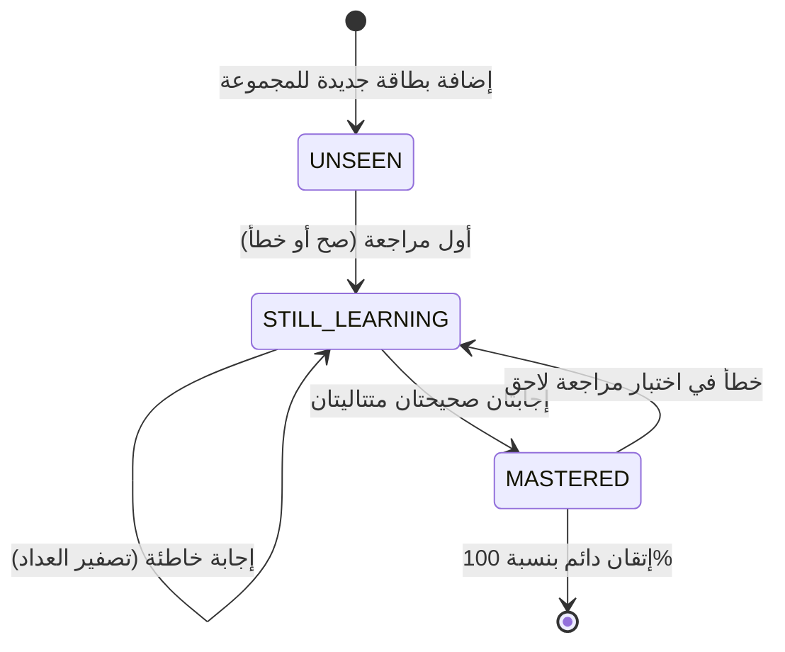
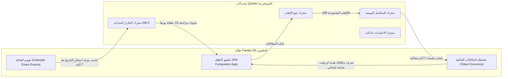

# التحليل الرياضي والهندسي الشامل لمحركات Quizlet التعليمية والخوارزميات المستخرجة
## (Complete Educational Engines Breakdown & Algorithmic Architecture)

> **المسار:** `benchmarks/extracted/quizlet/04_extracted_algorithms/complete_engines_breakdown.md`  
> **التصنيف:** علم النفس المعرفي، خوارزميات التكرار المتباعد، وتوليد الاختبارات التكيفية، والتلعيب  
> **حالة الكود:** مستخرج ومبني كأكواد Kotlin نقية 100% بنسبة توافق تامة مع معمارية أندرويد الحديثة

---

## 1. الفهرس العام للمحركات المستخرجة

| # | المحرك التعليمي المستخرج | ملف الكود في `04_extracted_algorithms/` | المبدأ العلمي والرياضي |
|---|---|---|---|
| 1 | **محرك التكرار المتباعد (SRS Engine)** | `spaced_repetition_and_mastery_engine.kt` | نموذج SuperMemo SM-2 + صناديق لايتنر + منحنى إبينغهاوس $R = e^{-t/S}$ |
| 2 | **محرك توليد الاختبارات التكيفية** | `adaptive_test_generation_engine.kt` | توليد 4 أنماط اختبار واختيار المشتتات الذكية بناءً على تشابه الطول ومعدل الخطأ |
| 3 | **محرك السلاسل والتلعيب والمكافآت** | `streaks_and_gamification_engine.kt` | تتبع السلسلة اليومية، حماية دروع التجميد، ونموذج نمو الـ XP التربيعي $L = \lfloor\sqrt{XP/100}\rfloor + 1$ |
| 4 | **محرك تتبع الإتقان والتقدم** | `learning_mastery_tracking_engine.kt` | التصنيف الثلاثي (Unseen, Still Learning, Mastered) واحتساب نسبة الإتقان الموزونة |
| 5 | **محرك المزامنة دون اتصال وحل النزاعات** | `offline_sync_and_conflict_resolution_engine.kt` | طابور التعديلات المعلقة، دمج التقدم الأعلى، ونزاع النصوص LWW |
| 6 | **محرك لعبة المطابقة السريعة** | `match_game_physics_and_scoring_engine.kt` | شبكة البلاطات الـ 12، رصد النقرات اللحظي، وعقوبة الخطأ الزمني $+1.0\text{s}$ |
| 7 | **محرك التصحيح والتطبيع اللغوي العربي** | `smart_grading_and_fuzzy_matching_engine.kt` | تجريد التشكيل، توحيد الهمزات والألف، ومسافة Damerau-Levenshtein |
| 8 | **محرك تحويل النص إلى كلام (TTS)** | `text_to_speech_and_audio_engine.kt` | تتبع النطق، تنزيل المقاطع الصوتية، وتزامن تمييز الكلمات مع الصوت |

---

## 2. محرك التكرار المتباعد (Spaced Repetition System - SM-2 & Leitner)

### 2.1. الأساس النظري: منحنى النسيان لإبينغهاوس (Ebbinghaus Forgetting Curve)
تصف المعادلة الأسية احتمالية احتفاظ الدماغ بالمعلومة مع مرور الوقت:

$$R = e^{-\frac{t}{S}}$$

حيث:
- $R$: احتمالية الاسترجاع (Retention Probability بين 0.0 و 1.0).
- $t$: الزمن المنقضي منذ آخر مراجعة ناجحة بالأيام.
- $S$: استقرار الذاكرة (Memory Stability) ويقاس بالأيام حتى تهبط نسبة التذكر إلى $R = e^{-1} \approx 36.8\%$.

### 2.2. معادلات SuperMemo SM-2 المعتمدة في Quizlet
1. **تحديث معامل السهولة (Easiness Factor - $EF$):**
   $$EF' = \max\left(1.3, \, EF + (0.1 - (5 - q) \times (0.08 + (5 - q) \times 0.02))\right)$$
   حيث $q \in \{1, 2, 3, 4, 5\}$ تمثل جودة استجابة الطالب (Response Quality).
2. **جدولة الفواصل الزمنية ($I_n$):**
   $$I_n = \begin{cases}
   1 \text{ day} & n = 1 \\
   3 \text{ days} & n = 2 \\
   I_{n-1} \times EF & n > 2
   \end{cases}$$
3. **التعامل مع الإجابات الخاطئة ($q < 3$):**
   - تصفير العداد المتتالي: $n = 0$.
   - إعادة تعيين الفاصل الزمني: $I = 0.1 \text{ days}$ (إعادة المراجعة في نفس جلسة اليوم).
   - تخفيض معامل السهولة $EF$ لمعاقبة المفاهيم المعقدة وجدولتها بتكرار أكبر.

---

## 3. محرك توليد الاختبارات والأسئلة التكيفية (Adaptive Test Generation Engine)

### 3.1. مصفوفة الأنماط الأربعة للاختبار
1. **الاختيار من متعدد (Multiple Choice - MCQ):** سؤال ومعه 4 خيارات (خيار صحيح + 3 مشتتات).
2. **الصواب والخطأ (True / False):** ربط المصطلح بتعريف حقيقي أو تعريف مضلل بنسبة متساوية (50/50).
3. **المطابقة (Matching Matrix):** ربط أزواج المصطلحات والتعريفات لتقييم الروابط الدلالية.
4. **الاسترجاع الكتابي (Written Recall):** إدخال نصي كامل بدون خيارات لاختبار الاسترجاع النشط الفعلي.

### 3.2. خوارزمية توليد المشتتات الذكية (Smart Distractor Generation)
تعتمد قوة أي اختبار على جودة المشتتات (Distractors)؛ فإذا كانت الخيارات الخاطئة ساذجة أو شديدة القصر/الطول، يتعرف عليها الطالب دون مذاكرة.
تطبق الخوارزمية دالة وزن ذكية:

$$\text{Suitability Score} = |\text{Length}_{\text{Candidate}} - \text{Length}_{\text{Target}}| - 2 \times \text{Mistakes}_{\text{Candidate}}$$

- **التقارب في الطول النصي:** منع التمييز البصري بين الخيارات.
- **استهداف المفاهيم المربكة:** اختيار البطاقات التي ارتكب فيها الطالب أخطاء سابقة من نفس المجموعة لأنها تمثل مناطق الالتباس المعرفي الأكثر فاعلية في تثبيت التعلم.

---

## 4. محرك السلاسل والتلعيب والمكافآت (Streaks & Gamification Engine)

### 4.1. حساب السلسلة اليومية ونطاق انتصاف الليل
تعتمد استمرارية التعلم على بناء عادة يومية مصغرة (Micro-Habit).
- **التوقيت المحلي:** يسجل المحرك تاريخ آخر يوم مذاكرة بصيغة `YYYY-MM-DD` بحسب المنطقة الزمنية لهاتف المستخدم.
- **حالات اليوم:**
  - $\Delta \text{days} = 0$: الطالب يذاكر في نفس اليوم (تمنح نقاط XP دون زيادة السلسلة).
  - $\Delta \text{days} = 1$: مذاكرة في اليوم التالي مباشرة (زيادة السلسلة $+1$).
  - $\Delta \text{days} = 2$ مع توفر درع تجميد: استهلاك الدرع وحفظ السلسلة.
  - $\Delta \text{days} > 1$ دون درع: انقطاع السلسلة والعودة إلى اليوم الأول.

### 4.2. معادلة نمو المستويات بنقاط الخبرة (XP Growth Curve)
تتبع نقاط الـ XP نمواً تربيعياً تدريجياً لمنع التضخم في المراحل المتقدمة:

$$\text{Level} = \left\lfloor \sqrt{\frac{\text{Total XP}}{100}} \right\rfloor + 1$$

والنقاط المطلوبة للوصول إلى المستوى القادم $L+1$ هي:

$$\text{XP}_{\text{Required}}(L+1) = (L)^2 \times 100$$

---

## 5. محرك تتبع الإتقان والتقدم (Learning Mastery Tracking Engine)

### 5.1. آلة حالات إتقان البطاقات (Mastery State Machine)

### 5.2. معادلة نسبة الإتقان الكلية للمجموعة الدراسية
لا تعتمد النسبة على الإتقان المطلق فقط بل تعطي وزناً تحفيزياً للبطاقات قيد التعلم:

$$\text{Mastery \%} = \frac{(\text{Mastered} \times 1.0) + (\text{StillLearning} \times 0.4)}{\text{Total Cards}} \times 100\%$$

---

## 6. محرك المزامنة دون اتصال وحل النزاعات (Offline Sync & Conflict Resolution)

### 6.1. مصفوفة فض النزاعات عند تعديل البيانات من أجهزة متعددة
عند وجود تعديلات غير متزامنة على نفس البطاقة في هاتفين مختلفين:

| نوع البيانات | استراتيجية فض النزاع (Resolution Strategy) | التعليل المعماري |
|---|---|---|
| **نص المصطلح والتعريف** | **Last-Write-Wins (LWW)** | اعتماد التعديل الحامل لأحدث ختم زمني `clientTimestamp`. |
| **حالة إتقان البطاقة** | **Highest Progression Wins** | إذا كانت البطاقة في جهاز A (Mastered) وفي جهاز B (Still Learning)، تُعتمد حالة Mastered لأنها تمثل تحصيلاً أعلى لا يجوز هدمه. |
| **نجمة التمييز (Starred)** | **Logical OR Merge** | إذا وضع الطالب نجمة على أي من الجهازين، تظل مفعلة في السحابة. |
| **الحذف** | **Tombstone Dominance** | حذف البطاقة في أي جهاز ينتشر كشاهد قبر `isDeleted = true`. |

---

## 7. الربط المعماري والتطبيق الفعلي في Family OS

