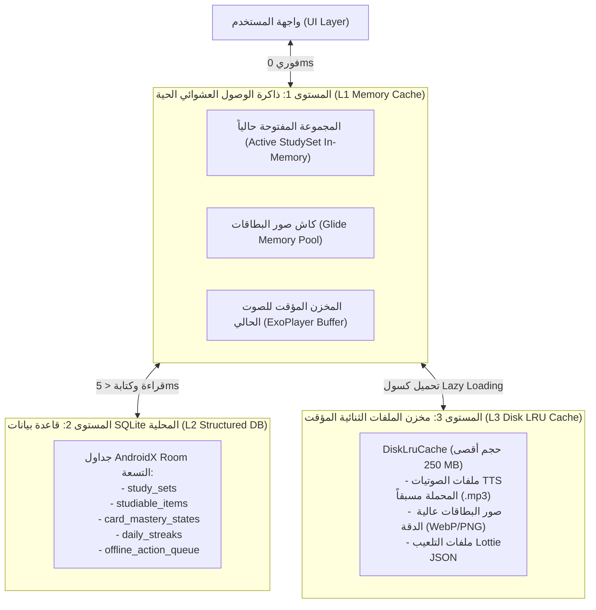

# معمارية التخزين المؤقت وتخزين بطاقات المذاكرة دون إنترنت في Quizlet
## (Offline Study Storage Architecture & Local Database Management)

> **المسار:** `benchmarks/extracted/quizlet/05_data_models_and_schemas/offline_study_storage.md`  
> **الحزمة المستهدفة:** `com.quizlet.db`, `com.quizlet.data.cache`, `androidx.room.*`  
> **التصنيف:** هندسة قواعد البيانات المدمجة، التخزين المؤقت للملفات والوسائط، وإدارة استهلاك الذاكرة

---

## 1. المعمارية الهرمية لطبقة التخزين المحلي (Local Storage Hierarchy)

يعتمد Quizlet على هيكلية تخزين ثلاثية المستويات لتحقيق التوازن بين سرعة استرجاع البيانات الفورية (أقل من 5 ميلي ثانية) وترشيد مساحة التخزين الداخلية لهاتف الطالب:



---

## 2. استراتيجية التنزيل والحفظ دون إنترنت (Offline Caching Policies)

### 2.1. المجموعات المحفوظة تلقائياً (Automatic Caching)
- **المجموعات المنشأة بواسطة الطالب:** تُخزن محلياً بالكامل (كافة البطاقات والنصوص) في قاعدة بيانات Room بمجرد حفظها ولا يتم مسحها إطلاقاً إلا بطلب صريح من المستخدم.
- **المجموعات المميزة بنجمة (Starred Sets):** تُعد ذات أولوية عليا؛ حيث يُبقي المحرك نصوصها وصورها مخزنة محلياً بصفة دائمة.
- **المجموعات الأخيرة (Recently Studied Sets):** تُحفظ آخر 10 مجموعات فتحها الطالب تلقائياً لتكون جاهزة للمذاكرة الفورية في حال انقطاع الشبكة فجأة في المدرسة أو الباص.

### 2.2. المجموعات العامة وسحب البحث (Public Search Sets & LRU Eviction)
- المجموعات التي يتصفحها الطالب للبحث ولا يملكها ولا يضع عليها نجمة تخضع لسياسة **Least Recently Used (LRU)**:
  - الحد الأقصى للمجموعات غير المملوكة هو **50 مجموعة**.
  - عند تجاوز هذا الحد، يتم تفريغ أقدم مجموعة تم فتحها (`last_studied_timestamp ASC`) وتحرير مساحتها مع الحفاظ على سجل إتقان الطالب إن وُجد.

---

## 3. هندسة الفهارس وتحسين أداء الاستعلامات (Index Optimization in Room)

تتضمن سكيما `local_db_schema.sql` فهارس مركبة تم تصميمها لخدمة سيناريوهات المذاكرة الأكثر حساسية للسرعة:

1. **فهرس ترتيب البطاقات المتسلسل:**
   ```sql
   CREATE INDEX IF NOT EXISTS idx_studiable_items_set_order 
   ON studiable_items(set_id, card_order ASC);
   ```
   *الفائدة:* سحب بطاقات المجموعة بالترتيب الدقيق لمطابقة واجهة تقليب البطاقات دون الحاجة لفرز `ORDER BY` في الذاكرة الحية.

2. **فهرس البطاقات المستحقة للمراجعة اليوم (SRS Due Index):**
   ```sql
   CREATE INDEX IF NOT EXISTS idx_card_mastery_due 
   ON card_mastery_states(user_id, next_review_due_at ASC);
   ```
   *الفائدة:* استعلام فوري في أقل من 1ms لجلب كافة البطاقات التي انتهى فاصلها الزمني وحان وقت مراجعتها لتغذية الشاشة الرئيسية ومؤشر الإشعار.

3. **فهرس طابور المزامنة المعلقة:**
   ```sql
   CREATE INDEX IF NOT EXISTS idx_offline_queue_synced 
   ON offline_action_queue(synced_status, timestamp_ms ASC);
   ```
   *الفائدة:* استخراج الأحداث التي لم تُرَفَع بعد مرتبة زمنياً لإرسالها في دفعات سريعة لعمال `WorkManager`.

---

## 4. عزل الوسائط المتعددة ومنع اختناق ذاكرة النظام (Blob Isolation & CursorWindow Protection)

- **حظر تخزين ملفات الوسائط في جداول SQLite:**
  تمنع معمارية Quizlet تخزين أي صور أو ملفات صوتية بصيغة `BLOB` داخل قاعدة بيانات Room؛ لأن تخزين ملفات ثنائية كبيرة يؤدي إلى استنزاف مساحة `CursorWindow` (المحدودة بـ 2 MB في نظام أندرويد) وتوقف التطبيق بخطأ `CursorWindowAllocationException`.
- **البديل المعتمد:**
  تخزين مسار الملف المحلي النسبي `audio_local_path` كـ `TEXT` داخل الجدول يشير إلى المسار الفعلي داخل مجلد التطبيق الآمن:
  `context.filesDir.resolve("media/audio/${cardId}.mp3")`.

---

## 5. تطبيق هذه المعمارية في منصة Family OS

1. **التعلم في بيئات السفر والرحلات:**
   تمكين أطفال العائلة من مراجعة البطاقات والمقررات المدرسية أثناء الرحلات العائلية بدون إنترنت.
2. **تكامل التقويم مع التخزين المسبق:**
   عند رصد موعد اختبار في تقويم العائلة بعد 48 ساعة، يقوم النظام تلقائياً بتنزيل المجموعة الدراسية وصوتياتها كاملة على جهاز الطفل لضمان جاهزيتها قبل الاختبار.
