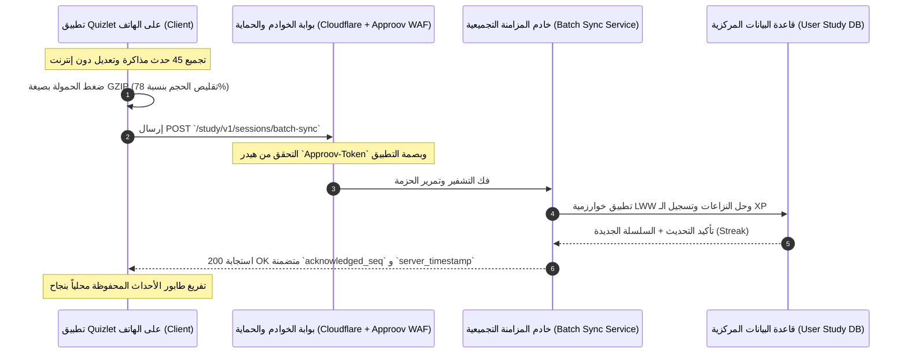

# بروتوكول مزامنة الجلسات التعليمية وضغط الحزم في Quizlet
## (Offline Study Sync Protocol, Payload Batching & Compression Specifications)

> **المسار:** `benchmarks/extracted/quizlet/06_network_and_telemetry/offline_sync_protocol.md`  
> **الحزمة المستهدفة:** `com.quizlet.remote.sync`, `com.quizlet.data.batch`  
> **التصنيف:** بروتوكولات المزامنة غير المتصلة، ضغط حمولة الشبكة، وترشيد استهلاك البيانات

---

## 1. الهيكلية العامة لبروتوكول المزامنة (Protocol Overview)

يُعد بروتوكول المزامنة السحابية في Quizlet بروتوكولاً هجيناً يعمل على نقل أحداث المذاكرة غير المتصلة (Offline Event Log) عبر طبقة **HTTPS REST** مدعومة بضغط **GZIP** وتوقيعات أمنية مشفرة عبر **Approov**:



---

## 2. ترويسات الطلب الإلزامية (Mandatory HTTP Headers)

| الترويسة (Header) | مثال القيمة (Example Value) | الغرض التقني |
|---|---|---|
| `Content-Type` | `application/json; charset=utf-8` | تحديد نوع المحتوى المتبادل. |
| `Content-Encoding` | `gzip` | إبلاغ الخادم بأن الحمولة مضغوطة ثنائياً بـ Gzip. |
| `X-Quizlet-Device-Id` | `dvc_and_88492048201` | معرّف الجهاز الفريد لفض النزاعات وتتبع التزامن المتعدد. |
| `X-Quizlet-Client-Time` | `1730248800000` | الختم الزمني لهاتف المستخدم بالميلي ثانية لمطابقة فترات السلاسل. |
| `X-Quizlet-Sync-Token` | `st_9981aef029c4` | توكن المزامنة التزايدية (Cursor Token) لطلب التحديثات الجديدة فقط. |
| `Approov-Token` | `eyJhbGciOiJSUzI1...` | توكن التوثيق الثنائي المولد من مكتبة `libapproov.so`. |

---

## 3. بنية حمولة الطلب التجميعي (Batch Sync Request Payload Schema)

```json
{
  "sync_version": 2,
  "client_generated_at": 1730248800000,
  "device_id": "dvc_and_88492048201",
  "timezone": "Asia/Riyadh",
  "client_sequence_id": 1420,
  "events": [
    {
      "event_id": "evt_99182a",
      "event_type": "CARD_RECALL",
      "card_id": "crd_101",
      "set_id": "set_bio_01",
      "mode": "FLASHCARDS",
      "is_correct": true,
      "response_duration_ms": 1450,
      "client_timestamp": 1730248740000
    },
    {
      "event_id": "evt_99182b",
      "event_type": "CARD_RECALL",
      "card_id": "crd_102",
      "set_id": "set_bio_01",
      "mode": "FLASHCARDS",
      "is_correct": false,
      "response_duration_ms": 3200,
      "client_timestamp": 1730248765000
    },
    {
      "event_id": "evt_99182c",
      "event_type": "CARD_STAR_TOGGLED",
      "card_id": "crd_102",
      "set_id": "set_bio_01",
      "is_starred": true,
      "client_timestamp": 1730248770000
    }
  ],
  "session_summary": {
    "total_cards_studied": 2,
    "total_duration_seconds": 120,
    "completed_full_round": true
  }
}
```

---

## 4. بنية استجابة الخادم وتأكيد المزامنة (Batch Sync Response Payload Schema)

```json
{
  "status": "SUCCESS",
  "server_timestamp": 1730248802150,
  "acknowledged_sequence_id": 1420,
  "synced_event_ids": [
    "evt_99182a",
    "evt_99182b",
    "evt_99182c"
  ],
  "streak_status": {
    "current_streak": 7,
    "longest_streak": 14,
    "streak_extended_today": true,
    "freeze_available_count": 2,
    "daily_goal_reached": true
  },
  "gamification_rewards": {
    "xp_awarded": 75,
    "total_xp": 4820,
    "current_level": 7,
    "new_badges_unlocked": [
      {
        "badge_id": "streak_7",
        "title": "صانع العادة",
        "xp_bonus": 250
      }
    ]
  },
  "conflicts_resolved": []
}
```

---

## 5. استراتيجية المزامنة التزايدية (Delta Sync & Incremental Pull)

لتفادي تنزيل المجموعة الدراسية بالكامل عند كل فتح للتطبيق، يدعم البروتوكول الاستعلام التزايدي عبر الترويسة `since`:

- **طلب التحديثات:**  
  `GET /study/v1/sets/set_bio_01/delta?since=1730200000000`
- **استجابة الخادم التزايدية:**  
  تُرجع الخوادم فقط البطاقات التي تم تعديلها أو إضافتها أو حذفها منذ ذلك الختم الزمني:
  ```json
  {
    "set_id": "set_bio_01",
    "latest_version_timestamp": 1730248800000,
    "updated_cards": [
      {
        "id": "crd_105",
        "term": "الميتوكوندريا المعدلة",
        "definition": "التعريف المحدث..."
      }
    ],
    "deleted_card_ids": ["crd_99"]
  }
  ```

---

## 6. تقنيات ترشيد البيانات والضغط (Compression & Bandwidth Conservation)

1. **ضغط GZIP التلقائي:**
   يتم ضغط الحزم التي يزيد حجمها عن **1 KB** تلقائياً عبر تدفق `GZIPOutputStream` قبل الإرسال؛ مما يقلص حجم حمولة JSON النصية بنسبة تتراوح بين **70% إلى 85%**.
2. **الدمج الزمني (Batch Debouncing):**
   لا يُرسل التطبيق كل تقليب لبطاقة على حدة، بل يجمع الأحداث في نافذة زمنية مدتها **30 ثانية** أو حتى إنهاء الجولة الدراسية لتقليل استهلاك البطارية وطلبات الـ Handshake.
