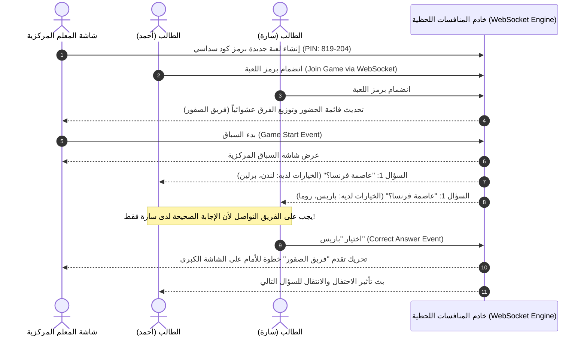

# بروتوكول الاتصال اللحظي والمنافسات الجماعية في Quizlet (Real-Time Gamification Protocol)

> **المسار:** `benchmarks/extracted/quizlet/06_network_and_telemetry/realtime_sync_and_gamification_protocol.md`  
> **التصنيف:** بروتوكولات الألعاب الجماعية التفاعلية (Quizlet Live) والتزامن اللحظي

---

## 1. بروتوكول المنافسات الجماعية بالفصول (Quizlet Live Architecture)

يُعد **Quizlet Live** أحد أكثر الابتكارات التعليمية نجاحاً في تحفيز التفاعل داخل الفصول الدراسية؛ حيث يتنافس الطلاب في فرق مكونة من 3 إلى 4 طلاب عبر شبكة اتصال لحظية ثنائية الاتجاه (Bi-directional WebSocket):



---

## 2. بنية رسائل الاتصال اللحظي (WebSocket Message Framing)

تعتمد لعبة Quizlet Live على بروتوكول رسائل JSON الخفيفة عبر قنوات مخصصة:

### 2.1. حدث الانضمام للعبة (`client-join-game`)
```json
{
  "event": "client-join-game",
  "data": {
    "game_pin": "819204",
    "user_id": "usr_991823",
    "nickname": "أحمد",
    "avatar_id": "owl_smart"
  }
}
```

### 2.2. حدث إجابة الفريق (`client-submit-answer`)
```json
{
  "event": "client-submit-answer",
  "data": {
    "game_pin": "819204",
    "team_id": "team_falcons",
    "question_id": "q_102",
    "selected_card_id": "c_4901",
    "latency_ms": 1420
  }
}
```

### 2.3. بث تقدم لوحة الصدارة (`server-leaderboard-update`)
```json
{
  "event": "server-leaderboard-update",
  "data": {
    "game_pin": "819204",
    "teams": [
      { "team_id": "team_falcons", "name": "فريق الصقور", "score": 11, "target": 12 },
      { "team_id": "team_tigers", "name": "فريق النمور", "score": 9, "target": 12 }
    ]
  }
}
```

---

## 3. رسائل الإشعارات السحابية وتنبيهات حماية السلسلة (FCM Study Push Protocol)

عند اقتراب منتصف الليل، يُرسل السيرفر رسالة FCM هجينة (Data + Notification) لحث الطالب على حماية إنجازه:

```json
{
  "to": "/topics/user_usr_991823_reminders",
  "priority": "high",
  "notification": {
    "title": "🔥 لا تكسر سلسلتك التعليمية!",
    "body": "أنت على بعد جولة مراجعة واحدة (3 دقائق) من إتمام 5 أيام متتالية في التاريخ!",
    "sound": "quizlet_bell.ogg"
  },
  "data": {
    "action": "OPEN_SET",
    "set_id": "set_8849102",
    "mode": "LEARN",
    "current_streak": 4
  }
}
```

---

## 4. دروس معمارية لتطبيقها في Family OS
- **تطبيق وضع مسابقات العائلة الأسبوعية (Family OS Live Quiz):** إنشاء مسابقة نهاية الأسبوع بين أفراد الأسرة (الوالدين والأبناء) لأسئلة المنهج الدراسي أو المعرفة الدينية والثقافية، مما يحول المذاكرة إلى نشاط عائلي ممتع وتنافسي!
