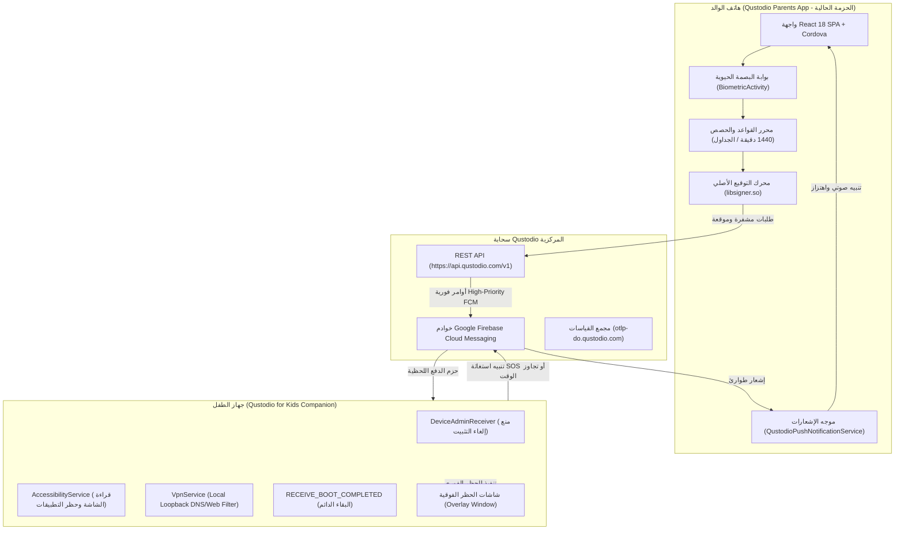

# آليات مكافحة التلاعب، الحماية المعمارية، وتأمين النظام في Qustodio
# Comprehensive Anti-Tampering, Persistence & Security Architecture

> **التطبيق المستهدف:** Qustodio Parents App (`com.qustodio.family.parental.control.app.screentime`)  
> **الإصدار وكود البناء:** v182.41.0 (Build 1824100)  
> **مستوى الحزمة:** Target SDK 36 (Android 16), Min SDK 24 (Android 7.0)  
> **المكتبات الأصلية للأمان:** `libsigner.so` (~945 KB عبر ABIs: `arm64-v8a`, `armeabi-v7a`, `x86`, `x86_64`)  
> **الكلاسات المركزية المفككة:** `NativeLibHelper.java`, `BiometricActivity.java`, `QustodioPlugin.java`, `QustodioPushNotificationService.java`

---

## 1. الثنائية المعمارية لمنظومة Qustodio: تطبيق الوالد المتحكم مقابل وكيل الطفل المنفذ (Parent Controller vs. Child Enforcement Agent)

### 1.1 التحليل الهيكلي لغياب مكونات الرقابة التنفيذية في تطبيق الوالدين
أحد أهم الاكتشافات المعمارية الناتجة عن التفكيك الجنائي لحزمة `qustodio.apk` هو الغياب المتعمد لمكونات الرقابة النظامية المباشرة:
- **لا وجود لـ `DeviceAdminReceiver`** داخل المانيفست.
- **لا وجود لـ `AccessibilityService`** لمراقبة نوافذ التطبيقات أو شريط العناوين.
- **لا وجود لـ `VpnService`** لاعتراض حزم الشبكة والـ DNS.
- **لا وجود لإذن `RECEIVE_BOOT_COMPLETED`** لبدء التشغيل الإجباري عند إقلاع النظام.

### 1.2 تفسير المعمارية المنفصلة (Two-App Ecosystem Topology)
يعتمد نظام Qustodio العالمي على توزيع وظيفي صارم بين تطبيقين مستقلين في متجر Google Play:



### 1.3 الأدوار الهندسية المنوطة بتطبيق الوالدين (PASA - Parents App):
1. **العقل المدبر ومجمع القواعد (Master Rule Engine):** يقوم الوالد بتحديد الحصص الزمنية (Quotas) بحد أقصى 1440 دقيقة يومياً، وجداول وقت النوم والمدرسة، والمواقع والتطبيقات المحظورة.
2. **مرسل الأوامر الفورية (Push Command Dispatcher):** عند الضغط على "قفل فوري" (Instant Pause)، لا يقوم هاتف الوالد بالقفل محلياً، بل يرسل أمراً موثقاً عبر API لتقوم خوادم Firebase بإيقاظ جهاز الطفل وتطبيق القفل خلال ثوانٍ.
3. **مستقبل إنذارات الطوارئ (Emergency Alert Hub):** يستقبل إشعارات الاستغاثة (`EventType: 500` - SOS Panic) فور انطلاقها من جهاز الطفل ويعرض إحداثيات الموقع اللحظية على الخريطة.

---

## 2. محرك التوقيع المشفر ومكافحة التلاعب عبر المكتبة الأصلية (`libsigner.so`)

### 2.1 الجرد الجنائي والتحليل الثنائي للمكتبة
تتضمن الحزمة المكتبة الأصلية `libsigner.so` بحجم **945,120 بايت** مكررة بالتطابق التام عبر المعماريات الأربع:
- `lib/arm64-v8a/libsigner.so`
- `lib/armeabi-v7a/libsigner.so`
- `lib/x86/libsigner.so`
- `lib/x86_64/libsigner.so`

### 2.2 تحليل كود JNI والدوال المصدرة
أثبت الفحص الجنائي لجدول رموز ELF وعمليات تفكيك DEX بواسطة JADX أن هذه المكتبة تتبع محرك الأمان الخاص بشركة Adjust لضمان سلامة الطلبات والتطبيقات (`com.adjust.sdk.sig.NativeLibHelper`):

```java
package com.adjust.sdk.sig;

import android.content.Context;
import android.util.Log;

class NativeLibHelper implements a {
    static {
        try {
            System.loadLibrary("signer");
        } catch (UnsatisfiedLinkError e) {
            Log.e("NativeLibHelper", "Signer Library could not be loaded: " + e.getMessage());
        }
    }

    private native void nOnResume();
    private native byte[] nSign(Context context, Object obj, byte[] bArr, int i);

    public final void a() {
        nOnResume();
    }

    public final byte[] a(Context context, Object obj, byte[] bArr, int i) {
        return nSign(context, obj, bArr, i);
    }
}
```

### 2.3 الآلية الخوارزمية للتوقيع ومنع التزييف (HMAC & Request Attestation)
تقوم الدالة الأصلية `nSign(Context context, Object obj, byte[] bArr, int i)` بالوظائف الأمنية التالية:
1. **فحص سلامة البيئة والتوقيع (App Attestation):**
   - فحص الـ Package Name ومقارنته برمز التجزئة للشهادة الرسمية (Keystore SHA-256 Hash).
   - رصد وجود بيئات الاستنساخ أو التعديل (Anti-Hooking / Anti-Frida).
2. **حساب التوقيع الرقمي (Cryptographic HMAC):**
   - استخراج معالم حمولة الطلب (Payload body bytes) والطابع الزمني اللحظي (Timestamp) ورمز فريد لكل جلسة (Nonce).
   - استخدام مفتاح سري مدمج ومشوش داخل كود الـ Machine Code لـ `libsigner.so` لإنتاج توقيع مشفر.
3. **حقن ترويسات الأمان:**
   - يتم إرفاق نتيجة التوقيع كترويسات مخصصة في ترويسات الـ HTTP (مثل `X-Adjust-Signature` أو `X-Qustodio-Signature`) لمنع هجمات إعادة الإرسال (Replay Attacks) أو تزوير معاملات الشراء والتسجيل عبر أدوات مثل Burp Suite أو Charles Proxy.

---

## 3. بوابة المصادقة الحيوية المشفرة للوالدين (`BiometricActivity`)

### 3.1 تحليل كود المصادقة المشفرة
يمتلك تطبيق Qustodio آلية حماية حيوية مستقلة عبر الكلاس `de.niklasmerz.cordova.biometric.BiometricActivity`:

```java
// من كود de/niklasmerz/cordova/biometric/BiometricActivity.java المفكك:
private static final String SECRET_KEY = "__aio_secret_key";

private void authenticate() throws CryptoException {
    int i = AnonymousClass2.$SwitchMap$de$niklasmerz$cordova$biometric$BiometricActivityType[this.mPromptInfo.getType().ordinal()];
    if (i == 1) {
        justAuthenticate(); // مصادقة سريعة لفتح الشاشة
    } else if (i == 2) {
        authenticateToEncrypt(this.mPromptInfo.invalidateOnEnrollment()); // تشفير الرمز السري عند التفعيل
    } else if (i == 3) {
        authenticateToDecrypt(); // فك تشفير الرمز السري عبر المفتاح الحيوي المخزن في Keystore
    }
}
```

### 3.2 مستويات التأمين الحيوي الثلاثة (The 3 Biometric Operational Modes):
1. **النمط الأول: المصادقة المباشرة (`JUST_AUTHENTICATE`):**
   - استدعاء `BiometricPrompt.authenticate(promptInfo)` للتحقق السريع من بصمة الإصبع أو الوجه قبل فتح شاشات تعديل الحساب والقواعد.
2. **النمط الثاني: تشفير المفتاح السري (`REGISTER_SECRET`):**
   - استخدام `CryptographyManagerImpl` لتهيئة Cipher في وضع التشفير وحفظ المفتاح السري `__aio_secret_key` في SharedPreferences مشفراً بواسطة مفتاح خاص مولد في مستودع مفاتيح النظام المعتمد على العتاد الصلب (Android Hardware Keystore / TEE).
   - تفعيل خيار `invalidateOnEnrollment(true)`: يؤدي تسجيل أي بصمة إصبع جديدة في إعدادات النظام إلى إلغاء صلاحية المفتاح المشفر فوراً، مما يمنع الطفل من إضافة بصمته في هاتف الوالد وتجاوز الحماية!
3. **النمط الثالث: فك التشفير المصادق عليه (`LOAD_SECRET`):**
   - لا يمكن قراءة المفتاح السري وفك تشفيره إلا بعد إتمام مصادقة بيومترية ناجحة تقدم `CryptoObject` صالح وموقع عتادياً.

### 3.3 حماية الرجوع لقفل الشاشة ومكافحة التخمين (Keyguard Fallback & Lockout)
- في حال تعذر استخدام البصمة أو تفعيل خيار القفل البديل، يتم استدعاء حوار القفل النظامي عبر:
  `keyguardManager.createConfirmDeviceCredentialIntent(title, description)`
- التعامل مع حالات الحظر:
  * `BIOMETRIC_LOCKED_OUT` (الكود 7): حظر مؤقت لمدة 30 ثانية بعد 5 محاولات فاشلة.
  * `BIOMETRIC_LOCKED_OUT_PERMANENT` (الكود 9): حظر دائم للبصمة يستوجب إدخال رمز PIN أو كلمة مرور الهاتف لإعادة تفعيلها.

---

## 4. التحقق الصارم من الروابط العميقة ومنع الحقن البرمجي (`QustodioPlugin.java`)

### 4.1 التحدي الأمني في تطبيقات Cordova الهجينة
في التطبيقات الهجينة، يمثل جسر الاتصال بين كود جافا وكود الجافاسكربت في الـ WebView منفذاً خطيراً (Cross-Context Injection). إذا استطاع تطبيق خبيث إرسال Intent برابط عميق غير مفحوص، فقد ينفذ كود جافاسكربت اعتباطي عبر دالة `loadUrl("javascript:...")`.

### 4.2 خوارزمية التحقق في `QustodioPlugin`
يُظهر الكود المفكك من `com/qustodio/pasa/QustodioPlugin.java` دفاعات متعددة الطبقات:

```java
// من كود QustodioPlugin.java المفكك:
private boolean isHttpsQustodioDeeplink(Intent intent) {
    if (intent.getData() == null) {
        return false;
    }
    // مطابقة صارمة عبر التعبير النمطي للنطاق الموثوق
    return Pattern.compile("^https://([a-zA-Z0-9_-]+\\.)*qustodio\\.com/parents-app.*")
                  .matcher(intent.getData().toString())
                  .matches();
}

private boolean isQustodioDeeplink(Intent intent) {
    if (intent.getData() != null) {
        String string = intent.getData().toString();
        return string.startsWith("qustodio");
    }
    return false;
}
```

### 4.3 آلية حفظ ومعالجة الروابط وفق جاهزية الواجهة (Deferred Deep Link Execution)
لمنع ثغرات Race Condition عند إطلاق التطبيق بـ Cold Start:
1. عند وصول الرابط قبل اكتمال تحميل الواجهة في الـ WebView، يتم حفظه في متغير مؤقت `this.pendingDeepLink`.
2. لا يتم استدعاء جافاسكربت إطلاقاً إلا بعد قيام تطبيق الـ SPA بإرسال إشارة تأكيد الجاهزية عبر استدعاء الأكشن:
   `execute("setWebAppReady", ...)`
3. عندها فقط يتم تحويل الرابط إلى استدعاء دالة آمنة ومحددة:
   `javascript:handleOpenURL('https://family.qustodio.com/parents-app/...')`
   دون السماح بوجود أي علامات اقتباس أو أكواد خارج نطاق المعامل النصي.

---

## 5. الحماية عبر تصاريح التوقيع الحصري (Signature-Level IPC Protections)

### 5.1 تصريح `PushHandlerActivity`
* **التعريف في المانيفست:**
  ```xml
  <permission android:name="com.qustodio.family.parental.control.app.screentime.permission.PushHandlerActivity" 
              android:protectionLevel="signature"/>
  <activity android:name="com.adobe.phonegap.push.PushHandlerActivity" 
            android:permission="com.qustodio.family.parental.control.app.screentime.permission.PushHandlerActivity" 
            android:exported="true"/>
  ```
* **الأهمية الأمنية:**
  - بالرغم من أن النشاط مصدّر (`exported="true"`), إلا أن نظام أندرويد يرفض منعاً باتاً استدعاء هذا النشاط من أي تطبيق على الجهاز إلا إذا كان موقعاً بنفس الشهادة الرسمية لـ Qustodio (Signature Match).
  - هذا يمنع هجمات حقن الإشعارات المزيفة (Fake Push Injection)، مثل إرسال إشعار خبيث يدعي أن الطفل قد أرسل استغاثة بهدف إرباك الوالدين أو خداعهما.

### 5.2 تصريح `DYNAMIC_RECEIVER_NOT_EXPORTED_PERMISSION`
* **التعريف في المانيفست:**
  ```xml
  <permission android:name="com.qustodio.family.parental.control.app.screentime.DYNAMIC_RECEIVER_NOT_EXPORTED_PERMISSION" 
              android:protectionLevel="signature"/>
  ```
* **الأهمية الأمنية:**
  - متوافق مع متطلبات الأمان الصارمة في Android 14+ (API 34+).
  - يحمي أي مستقبل بث يتم تسجيله ديناميكياً أثناء تشغيل التطبيق عبر الكود (`context.registerReceiver(..., RECEIVER_NOT_EXPORTED)`).
  - يضمن عدم إمكانية تصنت التطبيقات الجاسوسية على بث الأحداث الداخلية لتطبيق الوالدين.

---

## 6. بروتوكول الأوامر الفورية والإغلاق عن بُعد (Remote Lock Push Protocol)

### 6.1 دورة حياة أمر "القفل الفوري" (Instant Pause Flow)
عندما يقرر الوالد الضغط على زر "قفل الإنترنت" أو "قفل الجهاز" لطفل معين:

1. **إصدار الأمر من واجهة React SPA:**
   - استدعاء الدالة `pauseInternet(profileId, deviceId)` أو `lockDevice(profileId, deviceId)` في طبقة الـ Redux Ducks (`src/ducks/familyPause/pause.ts`).
2. **الإرسال المشفر إلى خادم REST API:**
   - إرسال طلب `POST /v1/rules/instant_pause` مصحوباً بتوكن المصادقة المشفر وتوقيع `libsigner.so`.
3. **توليد رسالة دفع فورية ذات أولوية قصوى (High-Priority FCM Message):**
   - يقوم خادم Qustodio بإرسال حزمة Push عبر Firebase بمستوى أولوية `priority: high` وخاصية الاستيقاظ الفوري.
4. **استلام وتنفيذ الأمر على جهاز الطفل:**
   - يستيقظ وكيل الطفل (`Qustodio for Kids`) حتى لو كان الجهاز في وضع السكون العميق (Doze Mode).
   - يتم تفعيل طبقة الحظر عبر:
     * **حظر التصفح:** تغيير قواعد الـ Local Loopback VPN لقطع استجابات DNS لكافة النطاقات باستثناء نطاقات الطوارئ.
     * **حظر الشاشة الكامل:** استدعاء `WindowManager.addView()` لرسم نافذة فوقية كاملة (System Alert Overlay) غير قابلة للإلغاء تمنع التفاعل مع أي تطبيق آخر وتظهر رسالة "Time's Up" أو "Paused by Parent".
5. **المزامنة العكسية مع هاتف الوالد:**
   - يرسل جهاز الطفل إقرار تنفيذ (ACK) للخادم، لتقوم خدمة `QustodioPushNotificationService` في هاتف الوالد بتحديث حالة الأيقونة إلى اللون الأحمر (Locked/Paused) في ثوانٍ معدودة.

---

## 7. الدروس المستفادة وتوصيات التطبيق لمنصة Family OS

| المحور الأمني | الممارسة في Qustodio | التوصية الهندسية لمنصة Family OS |
|---|---|---|
| **فصل الأدوار (Separation of Concerns)** | الفصل التام بين تطبيق الوالد وتطبيق الطفل Companion App. | اعتماد بنية الحزمتين المستقلتين: `family-os-parent` و `family-os-child` مع تركيز صلاحيات `DeviceAdmin` و `Accessibility` في تطبيق الطفل فقط لضمان سهولة قبول التطبيقين في متجر Google Play. |
| **المصادقة الحيوية (Biometrics)** | حماية مفتاح التشفير `__aio_secret_key` بـ Hardware Keystore وإلغائه عند إضافة أي بصمة جديدة (`invalidateOnEnrollment`). | تطبيق نفس النموذج في Family OS لضمان عدم إمكانية عبث الأبناء بهاتف الوالد عند تركه مفتوحاً. |
| **تأمين المكونات (IPC Security)** | إغلاق 72% من المكونات وحماية البقية بتصاريح `signature`. | جعل جميع الخدمات ومستقبلات البث الداخلية `exported="false"` واستخدام `signature permissions` لأي مكون يحتاج التواصل بين التطبيقين. |
| **حماية الروابط العميقة (Deep Links)** | حظر أي رابط لا يطابق التعبير النمطي الدقيق وتأخير التنفيذ حتى إشعار `setWebAppReady`. | تطبيق فحص صارم على الروابط في منصة Flutter / Web قبل تمريرها لمعالجات التوجيه (GoRouter). |
