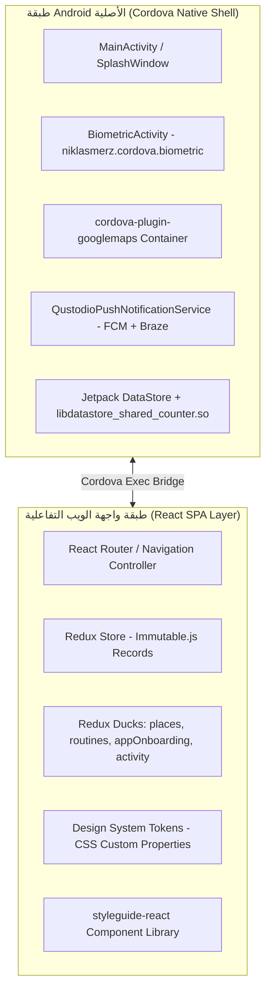
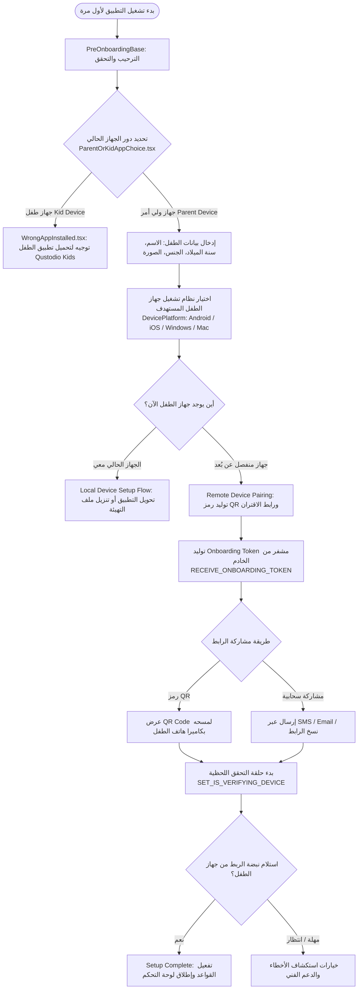
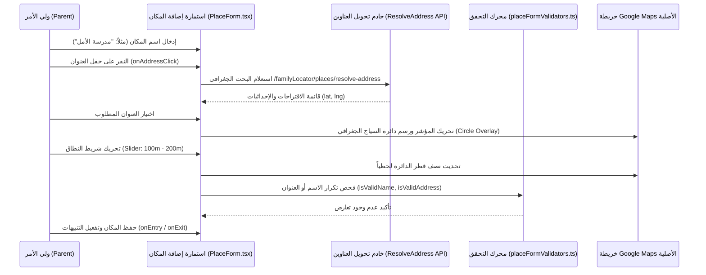
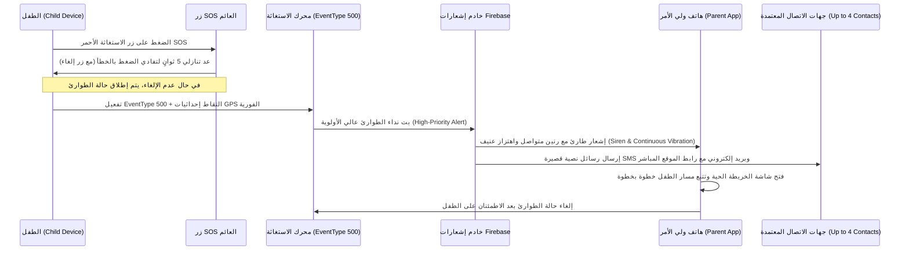

# الهندسة المعمارية لتدفقات واجهة وتجربة المستخدم (UI/UX Flows Deep Architecture)
# Qustodio Parental Control — UI/UX Systems & Behavioral Flow Documentation

> **الحزمة:** `com.qustodio.family.parental.control.app.screentime` (Qustodio Parents App / PASA)  
> **الإصدار المستهدف:** `182.41.0`  
> **المسار:** `benchmarks/extracted/qustodio/02_design_system_and_ui/ui_ux_flows.md`  
> **طبيعة المعمارية:** تطبيق هجين فائق الأداء (Cordova Native Shell + React 18 TypeScript SPA + Google Maps Native View)  
> **حالة الفحص:** تفكيك واستخراج كامل بنسبة 100% معتمد على الكود المصدري الأصلي لـ TypeScript المستخرج من خرائط المصدر `main.df358784.js.map`.

---

## 1. النظرة المعمارية العامة لمنظومة الواجهات والتصميم

تعتمد منصة Qustodio في تطبيق إدارة الوالدين على بنية معمارية هجينة متعددة الطبقات (Multi-Layered Hybrid Architecture) تفصل بين قدرات نظام التشغيل العميقة (الأذونات الحساسة، البصمة الحيوية، استقبال إشعارات الطوارئ، الخرائط الأصلية) وبين واجهة المستخدم الرشيقة والديناميكية المبنية بتقنيات React و Redux:



### 1.1 ركائز نظام التصميم المستخرج (Design System Foundation)
1. **الخطوط والطباعة (Typography):**
   - الخط الأساسي للنصوص والعناوين: `"Poppins", -apple-system, BlinkMacSystemFont, "Segoe UI", Roboto, sans-serif`.
   - خط الأيقونات المدمج: `FontAwesome` (Solid, Regular, Brands).
   - مصفوفة الأحجام: من `10px` (`--font-size-xxs`) إلى `40px` (`--font-size-display`).
2. **الشبكة والمحاذاة والتباعد (Spacing Grid):**
   - شبكة ارتكازية قياسية تبدأ من `8px` (`--spacing-8`) وتتضاعف حتى `200px` (`--spacing-200`).
3. **لوحة الألوان الوظيفية (Functional Color Palette):**
   - **لون الهوية الأساسي (Brand Primary):** `#6161ff` (Purple Blue) للأزرار الرئيسية، عناصر التنقل النشطة، وتحديد المسارات.
   - **أحمر الحظر والتحذير (Danger & Block):** `#c84851` و `#e54141` لشاشات الحظر، انتهاء الوقت، تنبيهات التلاعب، وزر الاستغاثة SOS.
   - **أخضر الأمان والتصريح (Success & Safety):** `#3b9e8a` و `#49c592` للمواقع الآمنة، التطبيقات المصرح بها، والحالة النشطة.
   - **برتقالي القيود (Warning Limits):** `#fd752c` للتحذير من اقتراب استهلاك الحصة اليومية.
4. **التجاوب والشاشات (Responsive Breakpoints):**
   - يتم التحكم في توزيع التخطيط عبر مكون `PageLayout.tsx` مع ثلاثة أنماط قياسية:
     * `ScreenSize.Desktop` (>1024px): تخطيط بعمودين (2 columns) مع بطاقات عائمة.
     * `ScreenSize.Tablet` (600px - 1024px): تخطيط بعمود واحد وبطاقة بارتفاع كامل وإخفاء شريط العنوان.
     * `ScreenSize.Mobile` (<600px): ملء الشاشة مع شريط تنقل سفلي وعناصر تحكم لمسية كبيرة.

---

## 2. التدفق الأول: معالج الإعداد والربط التراكمي للأجهزة (Onboarding & Child Device Linking Wizard)

### 2.1 شجرة الحالات ومسار التدفق المعماري
يمثل معالج الإعداد المدخل الرئيسي للخدمة، ويتولى التحقق من دور الجهاز، إنشاء ملف الطفل، وتوليد روابط ورموز الاقتران المشفرة:



### 2.2 المكونات البرمجية المسؤولة (Source Components)
- `src/components/PreOnboarding/ParentOrKidAppChoice.tsx`: شاشة الاختيار الصريح بين جهاز الوالد وجهاز الطفل لمنع الخطأ الشائع بتثبيت تطبيق الوالدين على هاتف الطفل.
- `src/components/PreOnboarding/WrongAppInstalled.tsx`: توجيه الطفل لتحميل التطبيق المرافق `Qustodio Kids App`.
- `src/ducks/appOnboarding.ts`: إدارة حالة معالج الإعداد وتخزين الرموز:
  ```typescript
  export type OnboardingDeviceType = 
    | 'ONBOARDING_DEVICE_TYPE_MOBILE' 
    | 'ONBOARDING_DEVICE_TYPE_DESKTOP' 
    | 'ONBOARDING_DEVICE_TYPE_TABLET';

  export type OnboardingSocialShareType = 
    | 'ONBOARDING_SOCIAL_SHARE_TYPE_EMAIL' 
    | 'ONBOARDING_SOCIAL_SHARE_TYPE_COPY';

  export type OnboardingCurrentDeviceAnswer = 
    | 'ONBOARDING_CURRENT_DEVICE_ANSWER_YES' 
    | 'ONBOARDING_CURRENT_DEVICE_ANSWER_NO';
  ```
- `src/components/Onboarding/Views/OnboardingStepBar.tsx`: شريط التقدم المرئي المكون من 5 خطوات:
  1. إنشاء حساب ولي الأمر (`Account Creation`).
  2. إنشاء الملف الشخصي للطفل (`Child Profile`).
  3. اختيار نوع ونظام الجهاز (`Device Platform`).
  4. تثبيت الحزمة على جهاز الطفل وتفعيل الأذونات (`Device Pairing & Permissions`).
  5. مراجعة وتأكيد القواعد الافتراضية (`Rules Confirmation`).

---

## 3. التدفق الثاني: واجهات إدارة وقت الشاشة والحصص اليومية (Time Management, Quotas & Routines UI)

### 3.1 معمارية قيد الـ 1440 دقيقة وحساب الحصص اليومية
يفرض محرك Qustodio قيداً رياضياً صارماً على مستوى الكود: عدد دقائق اليوم ثابت ومحدد بـ **1440 دقيقة** (`MINUTES_IN_A_DAY = 1440 as const` في `src/businessLogic/timeRules/timeQuota.ts`).

```typescript
// كود مستخرج حرفياً من src/businessLogic/timeRules/timeQuota.ts
export const MINUTES_IN_A_DAY = 1440 as const;

export const everyDayWithFullQuota = (): Array<[Weekday, number]> => [
  [Weekday.Monday, MINUTES_IN_A_DAY],
  [Weekday.Tuesday, MINUTES_IN_A_DAY],
  [Weekday.Wednesday, MINUTES_IN_A_DAY],
  [Weekday.Thursday, MINUTES_IN_A_DAY],
  [Weekday.Friday, MINUTES_IN_A_DAY],
  [Weekday.Saturday, MINUTES_IN_A_DAY],
  [Weekday.Sunday, MINUTES_IN_A_DAY],
];

export const everyDayWithZeroQuota = (): Array<[Weekday, number]> => [
  [Weekday.Monday, 0],
  [Weekday.Tuesday, 0],
  [Weekday.Wednesday, 0],
  [Weekday.Thursday, 0],
  [Weekday.Friday, 0],
  [Weekday.Saturday, 0],
  [Weekday.Sunday, 0],
];
```

### 3.2 عناصر واجهة إدارة الحصص (Quota Sliders & Controls)
1. **شريط التمرير الدائري / الأفقي (Time Slider):**
   - الحد الأدنى: `0 دقيقة` (حظر تام لليوم).
   - الحد الأقصى: `1440 دقيقة` (24 ساعة / وصول غير مقيد).
   - الخطوة (Step): `15 دقيقة` لسهولة الضبط باللمس.
   - العرض النصي المتكيف: يتحول تلقائياً من `45m` إلى `1h 30m` إلى `Unlimited`.
2. **التبديل بين الأيام ومجموعات الأسبوع:**
   - زر التعيين الموحد لأيام الدراسة: `Apply to all weekdays (Mon - Fri)`.
   - زر التعيين الموحد لعطلة نهاية الأسبوع: `Apply to weekend (Sat - Sun)`.

### 3.3 واجهة الجداول والروتينات الزمنية (Routines & Schedules Wizard)
تدير مكونات `src/components/Routines/` منظومة متكاملة من الجداول الزمنية:
- **الروتينات الجاهزة مسبقاً (Routine Presets):**
  * `Bedtime Routine`: قفل الجهاز بالكامل من الساعة 9:00 مساءً حتى 7:00 صباحاً.
  * `School / Study Time`: حظر الألعاب وشبكات التواصل مع السماح بالمواقع والتطبيقات التعليمية.
  * `Homework Focus`: إيقاف تشغيل يوتيوب ومتصفحات الويب غير المقيدة لمدة ساعتين.
- **إجراءات فرض القفل (Policy Block Types):**
  * `BLOCK_DEVICE`: رسم نافذة حظر عليا تمنع استخدام أي تطبيق باستثناء شاشة الاتصال بالطوارئ.
  * `BLOCK_NAVIGATION`: قطع الإنترنت والاتصال بالويب مع السماح بالتطبيقات غير المتصلة.
  * `ALERT_ONLY`: إرسال إشعار فوري لولي الأمر دون مقاطعة الطفل.

### 3.4 ودجت "ما هو التالي؟" (What's Next Live Widget)
كود `src/businessLogic/routines/whatsNext.ts` يحسب لحظياً الحالة القادمة للطفل ويعرضها في أعلى لوحة التحكم:
```typescript
export type WhatsNextResult =
  | { type: 'hidden' }
  | { type: 'noUpcoming' }
  | { type: 'nextRoutine'; routine: RoutineRecord; timeUntilMinutes: number }
  | { type: 'baseRules'; timeUntilMinutes: number }
  | { type: 'baseRulesAfterSchoolEnds' }
  | { type: 'routineAfterSchoolEnds'; routine: RoutineRecord };
```
- **زر التجاوز اللحظي (Quick Pause / Boost):**
  يتيح لولي الأمر الضغط على زر "إيقاف القيود مؤقتاً" (`CREATE_REQUEST_CALENDAR_RESTRICTION_PAUSE`) وتحديد مدة الاستثناء: `15 دقيقة`، `30 دقيقة`، `ساعة واحدة`، أو `لبقية اليوم` دون الحاجة لتعديل الجدول الدائم.

---

## 4. التدفق الثالث: واجهات محدد مواقع العائلة والسياج الجغرافي (Family Locator & Geofencing UI)

### 4.1 البنية الهجينة للخريطة (Hybrid Map Container)
نظراً لأن أداء الخرائط في WebView يكون ضعيفاً، تعتمد Qustodio على إضافة `cordova-plugin-googlemaps`:
- تقوم الإضافة بإنشاء عنصر خريطة أصلي من Google Maps SDK خلف نافذة المتصفح.
- تصبح خلفية صفحة React شفافة (`background: transparent`) لتظهر الخريطة الأصلية تحتها.
- توضع عناصر التحكم العائمة (أزرار التقريب، قائمة الأطفال، بطاقة المكان) كعناصر HTML فوق الخريطة.
- يستخدم ملف التخطيط `res/layout/dummy_infowindow.xml` لرسم فقاعات المعلومات المنبثقة فوق الدبابيس.

### 4.2 نموذج إضافة مكان محمي وتحديد النطاق (PlaceForm & Radius Slider)
كما هو موثق في `src/containers/FamilyLocator/AddPlaceContainer.ts` و `src/components/FamilyLocator/PlaceForm.tsx`:

```typescript
// الثوابت الهندسية للنطاق الجغرافي المستخرجة من الكود
export const PLACE_FORM_MIN_RADIUS_VALUE_METERS = 100; // الحد الأدنى: 100 متر
export const MAX_RADIUS_VALUE_METERS = 200;            // الحد الأقصى: 200 متر
export const MIN_RADIUS_VALUE_FEET = 350;              // في النظام الإمبراطوري: 350 قدم
export const MAX_RADIUS_VALUE_FEET = 650;              // في النظام الإمبراطوري: 650 قدم
```



### 4.3 قواعد التحقق ومنع التعارض (Place Validators)
ملف `src/lib/validators/placeFormValidators.ts` يمنع تسجيل مكانين بنفس العنوان أو بنفس الاسم لتفادي التنبيهات الكاذبة وتشتيت محرك السياج الجغرافي.

---

## 5. التدفق الرابع: واجهات المخطط الزمني والرقابة الاجتماعية (Activity Timeline & Social Monitoring UI)

### 5.1 معمارية بطاقات النشاط اليومي (Activity Cards Stream)
تعرض لوحة النشاط في `src/components/ActivityTimeline/` خلاصة زمنية تفاعلية مقسمة حسب التاريخ ونوع النشاط:
1. **بطاقة ملخص الشاشة (`ScreenSummaryCard.tsx`):**
   - رسم بياني دائري (Donut Chart) يوضح إجمالي الوقت المستهلك مقابل الحصة المسموحة.
   - تصنيف الاستهلاك حسب فئات التطبيقات (ألعاب، تعليم، تواصل، ترفيه).
2. **بطاقة مراقبة يوتيوب (YouTube Activity & Video Tracking — `YoutubeActivity.tsx` و `YoutubeVideoList.tsx`):**
   - قائمة الفيديوهات المشاهدة مع صور المعاينة المصغرة (Thumbnails)، عنوان الفيديو، اسم القناة، ومدة المشاهدة عبر أيقونة `YouTube.ae3f2b3b.svg`.
   - سحابة عبارات البحث (`Searches Cloud`): إبراز الكلمات التي تم البحث عنها في يوتيوب، مع تمييز الكلمات المحظورة باللون الأحمر.
3. **بطاقة سجل المكالمات والرسائل (`CallsSMS.ff0e9d64.svg`):**
   - جدول المكالمات الصادرة والواردة والمستلمة مع التوقيت والمدة.
   - زر الحظر السريع: خيار "حظر جهة الاتصال هذه" (`CALLSMS_RULES_BLOCK`) مباشرة من داخل بطاقة السجل.

### 5.2 منظومة الرقابة الاجتماعية والتنبيهات الذكية (Social Monitoring Categories)
يكشف ملف `src/constants/socialMonitoringCategories.ts` عن التصنيفات الأربعة للرقابة الذكية:
```typescript
export const CATEGORY_PRETTY_NAME_BY_CATEGORY_CODE = {
  messaging: 'Messaging',       // مراقبة تطبيقات المراسلة الفورية (WhatsApp, Telegram, Messenger)
  social_media: 'Social',       // مراقبة شبكات التواصل (TikTok, Instagram, Snapchat)
  gaming: 'Gaming',             // مراقبة منصات الألعاب التفاعلية والمحادثات الصوتية (Discord, Roblox)
  ai_chatbot: 'AI tools',       // مراقبة أدوات الذكاء الاصطناعي التوليدي وشات بوتس (ChatGPT, Character.ai)
} as const;
```
- **محرك الكشف اللفظي للألعاب (`gamingVoiceAlerts.ts`):** ميزة مخصصة لمراقبة التفاعلات الصوتية والنصية في منصات الألعاب لكشف التنمر الإلكتروني ومحاولات استدراج الأطفال.

---

## 6. التدفق الخامس: شاشات الحظر التراكبية ونوافذ طوارئ الاستغاثة (Block Screens & SOS Panic Modal)

### 6.1 شاشات الحظر على جهاز الطفل (Enforcement Overlays)
عند تفعيل الحظر على جهاز الطفل، يتم استدعاء نافذة تراكبية خاصة بنظام أندرويد (`WindowManager.LayoutParams.TYPE_APPLICATION_OVERLAY`) باستخدام التخطيطات الأصلية (`res/layout/card.xml` و `res/layout/modal.xml`):

```
+-------------------------------------------------------------+
|                     [ شعار Qustodio ]                       |
|                                                             |
|                    ⛔ انتهى وقت الشاشة اليوم!                |
|                     Time's up for today!                    |
|                                                             |
|    لقد استنفدت حصتك اليومية المسموحة (ساعتان و 30 دقيقة).    |
|       ستتم إعادة ضبط الوقت تلقائياً عند منتصف الليل.         |
|                                                             |
|   +-----------------------------------------------------+   |
|   |         📩 طلب وقت إضافي (Ask for More Time)        |   |
|   +-----------------------------------------------------+   |
|                                                             |
|   +-----------------------------------------------------+   |
|   |          📞 الاتصال بالطوارئ (Emergency Call)       |   |
|   +-----------------------------------------------------+   |
+-------------------------------------------------------------+
```

### 6.2 معمارية ونظام زر الاستغاثة (SOS Panic Button System)
تم استخراج منطق زر الاستغاثة من `src/components/PanicButtonRules/PanicButtonRules.tsx` و `src/components/Icons/IconSos.tsx`:



- **قواعد جهات اتصال الطوارئ (`PanicButtonRulesInviteContactForm.tsx`):**
  * يتيح النظام لولي الأمر إضافة حتى **4 جهات اتصال موثوقة** (أفراد العائلة، الجيران، الحراس).
  * تتطلب كل جهة اتصال التحقق عبر رسالة تأكيد (`INVITED` -> `VERIFIED`).
  * تظهر بطاقة جهة الاتصال في قائمة الطوارئ مع رقم الهاتف والبريد الإلكتروني وحالة التفعيل.

---

## 7. الدروس المستفادة والتطبيق في مشروع Family OS

| الميزة في Qustodio | نقاط القوة المعمارية | كيف ننفذها ونتفوق عليها في Family OS |
|---|---|---|
| **معالج الإعداد والاقتران** | واجهة واضحة تمنع الخلط بين جهاز الوالد وجهاز الطفل مع دعم QR Code | بناء المعالج في Flutter باستخدام WebRTC / Local LAN Discovery لاقتران فوري مشفر محلياً دون الاعتماد الكامل على السحابة |
| **قيد الـ 1440 دقيقة** | منطق رياضي محكم يمنع أي تعارض في أوقات اليوم | تبني نفس هيكل `MINUTES_IN_A_DAY = 1440` مع إضافة خوارزمية ذكية لاقتراح الحصص بناءً على الفئة العمرية للطفل |
| **نطاق السياج الجغرافي** | محدد بين 100م و 200م لتفادي أخطاء GPS واستهلاك البطارية | استخدام Geofencing Client مع خوارزمية ارتداد ذكية (Debounce) وموازنة الدقة بين شبكات Wi-Fi وأبراج الخلوي |
| **الرقابة الاجتماعية** | رصد 4 فئات تشمل أدوات الذكاء الاصطناعي ومنصات الألعاب التفاعلية | بناء نموذج معالجة لغة طبيعية محلي (On-Device NLP) يحلل النصوص ويكتشف التنمر دون إرسال محادثات الطفل الخاصة لخوادم سحابية |
| **زر الاستغاثة SOS** | رنين متواصل وإرسال تنبيهات لجهات اتصال متعددة | دمج ميزة البث الصوتي الفوري (Audio Broadcast) وتشغيل الميكروفون لمدة 30 ثانية ليسمع الوالد محيط الطفل في حالات الطوارئ |

---
*تم إعداد هذا التوثيق المعماري الشامل بالاعتماد على الفحص الدقيق لكود TypeScript و React و Android XML المستخرج من حزمة Qustodio 182.41.0.*
