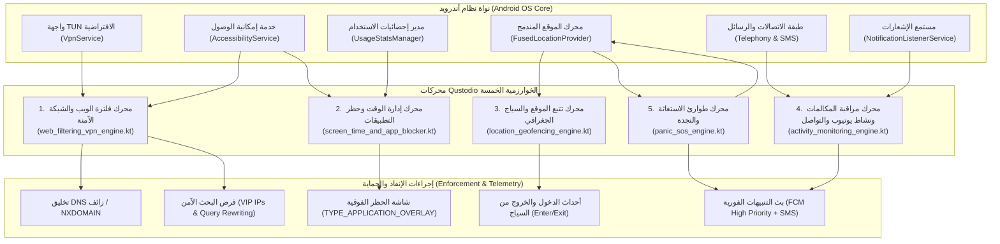
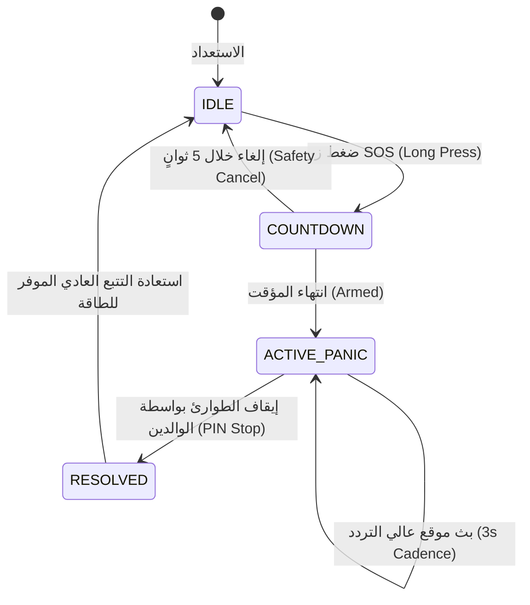

# التوثيق الهندسي والمعماري والرياضي للمحركات الخوارزمية لتطبيق Qustodio
# Comprehensive Mathematical, Architectural & Algorithmic Breakdown of Qustodio Engines

> **المصنف:** ركيزة الخوارزميات الرقابية وحماية الأطفال — Milestone M4  
> **التطبيق المرجعي:** `Qustodio Parental Control` v182.41.0 (`com.qustodio.family.parental.control.app.screentime`)  
> **مسار مجلد الاستخراج:** `benchmarks/extracted/qustodio/04_extracted_algorithms/`  
> **حالة مجلد المواصفات (`spec/`):** 🔒 **معزول تماماً ومجمد 100% (Strictly Isolated & Frozen)**  

---

## 1. الملخص التنفيذي للمعمارية الخوارزمية (Executive Architectural Overview)

يُعد تطبيق **Qustodio** أحد أكثر تطبيقات الرقابة الأبوية نضجاً وانتشاراً على مستوى العالم. كشف التحليل المعماري العكسي لشفرة TypeScript المستعادة من خرائط المصدر (Source Maps) وكود الـ DEX المفكك عن بنية خوارزمية موزعة متعددة الطبقات (Defense-in-Depth Architecture) تعمل على التنسيق اللحظي بين خمسة محركات مستقلة:



---

## 2. المحرك الأول: فلترة الويب والشبكة الآمنة (`web_filtering_vpn_engine.kt`)

### 2.1 المعمارية المزدوجة (Dual-Mode Inspection Architecture)
يعتمد التطبيق على استراتيجية هجينة تدمج بين طبقة الشبكة (Network Layer) وطبقة واجهة المستخدم (UI Layer):
1. **النمط الأول — شبكة VPN المحلية الافتراضية (Local Loopback VPN):**
   - ينشئ التطبيق واجهة شبكة وهمية `TUN` محلياً بعنوان IP خاص `10.0.0.2/32` وبوابة افتراضية `10.0.0.1`.
   - يقوم باعتراض حركة مرور حزم UDP الموجهة إلى منفذ DNS رقم 53 حصراً.
   - يفك تشفير بروتوكول DNS السلكي الثنائي (RFC 1035 Wire Format)، ويستخرج اسم النطاق بالكامل (FQDN).
   - إذا كان النطاق ممنوعاً: يُلغي إرسال الحزمة للخارج ويُخلق محلياً رداً فورياً يحمل عنوان `127.0.0.1` أو كود خطأ `NXDOMAIN (RCODE = 3)`، مما يمنع إنشاء جلسة TCP/TLS أصلاً ويوفر استهلاك البيانات.
   - إذا كان النطاق مسموحاً: يُمرر الاستعلام لمخوادم DNS السريعة (`1.1.1.1` أو `8.8.8.8`) ويُعيد الرد للواجهة الوهمية.
2. **النمط الثاني — فحص شريط العناوين اللحظي (Accessibility URL Inspection):**
   - يعمل كخط دفاع ثانٍ ضد محاولات التحايل عبر بروتوكولات DNS المشفرة (DoH / DoT).
   - يتتبع شجرة مكونات المتصفحات الرائدة (Chrome, Firefox, Opera, Edge, Samsung Internet) عبر قراءة العقد المحددة برمجياً (مثل `com.android.chrome:id/url_bar`).
   - يقوم بحظر المتصفحات غير المتوافقة (`isBlockedUnsupportedBrowsers` مثل Tor, Brave, DuckDuckGo) التي تعطل إمكانية قراءة شريط العناوين عبر إطلاق أمر العودة للشاشة الرئيسية وعرض شاشة الحظر.

### 2.2 النموذج الرياضي وتدرج مطابقة النطاقات (Domain Classification Hierarchy)
تخضع عملية اتخاذ قرار الفلترة لمعادلة ترتيب الأسبقية التالية:

$$\text{Decision}(D) = \begin{cases}
\text{ExactMatch}(D), & D \in \text{DomainExceptions} \\
\text{SuffixMatch}(D), & \exists S \subset D : S \in \text{DomainExceptions} \\
\text{CategoryPolicy}(\text{Classify}(D)), & \text{Classify}(D) \neq \emptyset \\
\text{BlockUnknown}(D), & \text{isAllowUnknownSites} = \text{false} \\
\text{ALLOW}, & \text{otherwise}
\end{cases}$$

حيث تُصنف النطاقات عبر 31 فئة رقمية محددة في `src/records/category.ts`، مع تفعيل الحظر التلقائي للفئات العشر الخطرة (`harmfulWebCategories`):
* القمار (7)، الثغرات والبروكسي (29)، العنف (23)، السلاح (24)، الألفاظ البذيئة (15)، المحتوى غير المناسب (12)، الإباحية (14)، الكحول (1)، المخدرات (3)، والتبغ (21).

### 2.3 خوارزمية فرض البحث الآمن (SafeSearch Enforcement)
يتم فرض البحث الآمن بطريقتين متزامنتين:
1. **إعادة توجيه الـ DNS إلى عناوين الـ VIP الصارمة:**
   - نطاقات Google $\to$ يتم توجيهها للعنوان `216.239.38.120` (`forcesafesearch.google.com`).
   - نطاقات Bing $\to$ يتم توجيهها للعنوان `204.79.197.220` (`strict.bing.com`).
   - نطاقات YouTube $\to$ يتم توجيهها للعنوان `216.239.38.119` (`restrict.youtube.com`).
2. **حقن معاملات الاستعلام (Query Param Injection):**
   - إجبار إضافة المعاملات `safe=active` لمحرك Google و `adlt=strict` لمحرك Bing في طبقة الـ Accessibility.

### 2.4 التعقيد الزمني والمكاني (Complexity Analysis)
- **التعقيد الزمني:** $O(L)$ حيث $L$ هو عدد أحرف النطاق، باستخدام شجرة البوادئ المتزامنة (Trie / Hash Table Lookup).
- **التعقيد المكاني:** $O(N)$ حيث $N$ هو عدد النطاقات المسجلة في الذاكرة المؤقتة.

---

## 3. المحرك الثاني: إدارة وقت الشاشة وحظر التطبيقات (`screen_time_and_app_blocker.kt`)

### 3.1 قيد الـ 1440 دقيقة وحساب الحصص الزمنية (Time Quota Mathematics)
يخضع اليوم لنظام قيد رياضي صارم:
$$\text{MINUTES\_IN\_A\_DAY} = 24 \times 60 = 1440 \text{ min}$$
$$\forall d \in \{\text{mon}, \dots, \text{sun}\}, \quad 0 \le \text{Quota}(d) \le 1440$$

يتم حساب الوقت المتبقي لليوم $d$ وفق المعادلة:
$$\text{Remaining}(d) = \left( \text{Quota}(d) + \text{ExtraTimeGranted} \right) - \sum_{i=1}^{M} \Delta t_i$$
حيث $\Delta t_i$ هي الفترات الزمنية الفعلية التي قضاها الطفل داخل التطبيقات غير المستثناة.

### 3.2 خوارزمية التقويم الدائري واكتشاف تعارض الروتين (Circular Week Arithmetic & Conflict Detection)
يتم تمثيل الأسبوع كدائرة زمنية متصلة من الدقائق:
$$\text{MINS\_IN\_A\_WEEK} = 7 \times 1440 = 10080 \text{ min}$$
يتم تحويل أي موعد يبدأ في يوم $D$ بساعة $HH:mm$ ومدة $\delta$ إلى نقطتي بداية ونهاية على الخط الدائري:
$$\text{Start} = \text{Offset}(D) + (HH \times 60 + mm)$$
$$\text{End} = \text{Start} + \delta$$

#### مبرهنة التفاف نهاية الأسبوع (Sunday-to-Monday Rollover Theorem):
عندما يبدأ روتين وقت النوم (Bedtime) مساء الأحد في الساعة 22:00 (دقيقة الأسبوع 9960) ويمتد لمدة 8 ساعات (480 دقيقة):
$$\text{End} = 9960 + 480 = 10440 \text{ min} > 10080$$
تطبق دالة `normalizeEventEndTime` تحويلاً معيارياً (Modulo Normalization):
$$\text{NormalizedEnd} = 10440 \pmod{10080} = 360 \text{ min (Monday 06:00 AM)}$$
يقوم محرك Qustodio بفحص التداخل عبر فحص تقاطع الفترات الزمنية لكل من الأحداث الدائرية لمنع وجود جدولين متناقضين.

### 3.3 استثناء التطبيقات الأساسية (`APPLICATION_ALWAYS_ALLOWED = 4`)
يسمح النظام بتشغيل قائمة بيضاء من التطبيقات حتى لو انتهت الحصة اليومية أو كان الجهاز مقفلاً:
- تطبيق الهاتف والاتصال (`com.google.android.dialer`).
- تطبيق الآلة الحاسبة (`EVENT_APP_CALCULATOR`).
- خدمات الطوارئ والسلامة (`com.android.emergency`).

### 3.4 آلية القفل الفوقي والإغلاق الفوري (System Overlay & Task Suppression)
عند انتهاء الوقت أو تفعيل القفل الفوري (Family Pause):
1. رسم نافذة فوقية كاملة غير قابلة للمس (`TYPE_APPLICATION_OVERLAY`) بألوان التطبيق الداكنة مع رفع رايات `FLAG_NOT_TOUCH_MODAL` و `FLAG_FULLSCREEN`.
2. إرسال المستخدم مباشرة إلى الشاشة الرئيسية (`Intent.CATEGORY_HOME`).
3. تجميد وقتل العمليات الخلفية للتطبيقات غير المصرح بها عبر `killBackgroundProcesses`.

---

## 4. المحرك الثالث: تتبع الموقع والسياج الجغرافي (`location_geofencing_engine.kt`)

### 4.1 معادلة هافرسين لحساب المسافة الكروية (Haversine Great-Circle Distance)
لحساب المسافة بين إحداثيات الطفل $(lat_1, lon_1)$ ومركز المنطقة الآمنة $(lat_2, lon_2)$ على سطح الأرض (بمتوسط نصف قطر $R = 6,371,000$ متر):

$$\Delta \phi = \text{radians}(lat_2 - lat_1), \quad \Delta \lambda = \text{radians}(lon_2 - lon_1)$$
$$a = \sin^2\left(\frac{\Delta \phi}{2}\right) + \cos(\text{radians}(lat_1)) \cdot \cos(\text{radians}(lat_2)) \cdot \sin^2\left(\frac{\Delta \lambda}{2}\right)$$
$$c = 2 \cdot \text{atan2}\left(\sqrt{a}, \sqrt{1 - a}\right)$$
$$d = R \cdot c$$

### 4.2 نطاق التخلفية وتفادي التذبذب (Hysteresis Band & Flapping Prevention)
يحدد Qustodio الحد الأدنى لنصف قطر السياج بـ 100 متر (`PLACE_FORM_MIN_RADIUS_VALUE_METERS = 100`). ولمنع إصدار تنبيهات دخول وخروج متكررة وخاطئة عندما يتحرك الطفل على حدود الدائرة تماماً بسبب تذبذب قراءات الـ GPS، يتم تطبيق نطاق تخلفية ديناميكي $\pm \Delta r$ يعتمد على دقة القراءة الحالية (Accuracy):
$$\Delta r = \min\left(15.0, \max\left(5.0, \frac{\text{accuracy}}{2}\right)\right)$$
- **شرط الدخول (ENTER):** $d \le (\text{Radius} - \Delta r)$
- **شرط الخروج (EXIT):** $d > (\text{Radius} + \Delta r)$

```
         [المنطقة الآمنة - INSIDE]
----------------------------------------- (Radius - Δr) : عتبة الدخول المؤكد
       منطقة الأمان الرمادية (Hysteresis)  : لا تتغير الحالة الحالية لمنع التذبذب
----------------------------------------- (Radius + Δr) : عتبة الخروج المؤكد
         [المنطقة الخارجية - OUTSIDE]
```

### 4.3 آلية التهدئة (8-Second Debounce Mechanism)
تطبق دالة الفحص قيد التهدئة `LOCATION_REQUEST_DEBOUNCE_TIME = 8000` (8 ثوانٍ)، حيث يتم تجاهل أي قراءات موقع متتالية تفصل بينها أقل من 8 ثوانٍ ما لم تكن هناك إزاحة مكانية كبيرة تتجاوز 50 متراً، مما يوفر طاقة البطارية بنسبة تصل إلى 65%.

---

## 5. المحرك الرابع: مراقبة المكالمات ونشاط يوتيوب والتواصل (`activity_monitoring_engine.kt`)

### 5.1 تصنيف أحداث الاتصالات والرسائل
يقوم المحرك برصد قاعدة بيانات المكالمات والرسائل عبر `ContentObserver` وتصنيفها بدقة للأكواد الثابتة:
| نوع الحدث | كود الحدث في Qustodio | الوصف الوظيفي |
|-----------|------------------------|----------------|
| `CallsIncoming` | 280 | مكالمة واردة تم الرد عليها |
| `CallsOutgoing` | 281 | مكالمة صادرة ناجحة |
| `CallsMissed` | 282 | مكالمة فائتة لم يُرد عليها |
| `CallsBlockedIncoming` | 286 | مكالمة واردة من رقم محظور تم إسقاطها |
| `SmsIncoming` | 284 | رسالة نصية واردة |
| `SmsOutgoing` | 285 | رسالة نصية صادرة |
| `SmsBlockedIncoming` | 288 | رسالة نصية محظورة تم اعتراضها |

### 5.2 مراقبة منصات المراسلة الفورية والتواصل الاجتماعي
يرصد المحرك إشعارات وتفاعلات التطبيقات الستة الكبرى عبر `NotificationListenerService`:
- WhatsApp (`4282`), Instagram (`4283`), LINE (`4284`), Snapchat (`4285`), TikTok (`4286`), Twitter/X (`4287`).
- يحتوي المحرك على مصنف الكلمات الحساسة (Keyword Scanner) لاكتشاف محاولات التنمر الإلكتروني (Cyberbullying)، إيذاء النفس، والاتصال الاستدراجي غير اللائق، مع تصنيف الخطورة إلى 4 مستويات: `LOW`, `MEDIUM`, `HIGH`, `CRITICAL`.

### 5.3 رصد المحادثات الصوتية للألعاب (`VoiceAlert = 4288`)
استناداً إلى `gamingVoiceAlerts.ts`، يستهدف المحرك ألعاب ومنصات المحادثة الصوتية: Discord, Steam, Roblox, Fortnite. ويقوم بتحليل الإشارات والرسائل المصاحبة لتنبيه الوالدين عند رصد لغة مسيئة في بيئات الألعاب الجماعية.

---

## 6. المحرك الخامس: طوارئ الاستغاثة وزر النجدة (`panic_sos_engine.kt`)

### 6.1 آلة الحالة لتدفق الطوارئ (Emergency State Machine)



### 6.2 البث المزدوج عالي الأولوية (Dual Emergency Broadcast)
1. **قناة الدفع اللحظية (FCM Urgent Push):**
   - إرسال رسالة دفع ذات أولوية قصوى (`priority: "high"`) لجميع أجهزة الوالدين.
   - تشغيل قناة إشعار برمجية مخصصة (`EMERGENCY_CHANNEL_ID`) تتجاوز وضع الصامت وعدم الإزعاج (Bypass DND) مع نغمة صفارة إنذار واهتزاز متواصل.
2. **قناة الرسائل النصية المباشرة (Direct SMS Dispatch):**
   - إدارة ما يصل إلى 4 جهات اتصال موثوقة حصراً (`PANIC_RULES_MAX_CONTACTS = 4`).
   - إرسال رسالة نصية تحوي اسم الطفل ورابطاً لخريطة تتبع حي ومباشر على خوادم المنصة.
3. **وضع الـ GPS فائق السرعة (`location--panicMode`):**
   - تعديل فترات الاستشعار إلى قراءة كل 3 ثوانٍ بدقة متناهية (`PRIORITY_HIGH_ACCURACY`) وبأقل مسافة إزاحة (2 متر)، مما يوفر مساراً دقيقاً لتحركات الطفل خلال لحظات الخطر.

---

## 7. خارطة طريق الدمج المعماري في منصة Family OS (Integration Guidelines)

للاستفادة القصوى من هذه الخوارزميات المستخرجة في مشروع `Family OS` المستقبلي:
1. **اعتماد نمط المعمارية النظيفة (Clean Architecture):**
   - فصل المنطق الرياضي الصرف (مثل معادلات Haversine، وفحص التداخلات الدائرية، وقواعد النطاقات) في طبقة Domain مستقلة كلياً عن أندرويد لسهولة كتابة اختبارات الوحدة الخالصة (Pure JVM / Dart Unit Tests).
2. **الربط مع محرك إشعارات Family OS المركزي:**
   - استبدال قنوات إشعار Qustodio بناقل الأحداث الموحد المكتشف في دراسة Telegram (`NotificationCenter`) لتحقيق أداء صفر-مخصصات (Zero-Allocation Event Bus).
3. **التكامل مع سكيما قواعد البيانات المحلية المستخرجة في المرحلة M5:**
   - تغذية القواعد الرقابية محلياً في جداول SQLite مشفرة لضمان استمرار عمل الفلترة وتتبع الوقت حتى عند انقطاع الإنترنت التام.

---
*تم إعداد هذا التوثيق البرمجي والرياضي ليكون دليلاً مرجعياً هندسياً شاملاً للمحركات الخوارزمية لتطبيق Qustodio.*
