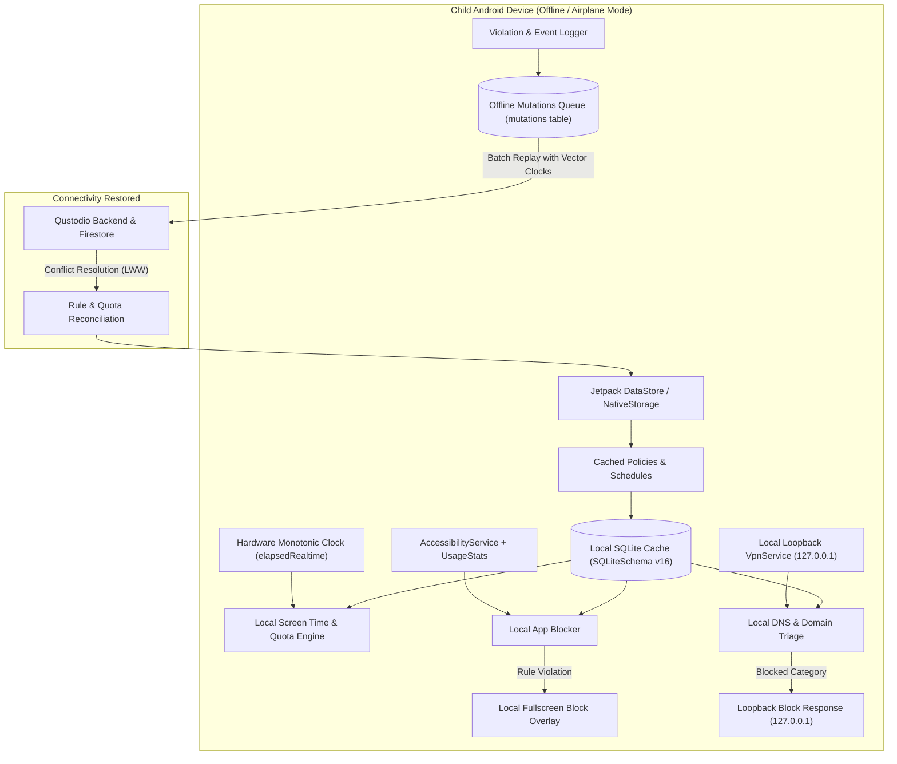

# Qustodio Offline Enforcement Rules & Architecture Breakdown
**Target App:** Qustodio Parental Control (`com.qustodio.family.parental.control.app.screentime`)  
**Artifact:** Data Models, Database & Schemas Extraction (`05_data_models_and_schemas/`)  
**Scope:** Architectural specification of zero-connectivity enforcement, offline snapshotting, local policy evaluation, clock anti-tampering, mutation logging, and reconciliation protocols.

---

## 1. Executive Summary & Zero-Trust Offline Principle

In parental control software, the device boundary is inherently untrusted: children actively probe for evasion techniques. The most common evasion attempts involve **disabling network connectivity**:
1. Switching on **Airplane Mode** (disabling Wi-Fi and Cellular).
2. Disconnecting from the home router or removing the SIM card.
3. Enabling captive portal isolation or blocking DNS lookups.
4. Tampering with the system wall clock (setting the date back to bypass bedtime or daily quota limits).

Qustodio addresses this threat model through a **Zero-Trust Offline-First Enforcement Engine**. The application guarantees that:
- **Zero Internet Requirement:** Active screen time limits, bedtime schedules, web filtering, and app block rules remain strictly enforced when the child device has zero internet connectivity or enters Airplane Mode.
- **Fail-Secure Architecture:** If the device cannot communicate with `api.qustodio.com` or Firebase Cloud Firestore, it defaults to the most restrictive valid policy state rather than failing open.
- **Local Loopback Enforcement:** Traffic inspection, DNS filtering, package tracking, and quota deduction execute entirely within local Android background daemons (`AccessibilityService`, `VpnService`, and foreground `JobService` / `WorkManager`).
- **Deferred Mutation Queuing:** All events (blocked attempts, search terms, call logs, SOS alerts) are durably buffered in local SQLite tables (`mutations`, `events`) and guaranteed to flush to cloud endpoints upon reconnection.



---

## 2. Offline State Snapshotting & Local Persistence

To survive reboots and prolonged periods without network access, Qustodio creates a multi-layered local snapshot of the family policy graph across three primary tiers:

### 2.1 Storage Tier Breakdown

| Storage Tier | Implementation | Purpose & Invalidation Strategy |
|---|---|---|
| **Tier 1: Cloud Firestore SQLite Cache** | `remote_documents`, `document_overlays`, `targets` (`SQLiteSchema.java` v16) | Persists complete document trees for `accounts/{uid}`, `profiles/{puid}`, `routines/{ruid}`, `devices/{duid}`, and `places/{plid}`. Kept indefinitely until overwritten by fresh cloud snapshots. |
| **Tier 2: Jetpack DataStore / NativeStorage** | Protobuf file + `libdatastore_shared_counter.so` atomic mutex | Stores high-velocity, cross-process runtime flags: `lockState`, `accessToken`, `lastInteractionTs`, `parentDeviceId`, `activeTamperedTimeLimit`, and `onboardingTokenData`. |
| **Tier 3: In-Memory Redux Store** | Immutable.js Record collections in WebView memory | Provides instantaneous O(1) in-memory lookups for active UI evaluation, synchronized with local disk storage via Redux persistent storage epics. |

### 2.2 Cached Policy Snapshot Components

The cached policy snapshot captures the following core entities:
1. **Routine Definitions (`RoutineDto` & `ScheduleDto`):**
   - Routine blocks (`POLICY_BLOCK_TYPE_NONE` vs `POLICY_BLOCK_TYPE_BLOCKED`).
   - Weekly schedules with 7-day matrices (`weekdays`), `startTime` (00:00 - 23:59), `durationMinutes`, and override flags.
   - Bedtime and Study time windows mapped to weekday minutes.
2. **Daily Quota Balances (`TimeQuotaDto`):**
   - 1440-minute daily allowance mapping (`quotas: Map<Weekday, number>`).
   - Daily consumed minute counter (`usage: Map<Weekday, number>`).
   - Per-application daily limits (`AppRule.quotas` with 1440-minute default allowance).
3. **Application Blacklist & Category Catalog:**
   - Package name executable mapping (`AppRule.exe` e.g., `com.instagram.android`, `com.zhiliaoapp.musically`).
   - Action code: `ALLOW` (0), `BLOCK` (1), `LIMIT` (2).
   - Application categories (e.g., Games, Social Media, Entertainment) with category-level default actions.
4. **Web Category & Domain Filtering Cache:**
   - Pre-compiled URL category dictionary (over 40 categories: Adult, Gambling, Violence, Weapons, Proxies/VPNs).
   - Explicit domain whitelist/blacklist rules (`domains: Map<string, WebfilterAction>`).
   - SafeSearch enforcement flag (`isSafeSearch = true`).
   - Unsupported browsers blocklist (`UnsupportedBrowserRecord`).

---

## 3. Local Offline Enforcement Mechanics (Device-Side Engines)

### 3.1 Local Screen Time & Quota Deduction Algorithm

When the device is offline, time deduction cannot rely on server heartbeats. Qustodio employs an autonomous local clock deduction cycle:
1. **Tick Interval:** A background alarm wakes up every 60 seconds (`TICK_INTERVAL_MS = 60 * 1000`).
2. **Interactive State Check:** The engine queries `PowerManager.isInteractive()` and `KeyguardManager.isKeyguardLocked()`. If the screen is off or the lock screen is engaged, screen time deduction is paused unless a background audio/video application has an active media session.
3. **Daily Balance Decrement:**
   $$\text{RemainingQuota}_{day} = \text{Allowance}_{day} - \text{ConsumedMinutes}_{day}$$
   When $\text{RemainingQuota}_{day} \le 0$:
   - The engine triggers `REASON_TIME_RESTRICTIONS_QUOTA`.
   - The device immediately enters **Time's Up** lock mode.
4. **Midnight Reset Handling:**
   - At `00:00` local time, the consumption counter resets to `0`, and the allowance for the new weekday is loaded from the pre-cached 7-day quota table.

```
+-----------------------------------------------------------------------------+
|                     OFFLINE SCREEN TIME TICK CYCLE                          |
+-----------------------------------------------------------------------------+
|                                                                             |
|  [ Every 60s Alarm / WorkManager ]                                          |
|                 |                                                           |
|                 v                                                           |
|       Is Screen ON & Unlocked? ---- (No) ----> [ Sleep / Skip Tick ]        |
|                 |                                                           |
|               (Yes)                                                         |
|                 v                                                           |
|       Read Active Routine Schedule from Local DB                            |
|                 |                                                           |
|       Is Current Time within Bedtime / Block Window?                        |
|              /     \                                                        |
|           (Yes)    (No)                                                     |
|            /         \                                                      |
|           v           v                                                     |
|   [ Show Bedtime ]  Decrement Daily Quota (RemainingMinutes - 1)            |
|   [ Block Window ]    |                                                     |
|                       v                                                     |
|                 RemainingMinutes <= 0?                                      |
|                     /      \                                                |
|                  (Yes)     (No)                                             |
|                   /          \                                              |
|                  v            v                                             |
|        [ Show Time's Up ]   Update Local DB usage table & Continue          |
|        [ Lock Device    ]                                                   |
+-----------------------------------------------------------------------------+
```

### 3.2 System Clock Anti-Tampering (`activeTamperedTimeLimit`)

Children frequently attempt to bypass screen time limits by advancing or setting back the device's system time (e.g., rolling back the clock to 3:00 PM when bedtime is 9:00 PM). Qustodio implements a dual-clock tamper detection mechanism:

1. **Dual Clock Comparator:**
   - **Clock A:** Linux Wall-Clock (`System.currentTimeMillis()`) — user-mutable.
   - **Clock B:** Monotonic Hardware Boot Clock (`SystemClock.elapsedRealtime()`) — strictly hardware-driven, cannot be adjusted by user, resets only on full reboot.
2. **Delta Integrity Verification:**
   On every tick, the engine records the tuple:
   $$\Delta_{wall} = \text{currentTimeMillis} - \text{lastRecordedWallTime}$$
   $$\Delta_{mono} = \text{elapsedRealtime} - \text{lastRecordedMonoTime}$$
   If $\lvert \Delta_{wall} - \Delta_{mono} \rvert > \text{THRESHOLD}$ (default: 120 seconds):
   - Tamper state transitions to `ACTIVE_TAMPERED_TIME_LIMIT`.
   - Qustodio locks the device into emergency restricted mode (`tamperState = 'TAMPERED'`).
   - A high-severity security alert is generated and queued into the `mutations` table.
   - Normal operation can only be unlocked by entering the parent master PIN or reconnecting to network time (NTP).

### 3.3 Offline Application Blocking Engine

1. **Accessibility & UsageEvents Polling:**
   - `AccessibilityService` listens to `TYPE_WINDOW_STATE_CHANGED` events.
   - Concurrently, `UsageStatsManager.queryEvents()` polls foreground transitions every 500ms.
2. **Local Package Evaluation:**
   - When a foreground package `pkg` is detected:
     1. Look up `pkg` in the cached `AppRuleRecord` table.
     2. If `action == 'BLOCK'`, or `quotas[today] <= usage[pkg]`, or active routine has `block_type == 'ROUTINE_TYPE_BLOCKED'`:
        - Invoke `WindowManager.addView()` to draw a fullscreen overlay (`WindowManager.LayoutParams.TYPE_APPLICATION_OVERLAY`).
        - The overlay covers 100% of the screen, consuming all touch events.
        - Fire `Intent.ACTION_MAIN` with `CATEGORY_HOME` to force the unauthorized app into the background.

### 3.4 Offline Web & DNS Filtering Engine

1. **Local Loopback VPN (`VpnService`):**
   - The Android VpnService establishes a virtual TUN interface routing UDP port 53 (DNS) to a local loopback daemon (`127.0.0.1:5353`).
2. **Offline Domain Triage:**
   - When an app or browser issues a DNS query for `domain.com`:
     1. Check local explicit whitelist/blacklist (`WebRules.domains`).
     2. Query local category database (`CategoryRecord` SQLite cache).
     3. If category is blocked (e.g., Category 1 = Adult, Category 3 = Gambling):
        - The local DNS resolver synthesizes a loopback DNS response: `A 127.0.0.1`.
        - The embedded HTTP server on `127.0.0.1:8080` serves the offline Qustodio Block Page HTML.
     4. If domain is unclassified and offline:
        - If `isAllowUnknownSites == false`: domain is blocked by default (fail-secure).
        - If `isAllowUnknownSites == true`: domain is resolved via the underlying carrier/Wi-Fi DNS forwarder.

---

## 4. Offline Mutation Logging & State Queuing

Every user event, restriction enforcement, and policy mutation generated while offline must be preserved without data loss.

### 4.1 Mutation Batch Storage Format

When an event occurs offline (e.g., child attempts to open TikTok, visits a blocked URL, or presses the SOS button), the event is written to SQLite:

```sql
-- Storing an offline event mutation
INSERT INTO mutations (uid, batch_id, mutations)
VALUES (
    'acc_parent_102938',
    (SELECT COALESCE(MAX(batch_id), 0) + 1 FROM mutations WHERE uid = 'acc_parent_102938'),
    ? -- Serialized Protobuf containing EventRecord payload with local timestamp
);

-- Indexing the mutation against document path for quick resolution
INSERT INTO document_mutations (uid, path, batch_id)
VALUES (
    'acc_parent_102938',
    'accounts/acc_parent_102938/profiles/prof_kid_01/events/evt_offline_88392',
    (SELECT MAX(batch_id) FROM mutations WHERE uid = 'acc_parent_102938')
);
```

### 4.2 Storage Capacity & Eviction Policy

To prevent unbounded storage consumption during prolonged offline periods:
- **Maximum Offline Batch Queue:** 1,000 batches or 25 MB payload limit.
- **Priority Tiering:**
  1. **Tier 1 (Highest / Never Evicted):** SOS Panic Alerts (`EventType.Panic = 500`), Clock Tampering Violations, and PIN lock attempts.
  2. **Tier 2 (High):** App Rule Violations (`REASON_APP_BLOCK`), Calls/SMS block records.
  3. **Tier 3 (Standard):** Routine usage tick logs and general web browsing history.
- If storage exceeds quota, Tier 3 entries are rolled up into consolidated aggregate counters (`HoursPerDayActivity`, `MinutesPerHourActivity`), preserving the total minute metrics while discarding raw URL breadcrumbs.

---

## 5. Conflict Resolution & Reconnection Synchronization

When connectivity is restored, the client must reconcile differences between changes made locally while offline and updates made remotely by the parent (e.g., parent unlocked extra screen time via Parent App on their phone while the child device was offline).

### 5.1 Reconciliation Protocol: Last-Write-Wins (LWW) with Vector Clocks

Qustodio utilizes a hybrid **Vector Clock + Server-Assisted Last-Write-Wins (LWW)** conflict resolution model:

```
+-----------------------------------------------------------------------------+
|                    RECONNECTION RECONCILIATION FLOW                         |
+-----------------------------------------------------------------------------+
|                                                                             |
|  [ Network Connectivity Restored (ConnectivityManager callback) ]           |
|                           |                                                 |
|                           v                                                 |
|  1. Exchange Handshake via mutation_queues.last_stream_token                |
|                           |                                                 |
|                           v                                                 |
|  2. Fetch Server Snapshot Header (snapshot_version_seconds / nanos)         |
|                           |                                                 |
|     +---------------------+---------------------+                           |
|     |                                           |                           |
|     v                                           v                           |
|  [ Server Version > Local Target ]       [ Uncommitted Local Mutations? ]   |
|     |                                           |                           |
|     v                                           v                           |
|  Download Remote Updates into             Replay Pending Batches in         |
|  remote_documents table                   mutations table via HTTP POST     |
|     |                                           |                           |
|     +---------------------+---------------------+                           |
|                           |                                                 |
|                           v                                                 |
|  3. Conflict Resolution Decision Engine:                                    |
|     - Quota Balancing: Server ExtraTime added to local RemainingQuota.      |
|     - Policy Edits: Server timestamp newer ? Overwrite local rule.          |
|     - Event Replay: Server assigns permanent server_id to offline events.   |
|                           |                                                 |
|                           v                                                 |
|  4. Commit Success: DELETE FROM mutations WHERE batch_id <= acknowledged;  |
|     Update mutation_queues.last_acknowledged_batch_id.                      |
+-----------------------------------------------------------------------------+
```

### 5.2 Specific Conflict Resolution Scenarios

| Scenario | Local Device State (Child) | Remote Server State (Parent) | Resolution Strategy |
|---|---|---|---|
| **Extra Screen Time Grant** | Child device locked (0 min remaining offline). | Parent granted +30 minutes via parent app (`/extraTime`). | **Additive Merge:** Local engine absorbs the extra 30 minutes, increments remaining balance, removes lock overlay, and resumes screen timer. |
| **Schedule Rule Modification** | Device enforces Bedtime starting at 21:00. | Parent extended bedtime to 22:00 while child was offline. | **Server Authority:** Remote schedule timestamp is strictly newer; client applies the 22:00 start time immediately. |
| **App Block Action Conflict** | App was `ALLOW` when child went offline; child used 45 min. | Parent changed app to `BLOCK` remotely at 14:00. | **Immediate Enforce + Retrospective Log:** As soon as online, the app is instantly blocked. The 45 minutes used offline are credited to usage logs without retroactive penalty. |
| **SOS Alert During Disconnection** | Panic button triggered offline; Siren sounded locally. | Server has not received alert. | **Immediate Burst Priority:** Upon reconnection, the SOS mutation skips the standard batch queue and transmits via expedited WebSocket/REST with highest QoS. |

---

## 6. Architectural Lessons for Family OS

The reverse-engineering of Qustodio's offline mechanisms provides four core architectural foundations for the upcoming Family OS design:

1. **Deterministic Local SQLite Persistence:**
   Relying purely on cloud APIs fails on mobile platforms. Family OS must maintain an embedded SQLite database (via Room / Drift) storing active routines, category rules, and app quotas locally.
2. **Monotonic Clock Defense:**
   Parental control time calculation must never trust `System.currentTimeMillis()`. Family OS will anchor its time tracker to `SystemClock.elapsedRealtime()` and NTP network time references to prevent wall-clock manipulation.
3. **Loopback Fail-Secure Filtering:**
   Network packet interception via local loopback (`127.0.0.1`) ensures zero-latency policy evaluation and guarantees that cutting Wi-Fi/Cellular connectivity does not open access to restricted domains.
4. **Idempotent Mutation Queueing:**
   Every event recorded offline must be assigned a client-generated UUID (`key`) and sequential batch ID. Replay requests must be idempotent to prevent duplicate activity entries upon unstable re-connections.
