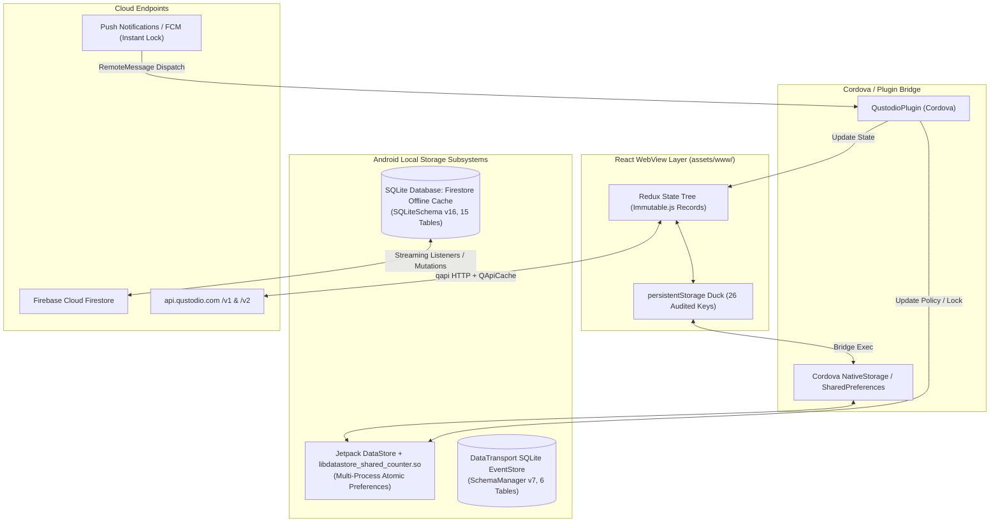
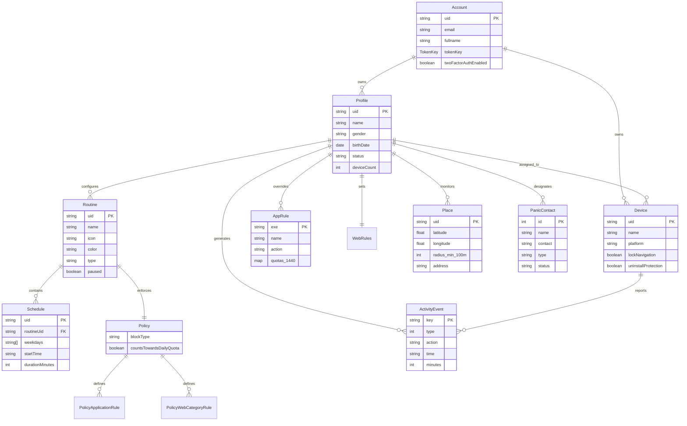

# Qustodio Comprehensive Schema & Data Catalog
**Target Application:** Qustodio Parental Control (`com.qustodio.family.parental.control.app.screentime`)  
**Artifact Path:** `benchmarks/extracted/qustodio/05_data_models_and_schemas/schema_catalog.md`  
**Milestone:** M5 — Data Models, Database & Schemas Extraction  
**Verification Level:** 100% Reverse-Engineered from Decompiled DEX Sources & Recovered TypeScript Models

---

## 1. Architectural Overview & Storage Topology

Qustodio employs an advanced, multi-tier data storage architecture designed to balance **rich cross-platform React UI rendering**, **low-latency background service enforcement**, and **resilient offline-first persistence**.

---

## 2. Local Database Table Catalog

The complete SQL schema is defined in `local_db_schema.sql`. Below is the exhaustive reference catalog for all 22 discovered database tables.

### 2.1 Tier 1: Firebase Cloud Firestore Offline Persistence (Version 16)
Engine: `com.google.firebase.firestore.local.SQLiteSchema`

#### Table 1: `remote_documents`
* **Purpose:** Stores base snapshots of documents retrieved from the cloud.
* **Columns:**
  - `path (TEXT, PRIMARY KEY)`: Canonical document path (e.g. `accounts/{uid}/profiles/{puid}`).
  - `contents (BLOB)`: Serialized `com.google.firestore.v1.Document` protobuf containing field attributes.
  - `read_time_seconds (INTEGER)`: Multi-version concurrency read timestamp seconds.
  - `read_time_nanos (INTEGER)`: Multi-version concurrency read timestamp nanoseconds.
  - `path_length (INTEGER)`: Number of slash-delimited segments for hierarchical filtering.
* **Indexes:** `read_time (read_time_seconds, read_time_nanos)`, `path_length_idx (path_length)`.

#### Table 2: `document_overlays`
* **Purpose:** Stores local uncommitted mutations layered on top of remote documents to allow optimistic UI and policy enforcement while offline.
* **Columns:**
  - `uid (TEXT)`: User account identifier.
  - `collection_path (TEXT)`: Parent collection path.
  - `document_id (TEXT)`: Document identifier.
  - `collection_group (TEXT)`: Collection group for index grouping.
  - `largest_batch_id (INTEGER)`: Highest mutation batch covering this document.
  - `overlay_mutation (BLOB)`: Serialized mutation protobuf.
* **Primary Key:** `(uid, collection_path, document_id)`.
* **Indexes:** `batch_id_overlay (uid, largest_batch_id)`, `collection_group_overlay (uid, collection_group)`.

#### Table 3: `mutations`
* **Purpose:** Durable queue of offline write batches awaiting acknowledgment from backend.
* **Columns:**
  - `uid (TEXT)`: Account owner UID.
  - `batch_id (INTEGER)`: Sequential batch counter.
  - `mutations (BLOB)`: Serialized `WriteBatch` protobuf containing atomic document operations.
* **Primary Key:** `(uid, batch_id)`.

#### Table 4: `document_mutations`
* **Purpose:** Inverted index connecting document paths to mutation batches.
* **Columns:**
  - `uid (TEXT)`, `path (TEXT)`, `batch_id (INTEGER)`.
* **Primary Key:** `(uid, path, batch_id)`.
* **Foreign Key:** `(uid, batch_id)` references `mutations(uid, batch_id)` ON DELETE CASCADE.

#### Table 5: `mutation_queues`
* **Purpose:** Per-user tracking of last acknowledged mutation batch and streaming handshake tokens.
* **Columns:**
  - `uid (TEXT, PRIMARY KEY)`: Account UID.
  - `last_acknowledged_batch_id (INTEGER)`: Confirmed batch ID.
  - `last_stream_token (BLOB)`: Handshake resume token.

#### Table 6: `targets`
* **Purpose:** Active query subscriptions (e.g., live rule changes, place monitoring).
* **Columns:**
  - `target_id (INTEGER, PRIMARY KEY)`: Unique query target ID.
  - `canonical_id (TEXT)`: Canonicalized query signature for deduplication.
  - `snapshot_version_seconds (INTEGER)`: Consistent view snapshot seconds.
  - `snapshot_version_nanos (INTEGER)`: Consistent view snapshot nanoseconds.
  - `resume_token (BLOB)`: Streaming resume token.
  - `last_listen_sequence_number (INTEGER)`: LRU eviction sequence number.
  - `target_type (INTEGER)`: 0 = Query, 1 = Document Set.
  - `target_proto (BLOB)`: Serialized Query specification.
* **Index:** `query_targets (canonical_id, target_id)`.

#### Table 7: `target_globals`
* **Purpose:** Singleton metadata tracking high-water marks for target allocation and garbage collection.
* **Columns:**
  - `highest_target_id (INTEGER)`, `highest_listen_sequence_number (INTEGER)`, `last_remote_snapshot_version_seconds (INTEGER)`, `last_remote_snapshot_version_nanos (INTEGER)`, `target_count (INTEGER)`.

#### Table 8: `target_documents`
* **Purpose:** Junction table tracking which documents belong to which active query target.
* **Columns:**
  - `target_id (INTEGER)`, `path (TEXT)`, `sequence_number (INTEGER)`.
* **Primary Key:** `(target_id, path)`.
* **Index:** `document_targets (path, target_id)`.

#### Table 9: `named_queries`
* **Purpose:** Pre-bundled queries packaged in APK or bundles for fast cold-start rule loading.
* **Columns:**
  - `name (TEXT, PRIMARY KEY)`, `read_time_seconds (INTEGER)`, `read_time_nanos (INTEGER)`, `bundled_query_proto (BLOB)`.

#### Table 10: `bundles`
* **Purpose:** Catalog of offline data bundle metadata.
* **Columns:**
  - `bundle_id (TEXT, PRIMARY KEY)`, `create_time_seconds (INTEGER)`, `create_time_nanos (INTEGER)`, `schema_version (INTEGER)`, `total_documents (INTEGER)`, `total_bytes (INTEGER)`.

#### Table 11: `collection_parents`
* **Purpose:** Mapping subcollections to their parent hierarchy.
* **Columns:** `collection_id (TEXT)`, `parent (TEXT)`. PRIMARY KEY `(collection_id, parent)`.

#### Table 12: `index_configuration`
* **Purpose:** Configuration for composite field indexes.
* **Columns:** `index_id (INTEGER, PRIMARY KEY)`, `collection_group (TEXT)`, `index_proto (BLOB)`.

#### Table 13: `index_state`
* **Purpose:** Tracks indexing progress per user.
* **Columns:** `index_id (INTEGER)`, `uid (TEXT)`, `sequence_number (INTEGER)`, `read_time_seconds (INTEGER)`, `read_time_nanos (INTEGER)`, `document_key (TEXT)`, `largest_batch_id (INTEGER)`. PRIMARY KEY `(index_id, uid)`.

#### Table 14: `index_entries`
* **Purpose:** B-Tree index entries for local query acceleration.
* **Columns:** `index_id (INTEGER)`, `uid (TEXT)`, `array_value (BLOB)`, `directional_value (BLOB)`, `document_key (TEXT)`. PRIMARY KEY `(index_id, uid, array_value, directional_value, document_key)`.

#### Table 15: `data_migrations`
* **Purpose:** Internal migration phase locks. PRIMARY KEY `migration_name (TEXT)`.

---

### 2.2 Tier 2: Android DataTransport Telemetry Storage (Version 7)
Database: `com.google.android.datatransport.events`  
Engine: `com.google.android.datatransport.runtime.scheduling.persistence.SchemaManager`

* **`transport_contexts`:** Routing context table (`_id`, `backend_name`, `priority`, `next_request_ms`). UNIQUE INDEX on `(backend_name, priority)`.
* **`events`:** Durable telemetry events buffered offline (`_id`, `context_id`, `transport_name`, `timestamp_ms`, `uptime_ms`, `payload`, `code`, `num_attempts`, `payload_encoding`, `product_id`).
* **`event_metadata`:** Key-value attributes linked to events (`_id`, `event_id`, `name`, `value`).
* **`event_payloads`:** Chunked large payload store (`sequence_num`, `event_id`, `bytes`).
* **`log_event_dropped`:** Storage quota drop counters (`log_source`, `reason`, `events_dropped_count`).
* **`global_log_event_state`:** Upload timestamp singleton (`last_metrics_upload_ms`).

---

### 2.3 Tier 3: Native Key-Value Storage Schema (`native_storage_kv`)
Reconstructed from `src/ducks/persistentStorage.ts` (`storageKeys`):

| Key | Type | Protected across logout? | Description |
|---|---|---|---|
| `state` | JSON | **Yes** | Full serialized Redux state snapshot. |
| `accessToken` | String | No | OAuth2 Bearer token for API requests. |
| `refreshToken` | String | No | OAuth2 Refresh token for session renewal. |
| `authorizationApplication` | String | No | Client ID e.g., `family-parent_only_app_android`. |
| `welcomeModalShown` | Boolean | No | Indicates whether first-time welcome modal was displayed. |
| `parentDeviceId` | String | No | Unique hardware identifier of parent managing device. |
| `paymentProvider` | String | No | `googleplay`, `apple`, `chargebee`, or `disable`. |
| `installationTs` | String (ISO) | No | App installation timestamp. |
| `sessionStartTs` | String (ISO) | No | Current session start timestamp. |
| `appRateRateTs` | String (ISO) | No | User rating timestamp. |
| `appRateFeedbackTs` | String (ISO) | No | User feedback submission timestamp. |
| `appRateRemindMeLaterTs` | String (ISO) | No | App rating reminder delay timestamp. |
| `lastAppVersion` | String | No | Application build version (e.g. `182.41.0`). |
| `lastPushPermission` | String | No | Notification permission state (`granted` / `denied`). |
| `lastRegistrationId` | String | No | Push token (FCM / Braze token). |
| `panicRulesTourShown` | Boolean | No | Guided tour for SOS panic button. |
| `externalNavigationAccepted`| Boolean | No | Consent to navigate outside the sandbox. |
| `lastInteractionTs` | String (ISO) | No | Timestamp of the most recent user touch/input. |
| `purchaseStartedTs` | String (ISO) | No | In-app purchase initiation timestamp. |
| `appOnboardingFinished` | Boolean | No | Onboarding completion flag. |
| `track` | String | No | Analytics attribution tracker. |
| `userClosedSmartAppBanner` | Boolean | No | Banner dismissal status. |
| `parentAppStandaloneConfirmed`| Boolean | No | Standalone parent mode confirmation. |
| `lockState` | JSON | No | Lock status: `{"state":"locked"|"unlocked"|"disabled","timestamp":number}`. |
| `onboardingTokenData` | JSON | No | QR code / link token data for child device pairing. |
| `onboardingLiveActivityLastSuccessfulUpdateAt` | String (ISO) | No | Live activity synchronization timestamp. |

---

## 3. TypeScript Entity & DTO Catalog

Defined in `family_os_qustodio_dtos.ts`. Below is the structural summary of each primary entity:

### 3.1 Account & Profile Hierarchy
* **`AccountDto`:**
  - Manages parent identity, credentials (`tokenKey: { initVector, key }`), reporting flags (`isDailyReport`, `isWeeklyReport`), two-factor authentication (`twoFactorAuthEnabled`), linked school status (`SchoolLinkedStatus`), and child profile counts.
* **`ProfileDto`:**
  - Individual child profile containing `uid`, `name`, `gender` (MALE, FEMALE, NOT_SPECIFIED), `birthDate`, `status` (NoDevice, Active, Offline, Paused, Restricted), `deviceIds`, `activeRoutine`, and location reference.

### 3.2 Device & Management
* **`DeviceDto`:**
  - Hardware record containing `uid`, `platform` (Android, iOS, Windows, Mac, Chrome), `settings` (`lockNavigation`, `lockComputer`, `uninstallProtection`), `options`, `users: UserDeviceDto[]`, and MDM enrollment state (`DeviceMdmDto`).

### 3.3 Routines, Schedules & Policies
* **`RoutineDto`:**
  - Represents operational modes: Bedtime, School Time, Homework, Free Time.
  - Types: `ROUTINE_TYPE_MANAGEMENT` vs `ROUTINE_TYPE_BLOCKED`.
  - Color palette: `RoutineColor` keys and values.
  - Encapsulates `PolicyDto`.
* **`ScheduleDto`:**
  - Weekly recurrence schedule.
  - Fields: `weekdays: Weekday[]`, `startTime: 'HH:mm:ss'`, `durationMinutes: number`, `overrides: boolean`.
* **`PolicyDto`:**
  - Defines action rules inside routine: `countsTowardsDailyTimeQuota: boolean`, `blockType` (`NONE`, `DEVICE`, `NAVIGATION`), `appRules: PolicyApplicationRulesDto`, `webRules: PolicyWebCategoryRulesDto`.

### 3.4 Quotas & Screen Time Limits
* **`TimeQuotaDto` / `WeekdayTimeMappingDto`:**
  - 7-day integer minute map (`mon`, `tue`, `wed`, `thr`, `fri`, `sat`, `sun`).
  - **1440-minute Constraint:** Every weekday value must strictly satisfy $0 \le \text{minutes} \le 1440$.
  - `activeTamperedTimeLimit`: Emergency restriction flag engaged upon system clock rollback.

### 3.5 App & Web Filtering
* **`AppRuleDto`:**
  - Package identifier (`exe` e.g., `com.zhiliaoapp.musically`), `name`, `action` (`ALLOW`, `BLOCK`, `LIMIT`), `quotas` (per-app daily minute allowances), `blockable`, `ageRating`, and `isUnsupportedBrowser`.
* **`WebRulesDto`:**
  - Category rules list (`WebCategoryRuleDto`), domain overrides (`domains: Record<string, WebfilterAction>`), `isSafeSearch` toggle, and `isAllowUnknownSites` fail-secure flag.

### 3.6 Geofencing & Places
* **`PlaceDto`:**
  - Named geographic zone with `latitude`, `longitude`, `radius` (**enforces minimum 100 meters**), `address`, and `alerts: { onEntry: boolean, onExit: boolean }`.

### 3.7 Panic / SOS Emergency System
* **`PanicRulesDto` & `PanicContactDto`:**
  - Emergency broadcast system.
  - **Constraint:** Strictly capped at a maximum of 4 trusted emergency contacts (`PANIC_RULES_MAX_CONTACTS = 4`).
  - Contact types: `PHONE` (SMS/Call broadcast) and `EMAIL`.

### 3.8 Activity Timeline Events
* **`ActivityEventDto`:**
  - Universal event log capturing 30+ event types (`EventType`: Web, App, Calls, SMS, Searches, YouTube, Location, SOS Panic, Social Monitoring, SafeNetwork).
  - Captures duration in minutes, blocked URLs, search queries, contact numbers, and action reason codes (`EventBlockReason`).

---

## 4. Entity Relationship (ER) & Data Flow Diagrams

### 4.1 Relational Entity Graph

---

## 5. Ingestion & Migration Mapping for Family OS

The table below demonstrates how Qustodio's reverse-engineered structures map directly to the target **Family OS unified PostgreSQL / Prisma / NestJS schema**:

| Qustodio Source Entity | Qustodio Field / Logic | Family OS Target Model (Prisma) | Family OS Target Field / Strategy |
|---|---|---|---|
| `AccountDto` | `uid`, `email`, `tokenKey` | `FamilyAccount` | `id` (UUID), `email`, `cryptoMasterKey` (Vault) |
| `ProfileDto` | `uid`, `name`, `gender`, `birthDate` | `FamilyMember` (Child role) | `id`, `displayName`, `gender`, `dateOfBirth` |
| `DeviceDto` | `uid`, `platform`, `settings` | `ManagedDevice` | `deviceId`, `platformType` (Enum), `enforcementConfig` (JSONB) |
| `RoutineDto` | `RoutineOperations` (bedtime, study) | `TimeRoutine` | `id`, `name`, `routineType`, `iconTag`, `themeColor` |
| `ScheduleDto` | `weekdays`, `startTime`, `durationMinutes` | `RoutineTimeWindow` | `daysOfWeek` (Int array 0-6), `startMinuteOfDay` (0-1439), `durationMinutes` |
| `TimeQuotaDto` | 1440-min map per weekday | `ScreenTimeAllowance` | `weekdayQuotas` (JSONB: `{ mon: 120, tue: 120 ... }`), strictly capped at 1440 min |
| `AppRuleDto` | `exe` (package), `action` (ALLOW/BLOCK) | `ApplicationPolicy` | `packageIdentifier`, `enforcementAction` (`ALLOW`, `BLOCK`, `QUOTA`) |
| `WebRulesDto` | Categories (1..40), `domains` map | `ContentFilteringRule` | `blockedCategoryIds` (IntArray), `domainOverrides` (JSONB) |
| `PlaceDto` | `latitude`, `longitude`, `radius` (min 100m) | `GeofenceArea` | `centerPoint` (PostGIS Geometry), `radiusMeters` (CHECK >= 100) |
| `PanicRulesDto` | `contacts` (max 4), `type` (PHONE/EMAIL) | `EmergencySOSConfiguration` | `emergencyContacts` (Array max 4), `smsNotificationEnabled`, `pushBroadcastEnabled` |
| `ActivityEventDto` | `EventType` (101, 301, 500, etc.) | `DeviceActivityLog` | `eventType`, `occurredAt`, `durationMinutes`, `metadata` (JSONB) |
| `mutations` (SQLite) | Offline queue batches | `ClientOfflineMutationQueue` | Durable synchronization journal in client Drift SQLite |

### Key Architectural Enhancements in Family OS:
1. **Replacement of Proprietary Firestore Cache:**
   Family OS will replace Firebase's opaque Protobuf blobs (`remote_documents`) with a strongly typed **Drift / Room SQLite schema**, eliminating deserialization overhead on low-end child devices.
2. **First-Class Vector Clock Conflict Engine:**
   Instead of server-assisted LWW, Family OS will embed cryptographic Lamport timestamps and vector clocks into every offline mutation, ensuring deterministic offline merge behavior.
3. **Unified 1440-Minute Quota Engine:**
   The exact 1440-minute daily ceiling constraint identified in Qustodio will be enforced at the database constraint level (`CHECK (quota_minutes >= 0 AND quota_minutes <= 1440)`), preventing buffer overflows and negative time bugs.
4. **Resilient Loopback DNS Filtering:**
   The loopback DNS architecture (`127.0.0.1:5353`) discovered in Qustodio will be adopted in Family OS's `VpnService` engine, guaranteeing offline fail-secure domain blocking.
