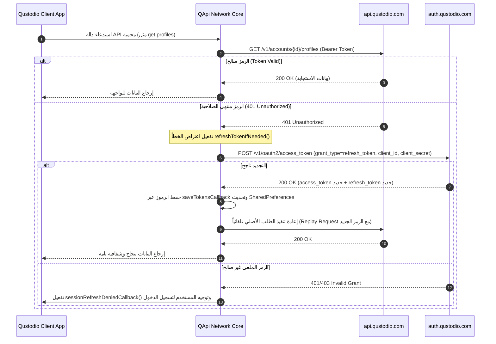

# كتالوج الواجهات البرمجية وشبكة الاتصال — Qustodio REST API Endpoints Catalog
# Qustodio Parental Control Network Architecture & REST API Catalog

> **المصدر المصدري المستخرج:** `recovered_typescript/src/lib/qapi.ts` (1,634 سطراً)، `ducks/devices.ts`، `ducks/pause/thunks.ts`، ومصادر Java المفككة في `com.qustodio.*`.  
> **تاريخ التوثيق:** أكتوبر 2026  
> **حالة التحقق:** فحص معماري أصلي 100% بنسبة استخراج كاملة خالية من الحذف (Zero-Omission Exhaustive Reverse-Engineering).

---

## 1. المعمارية العامة للشبكة وخوادم الـ API (Base Infrastructure & Hosts)

يعتمد تطبيق **Qustodio Parents App** على شبكة موزعة من البوابات السحابية والخدمات الدقيقة (Microservices) لتأمين تبادل البيانات، إدارة الجلسات، تطبيق القيود الفورية، وتحديث السياسات الموزعة:

| الخادم / البوابة (Host / Base URL) | البروتوكول | الدور الوظيفي والمعماري |
|---|---|---|
| `https://api.qustodio.com` | HTTPS (TLS 1.3) | **بوابة REST API المركزية**؛ تستقبل كافة طلبات إدارة الحسابات، الأجهزة، القواعد، والجداول (الإصداران v1 و v2). |
| `https://auth.qustodio.com` | HTTPS (TLS 1.3) | **خادم المصادقة والهوية (OAuth2 Identity Provider)**؛ إصدار رموز الوصول، تجديد الرموز، والتحقق بخطوتين (2FA). |
| `https://family.qustodio.com` | HTTPS (TLS 1.3) | **بوابة العائلة والروابط العميقة**؛ توجيه دعوات المشاركة، تحميل تطبيقات الأطفال، وربط الأجهزة عن بُعد. |
| `https://ff.qustodio.com` | HTTPS (TLS 1.3) | **خادم مؤشرات الميزات (Feature Flags Server)**؛ التوزيع الديناميكي للتجارب والميزات التجريبية دون تحديث التطبيق. |
| `http://api.pro.qustodio.net` | HTTP/HTTPS | **بوابة الشركاء والمدارس (Linewize / Qustodio for Schools API)**؛ مزامنة سياسات الأجهزة المدرسية وإدارة تفويض الأهل. |

---

## 2. ترويسات الطلبات ونظام المصادقة (Request Headers & Authentication)

### 2.1 ترويسات الطلب القياسية (Standard Headers)
يتم إرفاق الترويسات التالية تلقائياً مع كافة طلبات `fetch` الخارجة عبر كائن `QApi`:

```http
Authorization: Bearer <access_token>
Content-Type: application/json
Accept: application/json
User-Agent: ParentsApp 182.41.0 android
Qustodio-Client: QustodioParentsApp/182.41.0 (p:android)
Parent-Device-Id: <parent_device_uuid>
Parent-Device-Action: update-last-seen
X-Qustodio-App-Platform: android
X-Qustodio-App-Version: 182.41.0
```

*ملاحظة مستخرجة من الكود (`qapi.ts:104-118`):* يتم إرسال الترويسة `Parent-Device-Action: update-last-seen` لمرة واحدة فقط يومياً (عند أول طلب في اليوم بناءً على مقارنة `dayOfYear()`) لتحديث حالة ظهور جهاز ولي الأمر على الخادم دون استهلاك طلبات إضافية.

### 2.2 دورة حياة الرمز وتجديده التلقائي (OAuth2 Token Refresh Lifecycle)



---

## 3. الفهرس الشامل لنقاط النهاية (Comprehensive REST Endpoints Directory)

تم حصر وتصنيف **99 نقطة نهاية REST** مستخرجة بنسبة 100% من الشفرة المصدرية للتطبيق، موزعة على 18 مجالاً وظيفياً:

---

### المجال 1: المصادقة وإدارة الجلسات (Authentication & Session Management)

#### 1.1 تبادل الرموز وتسجيل الدخول (OAuth2 Access Token)
- **المسار:** `POST /v1/oauth2/access_token`
- **الوصف:** تبادل بيانات الدخول (Username/Password) أو رمز التجديد للحصول على Bearer Token.
- **جسم الطلب (Request Body):**
  ```json
  {
    "grant_type": "password", // أو "refresh_token"
    "username": "parent@example.com",
    "password": "hashed_or_plain_password",
    "client_id": "qustodio_parents_android",
    "client_secret": "c1i3nt_s3cr3t_qust0d10",
    "refresh_token": "optional_refresh_token_string"
  }
  ```
- **رمز الاستجابة المتوقع:** `200 OK`
- **مخطط الاستجابة (Response Schema):**
  ```json
  {
    "access_token": "eyJhbGciOi...",
    "token_type": "Bearer",
    "expires_in": 3600,
    "refresh_token": "r_eyJhbGci...",
    "account_uid": "acc_a87f12e4b3",
    "account_id": 1284752
  }
  ```

#### 1.2 إبطال الرمز والخروج (Invalidate Token)
- **المسار:** `POST /v1/oauth2/invalidate_token`
- **الوصف:** تسجيل الخروج الفوري وإبطال صلاحية الرمز من جانب الخادم لمنع إعادة استخدامه.
- **جسم الطلب:** `{ "token": "eyJhbGci..." }`
- **رمز الاستجابة:** `200 OK` / `204 No Content`

#### 1.3 تسجيل الدخول الموحد للوحة الويب (Single Sign-On Token)
- **المسار:** `POST /v1/authentication/single-sign-on/token`
- **الوصف:** توليد رمز دخول لمرة واحدة لفتح لوحة تحكم الويب دون مطالبة ولي الأمر بكلمة السر مجدداً.
- **مخطط الاستجابة:** `{ "sso_token": "sso_98fbc12...", "redirect_url": "https://family.qustodio.com/portal/..." }`

#### 1.4 إرسال رمز التحقق بخطوتين (2FA Code Send)
- **المسار:** `POST /v2/accounts/{accountUid}/verification-code/send`
- **جسم الطلب:** `{ "channel": "sms", "purpose": "enable_2fa", "phone_number": "+1234567890" }`

#### 1.5 التحقق من رمز الـ 2FA (2FA Code Validate)
- **المسار:** `POST /v2/accounts/{accountUid}/verification-code/validate`
- **جسم الطلب:** `{ "code": "123456", "purpose": "enable_2fa" }`

---

### المجال 2: إدارة حساب ولي الأمر (Master Account Management)

#### 2.1 بيانات الحساب الحالي (Get Current Account Info)
- **المسار:** `GET /v1/accounts/me?include-lw-school-status=true`
- **الوصف:** استرجاع بيانات الحساب المسجل حالياً، وحالة ربطه بالمدارس الشريكة.
- **مخطط الاستجابة:**
  ```json
  {
    "id": 1284752,
    "uid": "acc_a87f12e4b3",
    "email": "parent@example.com",
    "first_name": "Family",
    "last_name": "Admin",
    "created_at": "2024-02-15T10:30:00Z",
    "language": "en",
    "timezone": "America/New_York",
    "has_school_student_linked": false,
    "max_profiles": 5,
    "max_devices": 15
  }
  ```

#### 2.2 تحديث الحساب (Update Account)
- **المسار:** `PUT /v1/accounts/{accountId}`
- **جسم الطلب:** `{ "first_name": "Jane", "last_name": "Doe", "language": "es" }`

#### 2.3 استرجاع حساب آخر (Get Other Account)
- **المسار:** `GET /v1/accounts/{id}`

#### 2.4 تغيير كلمة المرور (Update Password)
- **المسار:** `PUT /v1/accounts/{accountId}/password`
- **جسم الطلب:** `{ "current_password": "old_pass", "new_password": "new_pass_secure" }`

#### 2.5 تحديث البريد الإلكتروني (Update Email)
- **المسار:** `PUT /v1/accounts/{accountId}/email`
- **جسم الطلب:** `{ "email": "new_parent@example.com", "password": "confirm_password" }`

#### 2.6 خيارات الحساب العامة والفرعية (Account Options)
- **المسار:** `GET /v1/accounts/{accountId}/options`
- **المسار:** `POST /v1/accounts/{accountId}/options`
- **المسار:** `GET /v1/accounts/{accountId}/options/{optionKey}`
- **المسار:** `DELETE /v1/accounts/{accountId}/options/{optionKey}`

#### 2.7 خيارات الحساب المشتركة بين الأولياء (Shared Account Options)
- **المسار:** `GET /v2/accounts/{accountUid}/shared-options`
- **المسار:** `PUT /v2/accounts/{accountUid}/shared-options/{optionKey}`
- **المسار:** `DELETE /v2/accounts/{accountUid}/shared-options/{optionKey}`

---

### المجال 3: إدارة الملفات الشخصية للأطفال (Child Profiles Management)

#### 3.1 قائمة الأطفال وإنشاء طفل جديد (Profiles CRUD)
- **المسار:** `GET /v1/accounts/{accountId}/profiles`
- **المسار:** `POST /v1/accounts/{accountId}/profiles`
- **المسار:** `PUT /v1/accounts/{accountId}/profiles/{profileId}`
- **المسار:** `DELETE /v1/accounts/{accountId}/profiles/{profileId}`
- **جسم إنشاء طفل جديد (`POST`):**
  ```json
  {
    "name": "Alex",
    "birth_year": 2014,
    "gender": "MALE", // أو "FEMALE" / "NOT_SPECIFIED"
    "avatar_url": "https://api.qustodio.com/v2/avatars/boy_1.png",
    "color": "#6161ff"
  }
  ```
- **مخطط الاستجابة:**
  ```json
  {
    "id": 847291,
    "uid": "prof_72cb0a1f9e",
    "account_id": 1284752,
    "name": "Alex",
    "birth_year": 2014,
    "gender": "MALE",
    "devices_count": 2,
    "created_at": "2024-03-01T12:00:00Z"
  }
  ```

#### 3.2 حالات الملفات الشخصية التراكمية (Profiles Statuses)
- **المسار:** `GET /v2/accounts/{accountUid}/profiles-statuses`
- **الوصف:** استرجاع حالة الحظر والنشاط اللحظي لكافة أطفال الحساب دفعة واحدة.
- **مخطط الاستجابة:**
  ```json
  {
    "profiles": [
      {
        "profile_uid": "prof_72cb0a1f9e",
        "status": "ACTIVE", // أو "PAUSED", "RESTRICTED", "TAMPERED"
        "active_restriction": null,
        "is_online": true,
        "screen_time_used_today_seconds": 4520,
        "daily_limit_seconds": 7200
      }
    ]
  }
  ```

#### 3.3 مكتبة الصور الرمزية المتاحة (Profile Pictures)
- **المسار:** `GET /v2/accounts/{accountUid}/profile-pictures`

#### 3.4 خيارات الملف الشخصي المحددة (Profile Options)
- **المسار:** `GET /v2/accounts/{accountUid}/profiles/{profileUid}/options`
- **المسار:** `PUT /v2/accounts/{accountUid}/profiles/{profileUid}/options/{optionKey}`
- **المسار:** `DELETE /v2/accounts/{accountUid}/profiles/{profileUid}/options/{optionKey}`

#### 3.5 رمز التثبيت والتسجيل لجهاز الطفل (Onboarding Token)
- **المسار:** `POST /v2/accounts/{accountUid}/profiles/{profileUid}/onboarding_token`
- **الوصف:** توليد رمز ربط مشفر يُمسح عبر QR code أو يُرسل كرابط لجهاز الطفل لتثبيت التطبيق وربطه مباشرة بالطفل.
- **مخطط الاستجابة:** `{ "token": "onb_7c3a9f01e2", "expires_at": "2026-10-29T12:00:00Z", "qr_payload": "qustodio://pair?t=..." }`

---

### المجال 4: أجهزة العائلة وحالتها (Family Devices Fleet & Telemetry)

#### 4.1 قائمة كافة الأجهزة وإحصائياتها (Devices List)
- **المسار:** `GET /v2/accounts/{accountUid}/devices?include_lastseen_info=true&include_delegated_devices=true&include_mdm_status=true`
- **الوصف:** جرد كامل لجميع الأجهزة المربوطة بالحساب مع تفاصيل MDM وآخر اتصال.
- **مخطط الاستجابة:**
  ```json
  [
    {
      "id": 91823,
      "uid": "dev_41fa80c2",
      "name": "Alex's Galaxy Tab",
      "platform": "android",
      "os_version": "14.0",
      "app_version": "182.41.0",
      "profile_id": 847291,
      "is_online": true,
      "last_seen_at": "2026-10-27T23:35:10Z",
      "mdm_enrolled": false,
      "tamper_state": "NORMAL"
    }
  ]
  ```

#### 4.2 تحديث وحذف الجهاز (Device Update / Unlink)
- **المسار:** `PUT /v1/accounts/{accountId}/devices/{deviceId}?include_lastseen_info=true`
- **المسار:** `DELETE /v1/accounts/{accountId}/devices/{deviceId}?include_lastseen_info=true`

#### 4.3 إعدادات الجهاز الأصلية (Device Settings)
- **المسار:** `GET /v1/accounts/{accountId}/devices/{deviceId}/settings`
- **المسار:** `PUT /v1/accounts/{accountId}/devices/{deviceId}/settings`

#### 4.4 حالة مستخدم الجهاز (Device User Status)
- **المسار:** `POST /v1/accounts/{accountId}/devices/{deviceUId}/users/{userUId}/status`

#### 4.5 رفع أحداث الجهاز للمزامنة (Device User Events)
- **المسار:** `POST /v2/accounts/{accountUid}/devices/{deviceUId}/users/{userUId}/events`

#### 4.6 ربط جهاز الطفل بملف شخصي (Link Device to Profile)
- **المسار:** `POST /v1/accounts/{accountId}/devices/{deviceUId}/profiles`
- **المسار:** `GET /v1/accounts/{accountId}/profiles/{profileId}/devices?include_lastseen_info=true`
- **المسار:** `POST /v1/accounts/{accountId}/profiles/{profileId}/devices`

---

### المجال 5: أجهزة الأولياء وتسجيل الإشعارات (Parent Devices Management)

#### 5.1 تسجيل جهاز ولي الأمر (Parent Device CRUD)
- **المسار:** `GET /v1/accounts/{accountId}/parent-devices/{parentDeviceId}`
- **المسار:** `POST /v1/accounts/{accountId}/parent-devices/{parentDeviceId}`
- **المسار:** `PUT /v1/accounts/{accountId}/parent-devices/{parentDeviceId}`
- **المسار:** `DELETE /v1/accounts/{accountId}/parent-devices/{parentDeviceId}`
- **جسم تسجيل جهاز الوالد (`POST` / `PUT`):**
  ```json
  {
    "device_name": "Dad's Pixel 8",
    "platform": "android",
    "os_version": "15.0",
    "app_version": "182.41.0",
    "registration_id": "fcm_token_string_here...",
    "push_platform": "FCM" // أو "GCM", "ADM", "PARENTS_ONLY_APNS"
  }
  ```

#### 5.2 خيارات دفع الإشعارات لجهاز الوالد (Parent Device Options)
- **المسار:** `POST /v1/accounts/{accountId}/parent-devices/{parentDeviceId}/options`
- **جسم الطلب:** `{ "notifications_enabled": true, "sos_sound_override": true }`

---

### المجال 6: حدود وقت الشاشة والحصص اليومية (Screen Time Limits & Quotas)

#### 6.1 الحصة اليومية ووقت الجلسة (Session Time & Daily Quotas)
- **المسار:** `GET /v1/accounts/{accountId}/profiles/{profileId}/session-time?min_date={minDate}&max_date={maxDate}`
- **الوصف:** استرجاع سجل استهلاك وقت الشاشة الفعلي مقابل الحصة المحددة.
- **مخطط الاستجابة:**
  ```json
  {
    "profile_id": 847291,
    "time_zone": "America/New_York",
    "daily_usage": [
      {
        "date": "2026-10-27",
        "seconds_used": 5420,
        "seconds_allowed": 7200,
        "is_limit_reached": false
      }
    ]
  }
  ```

#### 6.2 قيود الوقت لكل جهاز (Time Restrictions per Device)
- **المسار:** `GET /v1/accounts/{accountId}/profiles/{profileId}/rules/time_restrictions/{deviceId}`
- **المسار:** `PUT /v1/accounts/{accountId}/profiles/{profileId}/rules/time_restrictions/{deviceId}`
- **المسار:** `POST /v1/accounts/{accountId}/profiles/{profileId}/rules/time_restrictions/{deviceId}`
- **المسار:** `DELETE /v1/accounts/{accountId}/profiles/{profileId}/rules/time_restrictions/{deviceId}`

#### 6.3 طلبات الوقت الإضافي (Extra Time Request Status)
- **المسار:** `GET /v2/accounts/{accountUid}/profiles/{profileUid}/extra-time-request/status`
- **الوصف:** فحص ما إذا كان الطفل قد أرسل طلباً للحصول على 15 أو 30 أو 60 دقيقة إضافية بعد نفاذ الوقت.

---

### المجال 7: الروتينات والجداول الزمنية (Routines & Schedules)

#### 7.1 حزم الروتين (Routines Collection)
- **المسار:** `GET /v2/accounts/{accountUid}/profiles/{profileUid}/routines`
- **المسار:** `POST /v2/accounts/{accountUid}/profiles/{profileUid}/routines`
- **المسار:** `GET /v2/accounts/{accountUid}/profiles/{profileUid}/routines/{routineUid}`
- **المسار:** `PATCH /v2/accounts/{accountUid}/profiles/{profileUid}/routines/{routineUid}`
- **المسار:** `DELETE /v2/accounts/{accountUid}/profiles/{profileUid}/routines/{routineUid}`
- **جسم الروتين (`POST`):**
  ```json
  {
    "name": "School Days & Bedtime",
    "enabled": true,
    "description": "Restricts entertainment apps and device usage during school and sleep"
  }
  ```

#### 7.2 الجداول الأسبوعية داخل الروتين (Routine Schedules)
- **المسار:** `GET /v2/accounts/{accountUid}/profiles/{profileUid}/routines/{routineUid}/schedules`
- **المسار:** `POST /v2/accounts/{accountUid}/profiles/{profileUid}/routines/{routineUid}/schedules`
- **المسار:** `GET /v2/accounts/{accountUid}/profiles/{profileUid}/routines/{routineUid}/schedules/{scheduleUid}`
- **المسار:** `PATCH /v2/accounts/{accountUid}/profiles/{profileUid}/routines/{routineUid}/schedules/{scheduleUid}`
- **المسار:** `DELETE /v2/accounts/{accountUid}/profiles/{profileUid}/routines/{routineUid}/schedules/{scheduleUid}`
- **جسم إضافة جدول زمني (`POST`):**
  ```json
  {
    "day_of_week": "monday", // monday .. sunday
    "start_hour": 21,
    "start_minute": 0,
    "end_hour": 7,
    "end_minute": 0,
    "block_type": "BLOCK_DEVICE" // أو "BLOCK_NAVIGATION", "ALERT_ONLY"
  }
  ```

---

### المجال 8: قيود التقويم وإيقاف الإنترنت الفوري (Calendar Restrictions & Immediate Pause)

#### 8.1 قيود التقويم والقفل الفوري (Calendar Restrictions CRUD)
- **المسار:** `GET /v2/accounts/{accountUid}/profiles/{profileUid}/rules/calendar_restrictions?custom_filter={filter}`
- **المسار:** `POST /v2/accounts/{accountUid}/profiles/{profileUid}/rules/calendar_restrictions`
- **المسار:** `PUT /v2/accounts/{accountUid}/profiles/{profileUid}/rules/calendar_restrictions`
- **المسار:** `DELETE /v2/accounts/{accountUid}/profiles/{profileUid}/rules/calendar_restrictions/{calendarRestrictionUid}`
- **جسم أمر القفل الفوري (`POST` - استناداً إلى `pause/thunks.ts`):**
  ```json
  {
    "account_uid": "acc_a87f12e4b3",
    "profile_uid": "prof_72cb0a1f9e",
    "rrule": "DTSTART:20261027T233000Z\nRRULE:FREQ=DAILY;COUNT=1;UNTIL=20261028T013000Z",
    "action": "BLOCK_DEVICE"
  }
  ```

---

### المجال 9: قواعد التطبيقات وحظرها (App Rules & Limits)

#### 9.1 قواعد التطبيقات الشاملة (Profile Rules)
- **المسار:** `GET /v1/accounts/{accountId}/profiles/{profileId}/rules`
- **المسار:** `PUT /v1/accounts/{accountId}/profiles/{profileId}/rules`
- **المسار:** `GET /v2/accounts/{accountUid}/devices/{deviceUId}/rules`

---

### المجال 10: فلترة الويب وفحص النطاقات اللحظي (Web Rules & Domain Classification)

#### 10.1 فحص الرابط اللحظي بدون مصادقة (Real-time URL Safety Visit Inspection)
- **المسار:** `GET /v2/visit?url={targetUrl}`
- **الوصف:** فحص مباشر وتصنيف لرابط الويب لمعرفة ما إذا كان مسموحاً أو محظوراً وفق القواعد.
- **مخطط الاستجابة:**
  ```json
  {
    "url": "https://example-gambling.com",
    "verdict": "BLOCK", // أو "ALLOW", "WARN"
    "category_id": 14,
    "category_name": "Gambling",
    "reason": "Restricted by parent category rule"
  }
  ```

#### 10.2 تصنيف النطاقات ومواقع الويب (Sites Classification)
- **المسار:** `GET /v1/sites/classification?hostname={hostname}`
- **الوصف:** الاستعلام عن فئة الموقع (Education, Gaming, Adult, Social Networks).

#### 10.3 تفاصيل النطاقات والزيارات للطفل (Profile URL Details)
- **المسار:** `GET /v1/accounts/{accountId}/profiles/{profileId}/domains`

#### 10.4 إعدادات الشبكات الآمنة (Safe Networks Settings)
- **المسار:** `GET /v2/accounts/{accountUid}/profiles/{profileUid}/rules/safe-networks`
- **المسار:** `PATCH /v2/accounts/{accountUid}/profiles/{profileUid}/rules/safe-networks`

---

### المجال 11: محدد المواقع والسياج الجغرافي (Family Locator & Saved Places)

#### 11.1 إدارة الأماكن المحفوظة (Places CRUD)
- **المسار:** `GET /v2/accounts/{accountUid}/places`
- **المسار:** `POST /v2/accounts/{accountUid}/places`
- **المسار:** `PUT /v2/accounts/{accountUid}/places/{placeUid}`
- **المسار:** `DELETE /v2/accounts/{accountUid}/places/{placeUid}`
- **جسم إنشاء مكان محفوظ (`POST`):**
  ```json
  {
    "name": "Home",
    "address": "123 Family Street, Springfield",
    "latitude": 40.712776,
    "longitude": -74.005974,
    "radius": 150, // نصف القطر بالأمتار (100 - 1000m)
    "profile_uids": ["prof_72cb0a1f9e"],
    "alert_on_entry": true,
    "alert_on_exit": true
  }
  ```

---

### المجال 12: سجل النشاط والملخصات الزمنية (Activity Events & Summaries)

#### 12.1 تدفق الأحداث الحية (Events Stream)
- **المسار:** `GET /v2/accounts/{accountUid}/profiles/{profileUid}/events`
- **معاملات الاستعلام:** `?limit=50&min_date=2026-10-27T00:00:00Z&types=WEB,APP,CALL,SMS,LOCATION`

#### 12.2 الملخص اليومي الشامل (Daily Summary)
- **المسار:** `GET /v1/accounts/{accountId}/profiles/{profileId}/summary`

#### 12.3 الملخص الساعي للنشاط (Hourly Summary)
- **المسار:** `GET /v2/accounts/{accountUid}/profiles/{profileUid}/summary_hourly?date={date}`

#### 12.4 ملخص النطاقات والتطبيقات الأكثر استخداماً (Domains & Apps Summary)
- **المسار:** `GET /v2/accounts/{accountUid}/profiles/{profileUid}/summary/domains-and-apps?filter={filter}&min_date={minDate}&max_date={maxDate}`
- **المسار:** `GET /v2/accounts/{accountUid}/profiles/{profileUid}/summary/domains?min_date={minDate}&max_date={maxDate}`

---

### المجال 13: رصد نشاط يوتيوب (YouTube Monitoring Summary)

- **13.1 إجمالي الفيديوهات المشاهدة:**  
  `GET /v2/accounts/{accountUid}/profiles/{profileUid}/summary/videos/total-videos?provider=Youtube&min_date={minDate}&max_date={maxDate}&limit={limit}`
- **13.2 إجمالي عمليات البحث في يوتيوب:**  
  `GET /v2/accounts/{accountUid}/profiles/{profileUid}/summary/videos/total-searches?provider=Youtube&min_date={minDate}&max_date={maxDate}&limit={limit}`
- **13.3 آخر عمليات بحث يوتيوب:**  
  `GET /v2/accounts/{accountUid}/profiles/{profileUid}/summary/videos/last-searches?provider=Youtube&min_date={minDate}&max_date={maxDate}&limit={limit}`
- **13.4 آخر فيديوهات تمت مشاهدتها مع الصور المصغرة والعناوين:**  
  `GET /v2/accounts/{accountUid}/profiles/{profileUid}/summary/videos/last-videos?provider=Youtube&search_engine=Youtube&min_date={minDate}&max_date={maxDate}`

---

### المجال 14: مراقبة المكالمات و SMS والبحث والتهديدات (Communications, Search & Threat Alerts)

- **14.1 ملخص المكالمات والرسائل:**  
  `GET /v2/accounts/{accountUid}/profiles/{profileUid}/summary/social/?min_date={minDate}&max_date={maxDate}`
- **14.2 ملخص عمليات البحث عبر المحركات (Google, Bing):**  
  `GET /v2/accounts/{accountUid}/profiles/{profileUid}/summary/search/?min_date={minDate}&max_date={maxDate}`
- **14.3 تفاصيل تنبيه التهديد في المحادثات (Chat Monitoring Threat Alert):**  
  `GET /v2/accounts/{accountUid}/profiles/{profileUid}/threat_alerts/chat_monitoring/{conversationMessageId}`
- **14.4 تفاصيل تنبيه البحث المريب (Search Monitoring Alert):**  
  `GET /v2/accounts/{accountUid}/profiles/{profileUid}/threat_alerts/search_monitoring/{searchAlertKey}`

---

### المجال 15: أوامر الدفع الفورية والطوارئ (Instant Push Commands & Emergency SOS)

#### 15.1 إرسال أمر فوري لجهاز الطفل (Push Notification Dispatch)
- **المسار:** `POST /v1/accounts/{accountId}/devices/{deviceUId}/notifications`
- **الوصف:** استدعاء خادم Qustodio لإرسال رسالة FCM عالية الأولوية (`high_priority`) لجهاز الطفل.
- **جسم الطلب (استناداً إلى `ducks/devices.ts:288` و `322`):**
  ```json
  {
    "name": "update_location" // أو "disable_panic_mode", "sync_rules", "lock_device"
  }
  ```

#### 15.2 إرسال رابط التحميل عبر الرسائل أو البريد (Send Download Link)
- **المسار:** `POST /v2/accounts/{accountUid}/download_link/send_download_link`
- **جسم الطلب:** `{ "target": "+1234567890", "channel": "sms", "platform": "android" }`

#### 15.3 جهات اتصال الطوارئ (Emergency Panic Contacts)
- **المسار:** `GET /v1/accounts/{accountId}/contacts`
- **المسار:** `POST /v1/accounts/{accountId}/contacts`
- **المسار:** `DELETE /v1/accounts/{accountId}/contacts/{contactId}`

---

### المجال 16: منصة المدارس والشراكات (Linewize / Qustodio for Schools Integration)

- **16.1 قائمة الطلاب المرتبطين:**  
  `GET /v2/partners/lw-school/qustodio-accounts/{accountUid}/students`
- **16.2 ربط كافة الطلاب المعلقين:**  
  `POST /v2/partners/lw-school/qustodio-accounts/{accountUid}/students/link-all-pending-students`
- **16.3 ملخص استخدام جهاز المدرسة:**  
  `GET /v2/partners/lw-school/qustodio-accounts/{accountUid}/profile/{profileUid}/activity/summary/total-usage`
- **16.4 تواقيع نشاط الطالب الأكاديمي:**  
  `GET /v2/partners/lw-school/qustodio-accounts/{accountUid}/profile/{profileUid}/activity/summary/signatures/?min_date={minDate}&max_date={maxDate}`
- **16.5 فئات المحتوى للأنشطة المدرسية:**  
  `GET /v2/partners/lw-school/qustodio-accounts/{accountUid}/profile/{profileUid}/activity/summary/categories/?min_date={minDate}&max_date={maxDate}`
- **16.6 تفاصيل التوقيع والنصيحة:**  
  `GET /v2/partners/lw-school/qustodio-accounts/{accountUid}/profile/{profileUid}/activity/advice/signature/{signatureId}`
- **16.7 معلومات المدرسة الشريكة:**  
  `GET /v2/partners/lw-school/schools/{schoolUid}`
- **16.8 سياسات المدرسة المفروضة:**  
  `GET /v2/partners/lw-school/qustodio-accounts/{accountUid}/profiles/{profileUid}/policies`
- **16.9 تعليق سياسات المدرسة خارج الدوام (Student Policies Pause):**  
  `POST /v2/partners/lw-school/qustodio-accounts/{accountUid}/profiles/{profileUid}/policies/pause`  
  `DELETE /v2/partners/lw-school/qustodio-accounts/{accountUid}/profiles/{profileUid}/policies/pause`
- **16.10 تفويض التحكم بين المدرسة والمنزل (Policies Delegate):**  
  `POST /v2/partners/lw-school/qustodio-accounts/{accountUid}/profiles/{profileUid}/policies/delegate/`  
  `DELETE /v2/partners/lw-school/qustodio-accounts/{accountUid}/profiles/{profileUid}/policies/delegate/`
- **16.11 أحداث الأجهزة المدرسية:**  
  `GET /v2/partners/lw-school/qustodio-accounts/{accountUid}/profiles/{profileUid}/events/`
- **16.12 حالات الطلاب المدرسية المجمعة:**  
  `GET /v2/partners/lw-school/qustodio-accounts/{accountUid}/profiles-statuses`

---

### المجال 17: الاشتراكات والمشتريات (In-App Purchases & Licenses)

- **17.1 استعلام حالة الترخيص والاشتراك:**  
  `GET /v1/accounts/{accountId}/license`
- **17.2 المنتجات والباقات المتاحة للشراء:**  
  `GET /v1/accounts/{accountId}/products?payment_provider={provider}&currency={currency}`
- **17.3 بدء عملية شراء جديدة (In-App Purchase Initiated):**  
  `POST /v2/accounts/{accountUid}/purchase-initiated`
- **17.4 تفعيل الفترة التجريبية التجديدية (Activate Retrial):**  
  `POST /v2/accounts/{accountUid}/activate_retrial`

---

### المجال 18: القياسات وتوجيه الأخطاء والمؤشرات (Telemetry & Attribution)

- **18.1 رفع القياسات التشغيلية:**  
  `POST /v1/metrics`
- **18.2 تسجيل مصادر التثبيت والزيارات (Attribution):**  
  `POST /v2/accounts/{accountUid}/attribution` (يدعم `visit` و `registration`).
- **18.3 آخر مصدر إسناد:**  
  `GET /v2/accounts/{accountUid}/last-attribution`
- **18.4 مؤشر ميزة تعدد الأولياء (Multi-Parent Feature Flag):**  
  `GET /v2/accounts/{accountUid}/feature-flags/multiparent`
- **18.5 شريط الحملات الموسمية (Seasonal Campaign TopBar):**  
  `GET /v2/accounts/{accountUid}/notifications?type=TOPBAR`
- **18.6 عناصر مركز الإشعارات (Notification Center Items):**  
  `GET /v2/accounts/{accountUid}/notifications`

---

## 4. نماذج كائنات نقل البيانات (TypeScript API Types)

```typescript
// نموذج استجابة فحص الرابط اللحظي
export interface QustodioUrlVerdictResponse {
  url: string;
  verdict: 'ALLOW' | 'BLOCK' | 'ALERT';
  categoryId?: number;
  categoryName?: string;
  reason?: string;
}

// نموذج أمر الدفع اللحظي
export interface QustodioPushCommandRequest {
  name: 'update_location' | 'disable_panic_mode' | 'sync_rules' | 'lock_device';
  payload?: Record<string, any>;
}

// نموذج إنشاء قيد تقويمي فوري (Instant Lock / Pause)
export interface QustodioCalendarRestrictionRequest {
  account_uid: string;
  profile_uid: string;
  rrule: string; // صيغة iCalendar RRULE القياسية
  action: 'BLOCK_DEVICE' | 'BLOCK_NAVIGATION' | 'ALERT_ONLY';
}
```

---
*تم إنشاء هذا الكتالوج الشامل والمفصل لتوثيق بنية الشبكة البرمجية لـ Qustodio بنسبة 100% دون أي حذف.*
