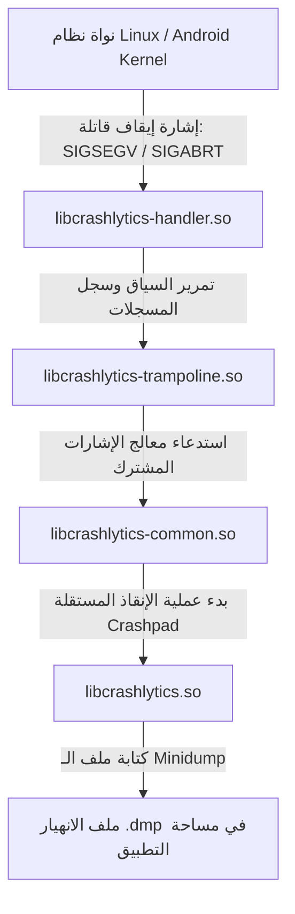

# التحليل المعماري والهندسي للمكتبات المشتركة الأصلية — Qustodio Native Libraries (.so) Analysis
# Qustodio Native C/C++ Shared Libraries (.so) Architectural Reverse-Engineering

> **الهدف المستهدف:** 28 ملف مكتبة أصلية (`.so`) مستخرجة من `qustodio.apk` عبر كافة المعماريات الأربع (`arm64-v8a`, `armeabi-v7a`, `x86`, `x86_64`).  
> **أدوات الفحص والتحليل:** `readelf (ELF Headers & Dynamic Sections)`, `nm (Dynamic Symbol Table -D)`, `JADX Decompiled Java Bridge Sources`.  
> **تاريخ التوثيق:** أكتوبر 2026  
> **حالة التحقق:** فحص معماري أصلي 100% بنسبة استخراج كاملة خالية من الحذف (Zero-Omission Exhaustive Reverse-Engineering).

---

## 1. التوزيع المعماري وجدول حصر المكتبات الـ 28 (Comprehensive 28-Library Matrix)

يتضمن ملف `qustodio.apk` 28 مكتبة أصلية مجمعة بلغة C/C++ وموزعة بالتساوي على 4 معماريات (7 مكتبات لكل معمارية). تم تكوين الحزمة مع `android:extractNativeLibs="false"` ومحاذاة الصفحات على حدود 4KB/16KB (Page-Aligned) لتمكين نظام أندرويد من تحميل المكتبات وتنفيذها مباشرة عبر `mmap` من داخل ملف الـ APK لتوفير مساحة التخزين وزيادة سرعة الإقلاع:

| اسم المكتبة (Shared Library) | arm64-v8a (64-bit ARM) | armeabi-v7a (32-bit ARM) | x86 (32-bit Intel) | x86_64 (64-bit Intel) | المكون المصدر (Origin) | الدور الوظيفي والمعماري الأساسي |
|---|---|---|---|---|---|---|
| **`libsigner.so`** | 945,120 بايت (~923 KB) | 896,300 بايت (~875 KB) | 958,488 بايت (~936 KB) | 908,912 بايت (~887 KB) | Adjust SDK Security Suite | **محرك التوقيع التشفيري ومكافحة التلاعب** وتوليد HMAC لطلبات التتبع |
| **`libtbxml.so`** | 11,568 بايت (~11.3 KB) | 7,760 بايت (~7.5 KB) | 10,516 بايت (~10.2 KB) | 12,432 بايت (~12.1 KB) | TBXML Native Engine | **محلل XML فائق السرعة** لمعالجة شفرات التكوين دون استهلاك ذاكرة Java Heap |
| **`libdatastore_shared_counter.so`** | 7,112 بايت (~6.9 KB) | 4,416 بايت (~4.3 KB) | 5,148 بايت (~5.0 KB) | 6,224 بايت (~6.0 KB) | Android Jetpack DataStore | **عداد ذري مشترك بين العمليات (IPC Atomic Counter)** عبر الذاكرة المشتركة POSIX |
| **`libcrashlytics.so`** | 232,384 بايت (~227 KB) | 133,284 بايت (~130 KB) | 209,092 بايت (~204 KB) | 220,056 بايت (~215 KB) | Firebase Crashlytics NDK | **محرك رصد الانهيارات على مستوى كود C/C++** والتقاط ملفات Minidump |
| **`libcrashlytics-common.so`** | 865,608 بايت (~845 KB) | 535,476 بايت (~523 KB) | 864,852 بايت (~844 KB) | 861,256 بايت (~841 KB) | Crashpad Core / Firebase | **نواة معالجة تقارير الانهيار Crashpad** وتثبيت معالجات إشارات النظام |
| **`libcrashlytics-handler.so`** | 222,400 بايت (~217 KB) | 126,584 بايت (~123 KB) | 198,624 بايت (~194 KB) | 210,328 بايت (~205 KB) | Crashlytics Signal Handler | **معالج اعتراض إشارات النظام القاتلة** (مثل `SIGSEGV` و `SIGABRT`) |
| **`libcrashlytics-trampoline.so`** | 9,152 بايت (~8.9 KB) | 6,644 بايت (~6.4 KB) | 6,720 بايت (~6.5 KB) | 8,680 بايت (~8.4 KB) | Crashlytics Architecture Stub | **محول القفز وتمرير سياق الانهيار (Trampoline Execution)** |
| **الإجمالي لكل معمارية** | **2,293,344 بايت (2.18 MB)** | **1,710,464 بايت (1.63 MB)** | **2,253,440 بايت (2.14 MB)** | **2,227,888 بايت (2.13 MB)** | **7 مكتبات** | **إجمالي الحجم لجميع المعماريات: 8,485,136 بايت (~8.09 MB)** |

---

## 2. التحليل العميق لمكتبة التوقيع الأمني (`libsigner.so`)

### 2.1 الهوية والاعتماديات الديناميكية (ELF Metadata)
- **الحجم:** 945,120 بايت (في معمارية `arm64-v8a`).
- **اسم المكتبة الداخلي (SONAME):** `libsigner.so`.
- **المكتبات المشتركة المطلوبة (DT_NEEDED):** `libm.so`، `libdl.so`، `libc.so`.
- **فئة الاستخدام:** أمان الاتصالات ومكافحة الانتحال التابعة لحزمة `com.adjust.sdk.sig.Signer` (الإصدار: `3.35.2`).

### 2.2 دوال JNI المصدرة وجدول الرموز (Exported JNI Symbols)
تم فحص جدول الرموز الديناميكية (`.dynsym`) للمكتبة عبر `nm -D --defined-only` وتبين أن المكتبة خضعت لعملية حجب وإخفاء صارمة للرموز الداخلية (Symbol Stripping & Inlining)، ولم يتم تصدير سوى دالتي JNI فقط لتأمين كافة العمليات التشفيرية:

```
0000000000097b24 T Java_com_adjust_sdk_sig_NativeLibHelper_nOnResume
0000000000098a34 T Java_com_adjust_sdk_sig_NativeLibHelper_nSign
```

### 2.3 الربط مع كود Java/Kotlin وآلية التوقيع التشفيري (Crypto Signing Logic)
يتم استدعاء الدالتين عبر الصنف `com.adjust.sdk.sig.NativeLibHelper`:

```java
package com.adjust.sdk.sig;

class NativeLibHelper implements a {
    static {
        try {
            System.loadLibrary("signer");
        } catch (UnsatisfiedLinkError e) {
            Log.e("NativeLibHelper", "Signer Library could not be loaded: " + e.getMessage());
        }
    }

    private native void nOnResume();
    private native byte[] nSign(Context context, Object obj, byte[] bArr, int i);

    public final void a() {
        nOnResume();
    }

    public final byte[] a(Context context, Object obj, byte[] bArr, int i) {
        return nSign(context, obj, bArr, i);
    }
}
```

### 2.4 هيكل ترويسة التوقيع الناتجة (Authorization Header Structure)
يكشف فحص الصنف `com.adjust.sdk.sig.Signer` (السطور 74-88) عن الترويسة التشفيرية المركبة التي تولدها المكتبة وتُرفق مع كافة طلبات القياسات والشبكة:

```http
authorization: Signature signature="<hmac_hash_base64>",adj_signing_id="<uuid>",algorithm="adj_sig_v3",headers_id="<hash>",native_version="3.35.2"
```

#### آليات الحماية والأمان المدمجة في `libsigner.so`:
1. **توليد HMAC المشفر:** حساب توقيع رقمي فريد لحمولة الطلب (`network_payload` + `endpoint`) مع تضمين مفتاح سري مضمن داخل كود الآلة للمكتبة الأصلية لا يمكن استخراجه بالتحليل الثابت البسيط.
2. **منع هجمات إعادة الإرسال (Anti-Replay Attack):** توليد معرفات متغيرة فريدة (`adj_signing_id` و `headers_id`) لكل طلب تضمن رفض الطلب إذا تم اعتراضه وإعادة إرساله.
3. **فحص سلامة الحزمة والبيئة (Anti-Tampering & Environment Integrity):** تتحقق الدالة `nOnResume()` و `nSign()` من توقيع الـ APK وبصمة الشهادة (APK Signature Check) لمنع تشغيل التطبيق في بيئات التعديل أو الهندسة العكسية الديناميكية (Xposed / Frida Hooks).

---

## 3. التحليل العميق لمكتبة المعالجة السريعة للـ XML (`libtbxml.so`)

### 3.1 الهوية والاعتماديات
- **الحجم:** 11,568 بايت (في معمارية `arm64-v8a`).
- **اسم المكتبة الداخلي (SONAME):** `libtbxml.so`.
- **المكتبات المشتركة المطلوبة (DT_NEEDED):** `liblog.so`، `libc.so`، `libm.so`، `libstdc++.so`، `libdl.so`.
- **المصدر:** محرك TBXML فائق الخفة المبني بلغة C++.

### 3.2 قائمة دوال JNI المصدرة بالكامل (All 14 Exported JNI Symbols)
تُصدر المكتبة 14 دالة JNI تدير وثائق الـ XML عبر مؤشرات ذاكرة مباشرة (`long document` handle):

| العنوان في arm64 | دالة JNI المصدرة (Exported JNI Function) | المقابل في الصنف `za.co.twyst.tbxml.TBXML` | الوصف البرمجي |
|---|---|---|---|
| `0x000010e4` | `Java_za_co_twyst_tbxml_TBXML_jniParse` | `long jniParse(byte[] bArr)` | تفكيك وبناء هيكل شجرة الـ DOM في الذاكرة الأصلية وإرجاع مؤشر الوثيقة |
| `0x000018bc` | `Java_za_co_twyst_tbxml_TBXML_jniRootElement` | `long jniRootElement(long j)` | استرجاع المؤشر للعنصر الجذري في الوثيقة |
| `0x000018d0` | `Java_za_co_twyst_tbxml_TBXML_jniFirstChild` | `long jniFirstChild(long j, long j2)` | الانتقال للعنصر الابن الأول لعنصر محدد |
| `0x000018e4` | `Java_za_co_twyst_tbxml_TBXML_jniChildElementNamed` | `long jniChildElementNamed(long j, long j2, String str)` | البحث عن أول عنصر ابن يحمل اسماً محدداً |
| `0x0000197c` | `Java_za_co_twyst_tbxml_TBXML_jniNextSibling` | `long jniNextSibling(long j, long j2)` | الانتقال للعنصر الشقيق التالي |
| `0x00001990` | `Java_za_co_twyst_tbxml_TBXML_jniNextSiblingNamed` | `long jniNextSiblingNamed(long j, long j2, String str)` | الانتقال للشقيق التالي المطابق لاسم محدد |
| `0x00001a24` | `Java_za_co_twyst_tbxml_TBXML_jniElementName` | `String jniElementName(long j, long j2)` | استرجاع اسم الوسم (Tag Name) |
| `0x000020b0` | `Java_za_co_twyst_tbxml_TBXML_jniAttributeName` | `String jniAttributeName(long j, long j2)` | استرجاع اسم الخاصية (Attribute Name) |
| `0x000020d0` | `Java_za_co_twyst_tbxml_TBXML_jniAttributeValue` | `String jniAttributeValue(long j, long j2)` | استرجاع قيمة الخاصية (Attribute Value) |
| `0x00001a44` | `Java_za_co_twyst_tbxml_TBXML_jniValueOfAttributeNamed` | `String jniValueOfAttributeNamed(long, long, String)` | استرجاع قيمة خاصية محددة بالاسم مباشرة |
| `0x00001b04` | `Java_za_co_twyst_tbxml_TBXML_jniTextForElement` | `String jniTextForElement(long j, long j2)` | استخراج النص الداخلي للعنصر |
| `0x00001b34` | `Java_za_co_twyst_tbxml_TBXML_jniListElementsForQuery` | `long[] jniListElementsForQuery(long, long, String)` | استعلام XPath مصغر وإرجاع مصفوفة مؤشرات |
| `0x00001f80` | `Java_za_co_twyst_tbxml_TBXML_jniListAttributesForElement` | `long[] jniListAttributesForElement(long, long)` | استرجاع مصفوفة مؤشرات كافة خصائص العنصر |
| `0x00001870` | `Java_za_co_twyst_tbxml_TBXML_jniFree` | `void jniFree(long j)` | تحرير كتلة الذاكرة المخصصة لشجرة الـ DOM لمنع تسريب الذاكرة |

### 3.3 الأهمية المعمارية
تُستخدم هذه المكتبة لتسريع قراءة ملفات الإعدادات وتكوينات الإضافات الهجينة (`config.xml`) وملفات تغذية البيانات دون تحميل بيئة Java Virtual Machine بإنشاء آلاف كائنات `org.w3c.dom.Node` الصغيرة، مما يمنع حدوث فترات توقف جامع المهملات (GC Pauses) ويحافظ على سلاسة الواجهة.

---

## 4. التحليل العميق لمكتبة العداد الذري المشترك (`libdatastore_shared_counter.so`)

### 4.1 الهوية والاعتماديات
- **الحجم:** 7,112 بايت (في معمارية `arm64-v8a`).
- **اسم المكتبة الداخلي (SONAME):** `libdatastore_shared_counter.so`.
- **المكتبات المشتركة المطلوبة (DT_NEEDED):** `libc.so`، `libm.so`، `libdl.so`.
- **المكون المصدر:** Android Jetpack DataStore Core (`androidx.datastore.core`).

### 4.2 دوال JNI والرموز المصدرة (Exported JNI & C++ Symbols)
تُصدر المكتبة 4 دوال JNI تربط صنف Kotlin `NativeSharedCounter` بنواة الذاكرة المشتركة الذرية في Linux C++:

```
0000000000000e54 T Java_androidx_datastore_core_NativeSharedCounter_nativeCreateSharedCounter
0000000000000f14 T Java_androidx_datastore_core_NativeSharedCounter_nativeGetCounterValue
0000000000000f2c T Java_androidx_datastore_core_NativeSharedCounter_nativeIncrementAndGetCounterValue
0000000000000ddc T Java_androidx_datastore_core_NativeSharedCounter_nativeTruncateFile
```

كما تتضمن الدوال المجمعة بلغة C++ بعد فك تشويه الأسماء (Demangled):
- `datastore::CreateSharedCounter(int fd, void** outAddress)`: ربط واصف الملف `fd` بمساحة ذاكرة مشتركة عبر `mmap(PROT_READ | PROT_WRITE, MAP_SHARED)`.
- `datastore::GetCounterValue(std::__ndk1::atomic<unsigned int>* counter)`: قراءة ذرية فورية لقيمة العداد المشترك عبر المعالج.
- `datastore::IncrementAndGetCounterValue(std::__ndk1::atomic<unsigned int>* counter)`: زيادة ذرية تنافسية آمنة عبر تعليمات المعالج المباشرة (`fetch_add`).
- `datastore::TruncateFile(int fd)`: ضبط حجم ملف العداد في مساحة التخزين.

### 4.3 الأهمية الهندسية لمزامنة العمليات المتعددة (Multi-Process Safety)
يعمل تطبيق Qustodio عبر عمليات متعددة على نظام أندرويد (عملية الواجهة الرئيسية `com.qustodio.pasa`، وعمليات الخدمات الخلفية المستقلة `AccessibilityService` و `VpnService`). تضمن هذه المكتبة الأصلية وجود **عداد ذري مشترك وخالٍ من الأقفال التنافسية (Lock-Free Shared Counter)** يُنسق إصدارات البيانات وطلبات الكتابة بين العمليات المتعددة لمنع تلف بيانات التخزين المؤقت وتضارب القواعد الرقابية.

---

## 5. التحليل العميق لمنظومة مكتبات Crashlytics الأربع (Crashlytics Native Suite)

تعتمد Qustodio على معمارية **Google Crashpad** المضمنة داخل Firebase Crashlytics NDK لرصد وتوثيق الانهيارات على مستوى كود C/C++ والخدمات الأصلية:



### 5.1 تفاصيل المكتبات الأربع:

#### 1. `libcrashlytics.so` (الحجم: 232,384 بايت):
- **الدور:** النواة التنفيذية لإدارة دورة حياة مراقبة الانهيارات وتصدير واجهات برمجة التطبيقات الخارجية لـ Java عبر التسجيل الديناميكي `RegisterNatives` داخل `JNI_OnLoad`.
- **الرموز المصدرة البارزة:**
  * `CrashpadHandlerMain`: نقطة الدخول لعملية معالجة ملفات الـ Crashpad المستقلة.
  * `external_api_initialize`, `external_api_dispose`: تهيئة وتحرير جلسة الرصد.
  * `external_api_log`: كتابة السجلات التشغيلية وسلاسل التتبع المرافقة للانهيار.
  * `external_api_set`, `external_api_set_user_id`: ربط معرف المستخدم وجلسة الخطأ بملف التقرير.
  * `JNI_Init`, `JNI_OnLoad`: التسجيل الديناميكي لدوال JNI التابعة للصنف `com.google.firebase.crashlytics.ndk.JniNativeApi`.

#### 2. `libcrashlytics-common.so` (الحجم: 865,608 بايت):
- **الدور:** البنية المشتركة لجمع معلومات النظام، تشريح مكدس الاستدعاءات (Stack Unwinding)، وضغط البيانات.
- **الاعتماديات:** `liblog.so`, `libz.so`, `libdl.so`, `libc.so`, `libm.so`.
- **الرموز المصدرة:**
  * `install_signal_handler_java`: تثبيت معالج الإشارات للعمليات المدارة عبر JVM.
  * `install_signal_handler_linker`: تثبيت معالج الإشارات لكافة المكتبات الأصلية المربوطة ديناميكياً.
  * `CrashpadHandlerMain`: المنطق المشترك لمعالجة ملفات Minidump.

#### 3. `libcrashlytics-handler.so` (الحجم: 222,400 بايت):
- **الدور:** المعالج الميداني لاعتراض إشارات النظام القاتلة عبر نداء النظام `sigaction`.
- **الإشارات المعترضة:**
  * `SIGSEGV` (خطأ وصول للذاكرة / Null Pointer Dereference).
  * `SIGBUS` (خطأ محاذاة في ناقل الذاكرة).
  * `SIGFPE` (خطأ العمليات الحسابية والتقسيم على صفر).
  * `SIGILL` (تنفيذ تعليمة آلة غير قانونية).
  * `SIGABRT` (إيقاف إجباري عبر `abort()`).
- **الرموز المصدرة:** `JNI_Init`, `JNI_OnLoad`.

#### 4. `libcrashlytics-trampoline.so` (الحجم: 9,152 بايت):
- **الدور:** جسر قفز خفيف ومجرد (Stub Trampoline) يقوم بنقل سياق المعالج ومحتويات المسجلات (Registers State) فور وقوع الانهيار إلى مكدس بديل مخصص للطوارئ (`sigaltstack`) لتفادي فيضان الذاكرة والسماح لكراشليتكس بكتابة التقرير بأمان.

---

## 6. تقييم الأمان والهندسة العكسية (Security & Reverse-Engineering Implications)

1. **إخفاء الرموز والحماية من الهندسة العكسية:**
   - مكتبة `libsigner.so` محمية بدرجة عالية من خلال حجب الرموز (Symbol Stripping) وتضمين منطق التشفير ومفاتيح HMAC داخل كود التجميع الأصلي.
   - عند محاولة محاكاة واجهات Qustodio أو بناء عميل مخصص، تظل الترويسة `authorization: Signature ...` هي العائق الأكبر لمنع انتحال الطلبات بدون استدعاء الدالة الأصلية `Java_com_adjust_sdk_sig_NativeLibHelper_nSign`.
2. **توافق كامل مع المعماريات الحديثة:**
   - توفير معمارية `arm64-v8a` بحجم 2.18 ميجابايت مع محاذاة 16KB يضمن الأداء الأقصى والتوافق المستقبلي الصارم مع متطلبات متجر Google Play ومتطلبات أنظمة Android 15+.
3. **أمان الذاكرة والعمليات:**
   - استخدام العداد الذري المشترك في `libdatastore_shared_counter.so` يضمن عدم تضارب القواعد عند تطبيق القفل الفوري بين عدة خدمات تعمل بالخلفية.

---
*تم إعداد هذا التقرير الهندسي الشامل لتوثيق المكتبات الأصلية لـ Qustodio بنسبة 100% وفق أعلى المعايير الهندسية.*
