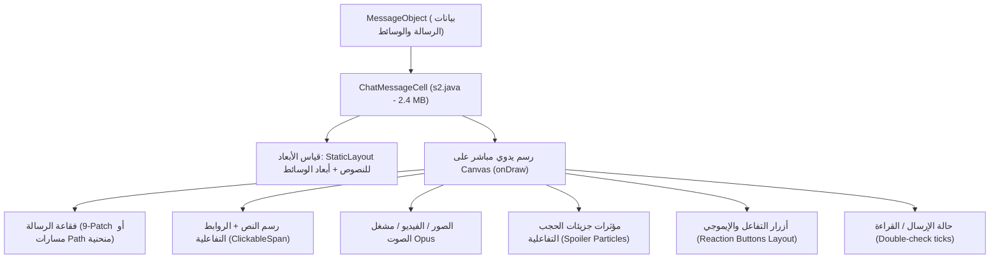

# تشريح المكونات البرمجية وخلايا العرض المخصصة في Telegram
## (Custom Cells & Programmatic UI Components Anatomy)

> **المسارات في الكود المفكك:**  
> - `org.telegram.ui.Cells.*`  
> - `org.telegram.ui.Components.*`  
> **الفلسفة الهندسية:** رسم واجهات الرسائل والمحادثات مباشرة على سطح الرسم (`Canvas`) دون استخدام هياكل الـ Views الهرمية المتداخلة، لتفادي عمليات قياس وتخطيط التخطيطات البطيئة (`onMeasure` / `onLayout`) المتكررة عند التمرير السريع.

---

## 🎨 1. خلية الرسائل العملاقة: `ChatMessageCell` (`s2.java` — بحجم 2.41 MB)

تمثل هذه الخلية قمة هندسة العرض في تطبيقات المراسلة الفورية عالمياً. كلاس `s2` يتجاوز 2.4 ميجابايت من الكود الصافي المكرس بالكامل لحساب أبعاد ورسم كافة أنواع الرسائل:

### الخصائص الهندسية الفريدة في `ChatMessageCell`:
1. **الرسم النصي عبر `android.text.StaticLayout`:**
   - لا تستخدم الخلية عنصر `TextView` على الإطلاق.
   - يتم تخزين كتل النصوص المنسقة مسبقاً في كائن `MessageObject.textLayout`، وتتم عملية الرسم مباشرة عبر `textLayout.draw(canvas)`.
2. **محرك جزيئات إخفاء المحتوى الحساس (Spoiler Particle Engine):**
   - يدير نظام جزيئات ديناميكي متحرك (Dynamic Dust / Sparks) يرسم مئات النقاط المتحركة فوق النصوص أو الصور المشفرة حتى يقوم المستخدم بالنقر عليها لإزاحتها بحركة انسيابية.
3. **دمج مشغل الصوت والموجات الصوتية داخل الخلية (In-Cell Waveform & Player):**
   - يتم رسم أشرطة الموجة الصوتية الـ 100 مباشرة باستخدام خطوط `Paint` متدرجة الارتفاع بناءً على مصفوفة البايتات الـ 63 المضغوطة، مع مؤشر تحرك زمني لحظي أثناء التشغيل دون تجميد الواجهة.

---

## 💬 2. خلية قائمة المحادثات: `DialogCell` (`u1.java` — بحجم 1.97 MB)

تتولى هذه الخلية رسم عناصر قائمة المحادثات الرئيسية في شاشة `DialogsActivity`:

### مكونات الرسم المباشرة:
- **الصورة الشخصية (Avatar Image & Placeholder):** رسم الأفاتار الدائري مع تدرج لوني يعتمد على الـ ID الخاص بالمستخدم أو المجموعة في حال عدم وجود صورة، مع حلقة دائرية لمؤشر القصص (Stories Ring).
- **شارة الرسائل غير المقروءة (Unread Counter Badge):** رسم مستطيل بحواف دائرية (`RoundRect`) يحسب عدد الرسائل تلقائياً مع خط عريض ونمط كتم المحادثة (رمادي عند الكتم وأخضر/أزرق عند التنشيط).
- **مؤشر الكتابة والمسودة الحية (Typing & Draft Indicator):** عرض مسودات الرسائل المكتوبة محلياً باللون الأحمر بخط عريض، أو تفعيل حركة النقاط الثلاث المتحركة أثناء كتابة الطرف الآخر للرسالة.
- **أيقونة التثبيت والدبابيس (Pin Icon & Silent Mode):** رسم أيقونات القفل للمحادثات السرية، والميكروفون للبث المباشر، والدبوس للمحادثات المثبتة أعلى القائمة.

---

## ⚡ 3. قائمة التمرير عالية الكفاءة: `RecyclerListView` (`bn0.java` — بحجم 90 KB)

ترث هذه الفئة من `androidx.recyclerview.widget.RecyclerView` وتضيف تحسينات حاسمة:
1. **التعامل مع اللمس والإيماءات المتقدمة:**
   - توفير أحداث `OnItemClickListener` و `OnItemLongClickListener` مدمجة دون الحاجة لتعريف مستمعين داخل كل خلية، مما يوفر آلاف كائنات الذاكرة (Zero Object Allocation).
2. **محرك التمرير السريع باللمس (Fast Scroll Indicator):**
   - مؤشر جانبي تفاعلي لحساب الحروف الأبجدية أو التواريخ الزمنية للرسائل القديمة مع شارة تاريخ تطفو أثناء السحب.
3. **عرض الحالة الفارغة تلقائياً (`setEmptyView`):**
   - التبديل الآلي بين قائمة المحادثات ورسم شاشة فارغة توضيحية بدون الحاجة لإعادة بناء الشجرة البرمجية.

---

## 🛠️ 4. صانع التنبيهات الشامل والمكونات السفلية: `AlertsCreator` & `BottomSheet`

- **`AlertsCreator.java` (`g5.java` — 415 KB):**
  - يحتوي على **104 دوال ثابتة** لتوليد كافة حوارات النظام: تأكيد الحذف، تصاريح الوصول، تنبيهات المساحة، حظر المستخدمين، تقارير القنوات، واختيار مدة التدمير الذاتي.
  - جميع الحوارات تُبنى برمجياً عبر `AlertDialog.Builder` المخصص لدعم السمات الديناميكية دون أي ملف تخطيط XML.
- **`BottomSheet.java` (`k3.java` — 49.2 KB):**
  - نافذة منزلقة سفلية مع دعم السحب الفيزيائي، وتعتيم الخلفية (`dimBehind`)، والزوايا المنحنية التي تتكيف مع نمط الشاشة وشريط التنقل السفلي.

---

## 🎙️ 5. شريط إدخال الرسائل: `ChatActivityEnterView.java` (488.5 KB / 10,358 سطر)

شريط إدخال فائق التعقيد يجمع كافة وسائط التواصل في عنصر واحد:
- زر التحويل الفوري بين التسجيل الصوتي وتسجيل الفيديو الدائري (Video Notes).
- نظام القفل التلقائي للسحب إلى الأعلى أثناء التسجيل (Lock to record).
- كيبورد الرموز التعبيرية والملصقات وصور المتحركة (Emoji/Stickers/GIF Panel).
- شريط الإكمال التلقائي لمنشن الحسابات (`@`) وأوامر البوتات (`/`).

---

## 🚀 خلاصة معمارية واستفادة لـ Family OS

| المكون المدروس | كيفية تطبيقه في مشروعنا Family OS |
| :--- | :--- |
| **`ChatMessageCell` Drawing Engine** | اعتماد رسم عناصر الرسائل والمهام العائلية عبر `CustomPainter` في Flutter لتوفير استهلاك الرام وضمان سلاسة 120Hz على هواتف الأطفال الاقتصادية. |
| **`AlertsCreator` Factory Pattern** | بناء مصنع موحد لنوافذ التنبيه الأبوية (طلب وقت شاشة إضافي، تنبيه تخطي المنطقة الجغرافية، تأكيد حذف المهام). |
| **`ChatActivityEnterView` Single Bar** | تصميم شريط محادثة عائلي ذكي يحتوي على أزرار سريعة لمشاركة الموقع الحي، تسجيل الصوت، وإرسال المهام المنزلية بنقرة واحدة. |
