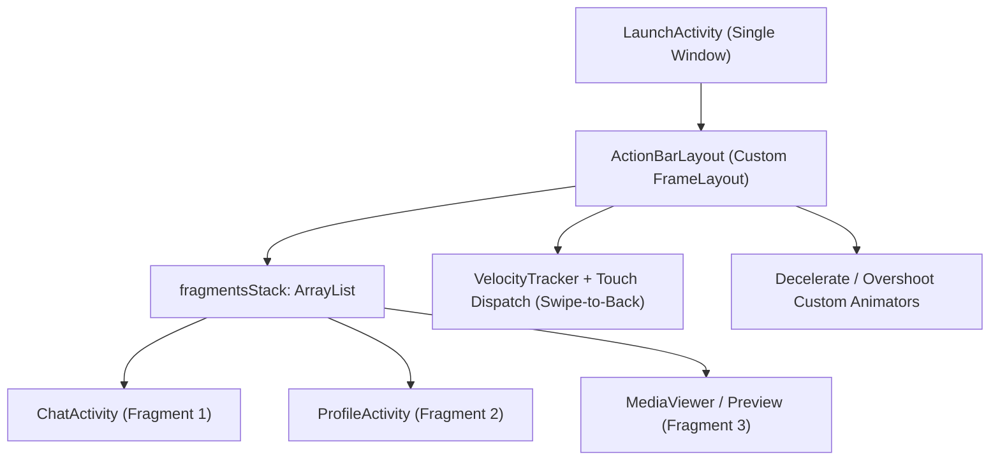
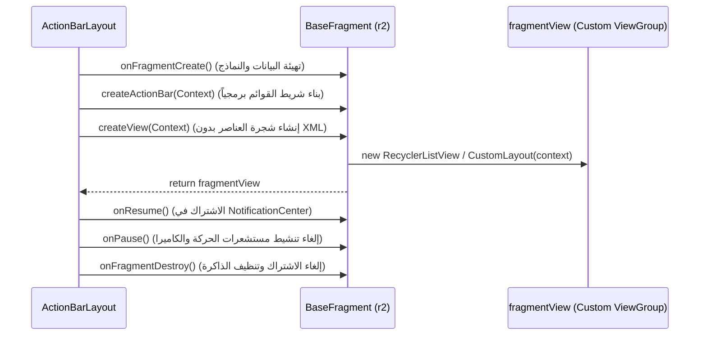

# الهندسة العكسية لمحرك الواجهات البرمجي في Telegram (Programmatic UI Engine)

> **المسار في الكود المفكك:** `org.telegram.ui.ActionBar.*`  
> **الملفات المركزية:** `ActionBarLayout.java` (130.9 KB / 3,228 سطر)، `r2.java` (`BaseFragment` - 47.7 KB / 1,050 سطر)  
> **الفلسفة الهندسية:** استغناء تام عن نظام `androidx.fragment.app.Fragment` وملفات `layout/*.xml` في أندرويد، وبناء محرك ملاحة ورسم شاشات برمجي يدوي 100% لتحقيق أقصى درجات الأداء وسرعة الاستجابة اللحظية (60-120 FPS).

---

## 🏛️ 1. الملاحة وإدارة مكدس الشاشات (`ActionBarLayout`)

يمثل كلاس `ActionBarLayout` حاوية الشاشات الفائقة (`FrameLayout`)، وهو المسؤول الوحيد عن دورة حياة كافة الشاشات داخل نافذة التطبيق (`LaunchActivity`):

### الخصائص المعمارية الأساسية لـ `ActionBarLayout`:
1. **مكدس الشاشات الداخلي (`fragmentsStack`):**
   - يدير قائمة داخلية `ArrayList<r2> fragmentsStack` تحتوي على كائنات الشاشات النشطة.
   - عند فتح شاشة جديدة عبر `presentFragment(r2 fragment, boolean removeLast, boolean forceWithoutAnimation)`، لا يتم استخدام `FragmentTransaction` الخاصة بأندرويد، بل يتم استدعاء `fragment.createView(context)` برمجياً وإضافته كـ `ChildView` مباشر داخل الحاوية.
2. **إيماءات الرجوع الفيزيائية التفاعلية (Interactive Swipe-to-Back):**
   - يتم تتبع لمسات المستخدم عبر `VelocityTracker`.
   - عند بدء السحب من حافة الشاشة اليسرى (أو اليمنى في واجهات RTL العربية)، يتم حساب مسافة الإزاحة وتطبيق `translationX` على الشاشة الحالية والشاشة السابقة في المكدس في الوقت الفعلي.
   - حساب عتبة الإغلاق: إذا تجاوزت سرعة السحب `1500 px/sec` أو تجاوزت المسافة نصف عرض الشاشة، يتم إنهاء الشاشة بحركة خروج انسيابية (`finishFragment`), وإلا تعود لموضعها الأصلي عبر `DecelerateInterpolator`.
3. **نظام العرض العائم ونوافذ المحادثة المصغرة (Bubble Mode & Split-Screen):**
   - يدعم `ActionBarLayout` وضع العرض داخل فقاعات عائمة أو تقسيم الشاشات في الأجهزة اللوحية (Master-Detail layout) مع عزل مكدس الشاشات لكل جزء بشكل مستقل.

---

## 🧩 2. الهيكل التجريدي للشاشات (`BaseFragment` / `r2.java`)

يمثل الكلاس التجريدي `r2` (المفكك من `BaseFragment`) العقد الأساسي الذي ترث منه أكثر من **200 شاشة برمجية** داخل Telegram (مثل `ChatActivity`, `DialogsActivity`, `ProfileActivity`, `SettingsActivity`).

### دورة الحياة البرمجية الصارمة (Programmatic Lifecycle):

### أبرز الوظائف الهندسية في `BaseFragment`:
1. **الاستغناء التام عن تضخيم الـ XML (`Zero LayoutInflater`):**
   - الدالة `createView(Context context)` لا تستدعي أبداً `inflater.inflate(R.layout.xxx)`.
   - يتم إنشاء العناصر مباشرة عبر `new FrameLayout(context)` و `new RecyclerListView(context)` وتحديد قيود الـ LayoutParams يدوياً عبر حساب الكثافة `AndroidUtilities.dp(x)`.
2. **شريط العنوان المستقل (`ActionBar`):**
   - كل شاشة تنشئ شريط `ActionBar` خاص بها برمجياً وتربطه كـ `Child View` داخل الحاوية العليا، مع دعم الشفافية وتغيير اللون الديناميكي أثناء التمرير.
3. **الاشتراك التلقائي في مركز الإشعارات الداخلي (`NotificationCenter`):**
   - تستقبل الشاشة تحديثات الرسائل الجديدة وتغيير حالة الاتصال عبر دوال الـ Callback في خيط المعالجة الرئيسي (`UI Thread`).

---

## 🎯 التطبيق العملي لمشروع Family OS

| المفهوم في Telegram | فائدته لمشروع Family OS |
| :--- | :--- |
| **تجاوز XML واستخدام البناء البرمجي** | في Flutter / Compose، يمنحنا هذا الفهم أساساً متيناً لبناء مكونات React/Declarative فائقة السرعة بدون أي عبء زائد على أجهزة الأطفال منخفضة المواصفات. |
| **مكدس الملاحة المستقل (`ActionBarLayout`)** | إدارة مسارات التنقل (Routing) بدون الاعتماد على آليات أندرويد المعقدة، مما يسهل التحكم في قيود الوصول والأقفال الأبوية على شاشات محددة. |
| **إيماءات الرجوع المخصصة مع سرعة التمرير** | تجربة مستخدم سلسلة وجذابة للأطفال والآباء تماثل جودة التطبيقات الرائدة عالمياً. |
