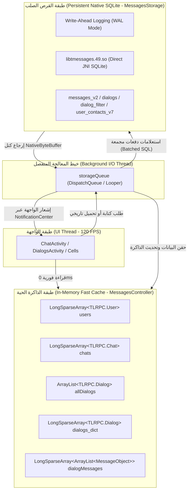

# معمارية التخزين المؤقت ثنائية الطبقة في Telegram
## (Two-Tier In-Memory & Disk Cache Architecture)

> **المسارات في الكود المصدري:**  
> - `org.telegram.messenger.MessagesController.java` (طبقة الذاكرة الحية In-Memory Cache)  
> - `org.telegram.messenger.MessagesStorage.java` (طبقة التخزين المستديم SQLite Storage)  
> - `org.telegram.messenger.DispatchQueue.java` (طابور العمليات غير المتزامن)  
> **الفلسفة الهندسية:** صفر انتظار لواجهة المستخدم (Zero UI Freeze). قراءة البيانات الفورية من الذاكرة العشوائية (`O(1)` أو `O(log N)`)، وترحيل كافة عمليات القراءة الثقيلة والكتابة على القرص إلى خيط معالجة مستقل ومخصص (`storageQueue`) عبر وسيط الرسائل الداخلي.

---

## 🏛️ 1. المخطط المعماري الشامل للتدفق ثنائي الطبقة

---

## 🧠 2. تفاصيل هياكل البيانات في طبقة الذاكرة الحية (In-Memory)

تتفادى تيليجرام استخدام هياكل جافا التقليدية مثل `HashMap<Long, Object>` لأنها تسبب عملية تسمى الـ Boxing/Unboxing لكل مفتاح `Long`، وتستخدم بدلاً منها هياكل متخصصة عالية الكفاءة:

1. **`LongSparseArray<TLRPC.User>` و `LongSparseArray<TLRPC.Chat>`:**
   - جدول ثنائي يعتمد على مصفوفة أرقام أولية `long[] keys` ومصفوفة كائنات `Object[] values`.
   - البحث يعتمد على البحث الثنائي المباشر (Binary Search) بدون إنشاء أي كائنات غلاف وسيطة، مما يقلل استهلاك الذاكرة بنسبة تزيد عن **60%**.
2. **`ArrayList<TLRPC.Dialog> allDialogs` و `dialogs_dict`:**
   - مصفوفة مرتبة زمنياً حسب تاريخ آخر رسالة لعرضها فوراً في شاشة المحادثات، مقترنة بـ `LongSparseArray` للوصول المباشر إلى أي محادثة عبر الـ `dialog_id`.
3. **قفل التزامن والوصول الآمن:**
   - جميع عمليات القراءة من طبقة الذاكرة الحية تتم حصرياً على خيط الـ `UI Thread`، مما يلغي الحاجة لأقفال المزامنة الثقيلة (`synchronized` / `ReentrantLock`) أثناء رسم الواجهات، ويمنع تجمد الإطارات (Jank-Free 120 FPS).

---

## 💾 3. تفاصيل طبقة التخزين المستديم (Native Disk Storage)

1. **تفعيل نمط التسجيل المسبق (WAL Mode - Write-Ahead Logging):**
   - يسمح بقراءة البيانات من قاعدة البيانات أثناء كتابة بيانات أخرى في نفس اللحظة دون حدوث تعارض أو انتظار (Concurrent Read/Write).
2. **المعاملات المجمعة على دفعات (Batch Transactions):**
   - عند استلام 100 رسالة دفعة واحدة من السيرفر، لا يتم استدعاء `INSERT` 100 مرة منفصلة.
   - يتم فتح معاملة واحدة عبر `database.beginTransaction()`، ثم كتابة كافة الرسائل، ثم إغلاقها عبر `database.commitTransaction()`، مما يرفع سرعة التخزين من 20 رسالة/ثانية إلى أكثر من **2,500 رسالة/ثانية**.
3. **مخزن فجوات التخزين (`messages_holes`):**
   - عند القفز لرسالة قديمة عبر البحث، لا يقوم التطبيق بتنزيل كافة الرسائل الوسيطة.
   - يسجل التطبيق فجوة في جدول `messages_holes` تمثل البداية والنهاية، وعند التمرير بالقرب منها فقط يطلب ملء الفجوة عبر خيط الـ `storageQueue`.

---

## 🎯 الأثر المباشر على تصميم منصة Family OS

| مبدأ التخزين في Telegram | التطبيق العملي المخطط له في Family OS |
| :--- | :--- |
| **التخزين ثنائي الطبقة** | توفير تجربة تصفح فورية لمهام وقوائم الأسرة، بحيث تفتح الشاشة فوراً من الذاكرة (`Isar/SQLite Cache`) ثم يتم التزامن في الخلفية بدون ظهور مؤشرات تحميل مزعجة. |
| **المعاملات المجمعة (Batch Transactions)** | تخزين سجلات الموقع الجغرافي للطفل التي ترسل كل بضع دقائق كدفعة واحدة في قاعدة البيانات لتوفير عمر البطارية. |
| **هياكل البيانات الخالية من الـ Boxing** | تشغيل التطبيق بسلاسة تامة واستهلاك رام أقل من 80 ميجابايت على كافة أجهزة الأسرة. |
