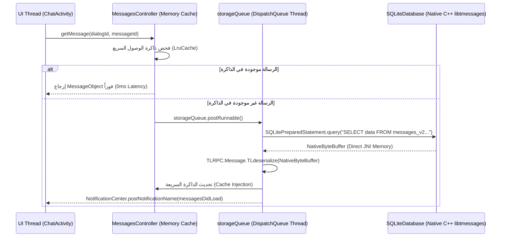

# خريطة ربط استعلامات SQLite بالكود البرمجي في Telegram
## (SQLite Queries to MessagesStorage Methods Mapping)

> **المسارات في الكود المصدري:**  
> - `org.telegram.messenger.MessagesStorage.java` (28,684 سطر / 1.82 MB / 224 دالة عامة)  
> - `org.telegram.SQLite.*` (محرك SQLite الأصلي عالي الأداء)  
> - `benchmarks/extracted/telegram/05_data_models_and_schemas/local_db_schema.sql` (95 جدول و 182 استعلام)

---

## 🗄️ 1. الجداول المركزية ومصفوفة الدوال البرمجية المقابلة

| اسم الجدول في SQLite | الغرض الوظيفي | الدوال البرمجية في `MessagesStorage` | نوع الاستعلام والعملية (CRUD) |
| :--- | :--- | :--- | :--- |
| **`messages_v2`** | تخزين الرسائل الأساسية، البيانات الثنائية BLOB، الردود، والثريدات. | `putMessages()`, `getMessages()`, `deleteMessages()`, `markMessageAsRead()`, `updateMessageSendState()` | `INSERT OR REPLACE INTO messages_v2`, `SELECT data FROM messages_v2 WHERE uid = ?`, `UPDATE read_state` |
| **`dialogs`** | جدول المحادثات والقنوات: العدادات، آخر رسالة، مؤشرات التثبيت، والـ PTS. | `putDialogs()`, `getDialogs()`, `resetDialogs()`, `updateDialogsUnread()`, `setDialogFlags()` | `REPLACE INTO dialogs VALUES(?, ?, ?, ...)`, `UPDATE dialogs SET unread_count = ? WHERE did = ?` |
| **`dialog_filter`** | مجلدات المحادثات وتصنيفاتها (Personal, Groups, Channels, etc.). | `loadDialogFilters()`, `saveDialogFilter()`, `deleteDialogFilter()`, `saveDialogFiltersOrderInternal()` | `INSERT OR REPLACE INTO dialog_filter`, `SELECT * FROM dialog_filter ORDER BY ord ASC` |
| **`dialog_filter_ep`** & **`dialog_filter_pin_v2`** | عضوية المحادثات داخل المجلدات وترتيب تثبيتها. | `processLoadedFilterPeers()`, `setDialogFiltersPinned()` | `INSERT INTO dialog_filter_ep VALUES(?, ?)`, `DELETE FROM dialog_filter_pin_v2 WHERE id = ?` |
| **`scheduled_messages_v2`** | الرسائل المجدولة زمنياً للإرسال المستقبلي. | `putScheduledMessages()`, `getScheduledMessages()`, `deleteScheduledMessage()` | `INSERT OR REPLACE INTO scheduled_messages_v2`, `SELECT * FROM scheduled_messages_v2 WHERE uid = ?` |
| **`saved_dialogs`** | محادثات الرسائل المحفوظة (Saved Messages per user/forum). | `putSavedDialogs()`, `getSavedDialogs()`, `updateSavedDialog()` | `REPLACE INTO saved_dialogs VALUES(...)`, `SELECT * FROM saved_dialogs ORDER BY date DESC` |
| **`messages_holes`** & **`media_holes_v2`** | تعقب الفجوات الزمنية في سلسلة الرسائل لسحبها عند التمرير. | `doneHolesInMedia()`, `getHoles()`, `closeHoles()` | `INSERT INTO messages_holes VALUES(?, ?, ?)`, `DELETE FROM messages_holes WHERE uid = ?` |
| **`randoms_v2`** | منع تكرار الرسائل المرسلة ومطابقة `random_id` بـ `mid`. | `putRandomId()`, `getMsgIdByRandomId()`, `deleteRandomId()` | `INSERT INTO randoms_v2 VALUES(?, ?, ?)`, `SELECT mid FROM randoms_v2 WHERE random_id = ?` |
| **`enc_tasks_v4`** | مؤقتات التدمير الذاتي للرسائل في المحادثات السرية. | `putEncTask()`, `getEncTasks()`, `deleteEncTasks()` | `INSERT INTO enc_tasks_v4 VALUES(?, ?, ?, ?)`, `SELECT * FROM enc_tasks_v4 WHERE date <= ?` |
| **`topics`** | مواضيع المنتديات في المجموعات الكبرى وحالات إغلاقها وتثبيتها. | `putTopic()`, `getTopics()`, `updateTopicTopMessage()`, `deleteTopic()` | `INSERT OR REPLACE INTO topics VALUES(...)`, `UPDATE topics SET top_message = ? WHERE id = ?` |
| **`user_contacts_v7`** & **`user_phones_v7`** | جهات الاتصال وأرقام الهواتف ومزامنة سجل الهاتف. | `putContacts()`, `getContacts()`, `deleteContacts()`, `searchContacts()` | `INSERT OR REPLACE INTO user_contacts_v7`, `SELECT * FROM user_phones_v7 WHERE phone = ?` |
| **`download_queue`** | طابور تحميل وتنزيل الملفات والوسائط بالخلفية. | `putToDownloadQueue()`, `getDownloadQueue()`, `removeFromDownloadQueue()` | `INSERT INTO download_queue VALUES(?, ?, ?, ?, ?)`, `DELETE FROM download_queue WHERE uid = ?` |

---

## ⚡ 2. النمط المعماري للاستدعاء والتنفيذ: Zero-Copy Serialization

### قراءة الحمولات الثنائية عبر `SQLitePreparedStatement.bindByteBuffer`:
لا تقوم تيليجرام بتحويل الأعمدة الثنائية (`BLOB`) إلى مصفوفات `byte[]` جافا عادية؛ لأن ذلك يؤدي إلى إنشاء ملايين الكائنات قصيرة العمر التي تنهك الـ Garbage Collector.
بدلاً من ذلك:
1. يتم قراءة كائن `NativeByteBuffer` مباشرة من مؤشر الـ C++ التابع لـ `SQLiteCursor`.
2. يتم فك ترميز كائنات الـ TL (مثل `TLRPC.Message` و `TLRPC.Chat`) مباشرة من نفس مخزن الذاكرة الأصلي (Direct Memory Zero-Copy Deserialization).

