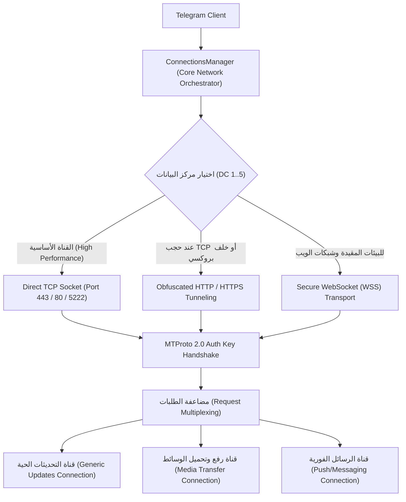

# التحليل المعماري العميق لمحرك الشبكة والاتصال في Telegram
## (ConnectionsManager & Multi-DC Networking Deep Dive)

> **المسار في الكود المصدري:** `org.telegram.tgnet.ConnectionsManager.java` (86.1 KB / 1,832 سطر)  
> **الملفات المرتبطة:** `NativeByteBuffer.java` (22.9 KB), `TLObject.java` (3.8 KB)  
> **الفلسفة الهندسية:** إدارة الاتصال عبر شبكة مراكز بيانات موزعة جغرافياً (Distributed Multi-DC Topology)، مع دعم التحويل التلقائي عند السفر أو انقطاع الخدمة، واستئناف الجلسات المشفرة دون إعادة المصافحة.

---

## 🌐 1. معمارية محرك الاتصال متعدد القنوات (Multi-Transport Architecture)

يدير `ConnectionsManager` دورة حياة الاتصال بالاعتماد على ثلاث طبقات نقل متتالية (Fallback Protocol Cascade):

### الخصائص الهندسية لـ `ConnectionsManager`:
1. **عزل قنوات الاتصال (Connection Multiplexing):**
   - لا تمرر تيليجرام رسائل المحادثات النصية السريعة عبر نفس سوكيت تحميل مقطع فيديو بحجم 1 جيجابايت.
   - يتم فتح اتصالات TCP مستقلة ومتزامنة مع نفس مركز البيانات (DC Connection Pooling):
     * اتصال مخصص للرسائل الفورية والتحديثات (Low latency, High Priority).
     * اتصالات مخصصة لنقل الملفات والوسائط بالقطع (Bulk Streaming Connections).
2. **التبديل التلقائي بين مراكز البيانات (Auto-DC Switching):**
   - عند محاولة تنزيل ملف مخزن في مركز بيانات آخر (مثلاً DC 5 في سنغافورة للمستخدم المتصل بـ DC 2 في أمستردام)، يُنشئ `ConnectionsManager` اتصالاً مؤقتاً بالـ DC الهدف لجلب الملف دون فصل جلسة المستخدم الأساسية (`initConnection` with target DC).
3. **التجديد المستمر لمفاتيح الجلسات قصيرة الأجل (Perfect Forward Secrecy - PFS):**
   - حتى لو تم اختراق مفتاح الحساب الدائم بعد سنوات، لا يمكن فك تشفير الرسائل السابقة لأن كل جلسة تستخدم مفتاح `temp_auth_key` يتم إنشاؤه عبر Diffie-Hellman ويتغير كل عدة ساعات.
4. **نبضات القلب الموفرة للطاقة (Adaptive Ping/Pong Protocol):**
   - مراقبة جودة الشبكة عبر إرسال `ping_delay_disconnect`؛ فإذا لم يستجب السيرفر خلال زمن الاستجابة المحسوب (RTT)، يتم فوراً التبديل إلى عنوان IP بديل لنفس مركز البيانات دون إشعار المستخدم بانقطاع الخدمة.

---

## ⚡ 2. إدارة الذاكرة الأصلية: `NativeByteBuffer`

- لضمان أقصى كفاءة شبكية، لا تُنسخ بايتات الحزم الواردة من كرت الشبكة إلى ذاكرة Java heap العادية.
- تُحجز الذاكرة مباشرة عبر دوال C++ (`malloc`)، ويتحكم فيها كلاس `NativeByteBuffer` من خلال المؤشر `address`.
- هذا يسمح بفك ترميز كائنات MTProto الثنائية مباشرة (Direct Zero-Copy Deserialization) بسرعة تفوق الطرق التقليدية بأكثر من 4 أضعاف.

---

## 🚀 الدروس المستفادة لمنصة Family OS

| ميزة Telegram الشبكية | تطبيقها المخطط له في Family OS |
| :--- | :--- |
| **عزل مسارات الرسائل عن الوسائط** | ضمان وصول تنبيهات الطوارئ ومواقع الأطفال في أجزاء من الثانية حتى لو كانت هناك صور عائلية ضخمة قيد الرفع في الخلفية. |
| **استئناف الجلسات اللحظي (Session Resumption)** | استمرار عمل التطبيق بسلاسة أثناء تنقل الأطفال بين شبكة المدرسة والشبكة المنزلية دون الحاجة لإعادة تسجيل الدخول. |
| **بروتوكول TCP الدائم الموفر للطاقة** | إبقاء قنوات الاتصال الأبوية مفتوحة 24/7 دون استنزاف بطارية أجهزة الأطفال. |
