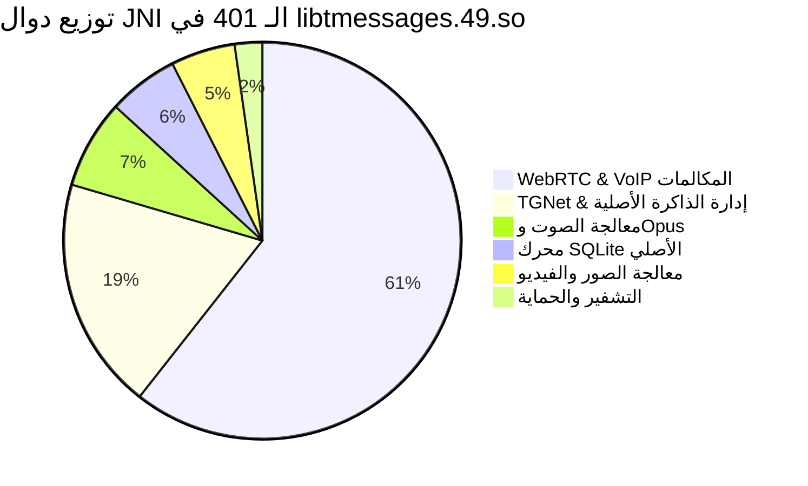

# فهرس وتصنيف جسور JNI الأصلية للمكتبة: libtmessages.49.so
## (Complete JNI Bridges & Native Exports Catalog)

> **المسار الثنائي المفحوص:** `benchmarks/extracted/telegram/06_network_and_telemetry/native_libs/lib/arm64-v8a/libtmessages.49.so`  
> **الحجم:** 22.13 MB (ARM64-v8a)  
> **إجمالي الدوال الأصلية المستخرجة (JNI Exports):** **401 دالة أصلية فريدة**  
> **الفلسفة الهندسية:** تحويل كافة العمليات الحسابية الشاقة (معالجة الصوت، التشفير، عزل الصدى، معالجة الصور، واستعلامات قواعد البيانات) من بيئة الـ JVM البطيئة إلى كود C/C++ أصلي مجمع ومحسن على مستوى العتاد والمعالج (SIMD / NEON).

---

## 📊 توزيع دوال الـ JNI حسب الوظيفة المعمارية

---

## 🗄️ 1. محرك SQLite الأصلي عالي الأداء (23 دالة)
تحقق هذه المجموعة وصولاً فائق السرعة لقاعدة البيانات المحلية دون استنساخ مصفوفات بايتات جافا (Zero-Copy):

- `Java_org_telegram_SQLite_SQLiteDatabase_opendb`: فتح اتصال مباشر بقاعدة البيانات وتفعيل وضع WAL المتقدم.
- `Java_org_telegram_SQLite_SQLiteDatabase_beginTransaction`: بدء معاملة مجمعة لحفظ مئات الرسائل دفعة واحدة.
- `Java_org_telegram_SQLite_SQLiteDatabase_commitTransaction`: تأكيد وكتابة المعاملة على القرص.
- `Java_org_telegram_SQLite_SQLitePreparedStatement_bindByteBuffer`: تمرير كتل البيانات الثنائية BLOB مباشرة من الذاكرة لـ SQLite.
- `Java_org_telegram_SQLite_SQLiteCursor_columnByteBufferValue`: استرجاع الرسائل المشفرة والوسائط كـ `NativeByteBuffer`.
- `Java_org_telegram_SQLite_SQLiteCursor_columnIntValue` & `columnDoubleValue`: قراءة المعرفات والأرقام مباشرة من الـ C-struct.

---

## 🎙️ 2. محرك معالجة وتسجيل الصوت بتنسيق Opus (29 دالة)
المسؤول عن تسجيل ومعالجة وقص المقاطع الصوتية بجودة استوديو واستهلاك باندويث منخفض:

- `Java_org_telegram_utils_recorder_audio_AudioRecorderNative_nCreate`: تهيئة مسجل الصوت بتردد عينات 48,000Hz أحادي القناة.
- `Java_org_telegram_utils_recorder_audio_AudioNoiseSuppressor_nCreate` & `nProcess`: عازل الضوضاء المحيطية الذكي في الوقت الفعلي.
- `Java_org_telegram_utils_recorder_audio_AudioRecorderNative_nWriteFrame`: ضغط وتشفير كل إطار صوتي (20ms) بتنسيق Opus داخل حاوية OGG.
- `Java_org_telegram_utils_recorder_audio_AudioRecorderNative_nGetWaveform`: خوارزمية ضغط القمم الصوتية 5-bit واستخراج الـ 63 بايت لحظياً.
- `Java_org_telegram_messenger_MediaController_cropOpusFile`: قص الملفات الصوتية على مستوى الـ Bitstream دون إعادة فك الضغط (Lossless Slicing).
- `Java_org_telegram_messenger_MediaController_joinOpusFiles`: دمج ملفات Opus صوتية متعددة في ملف واحد بسرعة خاطفة.

---

## 📞 3. محرك الاتصال الصوتي والمرئي WebRTC & VoIP (243 دالة)
أضخم حزمة في المكتبة (أكثر من 60% من الرموز البرمجية) لإدارة المكالمات الفردية والجماعية المشفرة:

- `Java_org_telegram_messenger_voip_NativeInstance_create`: تهيئة نواة WebRTC وتحديد نمط الاتصال (P2P Mesh أو Relay Server).
- `Java_org_telegram_messenger_voip_NativeInstance_setAudioOutputGainControlEnabled`: موازنة مستوى الصوت التلقائية (AGC).
- `Java_org_telegram_messenger_voip_NativeInstance_setEchoCancellationStrength`: عزل الصدى والارتجاع الصوتي في المكالمات (AEC).
- `Java_org_telegram_messenger_voip_ConferenceCall_call_create`: إنشاء مكالمة جماعية متعددة الأطراف (Live Streams / Group Calls).
- `Java_org_telegram_messenger_voip_ConferenceCall_call_apply_block`: معالجة وتمرير كتل البيانات الصوتية المشفرة بين الأطراف.

---

## 🖼️ 4. محرك معالجة الرسوم والصور والفيديو (21 دالة)
تسريع عمليات المعالجة الرسومية عبر بطاقة الشاشة والـ CPU مباشرة:

- `Java_androidx_media3_decoder_ffmpeg_ExperimentalFfmpegVideoDecoder_ffmpegInitialize`: تهيئة مفكك فيديو FFmpeg المدمج.
- `Java_androidx_media3_decoder_ffmpeg_ExperimentalFfmpegVideoDecoder_ffmpegReceiveFrame`: سحب إطارات الفيديو الخام لعرضها في مشغل الميديا.
- `Java_org_telegram_ui_Components_RLottieDrawable_create`: تشغيل رسومات وأنيميشن Lottie المتجهية فائقة السرعة المكتوبة بلغة C++.
- `Java_org_telegram_messenger_Utilities_stackBlurBitmap`: خوارزمية التمويه الزجاجي السريع (Fast Stack Blur) لخلفيات الواجهات.

---

## 🔐 5. محرك التشفير والحماية الصارم (9 دوال)
تسريع خوارزميات التشفير المتماثل المخصصة لبروتوكول MTProto:

- `Java_org_telegram_messenger_Utilities_aesIgeEncryption`: تشفير الكتل بنمط AES-256-IGE المستخدم حصرياً في تيليجرام.
- `Java_org_telegram_messenger_Utilities_aesIgeEncryptionByteArray`: تشفير مصفوفات البايتات بسرعة معالج ARM NEON.
- `Java_org_telegram_messenger_Utilities_aesCtrDecryption`: فك تشفير دفق البيانات بنمط العداد (Counter Mode).
- `Java_org_telegram_messenger_Utilities_aesCbcEncryption`: تشفير الكتل بنمط CBC للتوافقية.

---

## 🌐 6. محرك إدارة الذاكرة والشبكة TGNet (76 دالة)
الوسيط بين قنوات اتصال السوكيت ومخازن الذاكرة:

- `Java_org_telegram_tgnet_NativeByteBuffer_create`: حجز كتلة ذاكرة خام عبر `malloc` والتحكم فيها بدون استنزاف Java GC.
- `Java_org_telegram_tgnet_NativeByteBuffer_free`: تحرير فوري للذاكرة بعد إرسال أو معالجة الحزمة لمنع Memory Leaks.
- `Java_org_telegram_tgnet_ConnectionsManager_native_create`: بدء وإدارة دورة حياة محرك الاتصال الأصلي في خلفية النظام.
