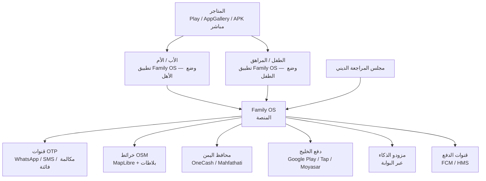
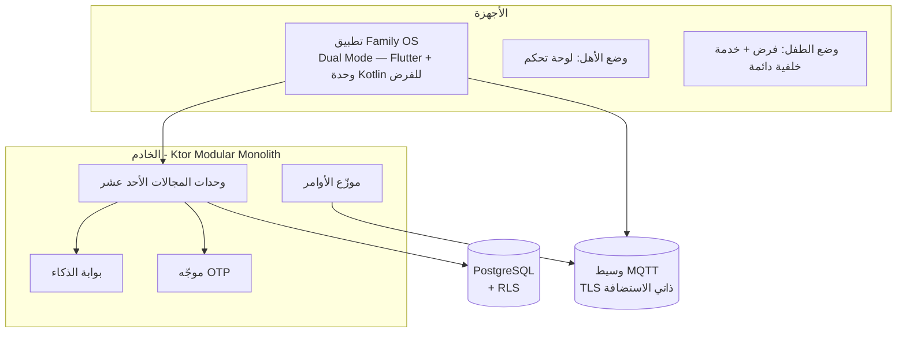
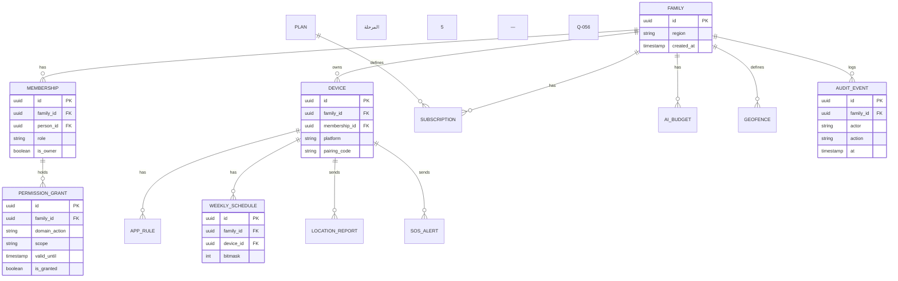
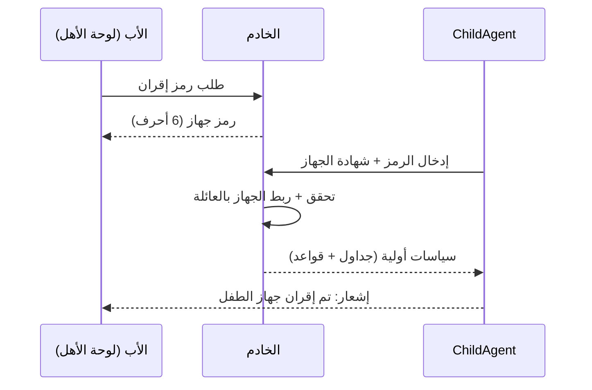
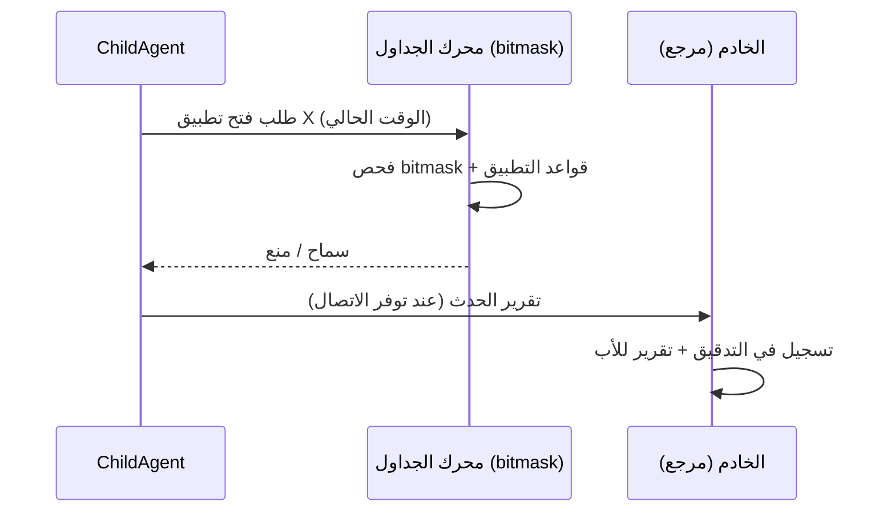
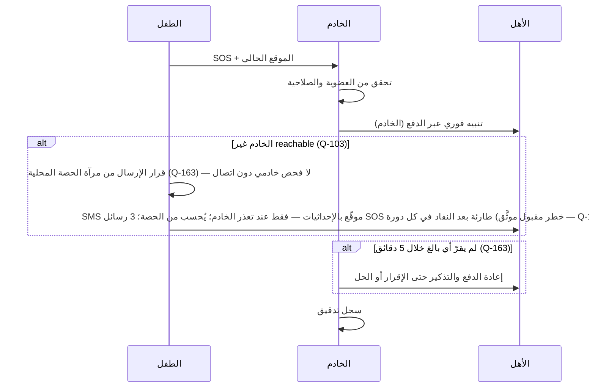
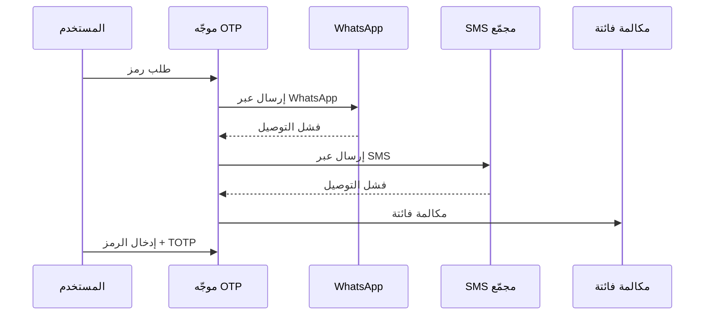
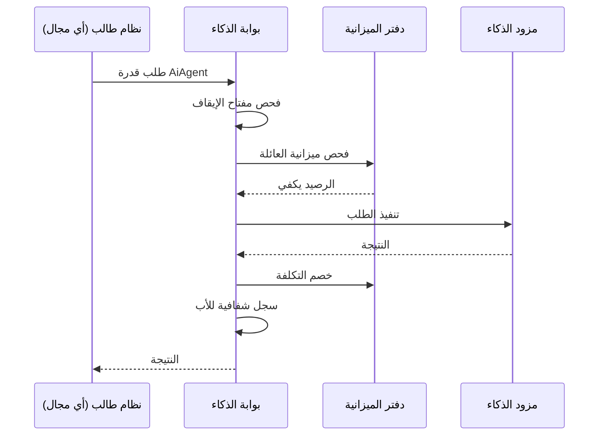
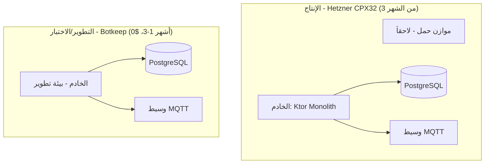

# وثيقة معمارية المنصة (Arc42) — Family OS

> **الحالة:** معتمدة — حكم المالك 2026-11-05 · **التاريخ:** 2026-11-05
> **الأساس:** G-010 (الهيكلية المعتمدة) · **المرجع:** `CONTEXT-MAP.md` (خريطة المجالات المعتمدة Q-054…Q-057)
> **القاعدة:** كل ادعاء هنا يتتبع إلى قرار معتمد أو دليل مفكك موثّق. الأرقام الموسومة **(مقترح)** أهداف للمراجعة لا أحكام. ما لم يُحسم يُذكر كنقطة مفتوحة.

---

## 1. المقدمة والأهداف

**المنصة:** Family OS — منصة عائلية واحدة (أمان وحماية وتعليم وإدارة وتواصل وصلاحيات مرنة) تُبنى بإعادة تركيب 8 تطبيقات مفككة + 3 تطبيقات أطفال.

**الأهداف المعمارية (بالترتيب):**
1. **نواة حماية عاملة أولاً** — تطبيق واحد بوضعين (وضع الأهل + وضع الطفل) بفرض تطبيقات بجدول أسبوعي (Q-002/Q-062/Q-068).
2. **اشتراك واحد يغني عن كثير** — القيمة التجارية التي تُبنى عليها الفوترة من المرحلة 1 (Q-055).
3. **صفر أعطال** — هدف الجودة المعلن؛ null-safety في Kotlin ركيزة منه (Q-001).
4. **10M مستخدم متزامن** — معيار قبول بعد التخطيط، يُثبَت باختبار حمل في المرحلة 7 (وليس بوثائق).
5. **مرونة تحت تصرف الأب** — كل خدمة وميزة قابلة للضبط لكل عائلة (Q-003)، داخل ثوابت سلامة صلبة (D-023/D-038).
6. **اليمن والخليج معاً** منذ الإطلاق، والبنية مهيأة للعالمية (Q-005).
7. **ذكاء في كل خدمة** — تفاعلي وحيّ (على غرار دوولينجو)، بميزانية وشفافية ومفتاح إيقاف (Q-011/Q-012/Q-054).

**أصحاب المصلحة:** المالك (القرار النهائي) · Juno (القائد التقني) · العائلات (أب/أم/مراهق/طفل) · مجلس المراجعة الديني (Q-030) · المستشار القانوني (Q-015).

---

## 2. القيود (ملزمة — لا تُتجاوز إلا بقرار جديد)

| # | القيد | المصدر |
|---|---|---|
| C-01 | الخادم **Kotlin (Ktor) + PostgreSQL** — نظام واحد مقسّم إلى وحدات (Modular Monolith) | Q-001 |
| C-02 | تطبيق واحد بوضعين (Q-062): **Flutter** للواجهة في الوضعين + **وحدة Kotlin أصلية للفرض** داخل التطبيق عبر قنوات المنصة (Q-068)؛ ChildAgent على iOS لاحقاً (قيد Apple — التحكم العميق أندرويد فقط)، وتطبيق الأهل على iOS عند الإطلاق (Q-005) | Q-062 / Q-068 / Q-005 |
| C-03 | محرك الصلاحيات **deny-override**؛ `scope` و`valid_until` إلزاميان | Q-007 |
| C-04 | **عائلة واحدة لكل حساب** في MVP؛ `family_id` في كل جدول + عزل RLS من اليوم الأول | Q-008 / D-021 |
| C-05 | التجهيز **مثل المنافسين الآن** (DeviceAdmin + Accessibility + VPN) مع طبقة تجريد؛ Device Owner ترقية لاحقة؛ **الخط الأحمر المعدَّل (Q-165): الخادم يفحص رسائل القاصرين آلياً لغرض الحماية فقط** — بلا قراءة بشرية، بلا تخزين نص بعد الفحص، بلا استخدام لغير التنبيه؛ وقناة الوالدين E2E بلا فحص أبداً؛ والفرض (S1-10) لا يقرأ محتوى أبداً | Q-031 / Q-165 / G-007 |
| C-06 | **لا كود قبل اكتمال الحوكمة**؛ التصميم بعد اعتماد المعمارية والمواصفات | G-003 |
| C-07 | مجموعة ميزات آمنة للمتجر (جداول + حظر + VPN + موقع + تقارير) — **لا قراءة محتوى SMS** | G-007 |
| C-08 | تصنيف المتاجر **"عائلي" (Families)** لا ضمن فئة الأطفال | D-024 |
| C-09 | الشفافية غير المزعجة: إفصاح دائم + موافقة واحدة في الإعداد المشترك + شفافية عن **الفئات** لا المحتوى + **إفصاح عن الفحص الآلي لرسائل القاصرين على الخادم (Q-165)** | G-006 / D-023 / Q-165 |
| C-10 | منطقة العائلة (`region`) من اليوم الأول — إقامة البيانات والمدفوعات والثقافة | Q-005 / R-007 |
| C-11 | المحتوى الديني الصرف تحت **فيتو ملزم** لمجلس مراجعة مستقل (7–9 أعضاء)؛ المساعد الذكي من قاعدة معتمدة فقط | Q-030 |
| C-12 | PDPL السعودي سارٍ (غرامات حتى 5M ريال)؛ اليمن بلا قانون بيانات شامل | Q-015 |
| C-13 | الاستضافة: تطوير/اختبار على **Botkeep** (3 أشهر مجانية) → إنتاج على **Hetzner CPX32 (~$50/شهر)** في الشهر 3 | G-005 |
| C-14 | لا بيانات أطفال تُجمع للتدريب دون حكم صريح (Q-050 مفتوح) | G-008 |

---

## 3. السياق والنطاق (C4 — المستوى 1)

| النظام الخارجي | ما يقدمه | طبقة التجريد | القرار |
|---|---|---|---|
| WhatsApp / SMS / مكالمة فائتة | توصيل OTP | موجّه OTP (Router) | Q-021 |
| OSM (MapLibre) | خرائط + بلاطات + دون اتصال | طبقة تجريد خرائط | Q-020 |
| OneCash / Mahfathati | دفع اليمن | مسار دفع `PaymentRoute` | Q-025 |
| Google Play / Tap / Moyasar | دفع الخليج | مسار دفع `PaymentRoute` | Q-025 |
| مزودو الذكاء | نماذج لغوية | بوابة الذكاء (Gateway) | Q-011 |
| FCM / HMS | دفع للوحة الأهل | قناة إشعارات موحدة | Q-022 |
| Firebase Auth | مصادقة بالبريد الإلكتروني للبالغين (ID Token) | موصّل مصادقة لا سلطة — Ktor يتحقق من ID Token ويصدر رموز الجلسة؛ بيانات العائلة لا تعيش في Firebase | Q-084 |
| Play / AppGallery / APK | توزيع | — | Q-022 |

---

## 4. استراتيجية الحل

1. **مونوليث مقسّم إلى وحدات** (Q-001): عملية نشر واحدة، والوحدات = المجالات الأحد عشر من خريطة المجالات. الوحدة لا تستدعي وحدة أخرى إلا عبر واجهة معلنة؛ الفصل اليوم يتيح الاستخراج غداً دون إعادة كتابة.
2. **DDD حيث تتصادم المجالات** (G-010): النواة المشتركة (`family_id`، العضوية، الصلاحيات، `region`، التدقيق) واحدة لا تُعاد؛ باقي المجالات تتواصل بأحداث مجال ولغة منشورة.
3. **طبقات تجريد عند كل حدود خارجية** (Q-020/Q-022/Q-031): الخرائط، قنوات الدفع، التجهيز، مزود الذكاء — كلها خلف واجهة، فيتسرب نموذج المزود أبداً.
4. **الأوامر عبر MQTT-over-TLS أولاً** (Q-022): ChildAgent يتصل بوسيط MQTT ذاتي الاستضافة؛ FCM/HMS للوحة الأهل فقط؛ والاحتياط منهجية المنافسين (طلب تعطيل توفير البطارية).
5. **الذكاء كبوابة** (Q-011/Q-054): كل طلب ذكاء يمر ببوابة واحدة تفحص الميزانية ومفتاح الإيقاف وتسجّل — العقد والميزانية من المرحلة 1، والطبقة الكاملة في 6.
6. **الفوترة من المرحلة 1** (Q-055): الخطط أعلام ميزات وحصص؛ كل نظام يسأل "هل خطة هذه العائلة تسمح؟" قبل التنفيذ.
7. **التقييم على الجهاز أولاً** (Q-020/Q-023/Q-031): الجدول الأسبوعي والأسوار تُحسب على الجهاز؛ الخادم مرجع ومراقب — فيعمل الحظر بلا اتصال. **استثناء (Q-165): الفرز الخفيف لرسائل القاصرين يُحسب على الخادم** (يُعدَّل موضع الفرز في Q-023 من الجهاز إلى الخادم) — فحص آلي للحماية فقط، بلا قراءة بشرية وبلا تخزين نص بعد الفحص.
8. **الشفافية بالتصميم** (G-006): إشعار دائم يعرض معلومات نافعة (مثلاً: الوقت المتبقي) لا "نحن نراقبك"؛ موافقة واحدة في إعداد مشترك.
9. **التدرج المرحلي** (ROADMAP): 0 حوكمة ← 1 نواة الحماية ← 2 تواصل ← 3 تعليم ← 4 دين ← 5 إدارة العائلة ← 6 ذكاء ← 7 تصليب/إطلاق.

---

## 5. منظر المكونات (C4 — المستويان 2 و3)

### 5.1 الحاويات (المستوى 2)

| الحاوية | التقنية | المسؤولية | ملاحظة |
|---|---|---|---|
| التطبيق (Dual Mode) | Flutter + وحدة Kotlin أصلية للفرض | تطبيق واحد بوضعين: وضع الأهل (لوحة تحكم) ووضع الطفل (فرض + خدمة خلفية دائمة)؛ الوضع يتحدد بالإقران/الدور (Q-062)؛ وضع واحد ثابت لكل جهاز في المرحلة 1 — لا تبديل ملفات/وضع (Q-063)؛ الفرض (DeviceAdmin + Accessibility + VPN) كود Kotlin عبر قنوات المنصة (Q-068/Q-031) |
| الخادم | Ktor — Modular Monolith | كل منطق الأعمال؛ وحدة لكل مجال | Q-001 |
| PostgreSQL | PostgreSQL + RLS | كل البيانات؛ `family_id` في كل جدول | Q-008 |
| وسيط MQTT | MQTT-over-TLS ذاتي الاستضافة | أوامر الأجهزة وحالتها | Q-022 |
| بوابة الذكاء | وحدة داخل المونوليث | عقد موحد، ميزانية، مفتاح إيقاف، سجل شفافية | Q-011 / Q-054 |

### 5.2 وحدات الخادم (المستوى 3 — ملخص)

| الوحدة (المجال) | المكونات الرئيسية | المرحلة |
|---|---|---|
| الهوية والعائلة | `FamilyService` · `MembershipService` · `PairingService` (رمز الجهاز) · `InvitationService` | 1 |
| الصلاحيات | `PermissionEvaluator` (deny-override) · `GrantStore` · `ScopeChecker` | 1 |
| الحماية | `CommandDispatcher` · `ScheduleEngine` (bitmask) · `EnforcementSync` · `DeviceState` — يملكها **S1-10 "الحماية والفرض"** (Q-141؛ المواصفة قيد الكتابة) | 1 |
| الموقع والسلامة | `LocationIngest` · `SosService` (يستشير `SmsLedger` في الفوترة قبل أي SMS عند الاتصال — Q-106؛ ودون اتصال تُستخدم مرآة الحصة المحلية — Q-163) · `GeofenceEngine` (المرحلة 5، Q-056) | 1 / 5 |
| الإشعارات والتوصيل | `OtpRouter` · `PushChannel` (FCM/HMS) · `MqttBridge` | 1 |
| التواصل | `ChatService` · `MessageService` · `ChatAdminService` (صلاحيات ذرية) | 1 (أساسي S1-08) / 2 (توسيع) |
| التعليم | `StudySetService` · `SrsEngine` (خادم) · `ProgressService` | 3 |
| الدين | `PrayerService` (حساب على الجهاز) · `QuranService` · `ReviewQueue` (للمجلس) | 4 |
| إدارة العائلة | `TaskService` · `CalendarService` · `RewardService` (أطفال فقط) | 1 (مهام/تقويم/مكافآت أساسية S1-05/S1-06) / 5 (كامل) |
| الذكاء الاصطناعي | `AiGateway` · `BudgetLedger` · `KillSwitch` · `AiAgent` | 1 (عقد) / 6 (كامل) |
| الفوترة | `PlanService` (أعلام + حصص) · `SubscriptionService` · `PaymentRouter` · `SmsLedger` (حارس حصة SMS يستشيره `SosService` — Q-106/Q-129: المجانية 20/شهر، المميزة 100/شهر، حزمة تعبئة 50، 3 رسائل SOS طارئة بعد النفاد في كل دورة — الحد خطر مقبول موثَّق Q-163؛ ومرآة الحصة المحلية + توقيع SMS + تصعيد 5 دقائق Q-163) | 1 (الحد الأدنى) |

### 5.3 نموذج البيانات الموحد (ERD — النواة + ملخص المرحلة 1)

**قواعد النموذج (ملزمة):**
- `family_id` في **كل** جدول + سياسات RLS (Q-008/D-021).
- الجداول اللاحقة (محادثة، دراسة، صلاة، مهام…) تُضاف بنفس القاعدة في مواصفات أنظمتها — لا استثناء.
- الجدول الأسبوعي **bitmask** واحد يُحسب على الجهاز والخادم بنفس المنطق (خريطة المجالات §5).

**ملاحظات نطاق ERD:**
- هذا ERD **نواة + ملخص المرحلة 1** لا تفصيلها الكامل؛ جداول المرحلة 1 الكاملة تعيش في §5 لكل مواصفة نظام: الستة في S1-01، وجداول S1-02، ومحفظة النقاط/السجل في S1-05، والمهام/التقويم في S1-06، وجداول الدردشة/الوسائط في S1-08.
- `APP_RULE` / `WEEKLY_SCHEDULE` يملكهما **S1-10 "الحماية والفرض"** (Q-141) — مواصفته قيد الكتابة، فلا تفصيل لهما هنا.
- `MEMBERSHIP.person_id`: سؤال مفتوح **Q-137** (هل عضوية الطفل تحمل `person_id` فارغاً؟).

### 5.4 سطح API (المبادئ — التفاصيل في مواصفات الأنظمة)

- **نمط:** REST عبر Ktor للوحة الأهل والإدارة؛ **MQTT** لأوامر ChildAgent وحالته (لا REST لـ ChildAgent في الأوامر).
- **المصادقة:** OTP (موجّه Q-021) + TOTP بعد أول تحقق؛ أجهزة الأطفال برمز إقران + شهادة جهاز؛ **بصمة/وجه للبالغين في وضع الأهل فقط في المرحلة 1، ولا تتجاوز بوابة الوالدين أبداً (Q-072)**؛ **دخول بالبريد الإلكتروني للبالغين فقط عبر Firebase Auth كموصّل مصادقة لا سلطة — Ktor يتحقق من ID Token ويصدر رموز الجلسة، وبيانات العائلة لا تعيش في Firebase (Q-084)**؛ التحقق من PIN **محلي فقط** — الـ PIN وhashه لا يغادران الجهاز أبداً، والخادم يسجل الإثبات + القفل فقط (Q-142)؛ **ومعايير PIN: 6 أرقام حداً أدنى + Argon2id (m=64MiB، t=3، p=1) في مخزن آمن مدعوم بالعتاد، والعمليات الحساسة تُثبَت بتحدٍّ من الخادم يوقّعه مفتاح توقيع جهازي (ECDSA P-256) — Q-164**.
- **النطاق:** كل طلب يحمل سياق العائلة (`family_id`)؛ الخادم يرفض أي طلب خارج عائلة الطالب — بلا استثناء.
- **الأوامر:** مفتاح عدم تكرار (idempotency key) لكل أمر جهاز؛ إقرار (ack) إلزامي؛ إعادة المحاولة بتراجع أسّي.
- **الإصدار:** `/api/v1/...`؛ كسر التوافق يتطلب قراراً.
- **الأخطاء:** صيغة موحدة (رمز + رسالة عربية + مرجع تتبع).
- **مجموعات النقاط (حسب المجال):** `/identity` · `/permissions` · `/protection` · `/location` · `/messaging` · `/education` · `/religion` · `/family-management` · `/ai` · `/billing` · `/notifications` — التفاصيل الكاملة لكل مجموعة في مواصفة نظامها.

---

## 6. منظر التشغيل (سيناريوهات رئيسية)

### 6.1 إقران جهاز طفل

### 6.2 تقييم حظر تطبيق (على الجهاز — يعمل دون اتصال)

### 6.3 SOS

زر SOS دائم في الغلاف، **ضغط مطول 3 ثوانٍ** (Q-067)؛ بوابة الوالدين **PIN الأب فقط** (Q-065) — التحقق محلي (Q-142).

### 6.4 تسجيل دخول OTP (الموجّه)

### 6.5 طلب ذكاء عبر البوابة

---
## 7. منظر النشر

| البيئة | الاستضافة | الغرض | التكلفة |
|---|---|---|---|
| تطوير/اختبار | Botkeep (أشهر 1–3) | تطوير + اختبار متكامل (Q-027) | $0 |
| إنتاج | Hetzner CPX32 (من الشهر 3) | الإطلاق | ~$50/شهر |

**النسخ الاحتياطي والتعافي (Q-060):** نسخة كاملة يومية + WAL مستمر (استرجاع لأي لحظة) + النسخة خارج الخادم + اختبار استعادة شهري — **RPO ساعة، RTO 4 ساعات**. الترقية إلى خادم احتياطي جاهز (RPO 5 دقائق + RTO ساعة) قبل الإطلاق الكبير في المرحلة 7. **تطهير الحذف (Q-166):** بيانات الحذف الصلب تُطهَّر من النسخ خلال 30 يوماً بعد الحذف الصلب بانتهاء الدورة — لا تطهير فوري من WAL ولا تعديل جراحي للنسخ.

**التحديثات (Q-069):** عبر المتجر للتحديثات العادية + تحديث إجباري داخل التطبيق للإصدارات الأمنية الحرجة فقط + حد أدنى لإصدار مدعوم.

**مسار التوسع نحو 10M (مفتوح بالتصميم، لا يُبنى اليوم):**
- طبقة التطبيق بلا حالة (stateless) ← موازن حمل ← عقد متعددة.
- PostgreSQL: نُسخ قراءة + تقسيم بمفتاح `family_id`/`region`.
- MQTT: تجميع الوسيط (clustering).
- الوحدات المعزولة اليوم هي حدود الاستخراج غداً (خدمات مستقلة عند الحاجة، بقرار).
- **بصراحة:** لا وثيقة تثبت 10M — الإثبات اختبار حمل في المرحلة 7 (Q-027 مختبر Juno).

---

## 8. مفاهيم عابرة (تطبق على كل الوحدات)

| المفهوم | القاعدة |
|---|---|
| الصلاحيات | كل طلب يُقيَّم بمحرك deny-override قبل التنفيذ؛ لا مسار يتجاوز التقييم |
| التدقيق | كل فعل رقابي/إداري/مالي في `AuditEvent` (من، متى، على من، النتيجة) |
| المنطقة | `region` في سياق كل طلب؛ تحكم إقامة البيانات والمدفوعات والثقافة |
| الشفافية | الإفصاح الدائم بمعلومات نافعة؛ الموافقة مرة واحدة؛ الشفافية عن الفئات لا المحتوى (G-006) |
| الأوامر | idempotency key + ack إلزامي + إعادة محاولة بتراجع أسّي |
| الوقت والجداول | bitmask أسبوعي موحد؛ المنطقة الزمنية لكل عائلة؛ الحساب متطابق على الجهاز والخادم |
| الأمان | TLS في كل اتصال؛ **الفحص الآلي لرسائل القاصرين على الخادم للحماية فقط** — بلا قراءة بشرية، بلا تخزين نص بعد الفحص (Q-165 يعدّل الخط الأحمر Q-031)؛ وقناة الوالدين E2E بلا فحص؛ والفرض لا يقرأ محتوى أبداً؛ الحقول الحساسة مشفرة |
| التخزين | وسائط الدردشة والتقارير في **MinIO** (تخزين ذاتي متوافق مع S3 على خادمنا)؛ الحد **10MB للصور / 5MB للرسائل الصوتية** (Q-058) |
| التشفير | **Envelope Encryption** بمفاتيح يديرها الخادم + جاهزية E2E (Q-081)؛ قناة الوالدين **E2E كاملة** (Q-100)؛ مفاتيح قناة الوالدين محفوظة مشفرة بمفتاح استرداد مشتق من PIN الأب (**Argon2id — m=64MiB، t=3، p=1 — Q-164**)؛ نسخة مشفرة فقط على الخادم للاسترداد — الخادم لا يقرأ المحتوى أبداً |
| النطاق المنخفض | وضع اليمن إلزامي في المرحلة 1: ضغط الاستجابات (**Brotli/Gzip**) + لا تحديثات تلقائية + مزامنة يدوية/مجدولة (Q-064) |
| بوابة الوالدين | **PIN الأب فقط** — بلا سؤال حسابي؛ الأب وحده يفتحها (Q-065)؛ **6 أرقام حداً أدنى + Argon2id (m=64MiB، t=3، p=1) في مخزن آمن مدعوم بالعتاد (Q-164)**؛ التحقق **محلي فقط** — الـ PIN وhashه لا يغادران الجهاز أبداً، والخادم يسجل الإثبات + القفل فقط (Q-142)؛ والعمليات الحساسة تُثبَت بتحدٍّ من الخادم يوقّعه مفتاح جهازي (Q-164) |
| SOS | زر دائم في الغلاف، **ضغط مطول 3 ثوانٍ** (Q-067)؛ التنبيه للأب + كل البالغين **< 10 ثوانٍ** (Q-061/Q-104)؛ SMS بديل فقط عند تعذر الخادم (Q-103) ويُحسب من الحصة (Q-106)؛ وإعادة دفع كل 5 دقائق حتى الإقرار أو الحل، ومرآة حصة محلية، وSMS موقّع (Q-163) |
| المصنف | **على الخادم (Q-165)**؛ يعمل دائماً على رسائل الأطفال دون 13؛ وعلى رسائل المراهقين 13–17 بمفتاح تحكم بيد الأب، الافتراضي **مفعّل** (Q-140؛ يعدّل Q-083)؛ فحص آلي للحماية فقط — بلا قراءة بشرية، بلا تخزين نص بعد الفحص، بلا استخدام لغير التنبيه |
| الحذف والتصدير | حذف العائلة/العضو/الحساب: حذف ناعم + سماح 30 يوماً ثم حذف صلب؛ والتصدير JSON + وسائط برابط 7 أيام؛ وآخر موقع معروف ينتهي بعد 7 أيام؛ وتطهير النسخ خلال 30 يوماً (Q-166) |
| الملاحظة | سجلات + مقاييس + تتبع موحد لكل وحدة — **Prometheus + Grafana + Loki + Uptime Kuma + GlitchTip على خادمنا، مع OpenTelemetry لغة موحدة** (Q-059) |
| التدويل | العربية والإنجليزية في هذه النسخة؛ **الافتراضي العربية**، RTL للعربية (Q-070) |
| الخصوصية | جمع الحد الأدنى؛ لا بيانات أطفال للتدريب دون حكم (Q-050 مفتوح) |

---

## 9. قرارات معمارية (مرجع — التفاصيل في DECISIONS-LOG)

| القرار | أين انعكس في هذه الوثيقة |
|---|---|
| Q-001 (Kotlin/Ktor + PostgreSQL، مونوليث مقسّم) | §2 C-01 · §4 (1) · §5.1 |
| Q-002 (نواة الحماية أولاً) | §1 (1) · §5.2 (المراحل) |
| Q-003 (مرونة يحددها الأب) | §1 (5) · §5.2 (AiAgent) |
| Q-005 (اليمن والخليج معاً) | §2 C-10 · §8 (المنطقة) |
| Q-007 (deny-override) | §2 C-03 · §8 (الصلاحيات) |
| Q-008 (عائلة واحدة + RLS) | §2 C-04 · §5.3 (قواعد النموذج) |
| Q-010 (صلاحيات محادثة ذرية) | §5.2 (التواصل) |
| Q-011 (حياد مزود الذكاء) | §3 (بوابة) · §4 (5) · §6.5 |
| Q-012 (ميزانية + مفتاح إيقاف) | §6.5 · §5.2 (الذكاء الاصطناعي) |
| Q-020 (OSM + تجريد) | §3 (خرائط) · §4 (3) |
| Q-021 (موجّه OTP) | §3 (OTP) · §6.4 |
| Q-022 (MQTT أساسي) | §4 (4) · §5.1 · §7 |
| Q-023 (فرز خفيف على الجهاز) | §5.1 (ChildAgent) |
| Q-025 (محافظ اليمن / Play الخليج) | §3 (الدفع) · §5.2 (الفوترة) |
| Q-030 (مجلس مراجعة ديني) | §2 C-11 · §5.2 (الدين) |
| Q-031 (مثل المنافسين + تجريد) | §2 C-05 · §5.1 (ChildAgent) |
| Q-054 (عقد البوابة من 1) | §5.2 (الذكاء الاصطناعي) · §6.5 |
| Q-055 (الحد الأدنى للفوترة من 1) | §4 (6) · §5.2 (الفوترة) |
| Q-056 (الموقع الأساسي 1 / الأسوار 5) | §5.2 (الموقع) · §6.3 |
| Q-057 (التسمية) | أسماء الوحدات في كل الأقسام |
| Q-062 (تطبيق واحد بوضعين) | §1 (1) · §2 C-02 · §3 (السياق) · §5.1 (الحاويات) |
| Q-068 (Flutter + وحدة Kotlin للفرض) | §1 (1) · §2 C-02 · §3 (السياق) · §5.1 (الحاويات) · §5.2 (الوحدات) |
| Q-058 (تخزين ذاتي MinIO + 10MB صور / 5MB صوت) | §8 (التخزين) |
| Q-059 (ملاحظة ذاتية على خادمنا) | §8 (الملاحظة) |
| Q-060 (RPO ساعة / RTO 4 ساعات) | §7 |
| Q-061 (أهداف رقمية: أمر+إقرار <5s؛ SOS <10s؛ p95 <300ms) | §10 |
| Q-063 (وضع واحد ثابت لكل جهاز في 1؛ لا تبديل) | §5.1 |
| Q-064 (نطاق منخفض إلزامي لليمن) | §8 (النطاق المنخفض) |
| Q-065 (بوابة الوالدين: PIN الأب فقط) | §8 (بوابة الوالدين) · §6.3 |
| Q-066 (إقلاع بارد <1.2s في 1) | §10 |
| Q-067 (SOS ضغط مطول 3 ثوانٍ) | §8 (SOS) · §6.3 |
| Q-069 (تحديث عبر المتجر + إجباري أمني فقط) | §7 (التحديثات) |
| Q-070 (عربي/إنجليزي؛ الافتراضي العربية) | §8 (التدويل) |
| Q-072 (بصمة/وجه: وضع الأهل فقط؛ لا تتجاوز البوابة) | §5.4 |
| Q-084 (بريد للبالغين عبر Firebase Auth كموصّل لا سلطة) | §3 (الأنظمة الخارجية) · §5.4 |
| Q-140 (مصنف: دائم <13؛ مفتاح الأب للمراهقين، الافتراضي مفعّل) | §8 (المصنف) |
| Q-165 (المصنف على الخادم + تعديل الخط الأحمر) | C-05 · §4(7) · §8 (المصنف + الأمان) · S1-08 REQ-012 |
| Q-166 (بروتوكول الحذف والتصدير) | §7 (تطهير النسخ) · §8 (الحذف والتصدير) · S1-02 §4.1/§5/§6 · S1-03 REQ-020 · S1-07 §5-2 |
| Q-141 (S1-10 "الحماية والفرض" — مالك AppRule/WeeklySchedule) | §5.2 (الحماية) · §5.3 |
| Q-142 (تحقق PIN محلي فقط) | §5.4 · §8 (بوابة الوالدين) |
| Q-164 (معايير PIN + إثبات التحدي) | §5.4 · §8 (بوابة الوالدين + التشفير) · S1-01 §4.2/§5 · S1-03 §4 · S1-08 REQ-011 |
| D-021 (RLS) · D-023 (ثوابت السلامة) · D-038 (لا صلاحيات إشرافية للأطفال) | §2 · §5.3 · §8 |

---

## 10. متطلبات الجودة

| السمة | المتطلب | المصدر / الحالة |
|---|---|---|
| الأداء | **10M مستخدم متزامن** — معيار قبول بعد التخطيط | هدف معلن؛ الإثبات اختبار حمل (مرحلة 7) |
| الموثوقية | **صفر أعطال** — هدف الجودة المعلن | هدف معلن؛ null-safety + اختبار متكامل (Q-027) |
| زمن الاستجابة | توصيل أمر الأب إلى جهاز الطفل وإقراره **< 5 ثوانٍ** في اتصال عادي | معتمد (Q-061) |
| زمن الاستجابة | إقلاع بارد **< 1.2 ثانية** (المرحلة 1) | معتمد (Q-066) |
| زمن الاستجابة | تنبيه SOS للأهل **< 10 ثوانٍ** | معتمد (Q-061) |
| زمن الاستجابة | قراءات لوحة الأهل p95 **< 300ms** | معتمد (Q-061) |
| الأمان | الفحص الآلي لرسائل القاصرين على الخادم للحماية فقط (Q-165)؛ TLS دائماً؛ RLS في كل جدول | C-05 / C-04 / Q-165 |
| الخصوصية | PDPL السعودي؛ جمع الحد الأدنى؛ لا بيانات أطفال للتدريب دون حكم | C-12 / C-14 |
| المتاجر | بوابة مراجعة سياسة المتجر الدائمة قبل كل إصدار (G-004 في QUALITY-GATES) | QUALITY-GATES |
| قابلية الصيانة | وحدة = مجال؛ لا استدعاء عابر للوحدات إلا عبر واجهة معلنة | §4 (1) |
| قابلية الاختبار | بيئة تطوير/اختبار متكاملة على سيرفر Juno (Q-027) | Q-027 |

---

## 11. مخاطر وديون تقنية

| الخطر | الأثر | التخفيف | المرجع |
|---|---|---|---|
| قتل الشركات المصنعة للخلفية (OEM) يعطّل MQTT | أوامر لا تصل؛ حظر يتأخر | قنوات احتياطية (FCM) + منهجية المنافسين؛ أجهزة فعلية للاختبار | Q-022 / R-003 |
| الأسوار الجغرافية تستهلك البطارية | شكاوى + إلغاء تثبيت | تأجيلها للمرحلة 5؛ تقييم على الجهاز؛ اختبار بطارية | Q-056 |
| عقد بوابة الذكاء إما مبالغ فيه أو ناقص | هندسة مبكرة / ترقيع لاحق | رفيع فقط في المرحلة 1 (Q-054)؛ مراجعة العقد قبل المرحلة 6 | Q-054 |
| انجراف الوثائق عن التنفيذ | موت الفرع القديم يتكرر | مواصفة قبل كل نظام مباشرة (G-010)؛ التتبع قرار ← معمارية ← مواصفة ← كود ← اختبار | G-010 |
| تغيير سياسة متجر مفاجئ | إزالة من المتجر | بوابة مراجعة سياسة دائمة قبل كل إصدار؛ توزيع مباشر احتياطي | G-007 / R-005 |
| تكلفة ذكاء تنفلت | فاتورة غير متوقعة | ميزانية لكل عائلة + مفتاح إيقاف + سقف شهري مكتوب | Q-012 / Q-013 |
| PDPL / قوانين بيانات الأطفال | غرامات حتى 5M ريال | استشارة قانونية قبل الإطلاق (Q-015)؛ `region` من اليوم الأول | Q-015 |

**قرارات محكومة سابقاً (لا تُسجَّل كمفتوحة هنا):**
- **Q-058 / Q-059 / Q-060** — محكومة 2026-11-06 (انظر §8: التخزين Q-058 والملاحظة Q-059؛ و§7: النسخ الاحتياطي Q-060).

---

## 12. مسرد

| المصطلح | المعنى في Family OS |
|---|---|
| المجال المحدد (Bounded Context) | نطاق له لغته ونموذجه الخاصان؛ حدوده صريحة في خريطة المجالات |
| النواة المشتركة (Shared Kernel) | مفاهيم واحدة يفهمها كل المجالات بنفس المعنى (`family_id`، العضوية، الصلاحيات، `region`، التدقيق) |
| طبقة مكافحة الفساد (ACL) | طبقة ترجمة تمنع تسرب نموذج نظام خارجي إلى أي مجال |
| المونوليث المقسّم (Modular Monolith) | عملية نشر واحدة، وحدات معزولة بواجهات معلنة |
| bitmask | قناع بت يمثل الجدول الأسبوعي (خانة لكل فترة) — يُحسب على الجهاز والخادم بنفس المنطق |
| موجّه OTP | مكون يرسل رمز التحقق عبر WhatsApp ثم SMS ثم مكالمة فائتة حسب نجاح التوصيل |
| بوابة الذكاء | نقطة دخول واحدة لكل طلب ذكاء: تفحص مفتاح الإيقاف والميزانية وتسجّل |
| مفتاح عدم التكرار (Idempotency Key) | معرّف يجعل إعادة إرسال الأمر آمنة (لا يُنفَّذ مرتين) |
| RLS | عزل على مستوى الصفوف في PostgreSQL — كل عائلة ترى صفوفها فقط |
| C4 | نموذج مخططات بأربعة مستويات: السياق ← الحاويات ← المكونات ← الكود |

---

## التتبع

| القرار | أين انعكس |
|---|---|
| Q-001…Q-142 | §9 (جدول القرارات المعمارية) |
| G-005 (Botkeep → Hetzner) | §7 |
| G-006 (شفافية غير مزعجة) | §2 C-09 · §4 (8) · §8 |
| G-007 (مجموعة ميزات آمنة) | §2 C-07 |
| G-010 (الهيكلية + الشرطان) | بنية الوثيقة كلها |
| ROADMAP (المراحل 0–7) | §4 (9) · §5.2 · §7 |
| RISK.md (R-001…R-010) | §11 |
